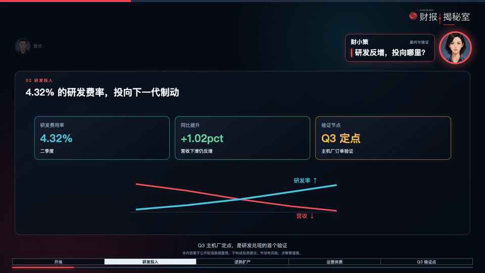
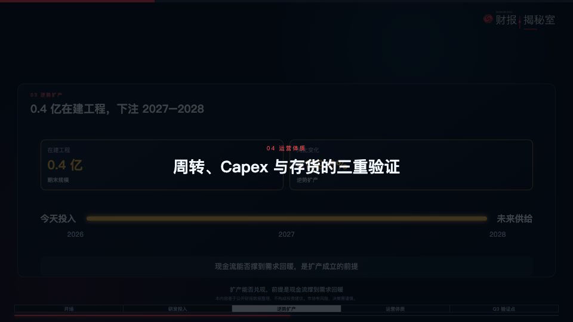

# 《财报揭秘室》财经双人对话视频生成指令

> 用途：下次制作同类财经解读视频时，直接把下面的“步骤 A”和“步骤 B”发给 Codex。本手册把栏目视觉、节奏和验收要求固定下来；**TTS 音色、背景音乐与音效不固定，每期按选型标准重新确认。**

## 成片应有的观感

不是“整段旁白 + 静态 PPT”。而是两位主持人围绕一份财报逐层追问：

- 谁说话，谁高亮；另一位缩小、弱化。
- 对话框只展示本句的关键结论，不复述整段旁白。
- 旁白说到哪里，数据和图形就出现到哪里；不能一进画面全展示。
- 章节标题先出现、先退出，再进入下一位人物的解说。
- 最后一条收束旁白开始时才进入全屏片尾；旁白结束的同一帧结束视频。



---

## 步骤 A：先让 Codex 规划，不要直接渲染

```text
我要做一支《财报揭秘室》风格的横版财经双人对话视频。请先不要生成视频，先阅读我提供的解读稿、人物头像、数据素材、音效、背景音乐和参考视频。

目标：约 [X] 分钟、1920×1080 / 30fps、16:9；不需要口型，只要头像与数据动效。

请先输出并等我确认：
1. 压缩后的完整男女对话文案：标明发言者、每句完整旁白、该句的关键结论；
2. 逐镜头分镜表：时间段、发言者、数据画面、关键句、音效类别、转场；
3. 每章节的标题卡位置、标题卡时长和与前后旁白的关系；
4. 片头、片尾如何接入现有栏目动效；
5. 需要我确认的财务数据、音色、背景音乐、音效和素材缺口。

节奏要求：钩子 → 片头 → 章节分析 → 全屏片尾。
数据必须随旁白渐进出现；章节标题必须先出现并消失，再进入人物解说；不得直接把所有数据和完整旁白同时放在画面上。
```

## 步骤 B：确认分镜后，让 Codex 执行

```text
按已确认的分镜执行并渲染预览。

配音：先为男女主持人各生成 3 段 10 - 20 秒试听，分别覆盖“短提问、数字密集说明、栏目收束句”。我确认音色后再批量配音；不要默认沿用上一次的音色。

人物规则：正在说话的人高亮放大；另一人缩小、弱化；对话卡只显示一句关键结论，不能直接放完整旁白。
音画规则：每条音频以真实时长写入 timeline；数据/卡片按句中信息分批出现；章节标题只占上一句结束后的转场空档；禁止标题和人物卡同屏。
声音规则：背景音乐、章节音效、数据音效和风险提示音均按本期试听确认的素材使用；对白优先；不使用无意义的收尾音或空白延时。
片尾规则：最后女声的栏目收束句开始时切入全屏主标动效，其他 UI 全部关闭；女声结束的同一帧结束视频，不加尾音、不留空白。

先输出 3 个关键时间点的静帧供我确认：一个人物切换、一个章节转场、一个片尾。确认后再导出完整 MP4。
```

---

## 需要提供给 Codex 的素材

| 输入 | 最小要求 | 建议说明 |
| --- | --- | --- |
| 解读稿 | 有章节小标题，数据口径明确 | DOCX 或 Markdown；把必须出现的数字、结论、风险提示标出 |
| 人物头像 | 男女主持人各 1 张，正面、清晰、背景干净 | PNG；脸部占图像约一半以上 |
| 品牌资产 | 透明 Logo、主视觉色、免责声明 | 说明右上角 Logo 是否常驻 |
| TTS | 本期可用的音色范围/试听权限 | 先出试听，确认后再生成全片 |
| 背景音乐与音效 | 可用文件夹或素材库 | 标明是否允许剪辑、循环、调音量 |
| 参考视频 | 至少 1 支 | 指出喜欢的是节奏、人物切换、排版或声音 |

---

## 分镜与排版：固定镜头语法


| 镜头 | 画面规则 | 推荐时长 |
| --- | --- | --- |
| 开场钩子 | 单人抛出问题或 1 - 3 个反差数据；先制造问题，不先解释 | 8 - 15 秒 |
| 栏目片头 | 钩子后接品牌主标动效；片头不带某家公司/某期特有的数据 | 2.23 秒 |
| 女主持人提问 | 女头像在右侧高亮；男头像缩小弱化；对话卡只留一行问题 | 2 - 6 秒 |
| 男主持人回答 | 男头像在左侧高亮；女头像缩小弱化；数据面板是视觉中心 | 6 - 16 秒 |
| 章节标题卡 | 暗场/暗遮罩 + 章节编号与标题；只占转场空档 | 1.2 - 1.6 秒 |
| 收束与片尾 | 分析结论仍保持数据画面；最后一句才全屏切片尾 | 随末句，不额外拉长 |

### 人物与对话卡

- 当前发言者约为弱化头像的两倍尺寸；高亮可用描边、发光和 100% 不透明度，另一位只做低透明度待场。
- 对话卡在头像旁，但必须避开右上角栏目 Logo；不能与 Logo、人物脸部或标题重叠。
- 对话卡只写 8 - 18 字的关键句。例如旁白讲研发费率、线控制动与验证节点时，对话卡只写：`Q3 主机厂定点，是兑现门槛`。
- 每条旁白切换到下一位时，再切人物高亮；不要让双人持续同时高亮。


### 章节与数据出现顺序

1. 每条 TTS 使用**真实音频时长**写入 timeline；不按字数估算、不把音频硬拉长。
2. 为每段旁白标出“语义触发点”：提到第一个数字时出现第一张指标卡，提到验证点时出现第二项，讲因果时再出现曲线或说明。
3. 章节标题放在上一段结束后的自然空档内；若没有空档，可预留约 1.3 秒，用章节音效填充。
4. 章节卡完全淡出后，下一位人物和新数据面板才进入。**章节标题与人物对话不能同屏。**
5. 不要因为转场或默认片尾音效造成额外的 1 秒停顿。



---

## TTS、背景音乐与音效：每期怎样选

下列是**选型标准**，不是固定音色、固定曲目或固定文件名。

| 类别 | 选择标准 | 使用与验收标准 |
| --- | --- | --- |
| 男声 TTS | 沉稳、自然、信息密度高时仍清晰的成年男声；避免播报腔、尾音拖沓、情绪过满 | 试听必须包含结论判断、百分比/专有名词、长句；适合解释、判断和结论 |
| 女声 TTS | 自然口语感强，有轻微交流感但不过度甜美或表演化；优先降低 AI 腔 | 试听必须包含短问题、追问、栏目收束句；与男声形成清晰的问答关系 |
| 背景音乐 | 无歌词、低存在感、轻科技/财经感、可循环；不选抢旋律、强鼓点或明显情绪转折的曲目 | 对白下约 10% - 14% 音量，开头 1 - 2 秒淡入；以对白优先，在章节/风险处可短暂再压低 |
| 章节音效 | 短促的扫光、界面切换或标题落定音；干净，不像游戏升级提示 | 一次章节最多两个声部：标题入场一次、落定一次；只填转场空档，不延长章节 |
| 数据音效 | 轻量 tick、计数或提示音；高频不刺耳、尾音不长 | 只配关键数字、指标卡、曲线的首次出现；同一镜头不要每个元素都响 |
| 风险提示音 | 单次、克制的提示/警示音；不选夸张警报或持续鸣叫 | 只在阈值、风险提示或警示结论出现时使用一次；不能遮住旁白关键词 |
| 片尾声音 | 优先用片尾主标动效内的短扫描/收束声；若另选，必须很短 | 与最后一句并行，不在说完后额外播放；旁白最后一帧即视频最后一帧 |

### 每期必做 A/B 试听

用同一段约 15 秒脚本试听候选素材，至少包含：

1. 男声的数字密集解释；
2. 女声的提问和追问；
3. 加背景音乐后的对白；
4. 一次章节切换、一次数据出现、一次风险提示；
5. 最后一句与片尾动效并行的收束。

确认四件事再锁定素材：中文咬字自然、男女声不像同一人、音乐不压词、音效不抢词。未确认前，不能批量生成整片配音。

---

## 直接复用的片头、片尾与参考成片

### 使用顺序

`开场钩子` → `双人物主标片头` → `正文分章节对话` → `最后一句开始时切纯主标片尾` → `旁白结束即结束`

### 片头：双人物主标

- 用途：钩子之后、正文之前；只建立栏目识别，不放本期公司数据。
- 时长：2.23 秒，67 帧，30fps。
- 文件：[financial-intro-portrait-sfx-v1.mov](/Users/jiang/Documents/remotion动画/claude-code-video-toolkit/examples/hello-world/out/financial-intro-portrait-sfx-v1.mov)


### 片尾：纯主标

- 用途：最后女声收束句的第一字开始播放；此时关闭头像、对话框、Logo 常驻、进度条、数据面板。
- 时长：2.23 秒，67 帧，30fps；若女声更长，动效完成后保持最后定帧直到女声结束。
- 文件：[financial-intro-logo-sfx-v3.mov](/Users/jiang/Documents/remotion动画/claude-code-video-toolkit/examples/hello-world/out/financial-intro-logo-sfx-v3.mov)


### 已完成成片（排版与节奏参考）

[financial-report-dialogue-v3-final-cut-preview.mp4](/Users/jiang/Documents/remotion动画/claude-code-video-toolkit/examples/hello-world/out/financial-report-dialogue-v3-final-cut-preview.mp4)

---

## 导出前让 Codex 自检

- [ ] 逐条核对音频真实时长与 Sequence 起止帧，无配音、字幕、动效提前或滞后。
- [ ] 任意时刻只突出一位人物；对话框不是完整旁白；Logo、头像、气泡卡不重叠。
- [ ] 所有数据、曲线、风险提示均按旁白递进出现，不能一进场全亮。
- [ ] 每个章节标题在说话前淡出，不能和人物卡同屏；章节没有无意义空白停顿。
- [ ] 片头不放本期业务数据；片尾从最后一句启动；女声结束时视频立即结束，没有尾音或空白。
- [ ] 导出并人工查看人物切换、章节转场、片尾三个关键静帧，再导出最终 MP4。

## 一句话交付标准

观众应感觉是在看两位主持人围绕一份财报逐层追问：**谁说话谁突出；说到哪里数据就出现到哪里；章节和片尾都是节目节奏的一部分，而不是后贴上的模板。**
