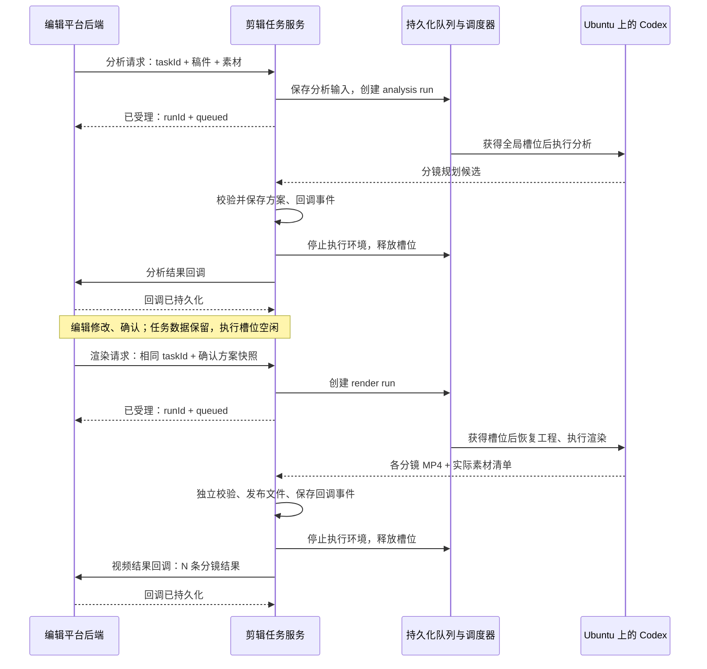

# AI 视频剪辑上下游对接方案

方案日期：2026-09-10。本文记录已确认的链路设计；首版代码及部署说明见 [Worker README](../video-worker/README.md)。

现有目录、复用文件、Worker 模块划分和开发批次见 [Worker代码架构与现有项目接入方案](Worker代码架构与现有项目接入方案.md)。

依据：用户明确的两阶段业务流程、编辑工作台截图，以及《AI视频剪辑接口文档.md》。原接口文档保留截图转录；本文以最新业务说明设计，新增字段和语义调整均为对接提案。

项目目录约定：`VideoCutEditor/` 下的 `claude-code-video-toolkit/`、`video-worker/`、`huibo-saas/`、`xiling-http/`、`docs/` 为同级目录。Worker 位于 `video-worker/`，视频制作工具仍在 `claude-code-video-toolkit/`，不展开到根目录，也不增加 services 中间层。

## 1. 方案结论

在现有视频制作 pipeline 外增加「剪辑任务服务」，统一接收上游请求、保存任务及版本、调度 Codex 沙箱，并向编辑平台发送分析结果和分镜视频结果。

业务分为两阶段：

1. **分析阶段**：接收解说稿与素材 → Codex 理解素材、拆分解说稿、规划分镜 → 回调结构化方案 → 编辑在平台确认或修改。
2. **渲染阶段**：接收编辑确认的完整方案 → 按确认内容生成配音、画面、动画、字幕 → 每个分镜合成一个独立 MP4 → 回调分镜列表和实际使用素材。

全局最多 4 个执行中的任务，分析和渲染共用这 4 个槽位。同一业务任务最多执行一个阶段任务。等待编辑确认、等待回调送达都不占用执行槽位。

按本次需求，确认后的 5 条口播对应 5 个分镜 MP4。平台按顺序播放这 5 个片段；整片拼接可由下游交付模块另行负责。

## 2. 系统职责与调用方向

为避免「上游」「下游」在不同阶段含义变化，本文使用三个角色：

- **编辑平台后端**：管理编辑工作台、稿件、素材、人工修改和确认。即使素材平台和编辑平台实际分属不同系统，也统一经此后端对接剪辑服务。
- **剪辑任务服务**：提供接收接口，管理任务、排队、运行版本、校验、文件发布和回调。
- **Codex 执行环境**：由 Ubuntu app-server 与独立 Linux 任务沙箱完成分析和视频制作，产出候选结果。

| 接口 | 谁提供 | 谁调用 | 作用 |
| --- | --- | --- | --- |
| `getAiVideoEditingAnalysisData` | 剪辑任务服务 | 编辑平台后端 | 提交稿件与素材，触发分析排队 |
| `getAiVideoEditingAnalysisDataCallback` | 编辑平台后端 | 剪辑任务服务 | 推送分镜规划，进入人工确认 |
| `getAiVideoEditingData` | 剪辑任务服务 | 编辑平台后端 | 提交编辑确认的方案，触发渲染排队 |
| `getAiVideoEditingDataCallback` | 编辑平台后端 | 剪辑任务服务 | 推送已合成的分镜 MP4 和素材信息 |

上述接口路径均保留 `/ai_video_director/` 前缀；实际部署域名由双方配置。接口名称中的 `get` 不解释为轮询查询：按用户说明，它们是 POST 提交和回调。



## 3. 任务 ID、执行 ID、分镜 ID 和版本

### 3.1 保留上游 taskId

此次链路已经由上游传入 `taskId`，建议原样贯穿四个接口，不再要求上游换成 Codex 会话 ID。服务内使用独立主键，并以「调用方/租户 + taskId」建立唯一约束，防止不同业务系统的 ID 碰撞。

```jsonc
{
  "taskId": "task_001", // 上游业务任务 ID，长期不变
  "runId": "run_render_002", // 我方生成，每次分析或渲染请求一个
  "requestId": "request_003", // 调用方生成，用于本次请求幂等
  "stage": "render", // analysis 或 render
  "planVersion": 2, // 我方接受并持久化的不可变方案版本
  "threadId": "codex_thread_xxx", // 内部 Codex 会话映射，不要求前端使用
  "sandboxId": "container_xxx", // 本次执行环境，重建时可以变化
  "attempt": 1 // 同一 run 的故障重试次数
}
```

`runId` 标识业务执行，不因内部重试变化；每次领取或恢复另外递增执行令牌，防止旧 Worker 提交结果。一个 task 可以有多次分析和多次渲染，各 run 的输入和结果独立留档。

### 3.2 分镜 ID 必须稳定

沿用现有 `dataList[].id` 作为分镜 ID。修改素材、字幕或文本时保留该 ID，调整顺序时改变数组顺序。拆分、合并分镜时分配新 ID，并记录对应关系。

最终交付数量由**编辑确认后的分镜列表**决定。默认一句一镜；编辑若确认 5 条，返回 5 条；如明确拆为 6 条，则返回 6 条。不能仅靠标点数决定实际数量。

### 3.3 方案版本与人工确认

分析生成方案 v1，平台编辑草稿。编辑点击确认后，将完整方案与 `basePlanVersion: 1` 提交给我方；我方原子检查基础版本、保存确认方案 v2、创建渲染 run，返回 `planVersion: 2`。

人工确认依据数据库中的方案快照，不依赖聊天记录中的「确认」字样。执行中的 run 永远读取自己的快照，后续修改不能覆盖它。

第一版同一 task 只允许一个待执行或执行中的业务 run。已有活动 run 时，新业务提交返回 409 和当前 run 信息，避免编辑在旧版本上连续排入多条冲突修改。不同 task 正常排队；需要改已提交任务时，先取消并确认终止，再提交新版本。

## 4. 四个接口如何承载业务数据

以下为**建议的联调契约**，不是声称原接口已经具备这些字段。保留原有业务字段，建议新增 `schemaVersion`、`requestId`、`runId`、方案版本和回调事件 ID。

采用 `schemaVersion: 2` 表示此次调整后的契约，版本号是提案。字段注释使用 JSONC，实际 HTTP 消息使用无注释 JSON。

### 媒体文件路径约定（按最新需求调整）

所有媒体字段保留 `url` 名称，但值表示**文件系统绝对路径**：当前为本机文件路径，后续为共享盘挂载后的文件路径。包括配音、图片、源视频、分析方案中的素材引用和成片回调中的 MP4。当前不使用远程媒体 URL，也不加 `file://` 前缀。四个业务接口和回调本身仍通过 HTTP 传递 JSON。

服务部署在 Ubuntu，媒体根目录统一配置为 `MEDIA_ROOT=/home/ops/jiangzb/videos`。下文该根目录下的文件名仅为示例，不代表文件已存在；后续切换共享盘时调整根目录映射和挂载配置。内部保存根目录下的相对文件标识、`assetId` 和文件摘要，接口边界再生成绝对路径，避免把开发机路径写死在业务代码中。实现中，回调素材路径指向本任务的持久化内容快照，避免源路径后续被覆盖；编辑确认时可以继续引用这些已登记快照。

上下游必须对同一文件有明确的路径映射：本机联调时使用双方进程可读取的目录；迁移共享盘时配置挂载、权限和各服务所见根目录。若挂载点不同，在适配层配置调用方根目录与 Worker 根目录的对应关系。业务字段与流程保持不变。已固化的回调事件保留原内容，切换时须保留旧路径映射直到在途回调处理完毕。

### 4.1 接收稿件和素材

`POST /ai_video_director/getAiVideoEditingAnalysisData`

目前原定义没有独立的解说稿字段，只有 `otherRequirements`，无法明确区分「完整口播稿」和「制作要求」。建议新增 `script`，不能默认把需求描述当解说稿。

```jsonc
{
  "schemaVersion": 2,
  "requestId": "req_analysis_001",
  "taskId": "task_001",
  "script": "第一句口播。第二句口播。第三句口播。第四句口播。第五句口播。", // 新增：完整稿件
  "otherRequirements": "财经解说，按句分镜，画面配合口播",
  "digitalHumanAccounId": "account_001", // 暂保留原字段；账号命名需双方统一
  "plugin": {
    "digitalHumanId": "presenter_001",
    "templateId": "finance_vertical_v1"
  },
  "narration": { // 建议新增；无预配音时为 null，使用任务配置的 TTS
    "assetId": "audio_001",
    "url": "/home/ops/jiangzb/videos/input/narration.wav"
  },
  "outputSpec": { // 建议新增，也可由固定版本模板提供默认值
    "width": 1080,
    "height": 1920,
    "fps": 30
  },
  "otherMaterial": {
    "picInfoList": [
      { "assetId": "pic_001", "url": "/home/ops/jiangzb/videos/input/chart.jpg" }
    ],
    "videoInfoList": [
      { "assetId": "video_001", "url": "/home/ops/jiangzb/videos/input/market.mp4" }
    ]
  }
}
```

`assetId` 为建议新增的稳定素材标识。同一路径的文件可能被替换，路径本身不能独立承担素材身份。我方读取本地文件并保存任务独立的输入快照、文件摘要；文件不存在或不可读取时明确失败，不静默替换素材。后续读共享盘时沿用相同流程。

无预配音时，数字人账号不自动等于配音配置：模板或请求还需提供确定的 TTS provider、voiceId。每镜是否数字人出镜与是否需要配音分开处理。无素材数组可按新契约允许为空；无法用模板完成的必需素材缺失应报错。

提交接口建议立即返回以下结构；受理成功只表示输入、队列记录已持久化：

```jsonc
{
  "status": 0,
  "msg": "accepted",
  "data": { // 建议扩展现有响应
    "taskId": "task_001",
    "runId": "run_analysis_001",
    "state": "queued",
    "stage": "analysis"
  }
}
```

数据库事务失败不能返回受理成功。同 `requestId`、同规范化内容返回原执行；同 `requestId`、不同内容返回 409。重复请求不应重新启动 Codex。

### 4.2 返回素材理解和分镜方案

`POST /ai_video_director/getAiVideoEditingAnalysisDataCallback`

Codex 的分析工作包含：读取完整稿件，探测素材规格，抽帧/转写并理解素材内容，匹配每条口播与素材片段，生成字幕/花字、布局和动画计划。阶段结果是可编辑的数据，不要求先渲染 MP4。

```jsonc
{
  "schemaVersion": 2,
  "eventId": "evt_analysis_001", // 建议新增；重复回调沿用相同 ID
  "requestId": "req_analysis_001",
  "taskId": "task_001",
  "runId": "run_analysis_001",
  "planVersion": 1,
  "status": 0,
  "msg": "",
  "dataInfo": {
    "templateId": "finance_vertical_v1",
    "durationMode": "audio" // 建议新增：以实际口播时长为主时间轴
  },
  "dataList": [ // 此处只示意一镜，实际返回全部已规划分镜
    {
      "id": "scene_001",
      "content": "第一句口播。",
      "dur": 5.5, // 分析阶段为估计值；预配音已对齐时可为测量值
      "durationSource": "estimated", // 建议新增：estimated 或 measured
      "visualPlan": { // 建议新增：编辑可查看的画面方案
        "description": "以行情素材为主画面，字幕位于底部",
        "layoutPreset": "full_frame",
        "animationPreset": "slow_zoom",
        "selectionReason": "素材内容与本句口播匹配"
      },
      "extraData": {
        "keywordList": ["重点信息"],
        "digitalHumanId": "", // 提案：空串为本镜不出镜
        "videoInfoList": [
          {
            "assetId": "video_001",
            "url": "/home/ops/jiangzb/videos/input/market.mp4",
            "dur": 12.0, // 提案：源视频总时长
            "sourceStartTime": 2.0, // 新增：源素材截取起点，秒
            "sourceEndTime": 7.5, // 新增：源素材截取终点，秒
            "startTime": 0.0, // 提案：在本分镜内出现的起点，秒
            "endTime": 5.5, // 提案：在本分镜内出现的终点，秒
            "role": "content", // 新增：背景、内容等层级
            "order": 0 // 新增：跨图片/视频的共同播放顺序
          }
        ],
        "picInfoList": []
      }
    }
  ]
}
```

其余分镜采用同样结构。图片素材沿用 `w/h/url/startTime/endTime`，建议补充 `assetId/role/order`。图片和视频不能只依靠两个数组各自的顺序表达混合播放，应以共同的 `order` 或明确时间安排合并。`role` 建议至少区分 `background` 和 `content`；背景铺底不分摊内容播放时间。

第一版动画、布局、字幕样式由预设和模板决定，编辑可改内容与素材。若特效、音乐、音效在工作台允许修改，需要另补字段或稳定配置引用；不能放进模型自由文字里作为唯一配置。

分析阶段不为了“粗剪方案”执行完整视频制作。无实际音频时界面展示估算时长；渲染后以实际音频/帧数更新。若业务要求分析阶段即有准确时长，可增加分句 TTS/音频对齐并缓存，后续渲染复用，作为单独明确的产品选项。

### 4.3 编辑确认后提交制作

`POST /ai_video_director/getAiVideoEditingData`

编辑平台保存替换素材、口播、花字、数字人开关等修改。点击确认后，提交**完整、最新的方案快照**；不只发送“已确认”或几句修改说明。

```jsonc
{
  "schemaVersion": 2,
  "requestId": "req_render_001",
  "taskId": "task_001",
  "basePlanVersion": 1, // 建议新增：所编辑方案的基础版本
  "field_5": "account_001", // 原接口字段，内部映射到统一账号字段
  "templateId": "finance_vertical_v1",
  "dataList": [ // 示意一镜，实际必须提交本次确认的完整列表
    {
      "id": "scene_001",
      "content": "编辑确认后的第一句口播。",
      "dur": 5.5,
      "visualPlan": {
        "description": "使用编辑替换后的主画面",
        "layoutPreset": "full_frame",
        "animationPreset": "slow_zoom"
      },
      "extraData": {
        "keywordList": ["编辑确认的花字"],
        "digitalHumanId": "",
        "videoInfoList": [
          {
            "assetId": "video_002",
            "url": "/home/ops/jiangzb/videos/input/replacement.mp4",
            "dur": 20.0,
            "sourceStartTime": 3.0,
            "sourceEndTime": 8.5,
            "startTime": 0.0,
            "endTime": 5.5,
            "role": "content",
            "order": 0
          }
        ],
        "picInfoList": []
      }
    }
  ]
}
```

未改变的音色、输出规格和模板版本从已保存任务配置继承；若平台允许改这些配置，应显式提交并纳入新版本。服务返回受理响应和新 `planVersion`。

渲染执行严格遵循确认的文本、素材、花字和数字人选择，不再自由改写稿件、重新拆镜或换素材。不合规输入由 API 校验拒绝；制作中遇到不可满足条件，返回结构化失败，由编辑平台决定如何调整。

### 4.4 返回每镜完整合成 MP4

`POST /ai_video_director/getAiVideoEditingDataCallback`

每个 `dataList[]` 包含该镜的口播音频、画面、动画、字幕等合成后的独立 MP4 地址；`extraData` 记录**实际使用**的素材，不是最初候选素材全集。

```jsonc
{
  "schemaVersion": 2,
  "eventId": "evt_render_001",
  "requestId": "req_render_001",
  "taskId": "task_001",
  "runId": "run_render_001",
  "planVersion": 2,
  "resultVersion": 1, // 建议新增：已发布结果版本
  "status": 0,
  "msg": "",
  "dataInfo": {
    "templateId": "finance_vertical_v1",
    "sceneCount": 5,
    "width": 1080,
    "height": 1920,
    "fps": 30
  },
  "dataList": [ // 以下展开一镜示意；sceneCount 为 5 时实际必须有 5 项
    {
      "id": "scene_001",
      "content": "编辑确认后的第一句口播。",
      "dur": 5.6, // 实际输出时长，示意值；number，单位秒
      "url": "/home/ops/jiangzb/videos/tasks/task_001/results/r1/scene_001.mp4",
      "extraData": {
        "keywordList": ["编辑确认的花字"],
        "digitalHumanId": "",
        "videoInfoList": [
          {
            "assetId": "video_002",
            "url": "/home/ops/jiangzb/videos/input/replacement.mp4",
            "dur": 20.0,
            "sourceStartTime": 3.0,
            "sourceEndTime": 8.6,
            "startTime": 0.0,
            "endTime": 5.6,
            "role": "content",
            "order": 0
          }
        ],
        "picInfoList": []
      }
    }
  ]
}
```

示例为结构说明，路径与数值均为占位；联调样例必须提供完整 5 项。实际按确认顺序返回 `scene_001` 至 `scene_005`，不得添加占据第 0 项的整体数据。

**与原截图的差异必须同步到下游：**原文约定“第 0 个元素是整体数据”，用户本次要求只返回分镜，因此新契约中 `dataList[0]` 就是第一镜。若现有调用方仍依赖旧语义，要按协议版本区分，不能对同一消费者静默更改。将来若需要整片，建议单独增加 `dataInfo.fullVideoUrl`（同样表示文件路径），不挤占分镜列表。

### 4.5 时间与素材语义

建议统一：所有时间字段为秒，区间为左闭右开；`dataList[].dur` 为本镜时长，素材的 `dur` 为源视频总时长，`sourceStartTime/sourceEndTime` 为源素材坐标，`startTime/endTime` 为分镜内坐标。内部使用帧和采样点计算，避免小数累积误差。

口播优先模式下，分析中的 `dur` 是估计，最终以配音测量和帧量化为准。主素材过长截取，过短按已配置的慢放/定格策略处理；不自动拼接新素材。使用变速、定格等处理时，另外记录 `playbackRate`、补帧/定格策略，不能让两组时间看起来是等速映射。

字幕在分镜内部烧录；下游播放时不要再次叠加同样的口播或字幕。素材清单不承担恢复字幕逐字时间和动画工程的职责，完整编辑工程由我方持久化。

## 5. 编辑中单镜重做

截图中的「应用并重新渲染本段」可以复用 `getAiVideoEditingData`：编辑平台仍发送完整方案和基础版本，我方对各镜计算制作输入摘要，只重做变化的镜头。

摘要至少包含文本、源文件摘要、截取区间、花字、布局/动画、数字人/音色、模板/工具版本、输出规格和音频策略。不能只看文件路径或分镜 ID 判断未改变。

例如 5 镜中只换第 3 镜素材：

1. 新建 render run，占一个任务槽位；复用未变化的第 1、2、4、5 镜。
2. 生成并校验新的第 3 镜。
3. 成功后发布完整新结果清单，回调仍返回 5 项，其中 4 项可以指向已有不可变文件。
4. 如果第 3 镜失败，旧版完整结果仍可播放，不用新旧文件覆盖同一路径。

第一版镜头间使用硬切，各镜有完整本地音频。跨镜转场、连续 BGM 或跨镜动画会建立依赖，不能承诺只重做一镜；如需要这些效果，应纳入依赖计算或由下游统一混音、拼接。是否把 BGM 烧入每镜需统一责任，避免下游叠加重复音轨。

## 6. 全局 4 并发与队列

### 6.1 排队单位

队列中放 `analysis run` 或 `render run`，不是永久占用资源的业务 task。一次 render run 内可以有 5 镜，但仍算一个任务；第一版建议镜头顺序制作，单镜渲染自身并发也受本机任务资源限制。

```text
槽位 1：task_A / analysis
槽位 2：task_B / render（5 镜）
槽位 3：task_C / analysis
槽位 4：task_D / render

等待：task_E / analysis → task_F / render

task_A 分析完成、停止执行环境：释放槽位 1
task_A 等待编辑确认：只保留数据
task_E 获得槽位 1
task_A 日后确认：新 render run 进入队尾
```

默认 FIFO，不区分分析/渲染优先级；第一版同任务活动 run 的互斥由数据库约束保证。4 个是整个部署的全局上限，不能给每个 Worker 各配置 4。

### 6.2 首版调度实现

建议使用 PostgreSQL 同时保存任务和队列，设置 4 条执行槽位记录，由 Worker 在事务内领取空槽位与最早可执行 run。无须首版就增加另一套消息队列。

执行槽位记录 `owner/leaseExpiresAt/fencingToken`，Worker 定期续租。任务数据提交、状态更新、发布均验证当前执行令牌。建议先用一个 Linux 执行宿主部署，简化任务进程停止确认和恢复。

持有槽位的范围包括：环境准备、素材处理、Codex 执行、配音/渲染、校验和发布。结果与回调事件持久化后停止运行环境，确认全部子进程终止，再释放槽位。独立的回调发送器不占这 4 个槽位。

租约过期不是释放槽位的充分条件。恢复器必须先确认或强制停止旧任务进程，再接管或放行下一任务；宿主失联、无法确认时保留占位并告警。执行令牌可以防止旧结果写入，但本身不能阻止旧机器继续消耗资源。

### 6.3 状态分开存

```jsonc
{
  "taskState": "awaiting_editor", // 当前业务位置
  "latestRun": {
    "runId": "run_analysis_001",
    "stage": "analysis",
    "state": "succeeded", // queued/running/succeeded/failed/cancelled
    "progressStage": "plan_saved"
  },
  "callbackState": "pending" // pending/retrying/delivered/dead_letter
}
```

task 的典型业务路径是 `analysis_queued → analyzing → awaiting_editor → render_queued → rendering → ready`。重做镜头可从 ready 回到 render_queued，同时保留上一版可用结果。失败、取消存于具体 run，并在业务视图展示；不要用一条 status 混合业务阶段、执行成败和通知成败。

## 7. Codex 会话与沙箱隔离

### 7.1 持久化任务和本机会话

默认采用 Docker 控制服务 + Ubuntu 本机 Worker。一个常驻 Codex app-server 管理 ChatGPT 登录和任务会话，四个任务共享受控的认证管理进程，分别使用不同 threadId。业务 taskId、内部任务主键、runId、threadId、turnId 分开保存；同一业务任务同时只执行一个 run。

Worker 通过 stdio 的 thread/start、thread/resume、turn/start、turn/interrupt 管理执行。host_executions 表记录本次执行令牌、会话、指令和工作目录。恢复会话以数据库映射为准，模型写入的 session.json 不可改变路由。每次重新注入当前阶段、最新确认快照和剩余预算。[官方 app-server 协议](https://learn.chatgpt.com/docs/app-server)

CODEX_HOME 保留在 Ubuntu 登录用户目录，不复制进任务、不挂到 Docker、不纳入 Git。会话文件由 app-server 管理；输入、确认方案和工程快照由业务服务持久化。无法恢复会话时明确失败并保留任务资料，当前实现不静默创建新会话替换丢失映射。

### 7.2 工作区与执行隔离

```text
/home/ops/jiangzb/video-worker-data/<内部任务主键>/
  inputs/                      已固化输入快照
  audio-cache/                 已确认付费配音缓存
  runs/<runId>/attempt_<N>/
    task.json                  可信任务描述，只读
    input/                     本次素材、稿件、确认方案、逐镜配音，只读
    project/                   可修改工程
    output/                    候选、检查证据和结构化事件
    cache/                     当前任务缓存
```

素材和发布结果位于 `/home/ops/jiangzb/videos`，对外字段 url 仍为绝对文件路径。请求素材先经授权和真实路径检查，再复制为快照；不会把整个媒体根或任务根暴露给 Agent。

模型通过 video_exec、video_view_image 调用 Worker 的本机执行器。命令在 Bubblewrap 私有文件系统/PID/网络命名空间中运行；模板、准入工具和当前输入只读，只能写 project/output/cache。systemd 为每个运行中的任务命令建立独立服务和资源限制，命令结束清理全部子进程，不保留后台进程。

模型命令没有网络、业务凭据、CODEX_HOME 或 Docker socket。可信配音步骤单独获得必要凭据和网络；可信校验器只读访问候选、没有网络。制作依赖由 Ubuntu 安装脚本预先安装，任务不能联网安装新依赖。整个业务仍由 PostgreSQL 控制四个槽位，不受模型自行声明状态影响。

### 7.3 结束和恢复

分析完成、等待编辑期间不占槽；渲染完成并安排回调后释放槽。取消先拒绝新工具调用，确认 Codex turn 已结束，再确认任务 systemd 服务已停止，之后才释放槽。停止确认失败保留占位。

app-server 异常影响当前由它管理的执行。Worker 停止领任务并由 systemd 重启；新 supervisor 持有同一宿主锁，先清理旧任务服务，再根据数据库租约与执行令牌恢复。总期限、付费调用记录、已发布结果及回调事件均保留，不因重启重置。

任务文件没有自动清理策略；清理需排除排队、执行、等待编辑及待回调的数据，并按运维约定备份。

## 8. 结果发布与可靠回调

### 8.1 成功由服务端认定

Codex 只生成候选。分析候选需校验稿件覆盖、分镜 ID 唯一、素材存在、引用合法和结构完整；渲染结果需逐镜独立检查：数量/顺序/ID 与确认方案一致、文件可完整解码、含所需音轨、宽高/帧率一致、时长与时间轴匹配，以及字幕/关键画面证据。

技术校验不能保证所有语义和审美正确；最终粗片仍由编辑查看。校验器必须来自服务端可信部署，不能信任 Agent 自己写出的“passed”。

发布时由可信 Worker 将候选 MP4 复制到本地持久化结果目录下的临时文件，校验内容和摘要后，在目标文件系统内重命名为版本化结果文件；不依赖跨文件系统的原子重命名。Agent 无权改写已发布文件。确认本轮全部视频可读取，再在数据库事务中保存结果 manifest、run 成功状态及待发送回调事件。中途崩溃留下的未引用文件可恢复或清理，不让下游看见半套结果。后续改用共享盘时沿用该流程，并验证共享盘的重命名及读取一致性。

最终 `url` 返回编辑平台后端可读取的本机绝对路径；后续返回其可读取的共享盘路径。Worker 将本次工作区中的候选复制到持久化目录后，按调用方路径映射生成回调值，不能直接返回任务临时路径。文件保留期与读写权限由双方约定，当前不引入对象存储、签名媒体 URL 或远程下载服务。

编辑平台浏览器不能直接把服务端文件路径作为可播放地址。由平台后端按路径读取 MP4，再通过平台自己的预览能力提供播放；这是平台的展示处理，不改变本次接口的文件路径契约。跨机器部署须先挂载同一共享盘并验证映射，只有路径字符串并不能让另一台机器读取本机文件。

### 8.2 回调单独可靠投递

结果与待回调事件在同一数据库事务中记录（outbox）。独立发送器读取事件、按已登记地址发送；回调失败只重试通知，不重新分析、不重新渲染、不占视频执行槽位。

接收端在结果持久化后返回 HTTP 2xx 且业务 `status: 0`。相同 `eventId` 重复到达返回成功，不重复写入。不能假设网络只送达一次：接收成功但应答丢失会造成重发。

回调带 `taskId/runId/planVersion/resultVersion`；编辑平台可保存历史结果，但只有匹配当前待处理版本的结果才能更新当前视图，旧回调不得把编辑状态倒退。分析/渲染阶段类型也必须匹配当前操作。

建议对连接失败、超时、429、5xx 退避重试，重试预算用尽进入待人工处理队列；鉴权/契约错误应告警，不盲目重试。延迟回调继续使用原 eventId 与内容。

回调地址由部署配置或调用方登记，不从任意用户文本解析。双方明确服务鉴权、签名校验、时间戳防重放和网络可达性。

### 8.3 失败、取消与查询

异步运行失败时调用对应阶段的回调接口，附加结构化 `error`：

```jsonc
{
  "schemaVersion": 2,
  "eventId": "evt_render_failed_001",
  "taskId": "task_001",
  "runId": "run_render_002",
  "planVersion": 3,
  "status": 1, // 提议失败值；具体枚举需双方约定
  "msg": "分镜 scene_003 的素材不可读取",
  "error": {
    "code": "ASSET_UNAVAILABLE",
    "sceneId": "scene_003",
    "retryable": false
  }
}
```

建议调整 schema 为成功/失败两种结构：失败回调不强制携带成功结果 `dataInfo/dataList`。原文全部必填的规则需同步修订。

当前四个接口不能查询排队状态或取消执行。建议补充以下管理能力，路径为提案：

- `GET /ai_video_director/tasks/{taskId}`：返回当前阶段、run、排队状态、回调状态、最新可用结果。
- `POST /ai_video_director/runs/{runId}/cancel`：取消排队任务，或进入 cancelling 并停止正在运行的任务进程；确认停止后才释放槽位。

前端经编辑平台后端查询，不能直接持有 Codex 凭据。若首版不新增查询接口，只能展示“已提交/等待回调”，无法准确展示 running 或队列位置。

外部配音/数字人生成可能有独立服务端任务。取消时记录并尽可能取消这些外部任务，忽略迟到结果；无法撤销的外部成本不承诺回滚。超时和重试的总预算持久化，Worker 重启不重置。

## 9. 与现有 video-pipeline 的适配

当前 pipeline 面向一次性无人值守制作，输出单个 `output/video.mp4`；不能原样用于分析阶段，否则可能越过编辑确认直接制作。

建议新增两个明确执行入口：

1. **分析入口**：输入检查 → 稿件/素材理解 → 分镜方案与素材映射 → 方案校验 → 返回候选规划。明确到此结束，不生成正式视频。
2. **渲染入口**：读取编辑确认快照 → 生成或复用分镜音频 → 构建工程/字幕/动画 → 逐镜渲染 → 候选清单。保留现有工具、模板和修复机制，但跳过自由重新规划。

控制服务为每次 run 生成内部 `task.json`，现有 `jobId` 可对应 runId；另保存上游 taskId 和 planVersion。内部契约需要加入阶段类型、确认方案、分镜 ID、输出列表等字段。

校验器从单文件检查扩展为逐镜校验与整组 manifest 校验。现有单文件检查能力可以复用，新增检查确认分镜集合、顺序和实际素材清单的一致性。

Agent 运行期间仍无人值守；“等待编辑”由外部业务状态承载，不让 Skill 内部对话挂起。恢复、修复和回调控制均在外部 Worker，避免模型自行决定何时对外宣告成功。

## 10. 首版部署与落地顺序

建议首版采用一个 Linux 执行宿主，Node.js/TypeScript API 与 Codex app-server 适配器、PostgreSQL 持久化任务/队列、Ubuntu 本机执行器、本地持久化媒体目录（后续切共享盘）、独立回调发送器。

API 不直接运行长时间渲染；调度器最多分配 4 个活动制作任务。资源规格通过真实镜头压测确定，同时限制单镜渲染并发；“4 个任务”并不代表任何服务器都能同时流畅处理 4 个高清渲染。

最低数据实体包括：tasks、runs、plan_versions、scene_artifacts、execution_slots、callback_events。每张业务记录绑定调用方/租户，结果查询和文件访问校验所有权。

按以下里程碑推进：

1. **对齐契约**：确定四接口方向、完整稿件字段、taskId/requestId 规则、方案版本、分镜 ID、时间字段、仅分镜返回语义、鉴权和媒体文件路径映射。
2. **跑通模拟链路**：不接模型，提交分析 → 回调 5 镜规划 → 编辑替换素材并确认 → 回调 5 镜测试结果，验证前后端字段映射与去重。
3. **接入真实分析**：Ubuntu app-server 中启动任务 turn，返回结构化方案，分析完成即释放槽位，确认工作台能编辑真实结果。
4. **接入真实分镜制作**：按确认快照合成独立 MP4、落盘、校验、回调，验证平台后端读取文件及预览；跨机器时验证共享盘挂载。
5. **补齐单镜重做与恢复**：按摘要复用未变化镜头，验证重启、取消、超时、重复/乱序回调、资源回收。

不在此阶段引入多机集群调度；将本机执行/停止和存储封装成适配层，以便之后扩容。全局上限仍以数据库为准。

## 11. 联调验收清单

- 同时提交 6 个不同任务，整个部署最多 4 个执行，另外 2 个等待；分析完成进入人工确认后，后续任务可以获得槽位。
- 分析回调包含完整确认所需数据；工作台能替换素材、改花字、数字人开关并提交完整方案。
- 确认 5 镜后返回恰好 5 个独立可播放 MP4，每镜的声音、字幕、动画已合成；没有第 0 项整片数据。
- 镜头顺序、分镜 ID、文本和实际素材与确认版本一致；所有素材字段按同一时间语义解释。
- 修改第 3 镜只重做受影响内容，失败不覆盖已有结果，成功回调仍给完整 5 镜结果清单。
- 重复提交不会重复入队；旧版本确认被拒绝；重复回调不重复写入；旧回调不覆盖新版本。
- Worker 崩溃后恢复不超过 4 个活动任务，旧任务进程停止且旧执行令牌不能发布。
- 回调端暂时不可用时视频结果仍保留，恢复后可补送，期间不重新制作。
- 一个任务无法读取另一任务的文件或会话；宿主机敏感目录和任务进程管理接口不可被任务访问。
- 从编辑平台后端实际读取所有 MP4 并通过平台预览播放，验证本地路径映射、文件权限、保留期及缺失文件处理；切共享盘后再验证各机器挂载点映射和读取一致性。
