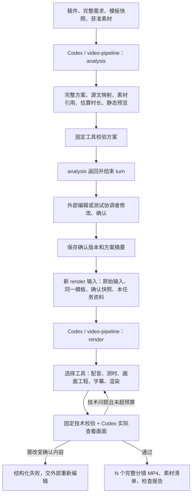

# Codex 两阶段执行开发方案

状态：用户已授权开发，本地两阶段核心代码已实现；新版本完整视频复测与 Ubuntu 联调待执行。更新日期：2026-09-15。

本文先复盘 DeepSeek 独立测试，再记录将 analysis / render 固化到 `video-pipeline` 的开发方案。第 1—10 节保留设计与验收依据；用户随后授权开发，本轮实际实现、使用入口及未验证边界见第 11 节。

## 1. 结论与开发前提

**本次测试符合两阶段的核心制作预期，可以作为开始两阶段能力开发的依据；尚不足以证明现有代码已经稳定支持这一流程，也不能直接据此宣布 Worker 链路可上线。**

已验证的是：Codex 能在 analysis 理解指定稿件和参考资料、输出完整方案并停止；收到独立确认后，能在 render 自行组织男女声配音、原创画面、字幕、动画、渲染和修复，交付与确认方案对应的逐镜 MP4。

没有充分验证的是：只靠仓库里的标准入口、无需协调者追加技术指令，就能重复完成上述过程。本次用到了任务内临时脚本、协调者纠正分镜口径、网络中断后的恢复指令，以及多轮编码与进程问题修复。

建议实施顺序：

1. 先开发并稳定 Codex 两阶段协议、Skill 分流、制作工具与验收工具。
2. 用同一双人财经任务复测，并验证编辑修改、跨 turn 恢复和一种明显不同的模板要求。
3. 两阶段独立验收通过后，再调整 Worker 的业务耦合与运行能力，接入真实模板接口、编辑平台和回调。

双人财经是首个验收案例。角色数量、音色、布局、动画和剪辑节奏由模板与 Codex 决定，不写成 Worker 中的特殊分支。技术检查和付费请求保护应固化为工具，不能每个任务重新临时编写。

## 2. 本次测试的证据与结果

### 2.1 审查范围

仅检查任务 **DeepSeek 两阶段独立测试**，任务 ID：`01a09f34-3712-7d10-99df-9b3fe9fb7e65`。

本次任务目录，以下称 `J`：

```text
/Users/jiang/Documents/Codex/2026-09-14/deepseek-two-stage-clean-test/outputs/deepseek-v4-analysis-20260914
```

审查来源：该任务的 analysis、render、恢复 turn 日志；确认方案；最终产物清单；质量、修复和素材报告；实际 MP4 及其抽帧。未打开其他 DeepSeek 样片、历史正文工程、日志或审计资料。

关键证据文件：

| 本任务文件 | 能支持的结论 |
| --- | --- |
| `analysis-plan.json`、`quality/analysis-verification.json` | 分镜规划、正文覆盖、估算时长；analysis 记录为 0 次 TTS、0 次视频生成 |
| `confirmation.json`、`confirmed-plan.json` | 协调者确认来源、冻结方案及 SHA256 |
| `render-manifest.json`、`timeline.json` | 16 镜成片、顺序、实际时间轴、声音与素材引用 |
| `render-quality/repair-log.json` | 6 轮技术修复及保留证据 |
| `render-quality/whole-video-verification.json` | 最终编码、解码、音画起点、总帧数等检查 |
| `render-quality/alignment-review.json` | 声学对齐与独立 ASR 的结果及不确定性 |
| `resource-use-report.json`、`normalized-input.json` | 本任务输入快照、素材来源和摘要 |
| `coordinator-review/independent-check.json` | 协调者对清单、成片规格和抽帧的独立复查 |

本次文档审查又重新计算了确认方案、16 个分镜和整片的哈希，均与交付清单一致；重新核对了确认方案与交付清单的分镜 ID、顺序及正文文本，完全对应。报告中的 `passed` 不单独作为充分证据。

### 2.2 对照最初预期

| 最初预期 | 实际证据与结果 | 判断 |
| --- | --- | --- |
| analysis 只做方案，不提前正式配音、制作 MP4 | 阶段结束日志与检查记录均为 0 次 TTS、0 次视频生成；输出完整方案与 4 张静态示意 | 符合 |
| 稿件完整、模板可决定双人布局和角色 | 686 个口播正文字符按序覆盖；标题、非口播标注另存；男女角色、位置、高亮、图解、音效与字幕写入方案 | 符合本案例 |
| analysis 结束后再提交 render | analysis turn 正常结束，随后独立授权 render；有冻结方案哈希 | 符合；确认由协调者模拟，未联调真实编辑平台 |
| render 自行完成制作业务 | 16 条双音色 TTS、实际音频测量、原创 Remotion 正文工程、字幕、动画与完整渲染 | 符合；存在任务内临时工具和协调恢复 |
| 按确认镜头交付完整 MP4 | 16 个确认分镜对应 16 个含画面、字幕及音轨的 MP4；整片另列，不占第 0 项 | 符合 |
| 原文和分镜不可擅自改变 | 确认方案哈希未变，最终 ID、顺序、正文匹配；时间随真实音频重算 | 符合本案例；尚未测试编辑换素材、改稿后的完整往返 |
| 成片可播放且音画技术合格 | 1920×1080、30fps、H.264/yuv420p、AAC；4066 帧，135.533 秒；完整解码通过，音视频起点均为 0 | 技术检查符合 |
| 故障不重复生成成功配音 | 本任务记录 16 次成功 TTS，恢复期间新增 0 次；保留并验证缓存 | 本案例符合；未独立对账供应商账单，结果未知时的恢复尚未测试 |
| 不参考历史样片 | 独立任务目录、白名单快照与可见日志支持此约束；只复用获准的头像、Logo、片头源码和独立音效 | 可见证据符合；不是操作系统级完整文件访问审计 |
| 可持续无人值守重复运行 | 有中断、浏览器卡住、编码异常及追加恢复指令 | 尚未验证 |
| 支持不同动态模板及生产部署 | 本次直接使用获准文档和本地能力，无真实模板 API，无 Worker | 尚未验证 |

### 2.3 效果判断与验收边界

画面达到本次可用验证样片的目标：男左女右、当前发言角色突出，正文图解与字幕清楚，引语显示合成旁白说明；图解按内容逐步呈现。本次复查重新查看了最终整片的开场与生态图解抽帧。

视觉仍有改进空间：多数正文沿用同一大面板结构，部分图形出现前留白较多，镜头之间的布局变化有限。它证明双人财经能够制作出来，不能代表所有模板都达到同样效果，也不能代替用户对整片节奏和审美的验收。

质量证据包括 61 张编码后抽帧比对、原故障区间的 42 个连续帧验证，以及 16 镜首尾共 32 帧的拼接像素核对。**这些是抽样和边界检查，不是对全部 4066 帧逐帧人工审看。**

尚未做人耳主观监听。独立 ASR 对 DeepSeek、CUDA、升腾等词存在识别差异；部分声学对齐词有低置信度或零时长，不能由此直接判定漏读，也不能宣布逐音节对齐完美。保留原文、字幕覆盖正确，不等于发音、停顿和听感已经验收。

本次未核查稿件事实，遵循保留用户稿件的测试要求。

### 2.4 日志暴露的具体问题

1. **分镜口径需要前置。** analysis 起初规划 20 个独立镜头，协调者要求改为 16 个交付镜头、20 个内部视觉段落：片头归第 1 镜，章节卡归相应章节首镜，片尾归最后一镜。应在分析输入明确交付口径，不能等输出后再解释。16 不是通用固定数量。
2. **估算与实际必须分开。** analysis 总估算 158.25 秒，实际 135.533 秒，较估算短约 14.4%。没有实际配音时这不构成失败；但 S01 的估算值 10.563 秒超出所列区间 `[7.08, 10.0]`，很可能混用了口播与含片头的总时长口径，现有检查未捕获。
3. **测试协议仍是临时形态。** `task.json` 是本地 `schemaVersion: 1`，仍记录 `operation: analysis`；render 信息另存在确认文件、阶段日志和 `render-checkpoint.json`。保留 analysis 历史本身正确，但执行器不能靠同一个旧 task 文件判断当前执行阶段。
4. **最终清单混有计划表达式。** `render-manifest.json` 的部分 `visualBlocks` 仍包含如 `speechEndFrame+67` 的表达式，实际帧数在 `timeline.json`。正式协议应明确哪些是计划描述、哪些是已解析的最终数值，避免下游二次推算。
5. **依赖预检不完整。** Python 字幕依赖出现兼容问题，转为独立 Python 3.11 环境；FFmpeg 编码能力也需选择可用实现。后续不能只检查命令是否存在。
6. **单帧预览通过不代表最终视频通过。** JPEG 渲染路径产生平铺、裁切和黑块，改 PNG、单并发并复测连续区间后通过。这是本次环境的证据，不推断所有 JPEG 渲染均有问题。
7. **封装引入同步偏移。** 曾出现约 42.7ms AAC 偏移、像素格式问题，以及整片拼接约 21ms 时间戳偏移。最终已修复，应转为工具检查与回归用例。
8. **恢复目前依赖协调。** render turn 曾因远端上下文压缩连接失败而终止；随后另发恢复消息。浏览器关闭阶段也卡住过，恢复时保留前 8 镜，逐镜隔离进程并回收本次子进程才继续完成。不能将这些写成现有 pipeline 已具备的自动恢复能力。
9. **检查状态需要限定阶段和来源。** analysis 时的 `envRead: false` 与 render 时可信工具加载配置并不矛盾；旧 checkpoint 中“等待协调者复查”也不代表现在未复查。正式报告需标明阶段、版本、生成时间和后续报告引用，不能把不同时间的快照当成同一当前状态。

## 3. 现有 video-pipeline 到底缺什么

现有维护源在 `claude-code-video-toolkit/.claude/skills/video-pipeline/`，Codex 使用 `.agents/skills/video-pipeline/`，通过现有迁移脚本同步。

当前存在两条规则：

- v1：本地完整无人值守制作，包含规划、配音、工程、时间轴、检查、渲染、交付。
- v2：已有 analysis / render 分流，但 render 要求使用 Worker 提供的逐镜配音、`renderSelection.sceneIds` 和固定 `tools/render_segments.py`，不能承载本次由 Codex 自行组织的完整双人制作流程。

本次测试利用本地制作能力，并由任务指令补充阶段边界、冻结方案与分镜交付，**没有证明当前 v2 固定链路已支持同等能力**。

拟议调整：仍保留 `video-pipeline` 一个业务入口，按显式 `stage` 选择 analysis 或 render；共享底层制作与检查工具。不是新建两套互不兼容的财经专用 pipeline，也不是把双人脚本搬进 Worker。

## 4. 两阶段的实际调用链



### 4.1 analysis 的执行步骤

1. 校验输入、复制或定位获准快照，记录稿件、完整需求、模板、素材摘要；技术依赖与业务参考资料分别列明。
2. 按模板理解稿件和素材，规划交付分镜、角色、发言、画面、字幕、动画触发、素材引用、片头片尾和内部视觉段落。只读取白名单内确需使用的资料。
3. 每镜保留稳定 ID 和源文位置，区分口播正文、标题及非口播标注。无现成音频时输出估算时长与明确口径，不伪造实际时标。
4. 生成完整方案和必要静态示意；由固定检查工具核对覆盖、引用、ID、顺序、估算区间及必需字段。预览图片不代替方案。
5. 保存 analysis 阶段结果，返回并结束 turn。模板中的“无人值守完成 MP4”不能取消此边界。正式 TTS 和 MP4 渲染入口在本阶段应拒绝执行。

首次本地测试无需开发编辑器界面；可通过可读方案与 JSON 修改完成确认。真正的等待由外部任务状态表示，不让 Codex 在一个长 turn 中等待用户。

### 4.2 确认与 render 的执行步骤

1. 外部保存完整确认方案、版本、来源和摘要。render 创建自己的执行输入，不能覆盖原 analysis 输入来冒充同一阶段。
2. render 校验确认快照及资源仍可用。即使换会话，也从文件恢复，不依赖模型记住 analysis 内容。冻结模板不得在 render 时重新读取成另一个版本。
3. Codex 按确认角色和文本选择获准配音工具，使用已有合格音频或生成新配音；根据实际音频安排每镜时间、字幕和动画。Worker 不选择音色，也不提前逐镜配音。
4. Codex 按模板和确认方案创建或适配独立工程；可复用获准通用组件，不读取被禁止的历史正文源码或样片。工程制作过程允许合理技术选择，不固定布局枚举。
5. 按确认分镜输出完整 MP4。内部片头、章节卡、多个素材段、字幕和音效留在归属镜头中；若提供整片，放在独立字段。
6. 技术问题在预算内修复；需要改文本、换未确认素材、改变交付镜头或违反硬性时长时，停止并返回具体原因，不擅自改确认稿。
7. 输出实际素材清单、实际数值时间轴、技术验证和视觉审查记录。固定检查工具通过后才形成合格候选；将来由服务端再决定发布与回调。

“按确认制作”不等于所有像素都在 analysis 锁死。排版微调、字幕分页、按实际音频计算帧数、编码修复属于技术实现；角色、文本、交付镜头、指定素材和模板硬性要求属于确认约束。

## 5. 拟议文件协议与目录

以下为**开发草案，不是现有 API 可直接接收的 JSON，也不是已实现命令**。沿用架构方案的 `stage: analysis | render`。新协议显式标识，不能悄悄改写现有 v1/v2 行为。

### 5.1 最小目录

```text
job/
├── input/                      稿件、完整需求、模板及素材快照
├── analysis/
│   ├── request.json            本阶段执行输入
│   ├── plan.json               可编辑完整方案
│   ├── plan.md                 阅读版，与 JSON 对应
│   ├── result.json             阶段结果、证据路径
│   └── preview/                静态预览
├── confirmation/
│   └── v1/                    确认记录、完整方案及摘要
├── render/
│   └── run_002/
│       ├── request.json        render 阶段执行输入
│       ├── checkpoint.json     已验证步骤、文件与摘要
│       ├── timeline.json       实际秒数和帧边界
│       ├── result.json         逐镜交付清单
│       └── quality/            技术与视觉检查
├── project/                    本任务生成的工程
├── cache/                      本任务音频及请求记录
└── output/run_002/scenes/       完整分镜 MP4
```

目录名称在实施时统一；必要的是阶段输入、确认版本、执行结果可以区分和追溯。首版不为每次生成操作引入额外服务或数据库。

### 5.2 执行输入

```json
{
  "contractVersion": "two-stage-draft",
  "taskId": "task_001",
  "runId": "run_002",
  "stage": "render",
  "input": {
    "scriptFile": "input/script.md",
    "requirementsFile": "input/requirements.md",
    "templateSnapshot": "input/template/manifest.json",
    "assetsManifest": "input/assets.json"
  },
  "confirmation": {
    "planVersion": 1,
    "planFile": "confirmation/v1/plan.json",
    "planSha256": "<实际文件的 SHA256>"
  },
  "previousArtifacts": null,
  "outputSpec": { "width": 1920, "height": 1080, "fps": 30 },
  "delivery": { "kind": "scene_mp4", "includeWholeVideo": true }
}
```

analysis 使用相同外壳，`stage` 为 `analysis`、`confirmation` 为 `null`、`delivery.kind` 为 `analysis_plan`。`previousArtifacts` 仅引用本任务已验证记录。技术能力与凭据由部署提供，不由任务 JSON 授权。

模板快照至少保存内容、附件列表、来源和摘要。本地先使用用户指定文档及直接嵌入图片，不伪造模板 API 返回；将来 API 适配器提供等价快照。

路径在任务内部使用相对路径，在入口处解析并检查归属；外部输入和回调的 `url` 按既有约定仍是本机/共享盘路径。Ubuntu 媒体根为 `/home/ops/jiangzb/videos`，不引入远程媒体 URL 前提，也不写死本次 Mac 测试路径。

### 5.3 analysis 方案应保存什么

方案外壳包含版本、输入摘要、完整要求引用、输出规格、有序分镜、素材清单、估算依据、未满足条件。每镜保存 ID、原文映射、文本、源素材引用和完整制作描述。

角色、布局、字幕、图解、动效等保存在可扩展的制作数据中，不能被有限字段重建时丢弃。下面只演示结构，不规定所有模板都必须有两个主持人：

```json
{
  "id": "scene_001",
  "text": "本镜口播原文",
  "sourceMapping": [{ "start": 0, "end": 6, "unit": "unicode_codepoints" }],
  "timing": {
    "kind": "estimated",
    "speechSeconds": 5.5,
    "totalSeconds": 7.5,
    "totalRangeSeconds": [6.5, 8.5],
    "basis": "口播估算加 2 秒内部片头；尚未正式配音"
  },
  "assetRefs": ["portrait_female", "logo_001"],
  "production": {
    "speaker": "female",
    "layout": { "description": "按本任务冻结模板布局，当前发言角色高亮" },
    "captions": { "description": "原文字幕，render 按实际音频分页对齐" },
    "visualBlocks": [
      { "id": "block_001", "type": "dialogue", "description": "口播及对应图解" },
      { "id": "block_002", "type": "intro", "durationSeconds": 2 }
    ]
  }
}
```

确认时保存**完整方案**，不可只回传前端看得见的几个字段。首次本地实现可直接保存完整确认 JSON；真实编辑平台采用完整透传还是服务端保留方案、前端提交修改项，留到对接时确定。任何方式都必须拒绝旧版本确认覆盖新版本。

### 5.4 render 结果与错误

```json
{
  "contractVersion": "two-stage-draft",
  "taskId": "task_001",
  "runId": "run_002",
  "stage": "render",
  "status": "candidate",
  "planVersion": 1,
  "confirmedPlanSha256": "<确认方案 SHA256>",
  "scenes": [
    {
      "id": "scene_001",
      "path": "output/run_002/scenes/scene_001.mp4",
      "sha256": "<成片 SHA256>",
      "frames": 225,
      "durationSeconds": 7.5,
      "usedResources": [
        { "id": "portrait_female", "kind": "source", "path": "input/assets/female.png" },
        { "id": "speech_001", "kind": "generated", "path": "cache/audio/speech_001.wav" }
      ],
      "resolvedVisualBlocks": [
        { "id": "block_001", "startFrame": 0, "endFrameExclusive": 165 },
        { "id": "block_002", "startFrame": 165, "endFrameExclusive": 225 }
      ]
    }
  ],
  "wholeVideo": null,
  "quality": { "report": "render/run_002/quality/report.json", "humanListeningPerformed": false }
}
```

正式结果必须给出全部确认分镜，按确认顺序排列，不只返回本次重做的子集。源素材、生成图解/音频、工程源码、最终 MP4 分开记录；程序绘制的图解不能伪称来源视频。时间统一使用秒、帧及明确的局部/全局坐标，所有实际边界都为数值。

失败结果沿用同一任务、run、stage 标识，包含 `status: failed`、失败步骤、错误码、原因、可重试性与已有有效产物引用。例如确认失效、缺少必需素材、硬时长冲突、能力缺失或付费结果未知。不要把失败伪装成静音占位片，也不要在失败时删除已经验证的音频和成片。

## 6. 代码落点与职责

下列均为拟修改范围，当前未实施。具体新增文件名可随实现组织调整，职责必须保持。

| 位置（相对仓库根） | 拟调整内容 | 边界 |
| --- | --- | --- |
| `claude-code-video-toolkit/.claude/skills/video-pipeline/SKILL.md` | 增加显式新协议的 analysis/render 入口与停止、确认、恢复规则 | 不以 DeepSeek 或双人模板 ID 分支 |
| 同目录 `references/` | 增加两阶段契约、阶段输入输出 Schema、确认与素材语义；协调原任务契约说明 | 新协议与旧 v1/v2 清楚区分，不让旧 Worker 输入误入新流程 |
| 同目录 `scripts/` | 新增或抽取通用方案、确认和逐镜结果校验；核对正文、引用、版本、时间及产物 | 检查结构和实际证据，不强制固定财经画面 |
| `claude-code-video-toolkit/tools/generate_dialogue_audio.py` 及现有底层配音工具 | 由 Codex 传入角色和音色；完善内容寻址缓存、请求记录、音频验证、实际时长 | 当前文件存在且大于 1024 字节的复用判断不足；不能靠文件名认定匹配 |
| `claude-code-video-toolkit/tools/` 通用渲染、音频、检查工具 | 提取本次可复用的渲染退出管理、音轨时间戳、最终编码验证及证据生成 | 不把任务中的绝对路径、16 镜数量、财经图解正文硬编码进去 |
| `claude-code-video-toolkit/scripts/migrate_to_codex.py` | 使用现有同步方式生成 `.agents/skills/`，检查源与生成版本一致 | 优先不改迁移器，只在确有不兼容时调整 |
| toolkit 的测试与测试说明 | 增加协议边界、确认失效、恢复、缓存与实际媒体问题的测试 | 不读取禁止参考的历史视频来指导新画面 |
| `video-worker/` | 本轮先不改；独立链路验收后再按既有架构方案接入 | 之后仍需去除预配音、固定渲染、业务复用等耦合 |

保留老的全流程本地入口。旧 v2 固定路径在 Worker 迁移前继续明确识别；新入口不依赖它预生成配音。这是过渡期的显式兼容，代价是暂时存在两份契约，迁移完成后再决定旧协议退出方式。

首版不必先建设业务 MCP。Codex 调用现有可信 CLI 即可完成配音、Remotion、FFmpeg、字幕对齐；之后如果封装 MCP，改变工具接入方式，不改变阶段职责。未来运行时开放哪些工具需单独验收，本次桌面测试不证明 Ubuntu Worker 的能力限制已经解除。

## 7. 需要固化的可靠性机制

### 7.1 输入、阶段与确认保护

阶段来自显式执行输入；模板负责业务要求，不能跨越 analysis 边界或扩大资料访问范围。正式 TTS、正式渲染工具检查当前阶段，避免只靠自然语言约束。文件快照、允许引用清单与确认摘要由固定工具核对。

确认方案变更产生新版本，旧版本的 render 不得覆盖新确认结果。本地先用文件与摘要完成验证，将来由 Worker 的任务版本和发布校验继续约束；文件设为只读本身不等于安全隔离。

### 7.2 配音与复用

缓存键至少包含精确文本、供应商、音色、有效模型/生成参数及相关输入摘要；命中后还要检查文件摘要、解码和音频规格。同名文件或仅“文件够大”不能算命中。

调用前写逻辑请求记录，成功后记录供应商标识、产物摘要与实际时长。结果未知时先查询或使用供应商幂等能力；没有查询/幂等能力则明确失败，不盲目重发收费请求。超时、重试次数与修复预算不能在恢复时清零。

是否复用镜头由 Codex 在制作层判断并核验证据。首版优先可靠复用本任务配音及已验证成片，不承诺通用的最小增量重渲染算法，也不在 Worker 按固定字段哈希强行决定哪些镜头不需要重做。

### 7.3 渲染、封装与检查

先检查 Node、浏览器、Python、字幕依赖、FFmpeg 编码器与字体实际可用性，再执行收费步骤。记录版本和环境，避免每个任务临时寻找兼容 Python。

将本次验证过的 PNG 帧渲染作为当前环境的保守起点，控制单任务渲染并发；在 Ubuntu 重新验证后再决定是否调整。不能直接复制 Mac 专用 FFmpeg 路径或假定不同机器问题相同。

每个渲染子进程归属于明确任务/执行，区分渲染超时与浏览器关闭超时；回收时只操作本任务进程。即使文件已生成，也要独立验证后才认定成功，不能仅忽略非零退出码。重复启动前先检查旧进程是否还活着。

实际 MP4 完整解码，核对画幅、帧率、编码、像素格式、时长、音轨、起始时间和音频削波。另从最终 MP4 抽帧检查，修复画面编码问题后验证原故障连续区间。整片若提供，还需核对拼接边界。

字幕按实际音频对齐，低置信度和零时长结果列为明确检查项；专有名词保留问题证据。编码同步允许何种容差按音频采样率、视频帧率与具体交付约定设定，不能只比较字符串时长，也不能把本次为模板末帧需求裁剪 12.625ms 静音变成所有视频的通用规则。

### 7.4 恢复与限额

每步原子写 checkpoint，保存阶段、输入/确认摘要、已验证产物、请求记录、尝试次数和耗时。续跑先复核文件，不只相信 checkpoint 标志。

本地阶段执行器须能识别会话失败和活跃制作进程，恢复时从文件继续。后续 Worker 接入后由执行器承担会话重试与取消，Codex 仍承担制作步骤决策。网络导致的模型 turn 失败和视频制作失败分开记录。

拟将等待编辑从制作执行预算中分离：analysis、render 各记录执行耗时，恢复累计不重置，外部等待不占执行槽位。具体预算默认值在开发评审时确定，不沿用旧全流程“首次启动后连续 4 小时”的含糊语义。

## 8. 分步实施与验收

### 第一步：固定协议与入口

完成阶段 Schema、确认快照、Skill 分流和本地提交/确认/续跑的最小入口。用户不需要手工写 `prepare.py` 调用；可提供任务输入，让 Codex 或薄入口工具建立目录。提交与确认工具只管理文件，不决定角色、配音或镜头内容。

验收：analysis 输出完整方案后结束；正式 TTS/MP4 入口拒绝 analysis；render 缺确认、确认哈希不一致、引用越界时明确失败。旧本地入口与旧 Worker 协议不能被误路由。

### 第二步：稳定制作与检查工具

完成配音缓存与请求记录、环境预检、渲染退出管理、实际媒体校验、结构化阶段结果。将本次问题转为小型针对性测试，不需要每次重跑整条付费视频。

验收：缓存参数变化不会误用旧音频；未知收费结果不盲重试；模拟进程卡住只回收本任务；错误时间戳、坏媒体、缺镜、镜头乱序、遗留占位符不能被标成合格。

### 第三步：正式重跑双人财经两阶段

在全新任务目录只提供原稿、指定《财经双人对话视频生成指令.md》及直接嵌入图片、获准头像/Logo/片头源码/独立音效、必要通用工具与依赖。不给模型本次或历史样片、正文源码、日志、方案或修复报告作为制作参考。

开发者可以使用本次故障证据完善通用工具；新制作任务只能使用发布后的通用能力，不能把已完成视频的布局和时间轴偷偷作为参考。两者访问范围明确区分。

先完成 analysis，再通过显式确认启动 render，保留两个独立结果。首次复测的技术目标是：不需要协调者追加编码修复或手写恢复脚本；出现支持范围内故障时由固化机制处理。

验收包含：全文与确认镜头一致、男女声和角色高亮符合模板、最终 N 镜完整合成、实际字幕对齐、素材来源、技术规格、完整解码和真实画面审看。最终主观效果仍需用户观看与听音。

### 第四步：验证协议不是只适合这一个案例

至少补充以下针对性用例：

- 修改一镜允许替换的素材或发言安排，形成新确认版本，render 按新版本制作，其余完整方案不丢失；不强制要求未变镜头一定不重渲染。
- 重新启动会话，单靠任务文件恢复；已成功配音不得重复请求，已验证镜头不被损坏产物覆盖。
- 同一入口换成一个内容明显不同的模板要求，例如单主持人/无头像布局，确认无需新增 Worker 或任务名分支。先使用短稿验证，避免为证明通用性重复制作多条长视频。
- 模拟缺必需素材、阶段越权、旧确认、配音结果未知、进程超时和最终检查失败，核对结果可定位、可恢复且不误报成功。
- 在目标 Ubuntu 环境执行相同的本地两阶段检查，验证字体、浏览器、编码器、路径和 `codex login` 所用运行环境；本地 Mac 通过不能替代该检查。

以上通过后，才进入 Worker 集成验收。两阶段本地开发不需要先接数据库、四并发队列或真实回调。

## 9. 后续 Worker 如何接入

本节界定下一步边界，不表示本轮要修改 Worker。

Worker 保留任务持久化、全局最多 4 个活跃执行、同任务串行、领取/租约/取消、文件隔离、候选结果校验与可靠回调。等待编辑和发送回调不占 Codex 执行槽位。

仍需调整的现有代码：`execute-run.ts` 中预配音，`workspace.ts` 中固定复用选择及资料恢复，`prompts.ts` 中固定制作指令，`results` 中按有限字段重建方案，以及 `app-server.ts` / `codex-host.ts` / `host-processes.ts` 中阻断所需工具的配置和路由。不能理解为 Worker 当前执行链无需改动。

接入后：模板适配器读取并冻结模板 → Worker 准备阶段输入与本任务工作区 → Codex 执行 → 固定工具复核候选与确认版本 → Worker 保存并通知回调发送器。Worker 不提前选音色、制作配音、设计镜头或判断业务上哪些镜头可以复用。

四并发、隔离、崩溃恢复、旧执行不能发布、回调重试，以及真实编辑平台的方案完整往返，均是后续集成验收项，本次视频样片没有验证它们。

相关已有文档：[Worker 代码架构与现有项目接入方案](Worker代码架构与现有项目接入方案.md) 第 9 节、[AI 视频剪辑上下游对接方案](AI视频剪辑上下游对接方案.md) 第 12 节。本文细化其中“先稳定 Codex 两阶段”的实施部分，未改写原接口定义。

## 10. 评审时需要确定的事项

本方案建议先完成本地两阶段再接 Worker；以下仍是评审项，尚未冒充已确定配置：

- 新协议的正式版本号、首版本地入口形式，以及 analysis/render 各自的执行预算默认值。
- 模板对独立片头片尾、内部章节卡和交付分镜的口径。当前测试采用归入正文镜头，但不能未经约定推广到全部模板。
- 主观效果验收重点：布局变化、发言节奏、音色与专有名词发音；技术报告不能代替用户的观看结论。
- 后续模板 API 的请求、鉴权、版本与附件语义，以及编辑平台保留完整方案的方式。这些不阻塞本地两阶段核心能力开发，但会阻塞对应的真实上下游集成。

以上为开发前的评审依据；当前实施状态以下方记录为准。


## 11. 本轮实现与使用入口（2026-09-15）

### 11.1 已实现的本地能力

正式协议名为 `video-two-stage/1`，以 `contractVersion` 识别，旧 `schemaVersion: 1/2` 路由保留。已实现的核心文件均在 `claude-code-video-toolkit/`：

| 文件 | 作用 |
| --- | --- |
| `tools/two_stage.py` | `init` 白名单快照、独立阶段输入；`validate` 方案/产物校验；`confirm` 保存完整确认与新 render 请求；`checkpoint/status/repair` 管理证据、恢复检查及修复次数 |
| `tools/stage_tts.py`、`tools/cached_tts.py` | Codex 传入发言与实际音色；核对确认文本；同任务配音缓存、供应商请求 ID、结果未知停止、成功音频验证 |
| `tools/stage_media.py`、`tools/render_scene.cjs` | 通用 Remotion 执行、进程组回收、已验证成片复用、真实 MP4 抽帧、技术验证和整片拼接 |
| `.claude/skills/video-pipeline/SKILL.md` 及 `references/two-stage-contract.md` | 新协议阶段分流、制作流程、命令与 JSON 说明；已同步 `.agents/skills/` |
| `references/two-stage.schema.json`（位于该 Skill 内） | 提交、阶段输入、完整方案、产物和视觉审查的结构定义 |
| `tests/test_two_stage.py` | 新协议、缓存、恢复与实际媒体测试 |

原 `generate_dialogue_audio.py` 保留调用入口，增加按参数核验的缓存；没有来源证明的旧同名音频不会自动当成可复用结果。`--force` 仍是明确重新生成，旧缓存保留。豆包底层增加可追踪请求 ID，不改变原 endpoint 和音色默认值。

任务通过 Skill 驱动 Codex 制作；上述 Python 工具负责确定性操作，不替 Codex 生成业务分镜。角色数量、布局、图解和素材理解没有写进 Worker。本轮没有修改 `video-worker/`、Docker Compose 或 `.env`。

### 11.2 怎样开始下一次实际测试

在本项目的新任务中，可以直接对 Codex 说：

```text
使用 $video-pipeline 的 video-two-stage/1 协议，先执行 analysis。
根据我指定的稿件、完整需求、模板文档和获准附件建立独立任务目录，
用 tools/two_stage.py init 准备阶段请求，然后按 analysis/request.json 执行。
只读显式获准业务资料和必要通用工具，不参考任何历史视频、正文工程、方案或日志。
本轮输出完整可编辑分镜 JSON、阅读版、必要静态示意和校验结果后结束。
不要调用正式 TTS、不要制作 MP4、不要自行确认或进入 render。
```

同时给出本次稿件、模板及获准附件的准确路径和完整需求。Codex 根据这些信息准备提交 JSON；无需用户手工写准备脚本。实际字段、CLI 示例见 [两阶段执行说明](../claude-code-video-toolkit/.agents/skills/video-pipeline/references/two-stage-contract.md)。

analysis 完成并审阅后，明确确认具体方案。确认工具生成 `confirmation/v1/` 和 `render/render_001/request.json`；再让 Codex 使用这个 render 请求继续。本地可以沿用同一个任务会话，也可以在新会话中读取同一任务文件。模板和原始需求不需要重新拼接到一条超长提示词中。

编辑后请另存完整方案文件，用当前 `base-version` 确认；不要直接修改已冻结的方案或阶段请求。旧版本执行会收到 `STALE_CONFIRMATION`。

环境需安装工具库 Python 依赖；Remotion/Node/浏览器路径由当前部署指定。`FFMPEG`、`FFPROBE` 可指定媒体工具路径，未设置时使用 PATH。没有远程媒体 URL 前提，Ubuntu 根目录仍沿用 `/home/ops/jiangzb/videos`。

### 11.3 本轮验证方法

本轮结果：新链路 32 项测试全部通过（含实际短 Remotion 渲染），旧入口和底层工具 22 项回归通过，共 54 项；Skill 格式、源/生成同步、文档 JSON 与本地链接检查通过。

使用全新临时目录和合成音视频验证协议与工具，不读取历史样片作制作参考，也没有重新调用付费 TTS。测试覆盖：

- analysis 阶段停止、正式 TTS 拒绝 analysis 请求、全文与映射覆盖、估算区间、未知素材、旧确认、快照篡改和路径越界。
- 模板自定义字段完整保留、编辑确认版本、checkpoint 产物变更、执行互斥与活跃旧进程检查。
- 配音精确缓存、文本/音色变化、损坏缓存、网络结果未知，以及旧音频无证明时不盲目重新收费。
- 实际 MP4 解码、缺镜/乱序、字幕覆盖、内部帧边界、错误声音、时间戳偏移、实际抽帧与伪预览图的区别、完整合片与声音/边界校验。
- 新建短 Remotion 工程通过通用入口实际渲染，再次执行命中已验证产物；错误帧数被拒绝。
- 旧本地 v1、旧 v2 校验、默认配置优先级、豆包请求格式和流解码回归。

运行机械测试：

```bash
cd claude-code-video-toolkit
python3 -m unittest discover -s tests -p 'test_two_stage.py' -v
```

真实短 Remotion 测试需设置 `VIDEOCUT_TEST_NODE`、`VIDEOCUT_TEST_MODULES`、`VIDEOCUT_TEST_BROWSER` 为实际 Node、node_modules 和浏览器路径；未设置时该用例会明确跳过。媒体测试需要带 `libx264` 和标准滤镜的 FFmpeg，可以通过 `FFMPEG` 指定。正式执行器自身通过 Remotion 渲染，并不要求系统 FFmpeg 与 Remotion 附带构建是同一版本。

### 11.4 尚未由本轮证明的能力

1. 新代码版本的完整 DeepSeek 双人财经效果复测、真实编辑换素材往返、另一种模板的完整模型制作效果，尚未执行。短工程通过只证明执行与校验工具可工作。
2. Ubuntu 上的浏览器、字体、字幕依赖和 ChatGPT 登录环境尚未实际联调；本轮在 Mac 本地验证。
3. 字幕声学对齐与业务画面设计仍由 Codex 按 Skill 选择现有工具完成；本轮没有新建业务 MCP，也不宣称自动技术检查能证明发音或审美合格。
4. 模型 turn 因网络断开后，仍由外部重新提交同一阶段请求；本地提供文件续跑、活跃进程检查和成功缓存，不常驻自动重启桌面会话。孤立进程组无法确认结束时保守阻止重复执行，需要外部核查。
5. 本地执行预算累计正式工具耗时，等待编辑不占用；尚未覆盖模型思考或任意手工命令的总时间。这一总预算由后续执行器/Worker 提供。
6. 当前文件白名单、摘要和阶段检查属于本地协议约束；不是 Worker 的 OS 沙箱、四并发、可靠回调或服务端发布验证。

本轮交付是可用于下一次两阶段实际测试的核心实现。完整效果与目标环境验收后，再按第 9 节接入 Worker。
