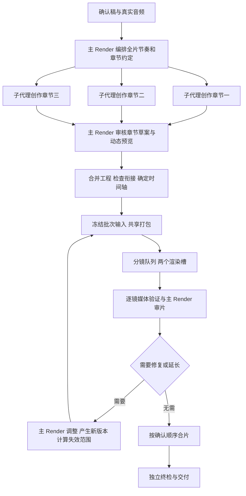

# Render 主控节奏与章节并行制作落地方案

状态：最终实施方案，尚未实现并行代码。本文于 2026-09-23 编写，作为后续开发与验收依据。

## 1. 目标与维护基线

目标：主 Render 始终掌握整片叙事、动画节奏和视觉一致性；章节子代理负责有边界的内容创作；Worker 管理执行、资源、预算及可信结果；最终按确认分镜顺序交付。

沿用 Analysis → 用户确认 → Render 两阶段流程。章节创作和并行渲染都是 Render 内部能力，不新增客户端阶段、公开任务类型或独立调度服务，不改变确认稿和逐镜交付协议。

本次修复基线：

- 代码提交：`f175881c23e988eb6fda6bf4106e3034d55a42d3`。
- 附注 tag：`render-adaptive-v1.2.0-20260923`，指向上述提交。
- 内容：模板 1.2.0、自适应检查、真实时间轴、媒体恢复及其所依赖的两阶段代码。
- 验证结果：18 个分镜、4112 帧、137.067 秒完整视频通过本地成片验证及 Worker 独立终检。自动 Render 因模型账户额度耗尽中断，本地续作通过不等于全自动链路通过。
- tag 保存在本地，尚未推送；视频、运行缓存、环境配置未纳入该提交。克隆代码不会自动获得测试视频或本机运行环境。

## 2. 核心决策

采用“主 Render 编排全片 → 子代理分章创作 → 主 Render 审核、合并和冻结 → Worker 按分镜并行渲染 → 主 Render 审片与修复 → 独立终检”。

创作按章节分工，渲染按分镜排队。两种并发分别配置，不能把三个章节子代理直接等同于三个渲染进程。

当前测试机为 4 个物理核心、8 个逻辑线程、16 GB 内存。初始建议：章节创作最多 3 路，正式渲染默认 2 路，每路 Remotion 帧并发为 1。正式大规模渲染与章节创作分阶段执行；预览也进入同一机器资源队列。3 路渲染必须通过本机基准后再启用。上述并发值是运行配置，不是章节数量上限。

第一版不实现跨机器渲染、自动扩容、复杂依赖图或章节之间自动协商。代价是主 Render 合并与审查仍有串行耗时，公共组件或全局时间轴修改仍可能扩大重渲范围。第一版明确保留这一代价，先保证结果可靠并测出收益。

## 3. 当前耗时与不能直接并发的原因

最终任务记录中，Worker 累计约 44.7 分钟，本地续作累计约 38.9 分钟，合计约 83.6 分钟。这包含创作、修复、恢复、重渲和终检，不是稳定工程的纯渲染基准，也不包含所有此前实验。不能据此承诺并行后降到三分之一。

| 当前实现 | 问题 | 本方案处理 |
| --- | --- | --- |
| `render_scene.cjs` 每镜打包、启动浏览器，帧并发为 1 | 重复准备成本，计算资源未充分利用 | 同一冻结工程只打包一次，分镜受控并行；浏览器复用另行测量后决定 |
| `two_stage.py:execution` 持有任务锁并拒绝活跃进程 | 多个普通 render 调用无法并行 | 批量操作统一持锁，内部管理多个分镜进程 |
| `HostProcesses.run` 每个 run 只允许一个命令 | 不能直接同时调用现有媒体入口 | 一个批量工具进程管理渲染子进程；章节执行使用有父任务归属的内部子执行标识 |
| `recordMediaProgress` 读取、修改再覆盖共享文件 | 并发写入可能丢记录 | 协调器单写，子执行只返回独立结果 |
| 工程与时间轴使用整体摘要 | 局部改动扩大失效范围 | 第一版保守失效；随后明确章节依赖再缩小重渲范围 |
| 合片、验证、独立检查多次解码 | 重复工作增加耗时 | 记录各次耗时；同一次可信检查中合并取帧，最终独立检查仍实际执行 |

本案例三个章节范围约为 25、75、27 秒，另有片头与过渡。按章节固定分配渲染槽会让其他槽等待最长章；按分镜动态领取可改善负载分配。

## 4. 权责划分

| 角色 | 决策与职责 | 写入范围 |
| --- | --- | --- |
| 主 Render | 全片叙事、章节作用、动画节奏、重点和留白、主持人切换、音乐与转场；审核章节、合并工程、批准时间轴版本、审片和修复决策 | 正式任务工程、创作约定、最终时间轴、交付候选清单 |
| 章节子代理 | 根据约定创作本章图解和局部动画，复用栏目组件，提交真实预览与必要调整建议 | 自己的章节工作目录与独立候选版本 |
| Worker 协调器 | 派发、进度汇总、并发限制、租约和取消、预算、缓存校验、结果登记与独立检查 | 可信控制记录、子执行记录、媒体结果登记 |
| 媒体子进程 | 根据固定输入实际渲染、混音和导出，报告实测信息 | 本次分镜尝试的临时目录与独立结果 |

Worker 不决定每章几个图解、动画怎么走；主 Render 不伪造 Worker 成功记录；子代理不能修改确认稿、全局时间轴、公共模板、其他章节或控制账本，也不能自行调用收费配音。

章节子代理是当前任务内部执行单元，不创建用户侧独立业务任务。能力不足时仍可由主 Render 按同一章节约定串行完成，不伪称并行成功。

## 5. 主 Render 如何始终掌握节奏

### 5.1 先建立全片编排，再派发创作

主 Render 通读全部确认稿，读取真实音频与已有字幕时间依据，先产出 `direction.json`。这一文件由主 Render 唯一修改，至少包含：

| 内容 | 作用 |
| --- | --- |
| 确认稿版本、分镜顺序、音频摘要 | 固定内容来源，禁止漏字、调序和擅自重配音 |
| 每章叙事目标、前后章关系 | 防止每个章节都独立重复开场或结尾 |
| 整片节奏曲线 | 明确哪里建立观点、哪里展开解释、哪里停留强化、哪里收束 |
| 重点层级 | 明确本章最重要的视觉事件和次要信息，避免每句都同时强调 |
| 视觉与动效规范 | 栏目字体、配色、布局、安全区、主持人位置、运动方向、缓动、转场语法 |
| 音频与视觉锚点 | 将出现、展开、强调、停留、退出关联到真实句段窗口 |
| 跨章衔接安排 | 前章如何退出、后章如何接入、是否承接图形、BGM 是否连续 |
| 章节可调整范围 | 区分必须保持的内容和可以建议调整的布局、表现形式及展示时间 |

节奏曲线必须落实到事件，不能只写“节奏紧凑、画面高级”。例如本稿：第一章建立“技术领先不等于胜利”；第二章先展开落地路径，再逐层解释五层模型，份额下降作为本章视觉重点；第三章降低信息密度，强调市场与应用并收束。第二章不是每张卡片都做一次高潮。

### 5.2 使用真实时间锚点

每个关键事件明确以下信息：

```json
{
  "id": "chapter_02_application_focus",
  "sceneId": "scene_010",
  "audioAnchor": {
    "utteranceId": "utterance_010_04",
    "position": "start"
  },
  "action": "突出应用层，其他四层保留作为上下文",
  "phases": ["入场", "强调", "停留", "退出"],
  "priority": "本章重点",
  "durationPolicy": "根据实际句段窗口与动画完成情况确定"
}
```

此结构是拟定接口示意，锚点 ID 必须由实际任务解析和验证。主 Render 在派发时附带真实起止帧，最终合并时再解析一次；跨章只使用主 Render 计算的全局偏移。子代理内部使用章节或分镜局部帧，不能自行修改全局位置。

句级音频只提供句级精度。需要精确到某个词出现时，必须有供应商时间戳、强制对齐或绑定实际音频的已核验时间记录。不得用字数比例推测。

入场、停留和退出的推荐时长可调整，不重新引入统一最短帧数。实际动画必须在可见窗口内完成，重点内容要有可读停留。空间和时间不够时，子代理提出简化、分页或延长建议，由主 Render 结合全片节奏决定。

### 5.3 三次主控检查

1. **创作草案检查**：子代理先提交视觉事件安排和主要布局。主 Render 检查叙事顺序、重复表达、重点冲突及跨章衔接，再让其完成复杂实现；复用组件的简单章可以合并这一步与预览。
2. **章节动态预览检查**：查看真实渲染的重点、转场和高密度片段，不只看截图。检查动画是否跟随口播、重点是否过密、读完前是否消失。主 Render 返回具体事件和位置的修复意见。
3. **整片节奏检查**：合并后查看跨章边界和整体预览，确认章节间快慢衔接、信息密度和重复动效，再批准正式冻结版本。最终成片还要复查受编码、拼接和最终参数影响的画面。

主 Render 等待章节时可审核已到达草案、安排片头片尾和检查相邻章衔接，不需要一直阻塞等待所有子代理结束。但正式合并只能采用已验收版本；过期回复不能覆盖新版编排。

## 6. 内部交付物与目录

保持现有正式工程和 `render/<runId>/timeline.json`。只增加任务内必要文件：

```text
render/<runId>/
  direction.json                     主 Render 的全片编排与版本
  chapters/<chapterId>/
    brief.json                       指定分镜、音频锚点、风格、衔接和交付要求
    attempts/<attemptId>/
      workspace/                     隔离的章节工作目录
      result.json                    候选组件、布局、视觉事件、预览、调整建议
  batches/<batchId>/
    manifest.json                    冻结输入、分镜参数与依赖摘要
    results/<sceneId>/<attemptId>.json
  timeline.json                      主 Render 确定的正式时间轴
```

可信子执行状态仍放在 Worker 控制目录，由协调器单写。上述候选文件不是成功账本，子代理自报“通过”也不等于验收通过。

章节结果必须绑定 `directionVersion`、`briefHash`、`chapterId`、`attemptId`、实际文件摘要，列出使用的组件、场景和音频锚点，并附实际预览路径。章节新增组件需有独立名称、参数校验和真实渲染；公共注册表由主 Render 合并，子代理不能共同改同一文件。

主 Render 校验所属范围、依赖、重复 ID、确认稿和锚点，统一注册组件。文件结构和字段使用简单 JSON 与现有校验方式，第一版不引入通用工作流 DSL。

## 7. 完整执行流程



混音后若发现有效声音超出画面，收集可信调整结果，主 Render 统一重新确定时长和节奏。不得为了维持冻结帧数裁掉声音，也不得让各渲染槽自行延长全局时间轴。

批次运行时正式输入不变。需要编辑时，先停止派发相关作业；已运行的旧版本可以完成并作为旧版本缓存保存，但结果不得登记为新版本产物。最后由协调器核验输入摘要与租约，再原子发布结果。

## 8. 并发实现与资源管理

### 8.1 章节创作

在现有 `codex-host.ts` 及 app-server 会话能力上增加内部章节执行管理，复用启动、消息、取消和恢复能力。先验证当前运行时能否可靠承载多个隔离会话；本方案不假定现有宿主已支持原生子代理接口。

拟新增受控章节工具，提供 `dispatch`、`status`、`cancel` 三种操作。派发返回内部执行标识，不让主 Render 阻塞到所有章节完成；主 Render 根据状态收取候选结果并反馈。模型只能请求合法章节工作，不能传任意系统命令、扩大权限或修改预算。

各子执行关联同一个父 run、租约令牌和编排版本，使用独立工作目录。写入权限必须由已有沙箱机制实施并测试，不能只靠提示词约束。子代理需要预览时经受控媒体入口申请，复用宿主渲染槽，不得在自己的 shell 中无限启动 Chrome。

现有按 runId 串行的 `HostProcesses` 需要为获准章节子执行增加内部执行标识；保留父任务的统一停止和进程归属，不伪造多个业务 run 来规避锁。章节模式只开放创作必需的工具与文件范围，关闭收费配音和最终交付操作。

### 8.2 正式渲染

在现有 `video_media` 增加拟定命令 `render-batch`，参数指向已校验的冻结批次清单。一个可信批量进程持有现有任务管理锁，在内部启动受限数量的不同分镜渲染子进程。

需要将 `render_scene` 分成“已有独占入口”和“由批量协调器调用的内部实现”，避免内部再次争抢任务锁。不移除单任务互斥，也不对任意外部 render 调用放开活跃进程检查。

分镜、尝试和临时输出各自隔离，同一分镜同一版本只允许一个有效执行。队列按确定规则派发，可优先处理预计较长的镜头；最终合片始终按确认顺序，与完成顺序无关。估计工作量只影响排队，不影响实际片长。

同一冻结工程、依赖和构建配置生成一次只读 bundle。子进程不能修改 bundle 或 public 资源；输出继续位于独立可写临时目录。初版每个分镜仍可独立启动和关闭浏览器，先避免浏览器状态污染。后续仅在测出启动占比明显时实现每槽浏览器复用，并补隔离和恢复测试。

宿主应有总渲染槽限制：多个视频任务和章节预览共用，不仅限制单任务，否则两个任务各开两路仍可能过载。第一版用现有宿主生命周期内的简单计数与队列，不新增分布式调度服务。

### 8.3 结果、取消与恢复

渲染子进程写独立结果；协调器逐条核验实际文件、冻结输入版本和租约后更新共享进度。单写并不替代原子文件发布和版本校验。

取消、预算耗尽或租约失效时，停止派发并终止父任务所属的全部章节与媒体子执行。Linux 控制组和本地进程组两条路径均需测试，不允许遗留 Chrome、FFmpeg 或过期完成回调。

恢复时重新计算剩余预算和校验产物，只复用输入与文件摘要相符的结果。重启后原有“运行中”状态必须核查实际进程，不能直接再启动同一分镜。旧租约完成结果不得覆盖新租约结果。

## 9. 缓存、失效与终检

第一版缓存以冻结批次为基础：不变批次中的成功镜头在重试、取消恢复时可以复用；工程或全局时间轴变化仍保守失效。必须诚实呈现可能重渲更多镜头的代价，不能仅把旧结果的 timelineHash 改成新值。

后续优化按明确依赖缩小失效范围：

| 变化 | 至少失效的范围 |
| --- | --- |
| 某章独立布局或组件 | 引用它的分镜 |
| 音频、字幕或分镜参数 | 对应分镜及因此发生时间变化的依赖 |
| 栏目公共组件、字体、公共素材 | 引用这些内容的全部分镜；不明确时全部失效 |
| 章节边界或某镜头时长 | 受全局偏移、章节导航、转场影响的分镜 |
| 总帧数变化 | 使用全局进度条等总时长信息的全部分镜 |
| BGM 编排或全局起点 | 音乐采样范围改变的分镜及整片混音 |

视觉依赖与音频依赖分别校验，但不在第一版实现复杂跨版本复用系统。主 Render 调整时优先汇总必要修改，减少改一点就重渲一轮。

终检继续验证完整口播、字幕、实际音频覆盖、布局、真实审查帧、逐镜版本、整片音画边界。为提速可以在一次 FFmpeg 解码中提取多个待检帧，减少从片头反复解码；不得以子代理报告或过期缓存替代独立检查。

## 10. 预算与故障处理

父任务墙钟预算按实际占用时间统一扣减，并行区间不按子执行数量重复扣墙钟，也不能为每个章节重置一份预算。模型消耗和收费资源按所有子执行的实际使用汇总；已有收费授权与总量约束继续执行，不因并行扩大额度。

| 故障或反馈 | 处理 |
| --- | --- |
| 章节超出推荐值但实际合格 | 主 Render 可接受，不强制改回默认值 |
| 章节节奏不符、遮挡、动画未完成 | 定位到章节和事件，由对应子代理或主 Render 修复；其他合格章节保留 |
| 单镜渲染失败 | 保留其他成功产物；分析后只重试对应作业，受现有预算与恢复规则约束 |
| 有效音频需要更多帧 | 汇总反馈，由主 Render 调整并生成新批次；校验失效范围 |
| 内存不足、浏览器崩溃 | 回收失败进程并减少并发；不反复按原并发重试 |
| 子代理超时或不可用 | 主 Render 在剩余预算内接管或串行继续，不能编造章节产物 |
| 账户级额度耗尽 | 停止新模型调用；已有冻结批次可在预算内继续可信渲染，需新增创作时按原恢复机制处理 |
| 取消、总预算耗尽、租约过期 | 停止整个父任务下的所有执行，保存可信检查点，不发布未终检成片 |

## 11. 开发顺序与文件范围

| 顺序 | 实现内容 | 主要位置 | 完成条件 |
| --- | --- | --- | --- |
| 1 | 增加编排、创作、打包、渲染、混音、审查、重试、终检耗时与峰值资源记录 | `codex-host.ts`、媒体工具、现有事件记录 | 同一任务能解释时间花在哪里，统计并发墙钟而非重复相加 |
| 2 | 冻结批次、共享 bundle、2 路分镜队列、协调器单写、取消恢复 | `media-tool.ts`、`stage_media.py`、`render_scene.cjs`、`two_stage.py`、宿主进程管理 | 固定工程可受控并行并通过独立终检 |
| 3 | 全片编排和章节约定、内部章节会话、权限隔离、主控审核与合并 | `codex-host.ts`、`prompts.ts`、`host-processes.ts`、任务工程、制作 Skill | 主 Render 可同时指导多个章节，掌控版本与节奏 |
| 4 | 基于实测优化重复取帧，评估 3 路渲染和章节依赖缓存 | 媒体检查、进度记录、`worker_stage.py` | 有基准收益且不降低检查强度，依赖不明时仍安全失效 |

本地 `scripts/local-render.ts` 与正式 Worker 共用核心实现和协议，不能只在本地脚本实现并行。第一版不新增服务端迁移来表示公开章节任务；内部子执行随原 run 管理。若实施发现现有宿主协议无法满足可靠恢复，需要另行说明必要变更，不能悄悄扩大方案。

制作 Skill 后续仅补充“主控编排、章节权限、预览审查、批次冻结和并行结果处理”，保留已有自适应与保真要求。当前本文只记录方案，没有修改 Skill 或并行代码。

## 12. 验收与发布

### 12.1 正确性

- 三章子代理分别输出合格结果，主 Render 能退回其中一章，并保留其他章；过期 brief 的回复不能被采用。
- 子代理越权写其他章节、共享组件、时间轴或控制账本被阻止。
- 并行完成顺序随机，交付仍严格按确认分镜排序，无缺失、重复或覆盖。
- 注入单镜失败、浏览器退出、父进程中断、租约变化和取消，进度不丢失，不残留进程，不重复收费。
- 修改一章时验证保守失效；若启用依赖缓存，补测全局进度、转场、BGM 位置和总帧数变化，不能出现旧画面配新时间轴。
- 三个章节分别好看但全片节奏失衡的样例，必须由主 Render 的整片审查发现并修复。
- 原有七章、六步、扩展动效、叠层、长字幕和长短动画回归继续通过；丢字、截音、越界仍不能交付。

### 12.2 性能

固定同一确认稿、音频、工程和输出规格，分别比较串行、2 路、3 路。冷启动和相同缓存条件的重复运行分开记录，至少各重复三次，给出中位数和波动范围。记录总墙钟、准备时间、每镜渲染、终检、峰值内存、CPU、失败与重试；模型创作耗时另列，不能与固定工程渲染基准混算。

并发前后核对实际帧数、口播字幕、解码画面及音频一致性。编码后文件字节可能不同，不把整个 MP4 的哈希相同当作唯一一致性标准；产物各自仍必须绑定自己的真实摘要。

发布默认 2 路需在目标机器上体现稳定的端到端收益且无质量、内存和失败率退化。3 路只有在实测优于 2 路时启用。没有收益则保留串行默认并解释瓶颈，不能为了宣称并行成功增加资源压力。

### 12.3 发布与回退

先通过受控配置启用并行，保留原串行路径。同一批次可减少渲染槽后继续；运行中不能无校验切换输入版本。每次实施阶段分别提交，当前 tag 保持不动。模型额度不足时不能把本地媒体检查通过宣称为全自动流程验收通过。

最终验收报告分别给出：主控节奏与章节协作结果、串并行性能对比、失败恢复结果、完整成片终检结果，以及仍存在的串行耗时。性能目标以测量为准，不承诺将本次约 84 分钟直接压缩到固定时长。
