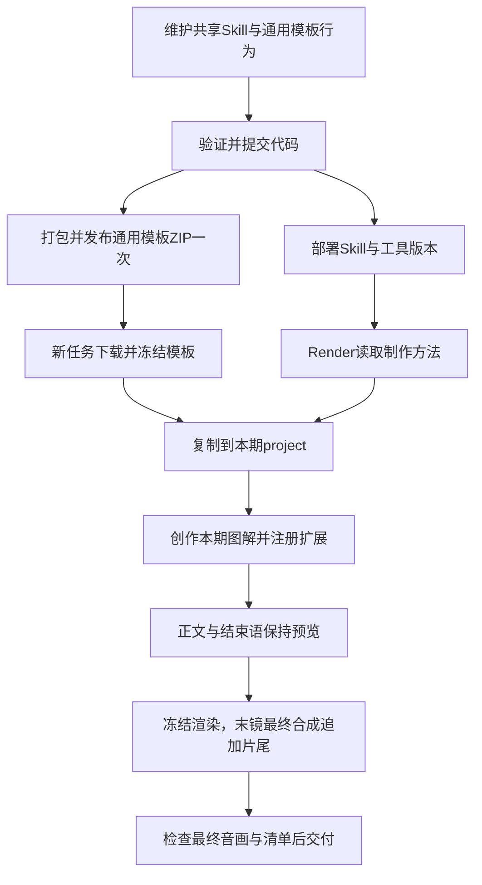

# Render 动效创作与片尾时序优化完整方案

> 后续正文动效优化以[《Render 制作指令优化开发记录》](Render制作指令优化开发记录.md)为准：本轮采用已确认的简化方案，明确制作需求、消除模板指令冲突并落实已有预览修订流程，已完成本地开发。中间讨论过的长方案已标记为被取代；本文保留上一轮实施记录及已确认的片尾方案。

> 状态：最终方案已获确认，对应代码、Skill及本地模板包已实施。更新日期：2026-10-08。具体修改、验证证据和发布边界见[开发与验证记录](Render动效与片尾优化开发验证记录.md)。
>
> 本文保留已确认的分析、设计与实施规格；其中“拟稿”是方案审阅时的文本，当前实际文件与测试结果以开发记录为准。代码已于2026-10-08推送并部署，新模板已上传网页；真实两阶段任务状态见[部署及网页验收记录](Render动效与片尾优化部署及网页验收记录.md)。
>
> 正文图解在每期任务工程内创作；共享模板保留栏目骨架。本文中的本期坐标和帧数用于解释已发生的问题，不作为后续视频的固定时间表，也不规定共享模板的构图或动作。

## 阅读顺序

- **片尾先读第17.1节**：用大白话说明“正文完成 → 保持正文最终画面说固定结束语 → 全部口播结束 → 追加完整片尾”。17.3～17.6说明记录、保持与追加步骤，17.7～17.8说明文件改法及交付，17.11～17.12说明测试发布。第10.11节是Skill完整替换文本。
- 第1～4节：实际发现、成因以及参考模板怎样实现图解。
- 第5～7节：外站具体参考、设计取舍和完整新链路。
- 第8～9节：时间分配与每次Render的任务产物。
- 第10节：全部拟新增、替换的 Skill 文本。
- 第11～13节：模板文档、代码、工具和发布链路具体改法。
- 第14～16节：验证、失败处理、实施顺序、代价和改动清单。

## 1. 目标和已经对齐的决策

### 1.1 要解决的问题

1. 实质讲解尚未结束，全屏片尾已经覆盖正文。
2. 正文大多是不同排列的文字卡，缺少能够解释数量、结构、关系和变化的图形。
3. 图解运动和口播重点没有充分对应：该出现时未出现，尚未讲到时已经完成。
4. Render 虽然能够生成可导出工程，但创作过程没有充分利用参考案例和任务内扩展能力。
5. 技术检查通过容易被误当作视觉质量通过；只有静帧，不能证明连续讲解过程合格。

### 1.2 保留什么

- Analysis → 用户确认文本 → Render 的两阶段业务流程。
- 确认后的 sceneId、完整口播、顺序和交付数量。
- 栏目人物、字体、配色、导航、字幕、品牌资产。
- 真实音频驱动的时间轴、完整声音、现有混音及交付检查。
- 模板下载、冻结、复制到任务工程的机制。
- 已有 visualExtensions 注册入口，不建设另一套插件系统。

### 1.3 改变什么

- 从“选组件、填文字”改为“理解关系、设计画面、编排运动、实现并修改”。
- 允许正文根据本期内容复用、组合或新增组件，不把新增当作最后才能采用的例外。
- 制作指南使用运动范围与适配规则；本次工程使用依据真实配音确定的具体帧数。
- 参考案例提供构图和运动方法，不限定行业、对象数量、组件类型和节目时长。
- 修正扩展组件重复入场；正文完成后保持完整最终画面播放固定结束语，声音和字幕继续，全部口播结束后在最终合成追加完整片尾。

### 1.4 不再采用的上一版提议

- 不新增固定能源、芯片、监管等有限行业图标菜单。
- 不把本期“五层模型、两地差异、市场份额”写成共享模板必须具有的固定表现。
- 不采用“五个字段写清即可”作为完整设计方法。
- 不新增 visual_review.py；它不能生成构图或判断画面美感。
- 不新增动画描述语言、通用动画排程器或新的视觉验收状态机。
- 首期不新增 frameRange 预览分支；先使用现有单分镜渲染。
- 片尾不再采用正文语义锚点、告别语重叠和resolve-ending编排；正文渲染中不播放片尾。
- 不把教学范围变成统一最短时长，不为了完成装饰动画延长口播或增加空等。

用户指定的 Onda、Jitter、RemotionLab、Mixkit 作为可用参考来源，查阅和借鉴不增加逐次确认流程。实际成片资源仍按当前工程的本地资源方式引用，避免渲染依赖临时网页状态。

## 2. 分析依据与实际发现

### 2.1 分析对象和证据范围

前面分析的任务为《黄仁勋：美国正在亲手葬送自己的国运》，相关标识：

| 项目 | 标识 |
| --- | --- |
| Worker任务 | 4eb1c648-dcc9-439b-a6a8-0668fbd0991b |
| Analysis run | 35371a1a-3e06-4615-ad45-3047c358fa4e |
| Render run | dcdca4eb-820e-43fa-8a3f-ed7ff73c3b33 |
| 网页任务 | 0c8e0a432c874064b5ae46c95cfcd74b |

任务工作区位于服务器的 /home/ops/jiangzb/video-worker-data/4eb1c648-dcc9-439b-a6a8-0668fbd0991b/workspace。此前核对了任务工程、音频时间轴、Render记录和已生成画面。本次整理文档主要复核本地源码，不将其表述为重新登录服务器完成了一次全片试听。

证据应分为三类：

- **已确认事实**：源码行为、实际文件差异、真实音频窗口、记录中执行过的操作。
- **原因判断**：根据事实重建为何生成了当前画面，属于有依据的推断。
- **待验证设计**：新的构图、运动和Skill如何改善效果，需要实施后通过样片验证。

参考视频原作者的内部思考过程不可见。本文说明的是从成片、源码与时间轴重建的制作方法，不声称获得了作者完整创作记录。

### 2.2 Render 实际没有充分创作本期图解

此前核对得到：

- 本期正文共14个视觉块，其中7个是quote。
- comparison、flow、layers等实际落入同一文字卡网格实现。
- 本期 visualExtensions 注册表为空，没有新图解组件。
- 除时间轴数据等适配外，正文视觉实现仍主要沿用冻结模板。
- direction 中主要是少量简短的目标和视觉描述，没有展开成足以指导复杂图解的构图、运动和状态说明。
- 任务已有46条短句配音及相应真实时间，说明并非完全没有可用的音频时间依据。
- 已核对的Render记录中，读取了参考说明和源码，但未找到实际查看参考视频关键帧或播放参考片的对应记录；主要检查了自身结果的静帧。
- 某次最终恢复审查记录明确 humanListeningPerformed 为 false，并说明基于缓存成片执行机械验证，未重新主观试听。

最后一点不能外推为所有正常生产任务都自动跳过审片，也不能据此断定存在某个尚未定位的统一“自动审批入口”。它说明这次的恢复检查不足以证明主观效果合格。

### 2.3 “应用层”为什么晚出现

第010镜为509帧，30fps。实际音频边界如下：

| 配音ID | 镜内帧区间 | 对应内容 |
| --- | --- | --- |
| u010a | 40～169 | 他用自己提出的AI五层蛋糕模型打比方 |
| u010b | 169～290 | 美国在能源、芯片、基础设施、模型 |
| u010c | 290～375 | 这四层全都遥遥领先 |
| u010d | 375～509 | 但在最关键的应用层已经被亚洲甩在了身后 |

旧图解从镜内第40帧开始，itemFrames为0、120、240、340、450。因此应用层到镜内第490帧才开始出现。

- 应用层口播从第375帧开始。
- 应用层画面从第490帧开始，晚了115帧，即约3.83秒。
- 从出现到镜头结束只有19帧。
- 再扣除约13帧入场，完整状态只剩约6帧，即0.2秒。

这不是“多加一些图标”能够解决的问题。触发点没有绑定讲解重点，最后一项的可读窗口也没有被检查。

### 2.4 “近90%到0”为什么与口播脱节

第012镜为329帧，实际口播边界为：

| 配音ID | 镜内帧区间 | 对应内容 |
| --- | --- | --- |
| u012a | 0～80 | 黄仁勋在采访中亲口承认 |
| u012b | 80～184 | 英伟达在中国AI芯片市场的份额已经 |
| u012c | 184～329 | 从巅峰时的近90%，直接跌到了0 |

旧trend配置在第26帧开始揭示，约28帧完成，即第54帧、1.8秒时就结束变化。而承载“近90%到0”的短句从第184帧、约6.13秒才开始。

当前图形本身也只是连接条填充及终点显现，未充分用同尺度几何变化表达份额下降。

已掌握的是句级时间，不能把第184帧冒充“0”这个字的发音点。改善方式是用真实句段驱动变化；需要更精细的落字点时，检查实际音频后调整，不能按字数比例猜测。

### 2.5 片尾为什么提前出现

此前分析的最后一镜为349帧，约11.63秒。片尾素材约67帧、2.23秒，从最后一镜开头播放，之后长时间保持Logo定帧，约9.4秒正文结论被片尾覆盖。

当前源码有明确对应：

- FinancialDialogue.tsx中只要scene.outro存在，立即进入片尾分支。
- types.ts的intro有fromFrame，outro没有fromFrame。
- 模板文档多处要求“最后一句／最后女声第一字开始片尾”。
- validateTimeline对含outro的镜头跳过一般正文覆盖检查。

因此，问题同时来自内容判断、文档规则和渲染能力。仅修改最后一镜的几个数字，不能可靠解决。

新方案采用严格顺序：正文解说和动效完成后，保持正文完整可读的最终画面，固定结束语的声音与字幕正常播放；全部口播结束后再追加完整片尾。第17节给出通用开发改法，不再让结束语与片尾并行。

此前调查记录中，末镜约从全片138.4秒开始，至约150.033秒结束；第7秒抽帧仍为纯Logo，字幕却在讲“就算美国有全世界最好的芯片和模型”。原本的结论图解被片尾分支覆盖，声音仍在继续。此处保留问题证据，不规定本期专属修复构图或播放方案。

原参考的最后两条音频功能不同：

| 原参考ID | 原文 | 实测时长 | 内容功能 |
| --- | --- | --- | --- |
| 15-closing-male | 财报不能只看当期利润，更要看投入是否指向未来回报。 | 4.824秒 | 实质正文结论 |
| 16-closing-female | 每期三分钟，拆解财报里的关键信号。 | 3.624秒 | 纯栏目收束 |

原源码通过startFor('16-closing-female')取得实际边界。这是历史实现事实；新方案只借鉴固定结束语有独立真实音频记录，不沿用“结束语开始就切片尾”。固定结束语说完以后才播放片尾。

核对来源：[参考音频时间轴](/Users/jiang/Documents/VideoCutEditor/claude-code-video-toolkit/examples/hello-world/public/audio/financial-dialogue-v3/timeline.json)、[参考片实现](/Users/jiang/Documents/VideoCutEditor/claude-code-video-toolkit/examples/hello-world/src/FinancialReportDialogueV3.tsx)。[本地片尾素材](/Users/jiang/Documents/VideoCutEditor/claude-code-video-toolkit/deliverables/财经双人对话视频生成指令/assets/video/outro/financial-intro-logo-sfx-v3.mov)经核对为30fps、67帧，音视频均为2.233333秒。这些是调查证据，不是其他素材的默认播放规格。

## 3. 原因分析：问题怎样沿链路形成

### 3.1 图解名称给了错误的完成信号

VisualBlocks.tsx将comparison、flow、layers、labels放入同一分支。它们主要区别在列数、编号、错位和文字，而不是不同的关系表达。

结果是：

```text
内容需要层级或流程
  → 选到了名为layers/flow的类型
  → 校验字段合法
  → 渲染出文字卡
  → 容易认为已完成图解
```

这些组件作为文字排版仍有价值，但不能被描述成已经提供了充分的结构、连接和传导动画。

### 3.2 模板文档引导“先选类型，再填数据”

当前《动效组件与内容适配说明》明确写着“先选下表动效类型，再填写数据”，并给出本期AI题材对应四种组件的例子。

这种引导限制了创作顺序：模型从现有菜单开始，而不是从观众需要理解的关系开始。把行业图标或更多固定组件加进菜单，仍可能重复相同问题。

### 3.3 已有扩展能力没有变成实际创作方法

visualExtensions已经支持真实React组件与validate注册。制作流程也允许任务副本新增。

缺少的是：

- 什么时候已有组件其实不适合；
- 怎样从口播关系画出对象和构图；
- 怎样把讲解编排成连续状态；
- 怎样把运动落实为路径、尺寸、坐标等计算；
- 怎样根据实际预览有方向地修改。

“允许新增组件”是权限和能力说明，不等于教会Render完成这些制作步骤。

### 3.4 技术Skill偏基础API和文字动画

现有remotion-best-practices包含timing、sequencing等基础规则，但text-animations主要是打字机和高亮；已有条形图示例没有得到清晰的入口路由。

其默认Studio预览与“静帧检查可跳过”的泛用说明，也容易与无人值守生产流程产生混淆。

需要补的是语义到视觉的设计方法，以及数据、SVG关系、布局重排和中文排印实现。不能只继续增加“要高级、要丰富”的要求。

### 3.5 时间合法不等于讲解节奏合理

motionFrames只把时长保护到available-1，不会自动产生等待。但当前内置duration使用整个block的剩余时长，没有考虑下一语义事件。

合法触发帧、合法总帧数，不代表：

- 重点出现在合适位置；
- 动作在下一重点前完成；
- 结果有可读停留；
- 画面没有在等待后续事件时提前清空。

也不应把所有动作的最短时长相加来决定镜头长度。

### 3.6 参考、预览与修订未形成闭环

仅阅读参考说明、看最终静帧，容易漏掉参考片真正有效的部分：图形怎样建立、对象怎样延续、信息怎样分阶段讲解。

机械检查可以证明帧数、声音和字段一致；它无法证明美感、叙事清晰度和运动是否恰当。新的方案需要让Render依据可见问题修改画面，而不是新增一份“证据齐全”报告。

### 3.7 不能据此归因的因素

目前没有充分证据把这次视觉质量归因于模型档位、账户预算或某次技术恢复本身。关键视觉选择已经体现在工程和时间轴中。

因此不把“换模型、加预算、加粒子”作为主要解决方案。

## 4. 参考视频模板怎样制作动效

参考实现：[FinancialReportDialogueV3.tsx](/Users/jiang/Documents/VideoCutEditor/claude-code-video-toolkit/examples/hello-world/src/FinancialReportDialogueV3.tsx)。

参考片：[financial-report-dialogue-v3-final-cut-preview.mp4](/Users/jiang/Documents/VideoCutEditor/claude-code-video-toolkit/deliverables/财经双人对话视频生成指令/assets/video/reference/financial-report-dialogue-v3-final-cut-preview.mp4)。

参考片约149.08秒。下面数字描述原作，不作为本期或未来视频默认参数。

### 4.1 它不是把整段旁白放进一个通用字卡

源码分别实现OpeningStage、ResearchStage、ConstructionStage、OperationsStage和Q3Stage。各段根据内容使用不同图形，复用的是栏目包装。

可以重建的创作逻辑为：

```text
确定章节要解释的问题
  → 选择有解释力的数值和关系
  → 为本章写一个组合场景
  → 按讲解阶段建立图形
  → 由统一栏目骨架承载
```

这正是应当迁移到Render的能力，而不是照抄原片财报数据。

### 4.2 开场：反差指标分批建立

OpeningStage的四个指标分别在本地0、45、90、135帧启动。每个卡片用短淡入和上移建立，形成阅读顺序。

借鉴重点是把反差组织成几次信息进入；不是未来所有开场都必须四张卡、每隔45帧出现。

### 4.3 研发段：数字与相反方向的线共同解释

ResearchStage上方建立三项指标，下方绘制红、青两条相反方向的路径。源码以strokeDashoffset驱动揭示。

图形负责让观众直观看到“营收下降、研发率上升”的方向关系；数字和文字解释具体依据。它的丰富度来自不同信息形式协作，不只是更多入场方式。

原作使用固定示意路径，不能把该路径当成新稿件的真实历史序列。迁移时应区分趋势示意和真实数据图。

### 4.4 在建工程段：从指标进入时间与供给关系

ConstructionStage先显示在建工程及同比指标，再用横向连接和年份组织“今天投入—未来供给”，最后补出现金流前提。

有效之处是从数值进入解释关系，再进入条件限制。每个阶段承担不同的讲解任务。

### 4.5 运营段：用指标、阈值条、环形构成分阶段阅读

OperationsStage先建立周转指标与解释，再出现Capex阈值条，随后出现存货占比环形。

应准确描述其实现：该段条形和环形的数值几何在原作中是固定的，主要通过分组透明度出现，并非所有数值图都进行了动态增长。

这说明高质量画面不要求所有元素持续运动。合理构图、真实图形和分阶段阅读本身就能提升效果。

### 4.6 Q3段：清单适合回顾，不必强行变图表

Q3Stage逐项建立验证点。这里文字清单适合“之后关注什么”的内容。

因此新方案不禁止文字卡，也不要求所有段落一定有图表；要按讲解关系选择。

### 4.7 栏目包装保持统一

人物的主次、头像大小、红青强调、深色面板、章节导航和背景构成稳定的栏目语言。正文图形可以变化，包装不必每期重写。

### 4.8 参考片本身也有同步局限

原作部分事件使用固定章节偏移，不能证明全部落字同步。此前核对运营段发现，Capex分组可能早于相应讲解约10秒出现。

因此学习它的图形表达、组合场景和分阶段组织；同步改用本期真实音频。不能把参考片所有固定延迟复制成通用规则。

## 5. 外站具体参考及迁移方法

外站已核对具体页面或公开源码。源码分析与实际观看视频分开表述；没有实际播放记录的案例不写成“已完整播放审片”。

| 案例 | 已核对内容 | 借鉴重点 | 本期适配 |
| --- | --- | --- | --- |
| [Onda Data Dashboard](https://github.com/degueba/onda/blob/main/www/src/showcase/data-dashboard/composition.tsx) | React组合场景源码 | 标题→总量→分项→目标，一阶段一个主要焦点 | 使用本期资料和口播窗口重排阶段 |
| [Onda Bar Chart](https://github.com/degueba/onda/blob/main/registry/components/bar-chart/README.md) | 组件说明 | 数值驱动条形长度，分项错开启动 | 共同尺度、零点、单位和本次时间 |
| [Onda Draw On](https://github.com/degueba/onda/blob/main/registry/components/draw-on/DrawOn.tsx) | SVG路径实现 | 路径逐步建立 | 用于轮廓、括号、连接和方向 |
| [RemotionLab 使用情境](https://remotionlab.com/showcase/yt-ai-use-cases) | 页面公开源码 | 同一对象从中心移到侧边，加入内容后重排 | 保持对象身份，按正文区域计算坐标 |
| [RemotionLab 节点网络](https://remotionlab.com/showcase/yt-ai-skill-network) | 页面公开源码 | 节点、连接、传导分开编排 | 按本期语义删减装饰，保留关系过程 |
| [Jitter Sliding Text Reveal](https://jitter.video/template/sliding-text-reveal/) | 具体模板页面 | 文字滑动揭示 | 以中文短语、整行遮罩重新实现 |
| [Mixkit Tagline Bold Text](https://mixkit.co/free-after-effects-templates/tagline-bold-text-546/) | 具体模板页面 | 文字框遮罩和标题包装 | 在Remotion中用裁切与位移实现 |

### 5.1 Onda：学习组合场景，不只拷贝一个组件

Data Dashboard将主数字、分项和目标分为不同阶段，数字之间保持一致。可借鉴“先总量、再解释、最后回到结果”的结构。

本项目不能只导入一个外站BarChart就认为制作完成，还要处理它在本期讲解中的位置、标签、前后衔接和停留。

Onda组件存在主题、布局及内部模块依赖。技术示例应提取核心方法并适配当前环境，不要求整套安装或把外站品牌样式搬入栏目。

### 5.2 RemotionLab：学习对象连续性

使用情境案例让同一个对象移动和重排，形成解释过程。节点网络案例分开绘制轮廓、节点和连接。

可迁移的方法是“保留对象、改变关系和重点”，不要求所有财经视频出现六边形、飞入图标和能量光波。

### 5.3 Jitter、Mixkit：学习动作表现

这些案例用于排印和包装参考，不把它们描述为现成可导入的Remotion源码。

实际实现可用固定文本布局、裁切容器、局部位移和强调区域完成。长旁白不逐字弹跳，完整字幕保持独立。

### 5.4 案例手册必须包含什么

每个条目应包含具体来源、对象与构图、动作顺序、实现方法、口播迁移方式和本期适配说明。不能只写“参考Onda图表、参考Jitter转场”。

第一批精选案例是起点；后续遇到不同关系可继续查找。它不是限制图解类型的固定菜单。

### 5.5 从具体案例迁移到本期的操作

**数据组合场景：**先标出本期“总量、分项、目标”的真实语义段；只采用稿件存在的阶段。先建立主值，随后可把主值缩小保留，展开共同尺度分项；最后保留结果，加入目标关系。阶段之间通过已有对象的移动或统一转场衔接，不复制原作秒数。

**路径建立：**先画好本期实际连接点和路径，再计算揭示进度。因果链从原因指向结果，分组括号覆盖当前解释的对象。箭头跟随可见端点，不能线尚未画到就固定显示终点箭头。当前环境没有外站依赖时使用原生SVG实现，不为单个动作引入整套库。

**对象重排：**先计算两组完整布局，保持相同对象身份，再连续插值位置和尺寸。标签、连接点随对象移动；当前内容弱化后仍保持可读。正文较矮时改用横向展开，不把全屏案例等比缩小后挤入面板。

**节点网络：**先区分对象存在、对象连接、连接激活三个状态。沿线标记必须对应真实传导、汇聚或分发内容。先显示弱轮廓可以帮助定位，但关键结论的强调不能提前。原作五个节点不是本期数量要求。

**中文排印：**先完成短语或整行的最终排版，固定容器尺寸，再在裁切区域内移动文字。位移随字号和行高调整，轻微错开服务阅读顺序。Jitter与Mixkit此处仅作为动作参考，不宣称已经获取或编译了它们的Remotion实现。

RemotionLab页面代码还需按当前工程整理、检查和编译；页面中可读的实现片段不等于可原样粘贴运行的已验证模块。

## 6. 旧方案、新方案和拟删除内容

| 项目 | 旧方案或容易形成的做法 | 新方案 | 删除或停止采用 |
| --- | --- | --- | --- |
| 创作起点 | 先选kind，再填文字 | 先理解关系、设计对象和构图 | “先选下表类型”指令 |
| 通用性 | 固定行业图标、固定四种升级 | 学习几何、连接、重排、排印方法 | 固定VisualIcon与本期硬映射提议 |
| 时间 | 教学帧数被当成节目时间表 | 范围指导，真实音频决定本次帧数 | 统一最短时长、机械排队 |
| 本期工程 | 每期内容回写模板再上传下载 | 在任务project创作并注册 | 每期发布正文组件的设想 |
| 审查 | 字段合法、静帧正常即完成 | 检查连续过程并有方向地修改 | 以技术通过代替设计完成 |
| 工具 | 新增证据检查和预览系统 | 复用现有单镜渲染与检查 | visual_review.py、首期frameRange扩展 |
| 片尾 | 最后scene开头切片尾，正文被覆盖 | 正文最终画面保持到固定结束语说完，再追加完整本地片尾 | 删除正文片尾覆盖、告别语重叠与resolve-ending；采用完整素材追加，不固定统一秒数 |

保留现有文字卡实现用于引文和简单清单，不为重构删除有用能力；停止把它们作为所有关系的默认答案。这里没有兼容旧错误语义的双轨设计，新文档使用同一套创作方法。

## 7. 完整新链路：每一步做什么

### 7.1 第一步：读取任务和真实模板

输入：完整原稿、确认文本、制作要求、冻结模板、可用资源、已有本任务资料。

Render检查模板清单、人物与字幕组件、正文区域、已有图解的真实实现，以及当前依赖。不能仅依据组件名称或说明表判断能力。

产出：内容与资源理解、需要复用的栏目部分、待创作的正文关系。此时不猜正式音频帧数。

### 7.2 第二步：查看参考并提取方法

先核对模板参考的关键阶段；按本期关系选择外站案例。

看的不是“颜色漂亮”几个词，而是：
对象如何建立、哪些部分保留、图形怎样变化、说明何时展开、重点怎样切换、如何转入下一阶段。

产出：可执行参考笔记，包含具体来源及本期借鉴内容。参考案例可以提供动作组织，不决定本期数据或时间。

### 7.3 第三步：组织整片视觉叙事

通读整稿，按逻辑章节安排：
哪里建立问题、哪里解释原因、哪里出现主要数据或关系、哪里强化结论、哪里降低信息密度收束。

direction保存整片安排。每章brief展开对象、构图、连续状态和动作。不是每句都做一次强强调，也不是每句都清空图解。

此时用语义触发点与建议范围。草案不需要伪造具体帧，也不以五项字段数量限制设计深度。

### 7.4 第四步：规划短句并生成或复用配音

新任务可在自然语义停顿处分短句，为关键视觉事件取得真实句段边界；拼接必须保持确认全文和顺序。

已有有效音频优先复用。不能为了图解方便，无条件重新收费或改写稿件。没有词级时间时，先使用真实句级边界，必要时检查实际片段后调整。

栏目已选固定结束语在配音准备时独立记录真实ID和音频窗口，仍属于原确认sceneId，不由Render临时猜测或添加。

产出：有效音频、真实长度、稳定utteranceId、字幕对应关系，以及固定结束语的明确记录。

### 7.5 第五步：把视觉意图落实到本次时间

先建立真实声音窗口，再把介绍、关系变化、数值变化和结论绑定到具体语句。

对每次动作确定：
起点、下一重点、完成点、完整状态保留区间、组件可见终点。将全局坐标统一计算后转换到章节或组件坐标。

时间不足简化动作，不补空等；后续语句仍解释同一图形时，允许稳定停留。

结尾单独遵循固定规则：正文动效在讲解结束时完成并留下可读状态；固定结束语期间保持这一正文画面，字幕和声音继续。最后再追加完整本地片尾。

产出：正式时间轴及组件本次参数。不是把Analysis估时或教学例子直接换算进来。

### 7.6 第六步：制作完整构图和关键状态

先画能读懂的完成状态，再检查开始状态和主要转折。

当前默认正文内部约1668×420，必须考虑标题、字幕、人物和导航。同屏信息过多时分阶段、重排或减少标签冗余，不无限缩小字体。

产出：完整状态、关键转折静帧，以及可以据此编码的具体布局说明。正文最终状态不能是退场中间帧或黑屏，需能承接固定结束语。

### 7.7 第七步：实现本期组件

在project/renderer/src/episode中实现实际TSX。按需要使用SVG、HTML、Canvas和当前可用资源。

通过visualExtensions注册component和validate。组件使用上层传入的局部frame，依据已计算的参数生成状态。数据图、关系图和排印可以组合，不被固定四类限制。

产出：可运行源码、注册、参数检查和当前时间轴。教学示例可参考或改写，不是生产必选组件。

### 7.8 第八步：渲染代表分镜并修改

优先选最能检验本期设计的代表分镜，通常一至两个，例如主要结构、数值变化或复杂重排。

使用现有stage_media.py render生成带真实声音的视频。检查构图、动作、读图停留和口播对应；静帧用于空间，连续片段用于过程。

发现问题必须具体修改：拥挤改布局，难理解改关系，像文字PPT改主图形，跳变改对象连续性，错时改触发及动作组合。

其他尚未验证的关键表现仍需检查，不能以一个简单样片代替全部章节。

### 7.9 第九步：合并、冻结和批量渲染

主Render统一栏目风格、章节衔接、重点密度和时间轴版本。存在章节创作时，先收敛已验收候选，再合并正式工程。

沿用现有freeze-batch、render-batch和总槽位管理。正式批次运行时不编辑冻结工程；修改后按现有指纹失效规则重新冻结，不伪装缓存仍有效。

末镜在现有render_scene的最终封装前追加完整本地片尾，输出已包含片尾的最后MP4和完整PCM。批量入口使用同一行为；assemble只拼接已经完成的分镜，不再追加一次片尾。

本方案不新增章节并行系统，也不改变当前配置；创作质量要求同时适用于串行和已有受控并行。

### 7.10 第十步：检查实际成片并交付

检查渲染、混音、字幕、跨镜头连续性、章节边界和片尾。带声音查看“正文最终状态 → 固定结束语期间视觉保持且字幕更新 → 口播结束后完整片尾”，核对最终MP4、PCM与清单一致。保留现有独立终检。

动态检查与主观试听按实际完成范围记录，不能把图片检查写成播放、把解码写成人耳试听。

只有完整候选通过现有交付入口才发布。预览资料不新增成片条目，不改变确认分镜数量。

## 8. 时间范围怎样落地，怎样避免空等待

### 8.1 三个层次

| 层次 | 使用什么 | 作用 |
| --- | --- | --- |
| 制作指南 | 秒数范围、语义规则 | 给Render可调整的制作起点 |
| 本次编排 | 真实音频和下一重点 | 决定这一条视频的具体安排 |
| 组件渲染 | 确定起点、完成点和局部frame | 每一帧可重复生成同样状态 |

范围不是下限。复杂动作可以合理超出，简单强调也可以更短。最终工程必须有确定数字，不能把“约一秒”留给渲染器临时猜测。

### 8.2 动作、停留和等待

- 动作：有意义的图形变化。
- 停留：口播正在解释当前图形，观众阅读完整状态。
- 等待：相关讲解开始了，但主体未建立；或者画面只剩无关内容。

不要求画面永远运动。信息已经建立、口播正在解释时，稳定图形通常更清楚。

### 8.3 分配方法

1. 找到当前语义触发点。
2. 找到下一视觉重点和图解实际可见区间结束，取最早截止。只有图解确实随镜头结束消失时，才将镜头结束作为截止；跨分镜的章节图解可以继续运动。
3. 根据对象复杂度选择参考范围内或合理超出的动作时长。
4. 检查完成状态是否有可读时间。
5. 不足时取消装饰、减少顺序步骤、合并动作或换成直接表达。
6. 仍解释同一结果时保留状态，不重复循环运动。

不要将“文字入场0.6秒＋节点0.7秒＋线1秒＋结论1秒”机械相加。如果它们可以同时建立，就不应排队。

### 8.4 简单数值示例

物流第二句有约2秒：可以用约0.7～1秒完成120到180的变化，剩余时间显示结果。第二句只有约0.6秒时，取消额外徽章和分步强调，使用一次更简洁变化；不能为了凑足1秒增加静音。

这只是适配方法，不把例子变成必选时长。

### 8.5 时间坐标

```text
全局帧 = scene.from + 镜内帧
章节帧 = 全局帧 - chapter.from
组件帧 = 所属镜头或章节帧 - block.startFrame
最后可见帧 = endFrameExclusive - 1
```

扩展已经收到组件局部frame，不能再次减block.startFrame。跨镜头章节组件不能因每条MP4独立导出重新从零播放。

motionFrames只作边界保护，不自动选择动作、构图、读图停留或语义窗口。

## 9. 每次Render实际保存什么

沿用现有目录，不新增外部协议：

| 位置 | 保存内容 | 不是用来做什么 |
| --- | --- | --- |
| direction.json | 整片目标、章节关系、风格，以及已选固定结束语ID和本地片尾 | 不只是四句“科技感、突出重点”，不做告别语语义分类 |
| chapters/.../brief.json | 对象、构图、连续状态、运动方式、口播锚点、本次时间 | 不以五个字段数量替代设计 |
| project/renderer/src/episode/ | 实际TSX及必要本期资源 | 不回写共享模板 |
| visualExtensions.tsx | 本期注册及参数检查 | 不只新增kind名称 |
| timeline.json | 实际声音、字幕、正文保持位置、全部口播结束位置和完整片尾长度 | 不使用Analysis估时，不在旧总长上重复加片尾 |
| previews/ | 静帧、局部检查资料与修订版本 | 不新增交付sceneId |
| 已有manifest与review | 含片尾的最终候选、完整PCM、实际保持与追加覆盖、真实检查范围 | 不把未追加占位或静帧检查当作最终播放效果 |

brief的可执行程度应达到：另一位实现者能够据此知道对象在哪里、怎样变化、为什么变化、何时变化。JSON可以使用现有自由内容字段表达，不另建强制Schema。

## 10. Skill完整拟稿

本节给出全部拟新增、替换的Skill文字。代码块是供审阅的文本，不代表这些Skill已经修改。未列出的现有内容保留。
### 10.1 video-pipeline/SKILL.md：入口新增段落

位置：/Users/jiang/Documents/VideoCutEditor/claude-code-video-toolkit/.agents/skills/video-pipeline/SKILL.md。

在render分支后增加以下完整段落；analysis的纯文本边界不变。

```md
## 正文图解制作

Render开始正文图解规划前，读取references/motion-design.md。
根据本期内容关系，从references/motion-reference-cases.md选择有用案例，
再按技术路由读取对应实现规则。

不能从现有组件名称反推本期画面，也不能把选择了图解类型视为完成设计。
栏目人物、字体、配色、字幕、导航和品牌资产继续复用。
正文对象、构图、数据图和运动根据本期内容创作：
现有组件能准确表达时直接复用；不能准确表达时，
在任务工程实现并注册本期组件。

规划阶段使用语义触发点和动作时长范围；
配音完成后根据本次真实音频确定数值帧。
参考案例的帧数、对象数量和布局不是后续视频固定要求。

先完成代表分镜的实际预览与修订，再批量导出。
检查字段合法、文件可解码和静帧正常，不能代替连续画面的制作判断。
```

### 10.2 production-flow.md：新增正文创作流程

位置：/Users/jiang/Documents/VideoCutEditor/claude-code-video-toolkit/.agents/skills/video-pipeline/references/production-flow.md。

在“输入检查与制作规划”之后新增：

```md
### 正文图解创作

正文创作按references/motion-design.md执行，并按需要读取具体参考案例。
先理解本段关系，确定对象与完整构图，再编排连续画面状态。
不能先选组件名称再把口播塞入组件。

配音前保存整体视觉安排和章节设计草案，
使用语义触发点与建议时间范围。
配音实测后补齐本次音频边界、视觉事件和动作时间，形成可执行版本。
不要为了制作草案提前猜测正式帧数。

direction.json记录整体视觉安排、章节衔接和跨分镜延续的图形。
章节brief写清视觉目标、对象、构图、连续状态、运动方式及口播对应关系。
说明应足以据此实现画面，不以固定字段数量替代设计。
已有文件可增补本次设计，不新增上游协议或动画解释器。

现有组件只有在实际表现适合本段时才使用。
需要新的几何图形、连接过程、布局重排或组合场景时，
直接在本期工程实现，通过visualExtensions注册组件及参数检查。
本期组件不回写共享模板，不要求上传模板后再下载。

先选择最能检验本期设计的代表分镜，通常一至两个，
使用现有单镜渲染入口生成带真实配音的候选视频。
检查构图、运动过程、重点切换和口播对应，修改后再批量渲染。
出现其他尚未验证的关键运动时，继续检查对应段落，
不能用一个简单样片代替全部关键设计。

动作时长范围不是镜头时长。不得按范围下限累加镜头，
不得为了完成装饰动作增加静音或延后口播。
时间不足先减少、合并或简化动作；
时间充足保留有解释价值的完成状态。

配音、声音覆盖或时间轴发生变化后，重新依据真实语句计算本期视觉事件，
同步更新扩展props与派生工程。工具对已知字段的平移，
不能证明自定义组件中的任意时间参数已经更新。

预览复用现有分镜渲染。较长分镜需要局部检查时，
可从已渲染视频提取区间，保存到本次previews目录。
局部预览不改变工程时间原点，也不作为新增交付分镜。
```

替换“主控编排与章节并行”的首段为：

```md
主Render保存render/<runId>/direction.json和chapters/<chapterId>/brief.json。
设计内容按motion-design.md编写；配音前可为草案，
配音实测后绑定directionVersion、确认稿摘要、有序分镜、
实际音频摘要及逐句帧窗口。

视觉事件引用实际utteranceId；每个动作根据下一语义事件和可见区间
确定自己的执行窗口，不以字数比例推算词级时间，
不把一个统一animationFrames用于所有动作。
创作并发与渲染槽独立管理。
```

保留现有配音、完整声音、字幕、混音、批量冻结、预算、取消、交付和恢复内容。已有“推荐值、非硬上限”的原意继续保留，不再另加相同门槛。

### 10.3 references/motion-design.md：新增全文

位置：/Users/jiang/Documents/VideoCutEditor/claude-code-video-toolkit/.agents/skills/video-pipeline/references/motion-design.md。

```md
# 正文图解创作方法

Render根据本期口播创作正文画面。
栏目人物、字体、配色、字幕、导航和品牌资产延续模板；
正文对象、构图和运动根据本期内容决定。

现有组件与参考案例提供方法，不构成固定菜单。
不要为了使用某个组件改变讲解重点，
也不要把几个不同名称的文字卡当作不同图解。

## 从含义确定画面

阅读完整段落，写出本段要表达的关系或变化：
数量变化、因果、组成、依赖、空间位置、先后顺序、
共同维度上的差异，或一种状态向另一种状态的转变。

不要把“提到了芯片”直接转换成“放芯片图标”。
先确定芯片与其他信息之间的关系，再决定需要什么图形。

每个主要视觉段落应有一句具体目标，
例如“让观众看见供给减少怎样影响交付和成本”。
不能只写“增加科技感”“突出重点”“丰富动效”。

## 决定对象和图形

列出完成目标所需的对象、标签、数据和连接关系。
文字负责命名和解释；数量、结构、方向、位置和变化尽量由图形表达。
可以使用SVG、HTML、Canvas和当前可用素材，不要求每段都有图标。

引文和简短观点可以用文字卡；
数值变化需要有依据的几何变化；
因果需要清楚的连接方向与传导；
层级需要表达上下、包含或依赖；
对比需要共用比较维度和尺度。

不能仅更换文字框排列方式，便宣称完成流程图或结构图。

## 先构图，再运动

读取当前模板真实正文区域、字幕区域和保留元素，
不直接套用参考案例全屏尺寸。

先制作可读的完整状态，确定主图、标签、连接、说明和结论的位置，
以及阅读方向、对象尺度、对齐和留白。

使用当前中文字体测量实际文字，检查换行和标签长度。
放不下时减少同屏信息、分阶段展开或重排已有对象，
不无限缩小字号。

运动中的位置和尺寸同样要检查。
对象展开、放大或移动后不能越过正文区域，
不能遮挡人物、字幕和导航。

## 连续状态与动作说明

沿着口播顺序安排画面变化。每一阶段写清：
哪个对象从什么状态开始，怎样变化，为什么变化，
完成后保留什么，下一阶段怎样接上。

优先保留已有对象，通过移动、缩放、连接、拆分、组合、
重排或重点变化形成连续讲解。
不要每说一句就清空画面、换一张文字卡。

数量变化由图形几何变化表达；
关系建立由连接过程表达；
整体解释由整体到局部展开；
对比结论由同尺度差异和重点切换表达；
新信息加入时，已有对象可连续移动到新位置。

透明度和位移可辅助入场，但不能成为全部图解的唯一变化。
粒子、发光和背景运动只能辅助重点，不能代替信息表达。

## 按真实口播安排时间

规划时使用语义触发点和动作时长范围。
配音完成后，依据真实utteranceId和音频窗口确定本次帧数。

只有句级边界时，就使用句级边界；
不能按字数推测某个词的准确发音时间。
已有有效音频优先复用；
新配音可按自然语义停顿拆短句，但不能改变确认稿。

每次动作的可用窗口，从相关口播触发点开始，
到下一视觉重点或图解实际可见区间结束之前截止，取最早者。
只有图解确实随镜头结束消失时，才以镜头结束为截止。
章节图解跨分镜导出时继续按章节时间执行，不因切成另一条MP4而截短。
不能把整个镜头剩余时间都交给一个入场动画。

可从以下秒数范围开始试做：
短语揭示约0.25～0.6秒；
节点建立约0.3～0.7秒；
连接绘制约0.4～1秒；
数值几何变化约0.5～1.5秒；
布局重排约0.4～0.9秒。

这些是初始参考，不是最低时长、固定时长或校验门槛。
根据移动距离、对象数量、信息密度和口播速度调整。
复杂结构可以分阶段展开，不强行塞进上述范围。

动作时间是图形建立或有意义变化的时间；
读图停留是完整状态保留、观众阅读或听解释的时间；
无意义等待是相关口播已经开始，主体尚未建立，
或者画面只剩无关内容的时间。

动作完成后，口播仍在解释当前图形，可以稳定保留画面。
不要为持续运动而循环缩放、反复涨落或添加无关粒子。
下一事件未到来时保留仍有解释价值的状态，不提前清空。

窗口变短时，先取消装饰、减少顺序步骤、
合并可同时执行的动作；仍不足时使用更直接的完成状态。
不要把复杂动画压成难以看清的闪动。

窗口变长时，补充稿件中确实存在的解释阶段或保留读图状态，
不把简单入场拉长到整个窗口。
不得为满足建议时长插入静音、推迟口播或增加无意义尾部。

## 数值变化示例

口播依次为：
“原来每小时处理120件。”
“调整后提高到180件。”

第一句显示长度对应120的条形，标签和单位清楚。
第二句开始后，条形与当前数值一起变到180，再保留结果。

第二句约2秒时，可用约0.7～1秒变化，余下展示结果。
第二句很短时，取消额外徽章和分步强调，仅保留一次简洁变化。
第二句很长时，继续展示正在解释的结果或展开后续解释，
不反复播放同一次增长。

时间来自本次音频，不要求类似视频使用相同秒数。

## 综合关系示例

口播依次解释供给减少、交付放缓、成本上升。

按从左到右安排三个对象，标签简短、连接方向明确。
讲供给时建立左侧对象并表达减少。
有可靠数字就按数值绘制，没有数字就使用定性表达，不编造比例。

讲交付时，从供给向交付绘制连接，并显示交付变化。
供给保留变化后的状态，不消失重建。

讲成本时，连接继续延伸到成本，显示有依据的结果。
前两部分降低亮度但保持可读，当前重点落在成本。
最后呈现完整链路，帮助观众回看关系。

第二句很短时，连接与交付变化可以同时执行，不必排队。
第三句较长时，保留结果并配合后续解释，不重复涨落。

本例展示连续讲解方法，不要求未来视频使用相同三个对象。

## 实现本期组件

在任务工程编写实际TSX，通过visualExtensions注册组件及参数检查。
组件接收本次已确定的触发点和动作时间，不自行猜口播。

所有状态由传入帧决定。
使用位置、尺寸、路径、角度、颜色和透明度计算画面，
不依赖浏览器实时动画。

统一时间坐标后再转换：
全局帧=scene.from+镜内帧；
章节帧=全局帧-chapter.from；
组件帧=所属镜头或章节帧-block.startFrame。

扩展收到的frame已是组件局部帧，不再次减block.startFrame。
跨分镜章节图解不在每条MP4中重新从零播放。

区间不包含终点，最后可见帧为endFrameExclusive-1。
零时长变化直接显示完成状态，不构造起止相同的插值区间。

## 预览和修改

先看完整状态与关键转折静帧，再检查带真实配音的代表分镜。

拥挤：改对象数量、布局、标签和阶段。
看不懂：改对象和关系，不只增加装饰。
像文字幻灯片：重做承担信息的主要图形。
跳变：保留同一对象，用连续位置和尺寸变化连接。
节奏不符：改触发点、动作组合和完成时间。
栏目不统一：改字体、配色、线条、背景和强调方式。

修改本期工程后复查受影响段落。
静帧正常不能证明运动正常，导出成功不能证明设计完成。
```

### 10.4 references/motion-reference-cases.md：新增全文

位置：/Users/jiang/Documents/VideoCutEditor/claude-code-video-toolkit/.agents/skills/video-pipeline/references/motion-reference-cases.md。

以下引用区块为完整拟稿；链接为具体来源。

> # 正文动效参考案例
>
> 按本期需要表达的关系选择案例，学习构图、对象连续性和运动组织，再适配栏目。案例原有帧数只说明原作实现，不作为当前任务时间表。
>
> ## 总量—分项—目标
>
> 来源：[Onda Data Dashboard源码](https://github.com/degueba/onda/blob/main/www/src/showcase/data-dashboard/composition.tsx)。
>
> 原作将标题、主数字、分项条形和目标分阶段呈现。借鉴一阶段一个主要焦点、从总量进入解释再回到结果的方法。根据本期语义段确定阶段，不照搬英文、数据、全屏尺寸或时间。稿件没有分项时不擅自补出分项。
>
> ## 数值改变图形
>
> 来源：[Onda Bar Chart说明](https://github.com/degueba/onda/blob/main/registry/components/bar-chart/README.md)。
>
> 借鉴共同尺度下的条形展开及分项进入。当前数值同时驱动数字与几何；零值保留标记。逐项讲才按语义错开，同时讲可同步变化。只有两个端点时不生成虚构历史曲线。
>
> ## 关系逐步建立
>
> 来源：[Onda Draw On源码](https://github.com/degueba/onda/blob/main/registry/components/draw-on/DrawOn.tsx)。
>
> 借鉴帧驱动的路径揭示，用于轮廓、括号、连接和方向。先确定真实路径与连接点，按口播组织建立过程。短句可以同步建立连接和结果，不统一套描边时长。
>
> ## 同一对象移动并展开解释
>
> 来源：[RemotionLab三大使用情境](https://remotionlab.com/showcase/yt-ai-use-cases)。
>
> 借鉴对象从中心移向侧边、加入新对象时重排已有内容的连续性。保持对象身份，标签和连接跟随移动。当前正文区域较矮时调整为横向展开，时间使用本次口播边界。
>
> ## 节点、关系与激活
>
> 来源：[RemotionLab技能节点网络](https://remotionlab.com/showcase/yt-ai-skill-network)。
>
> 借鉴把中心建立、分支建立、连接形成和沿线运动分开组织的方法。运动必须对应传导、分发或汇聚等内容。节点数量由本期决定，粒子和光波不作为必选效果。
>
> ## 中文标题和结论揭示
>
> 来源：[Jitter Sliding Text Reveal](https://jitter.video/template/sliding-text-reveal/)、[Mixkit Tagline Bold Text](https://mixkit.co/free-after-effects-templates/tagline-bold-text-546/)。
>
> 借鉴文字从遮罩后移动出现、文字框形成强调的方法。按中文短语或整行完成排版，再用帧驱动裁切内位移。完整字幕独立显示，不用长旁白逐字弹跳代替图解。
>
> ## 继续查阅其他案例
>
> 上述条目不构成固定菜单。当前关系需要其他表现时，可继续查阅指定外站。
>
> 每次写清具体来源、对象与构图、连续状态、要借鉴的动作及本期怎样改变。不能只写“参考Jitter风格”。
>
> 先理解完整案例，再使用局部技术。公开页面代码仍需按当前工程整理和编译验证；读到源码不等于已运行成功。

### 10.5 technical-routing.md：技术路由完整替换稿

位置：/Users/jiang/Documents/VideoCutEditor/claude-code-video-toolkit/.agents/skills/video-pipeline/references/technical-routing.md。

```md
# 技术路由

本地完整制作和Worker Render共用下列方法。
先确定当前需求，再读取对应资料，不默认加载全部参考。

| 需求 | 共用入口 | Worker适配 |
| --- | --- | --- |
| 正文构图与连续讲解 | video-pipeline/references/motion-design.md及motion-reference-cases.md | 根据本期内容创作，不以组件名称代替设计 |
| Remotion工程、时间与转场 | remotion-best-practices/SKILL.md，按需timing、sequencing、transitions、audio | 使用当前依赖，不启动Studio、不安装软件 |
| 数据图与数值变化 | remotion-best-practices/rules/data-animation.md | 使用本期数据、实际音频窗口和当前依赖 |
| 关系、结构与布局重排 | remotion-best-practices/rules/diagram-animation.md | 在任务工程实现，通过visualExtensions接入 |
| 中文标题与关键词强调 | remotion-best-practices/rules/text-animations.md、measuring-text.md | 使用当前中文字体，字幕独立 |
| 栏目人物与字幕骨架 | 冻结模板renderer及renderer-manifest.json | 复制到project后实际导入复用 |
| 探测、混音、解码 | ffmpeg/SKILL.md、FFprobe/FFmpeg | 通过原生命令工具，按实际时长制作 |
| 配音 | 共用制作流程的句级配音步骤 | 直接调用stage_tts.py |
| 渲染、抽帧、拼接 | tools/stage_media.py、tools/render_scene.cjs | 提供工程、Composition、Props和实测帧数 |
| 正文时间轴与格式派生 | 本任务实测编排；财经使用derive-timeline | derive只转换正式数据，不暗改时长 |
| 固定结束语与片尾 | 实测时间轴 → derive-timeline → render_scene末镜最终合成 | 正文最终画面保持到结束语说完，随后追加本地完整片尾；步骤见production-flow |
| 封装覆盖恢复 | extend-timeline → derive-timeline | 仅补画面覆盖，声音契约有效时使用fixedMix |
| 实际看图与过程检查 | 当前工程静帧、带音频分镜及成片抽帧 | 真实记录检查范围，静帧不冒充播放 |

当前工程的动画、数据、布局和时间问题在任务内修复。
共享工具或依赖错误按现有流程只读诊断，不能修改公共工具求通过。

财经字幕跟随真实句段音频；不按字数猜时间，不把逐词对齐当成默认前提。
新配音可按自然语义停顿拆短句，已有有效音频优先复用。
实际fps与时间坐标取当前任务，不套用教学示例帧数。

技术示例位于已允许读取的Skill目录。
未挂载公共lib或历史工程不属于可用依赖；
不能仅给Worker一个不可读的原始examples路径。

浏览器沿用当前环境REMOTION_BROWSER_EXECUTABLE配置。
模板清单允许的只读sentenceAudioValidator只用于句级检查，
不因此执行任意模板脚本。锁定依赖继续使用当前环境提供的版本。

检查工具不替代构图、运动与声音判断，不证明人工全片听看已经完成。
导出继续通过stage_media.py，不启用另一条默认业务入口。
```

### 10.6 remotion-best-practices/SKILL.md：三个替换和新增位置

位置：/Users/jiang/Documents/VideoCutEditor/claude-code-video-toolkit/.agents/skills/remotion-best-practices/SKILL.md。

将“Designing a video”开头的基础动画说明至CSS/Tailwind动画限制，替换为下段；后续资源目录和媒体组件用法保留：

```md
## 设计与实现动画

先确定画面要表达的关系及完整状态构图，再决定运动属性。
淡入、位移和缩放只是基础手段，不能代替数据、结构或关系表达。

数据变化读取rules/data-animation.md。
连接、结构展开、对象移动和布局重排读取rules/diagram-animation.md。
中文标题、短语揭示和关键词强调读取rules/text-animations.md。
按需继续读取timing、sequencing、transitions和measuring-text。

所有动画由当前帧确定，使用interpolate、spring或其他确定性计算。
组件由上层传入局部frame时，直接使用该frame，
不能再次减去组件起点，也不能混用全局和局部帧。

动作时间由当前任务实际窗口确定。
数值几何变化使用不会越过真实端点的进度；
装饰性弹簧不能导致图表短暂显示错误数值。

不使用CSS animation、CSS transition或依赖实时钟的动画。
资源目录和引用继续遵循当前工程约定。
```

将“Starting preview”和“Optional: one-frame render check”两节完整替换为：

```md
## 预览与修订

无人值守video-pipeline使用现有入口生成静帧和带音频分镜，
不启动Remotion Studio，不安装额外软件。

静帧检查构图、字体、完整状态和关键转折；
带音频分镜检查连续运动、口播对应和读图时间。
静帧不能证明动作合格，音频测量不能证明实际试听。

先验证本次关键设计，再批量渲染。
发现拥挤、跳变、重复入场或重点错位时，修改当前组件和编排，
重新检查受影响区间。

普通本地交互式Remotion项目可按其环境使用Studio；
不把该方式作为无人值守生产链的前提。
```

在文字动画、timing、transitions路由附近新增：

```md
## 数据与关系图解

数值变化和图表几何读取rules/data-animation.md。
节点连接、结构展开与布局重排读取rules/diagram-animation.md。
可运行示例见rules/assets/narrative-motion-examples.tsx。

示例展示实现方法，不固定行业、对象数量、节目时长或组件选择。
先看当前任务要表达的关系，再选择有用的技术。
```

### 10.7 rules/data-animation.md：新增全文

位置：/Users/jiang/Documents/VideoCutEditor/claude-code-video-toolkit/.agents/skills/remotion-best-practices/rules/data-animation.md。

```md
# 数据动画

先确定数值含义、单位、尺度和比较关系，再选择图形。
数据决定几何形状，动作进度只决定怎样从起点到达终点。

## 数值与几何

条形图先定义共同范围与零点，再把数值映射为长度。
同一比较的对象不能各自使用不同尺度。
占比使用固定整体尺度；零值保留标签或端点。

数字和几何使用同一进度，单位、精度和标签保持稳定。
避免数字位数变化导致整幅图跳动。

一般变化可以写成：
currentValue=fromValue+(toValue-fromValue)*progress。
再由currentValue计算长度、位置、面积或角度。
不能只更换终点数字而让图形不变。

## 前后变化与序列

只有前后两个值时，展示端点、同尺度条形或位置变化，
可保留弱化前值轮廓帮助比较。
不生成没有依据的中间年份、走势点或历史折线。

有真实序列时，按真实顺序和间距绘制。
路径揭示只显示已有数据，不生成新数据。

## 运动

组件接收本次起点与完成点。
起点前进度为0，完成后为1，在可见区间内达到完成状态。
起点与完成点相同的即时变化直接返回最终状态。

数值图形通常使用单调进度，不使用越过端点的弹簧。
多项启动顺序服从口播，不默认固定间隔轮流出现。

讲总量时突出总量；讲分项时展开分项；
讲差异时在共同尺度上突出差异。
不要求一开始显示所有图表。

## 完成状态与检查

变化结束后保留数值、单位、端点和必要说明。
后续仍解释当前结果时稳定展示；
出现新比较时再补充对象、切换重点或改变布局，
不反复播放同一次增长。

检查数值、来源、共同尺度、零值、标签、
数字与几何同步，以及是否越过真实端点。
检查带配音过程，确认结果不会刚出现就切走。

完整示例见assets/narrative-motion-examples.tsx中的数据变化示例。
示例是方法，不是所有视频固定使用的图表。
```

### 10.8 rules/diagram-animation.md：新增全文

位置：/Users/jiang/Documents/VideoCutEditor/claude-code-video-toolkit/.agents/skills/remotion-best-practices/rules/diagram-animation.md。

```md
# 关系图解与布局动画

先确定对象身份与关系，再确定坐标、形状和连接。
图标可以辅助识别，但图标集合不能代替结构设计。

## 节点与连接

每个对象具有稳定身份、位置、标签和连接点。
线从边缘或指定连接点出发，不从文字中间穿过。

可用SVG的pathLength、strokeDasharray、strokeDashoffset绘制路径。
进度从0到1时，路径从不可见到完整显示。
箭头或移动标记跟随当前绘制端点，不提前固定在终点。

因果有方向，包含有边界，依赖有上下游，分支有共同来源。
无方向关系不强行添加箭头。

先建立节点还是连接，依据口播决定。
短窗口可以同步建立，不要求所有动作排队。

## 结构展开

先呈现能定位整体的轮廓，再展开当前解释部分。
已解释内容保留并弱化，当前内容获得清楚重点。

层级可通过上下、包含、连接或整体拆分表达，
不默认等同于若干错位文字框。
对象数量由本期内容决定，不限定层数或行业。

## 对象保持与重排

同一对象从一种布局进入另一种布局时，保持稳定身份。
位置、尺寸和透明度从旧状态连续变到新状态，
不要删旧建新制造跳变。

标签和连接点跟随对象更新。
先计算两个完整布局，再在起止坐标间插值。
检查中间状态，避免交叉遮挡和文字挤压。

重排只有在帮助衔接、腾出空间或建立比较时使用，
不要求每段重复同一种移动。

## 运动时间与实现

组件接收本次已确定的时间，不自行均分镜头。
根据下一视觉事件与当前可见区间安排完成点。

窗口不足时减少层级步骤、合并连接与节点建立，
或直接展示清楚结构，不压成快速闪动。

所有状态由组件局部frame计算。
核对上层是否已施加入场，避免重复淡入和位移。
跨镜头图形使用章节时间，不在每句重新播放。

## 检查

检查完整结构、关键转折、中间状态和带配音实际片段。
关系不清先改对象与连接，拥挤先改布局，
不只增加发光、粒子或旋转。

完整示例见assets/narrative-motion-examples.tsx中的
关系建立和布局重排示例；示例不是固定组件菜单。
```

### 10.9 rules/text-animations.md：替换正文全文

位置：/Users/jiang/Documents/VideoCutEditor/claude-code-video-toolkit/.agents/skills/remotion-best-practices/rules/text-animations.md。

保留已有元信息，正文替换如下：

```md
# 中文排印与文字动画

先按实际字体完成静态排版，再制作运动。
标题、图形标签、结论与完整字幕承担不同职责，不能互相替代。

## 分组与阅读顺序

中文标题优先按语义短语或整行分组。
不把长句拆成逐字弹跳，不默认对全部正文使用打字机。

先确定行宽、行高、换行和对齐。
字号不因动画反复抖动。
文字较长时调整展示文字、换行或阶段，不无限缩小字号。
图解文字可提炼，确认口播及完整字幕不能因此删改。

## 遮罩揭示

将短语或整行放在固定排版容器，
通过容器裁切与内部位移实现揭示。

文字从略低于最终位置移动到最终位置，
可配少量透明度变化。
位移由字号和构图决定，时间取本次口播窗口。

多组可轻微错开，阅读顺序必须清楚。
不能为等待逐组出现而推迟已经开始讲解的信息。

## 关键词强调

可用背景展开、下划线绘制、颜色或局部重点变化。
强调范围按实际文字尺寸计算，不用固定宽度猜测。

动作绑定相关口播，完成后保持可读，
不持续闪烁或循环放大，避免多个重点互相竞争。

## 打字机

适用于输入过程、引用或需要逐步出现的短文本。
实现打字机时可以用字符串切片。
该方法只针对打字机，不限制遮罩揭示、短语错开等其他动画。

原有打字机和高亮示例可参考，
不照搬英文、字体、颜色和时间。

## 字体与检查

使用当前可用字体，按measuring-text规则测量。
检查完整状态、中间状态、对比、揭示边缘裁字和可读时间。
字幕按模板与真实音频边界独立显示。
```

### 10.10 可运行教学源码的交付内容

拟新增文件：

/Users/jiang/Documents/VideoCutEditor/claude-code-video-toolkit/.agents/skills/remotion-best-practices/rules/assets/narrative-motion-examples.tsx。

这不是新增Skill文本，而是让上述指导具备可查看、可编译、可渲染的代码例子。文件包含三个教学组件：

| 示例 | 输入 | 实现 | 必须展示 |
| --- | --- | --- | --- |
| 数据变化 | 起止值、范围、单位、尺寸、触发和完成点 | 共同尺度、当前值驱动几何、端点保留 | 数字与长度同步，零值仍可读 |
| 关系建立 | 节点、坐标、路径、当前重点、事件时间 | 节点保持、路径揭示、方向和重点切换 | 连接过程与结果有先后关系 |
| 布局重排 | 对象、两组布局、触发和完成点 | 相同key、坐标尺寸插值、标签跟随 | 同一对象连续移动，不删建跳变 |

示例只使用当前可用React、Remotion与原生SVG/HTML，不默认安装Onda整套依赖，不引用外站运行时服务。字号、颜色、尺寸和事件时间可传入，不固化当前AI题材。

开发时补充能够直接渲染示例的Composition或开发测试入口；不得只提交没有调用方式的片段。使用短、长两个窗口验证适配，示例中的教学数据明确标识，不假称本期事实。生产Render可以参考、改写或组合方法，不要求每期导入这三个组件。

### 10.11 固定结束语与片尾的Skill完整替换稿

以下全文替换此前片尾专项拟稿；不保留正文语义锚点、告别语重叠或resolve-ending要求。第17节说明对应开发行为；该决策已写入实际Skill。

#### A. production-flow.md：配音准备段插入

位置：任务内TTS清单格式之后、stage_tts.py调用之前。

```md
### 正文、栏目固定结束语与片尾

制作顺序固定为：
正文解说和动效完成 → 保持正文最终画面并播放固定结束语
→ 全部口播结束 → 完整播放本地片尾。

固定结束语使用当前栏目已选文本，并进入确认稿和配音清单。
Render不根据最后一句、说话人或关键词推断结束语，
也不自行添加、改写或重复确认口播。

准备配音时，将固定结束语按自然停顿独立记录，
保留稳定utteranceId；其ID保存到direction.ending.closingUtteranceIds。
所有短句按顺序拼合仍须等于各镜确认文本，sceneId与N镜不变。
结束语跨确认分镜时，各句仍归原sceneId。

同时记录direction.ending.outro.src和muted。
src使用工程public/template-assets内本地片尾的相对路径。
保留所选片尾的原声音效；明确要求静音时才使用muted。
本期素材副本无需重新上传共享模板。

已有有效配音优先复用；不按字数估计正文和结束语分界。
缺少可靠分界的历史音频先检查现有句级记录或实际音频，
不能伪造时间或仅为定帧默认重新收费配音。

用户明确不用固定结束语或片尾时执行其要求。
不使用结束语时省去保持阶段，剩余口播完整结束后再接已选片尾。
```

#### B. production-flow.md：实测时间轴与正文制作段插入

位置：真实配音窗口建立之后、derive-timeline之前。

```md
### 建立结束语保持区间

使用当前真实配音样本建立utterances和captions。
固定结束语ID必须是确认稿末尾连续的栏目语，
正文结束时间来自它之前最后一条正文音频的实际结束位置。

正式timeline.ending记录：
closingUtteranceIds：固定结束语真实ID；
holdFrame：正文结束前最后一帧的全局坐标；
narrationEndFrame：全部口播实际结束的全局右开边界；
outro：启用片尾时记录本地src、标准化后实测frames及muted；
用户仅禁用片尾时省去outro，仍保留结束语的保持记录。

正文动效应在holdFrame形成完整可读的最终状态。
不得在该处淡黑、清空、退出一半或还没显示完主要结论。
从正文结束到固定结束语说完，保持这一正文视觉状态；
字幕和声音继续按原时间播放。
结束语另占确认分镜时，也引用前面正文的最终状态，
不能冻结结束语镜头自己的空画面。

本地片尾先按输出规格整理并实测完整音画长度。
最终总帧数 = 全部口播结束帧 + 完整片尾帧数。
未启用片尾时，片尾帧数按0处理，不执行追加。
末镜长度据此更新；不在旧整片长度上重复累加。
字幕只覆盖真实口播，不延伸到片尾。

保存正式timeline后调用既有derive-timeline生成TS和各镜props。
derive只做格式转换，不自动决定片长。
不调用resolve-ending，也不设计片尾和结束语的重叠区间。
```

将原“工具不重新决定总时长”一段统一替换为：

```md
正文及固定结束语按真实音频编排，片尾在全部口播之后完整追加。
正式时间轴预先计入实测片尾长度，派生仍只转换格式。
stage_media的最终合成执行该顺序，不反向覆盖或缩短正文。
既有extend-timeline只处理必要封装覆盖，
补帧后重新核对受影响的全局坐标、派生与冻结版本。
```

旧resolve-timeline禁令继续保留，不为本方案新增另一个片尾编排命令。

#### C. production-flow.md：渲染、候选和交付段插入

```md
### 渲染并检查最终结尾

正文模板只渲染正文与结束语保持画面，不自行播放片尾。
字幕层与Audio在保持范围外，结束语期间仍正常更新和播放。

通过现有stage_media.py render或正式render-batch导出。
共享render_scene在末镜mux前，将本地完整片尾接在全部口播后，
并登记包含片尾原声的最终PCM。
只在共享工具实现并部署后使用该行为，不能仅写文档声称已追加。

片尾仍并入最后确认sceneId，不增加交付MP4。
assemble使用各镜已完成的MP4与PCM，不再追加第二遍。
缓存或fixedMix恢复时也只能有一次片尾画面和一次片尾原声。
声音合同变化按既有要求重建混音，未变配音继续复用。

带声音检查最后正文、固定结束语和完整片尾：
正文结论与动作已经完成；
结束语时正文最终画面可读，字幕变化，声音继续；
全部口播结束后，片尾才从头播放；
片尾完整，原声未截断，正文字幕不挂在片尾上。

发现正文末态为空或退出一半，修正文动作；
发现声音或字幕停止，修保持层级；
发现提前Logo或重复片尾，修正文覆盖与最终合成路径。

manifest记录实际最终结果：
resolvedVisualBlocks连续覆盖正文、保持画面与片尾，
只使用既有id、startFrame、endFrameExclusive字段；
captions保留真实边界；
audio指向含片尾原声的最终完整PCM；
usedResources登记本地片尾与摘要。
正式时间轴、冻结版本、最后MP4及wholeVideo保持一致。
真实检查范围写入现有review，不把静帧检查冒充播放或试听。
```

#### D. motion-design.md：片尾段全文替换

```md
## 正文最终状态、固定结束语与片尾

最后的实质结论仍属于正文，继续完成相应图解。
在正文实际结束位置留下完整可读的最终状态；
不提前清图、退场、淡黑或切Logo。

固定结束语期间保持这个正文视觉状态。
无需为了结束语另做图解，也不重复正文动效。
保持的范围不包含字幕和声音：结束语字幕正常更新，
固定结束语配音正常播放。

结束语来自栏目已选文本，时间取其实际音频记录，
不是按最后一句、角色或关键词推断。
全部口播结束后，由共享合成工具追加完整本地片尾；
片尾与结束语不重叠，不提前覆盖正文。

检查从最后正文到最终结束的带声音过程。
重点看正文最后状态是否完整、保持阶段字幕声音是否继续，
以及片尾是否在口播后从头完整播放一次。
```

#### E. technical-routing.md：时间轴及合成路由补充

```md
固定结束语与片尾按production-flow执行。
先建立真实口播时间轴和正文保持位置，计入完整本地片尾长度，
再derive-timeline、预览、冻结与渲染。
stage_media.py::render_scene在末镜mux前完成片尾追加，
返回最终MP4和完整PCM；assemble继续按原顺序合片。
不新增resolve-ending，不在正文scene.outro中播放片尾。
```

模板两份说明使用第11节相同规则；实施时搜索并删除所有相反的旧片尾指令。

## 11. 模板文档的具体替换文本

只更新Skill不够。模板仍保留旧引导时，Render可能再次按旧菜单生成文字卡。本节给出实际要删除和替换的内容。

### 11.1 《动效组件与内容适配说明.md》

文件位置：

/Users/jiang/Documents/VideoCutEditor/claude-code-video-toolkit/deliverables/财经双人对话视频生成指令/动效组件与内容适配说明.md。

#### 替换开头的创作边界

删除“不是让模型重新设计一套动画的提示词”，替换为：

```md
本模板提供栏目视觉骨架和可用基础实现。
正文图解由Render根据本期内容创作，可以复用、组合或在任务副本新增。
人物、字体、配色、头像比例、字幕和导航继续保持栏目一致性。
本期正文图解不回写共享模板。
```

#### 替换“两阶段与时间坐标”第4项

```md
4. 先确定本段要表达的关系、画面对象、完整构图和连续状态，
再判断已有组件是否适合。组件名称不能替代图解设计。
触发点和动作时间在配音实测后确定。
需要更细同步时检查实际片段；新配音可提前合理拆短句，
已有有效音频优先复用，不按字数推测时间。
```

保留全局、镜内、章节、组件时间坐标说明。特别保留scene.visualBlocks替换章节图解、而非叠加的事实。

#### 替换禁止移动的表述

将“先预留区域再逐项出现，不能让已显示内容跳位置”替换为：

```md
先安排可读的完整布局，再制作连续变化。
已有对象可以根据讲解需要重排，但应通过连续位置和尺寸变化完成。
不能因新增内容导致无解释跳变，也不能每切一句就清空章节图形。
```

#### 改写“动效组件配方”的用途

原表中的真实参数字段保留，表头改为“已有基础实现及适用范围”，增加：

```md
下表描述当前已有实现，不是本期创作菜单或能力上限。
comparison、flow、layers、labels主要提供文字卡片的不同排列。
只有文字卡适合本段表达时才使用；
需要真实连接、结构、数值几何或布局变化时，使用本期扩展。

metric用于指标卡；quote用于简短引文和观点；
line用于有依据的真实序列；gauge、ring用于具有明确数值含义的图形。
trend当前实现为端点与连接条，不能自动等同同尺度份额变化。
是否复用要看实际表现，不仅看类型名称。
```

删除“没有数字的观点稿使用comparison、flow、layers、labels或quote”以及本期AI内容与四类组件的硬映射例子，替换为：

```md
没有数字不等于只能使用文字卡。
根据内容可制作结构、因果、空间、路径、分支、状态变化或对象重排。
不能为了丰富画面编造百分比、阈值、历史序列或其他事实。
有数据也不强制所有段落使用图表，应选择能解释本段关系的表现。
```

#### 统一默认时长说明

保留参数API，不把13、28、45等默认帧数描述成节目要求：

```md
内置默认帧数是当前实现的起始值，不是节目时间表。
Render按本次实际fps、音频边界和下一视觉事件确定执行时间。
不同动作可以使用不同时间，不要求共享一个animationFrames。

短窗口先简化动作；长窗口保留有解释价值的状态。
边界截断只能防越界，不能代替节奏设计与实际预览。
已注册扩展自行控制入场；外层负责定位，不重复施加统一位移和淡入。
```

#### 片尾、验收与发布

```md
正文解说与动效完成后，保持完整可读的正文最终画面。
模板固定结束语在这张画面上正常播放，字幕同步更新。
全部口播结束后，再追加完整本地片尾视频及其自带音效。

固定结束语来自栏目已选配置，在确认稿和配音清单中独立记录。
保持时间由实际结束语音频决定，不额外加固定停留秒数。
保持只作用于正文视觉层，字幕和声音继续走。

正文模板不播放片尾，不使用scene.outro覆盖正文。
现有stage_media在最后MP4最终封装前追加片尾；
最后MP4、完整PCM、wholeVideo和manifest使用同一最终长度，
不新增交付sceneId，也不由assemble重复追加。

共享行为修复发布一次新模板包。
本期图解和素材副本保存在任务工程，
不要求每期改共享源码再上传下载；旧冻结快照不自动变化。
```

### 11.2 《财经双人对话视频生成指令.md》

文件位置：

/Users/jiang/Documents/VideoCutEditor/claude-code-video-toolkit/deliverables/财经双人对话视频生成指令/财经双人对话视频生成指令.md。

#### 替换正文制作引导

步骤B及“章节与数据出现顺序”中关于“优先复用既有动效、选择组件填写数据、固定动效实现”的引导，统一替换为以下原文：

```md
复用栏目人物、字体、配色、字幕、导航和品牌资产。
正文按当前口播关系设计构图与连续运动：
已有组件适合时直接使用，不足时在本期工程实现新组件并注册参数检查。

先完成代表分镜的实际预览与修订，再批量导出。
不能仅以组件名称、静帧正常或技术校验通过判定动效完成。
参考片中的图形与组织方法可以借鉴，历史数据、固定时间和正文不照搬。
```

#### 替换全部机械片尾规则

检查“成片观感”“步骤B”“镜头语法表”“声音说明”“制作顺序”“片尾用途”和“检查清单”。删除“末句第一字切片尾”“结束语期间播放片尾”“女声结束同帧结束视频”等相反要求，统一替换为：

```md
正文解说和动效必须完整完成，最终画面保持完整可读。
固定结束语使用栏目已选文本，声音和字幕继续播放；
其间保持正文视觉，不增加新图解、不冻结字幕或声音。
结束语说完，才从头播放完整本地片尾。

固定结束语的配音ID与实测边界保存到当前任务时间轴。
正文完成状态保留到该语音结束，不在退场或黑屏上定帧。
不根据说话人、最后一句或关键词推断播放片尾的时机。

正文渲染不播放片尾，删除旧scene.outro覆盖路径。
最终合成在全部口播之后追加完整片尾画面和自带音效，
片尾从素材开头正常播放，字幕不延伸到片尾。
片尾仍归最后确认sceneId，不改变确认文本和N个交付MP4。
整片合成使用已含片尾的最后MP4，不再次追加。

渲染前计入完整片尾的实测长度，再派生与冻结。
带声音检查正文最终状态、结束语保持和完整片尾，
核对正式时间轴、最终PCM、视频与清单一致。
```

整片顺序统一为：

```text
开场钩子 → 栏目片头 → 正文及实质结论完成
→ 保持正文最终画面，播放固定结束语并更新字幕
→ 全部口播结束 → 完整本地片尾视频及自带音效
```

实施时搜索模板、清单和制作指南全部片尾要求，删除相反旧指令。用户明确指定其他结束方式时优先执行用户要求。

## 12. 代码落点和行为设计

### 12.1 VisualBlocks.tsx：入场职责

文件：

/Users/jiang/Documents/VideoCutEditor/claude-code-video-toolkit/deliverables/财经双人对话视频生成指令/renderer/src/VisualBlocks.tsx。

当前：扩展收到local帧自行绘制，外层又应用entry透明度和上移。

拟改：
- 已注册扩展：外层只负责slot、定位、宽度及布局检查标记；扩展自行控制入场和后续运动。
- 内置组件：保留原有入场实现。
- 扩展参数仍由对应validate检查，不能取消校验。
- 不为此新增复杂entry配置系统；双方职责直接明确。

必须验证扩展只入场一次；本期SVG坐标和标记仍被LayoutGuard正确识别。内置quote、metric等不得意外失去原入场。

### 12.2 types.ts：固定结束语、保持帧和独立片尾

文件：

/Users/jiang/Documents/VideoCutEditor/claude-code-video-toolkit/deliverables/财经双人对话视频生成指令/renderer/src/types.ts。

新增timeline.ending，记录固定结束语的实际配音ID、正文保持帧、全部口播结束帧，以及本地片尾src、完整实测frames和muted。完整拟稿见第17.3节。

新模板不再使用正文scene.outro；删除该旧输入及其示例，不给它增加fromFrame。片尾位置就是全部口播结束位置，不需要重叠编排。旧冻结任务继续使用自己的模板版本。

### 12.3 FinancialDialogue.tsx：正文视觉保持，字幕声音继续

文件：

/Users/jiang/Documents/VideoCutEditor/claude-code-video-toolkit/deliverables/财经双人对话视频生成指令/renderer/src/FinancialDialogue.tsx。

将现有视觉拆成不含字幕音频的正文层和独立SubtitleLayer。结束语阶段，正文层重用holdFrame所属分镜的完成状态，显式frame参数和内部useCurrentFrame一起保持；字幕仍使用当前帧，SceneAudio正常播放。

删除scene.outro直接返回片尾的分支。片尾由stage_media最终合成追加。末镜正式长度中的片尾区间先输出静态无声占位，发布前替换，不把占位当作正式片尾。跨分镜保持及实现细节见第17.5节。

### 12.4 validateTimeline.ts：分别检查正文、保持和片尾

文件：

/Users/jiang/Documents/VideoCutEditor/claude-code-video-toolkit/deliverables/财经双人对话视频生成指令/renderer/src/validateTimeline.ts。

拟改：

1. 删除“有outro就免查正文”和“片尾镜首条配音必须从0开始”的旧约束。
2. 固定结束语ID必须对应真实末尾连续口播，不能把正文夹在结束语之后。
3. holdFrame须来自固定结束语之前的正文，且存在可渲染的章节和图解。
4. 正常正文区间继续完整覆盖；结束语保持区间必须引用有效正文完成状态。
5. 所有配音和字幕继续检查真实边界；保持不豁免字幕声音完整性。
6. 最后交付镜头和整片计入完整本地片尾，正文渲染中不得出现scene.outro。
7. 素材实测、最终追加与完整PCM由共享工具和可信终检复核，详见第17.6～17.8节。

程序检查来源和边界；最终正文画面是否完整可读仍需实际预览。

### 12.5 motion.ts与本期时间参数

motionFrames继续作边界保护，不新增通用排程器。

本期时间轴构建时确定每个动作的语义窗口；扩展通过自由props传入各自起点与完成点。不把一个animationFrames强制套给入场、连线、重排和强调。

内置组件适合时继续使用；需要不同动作窗口或更丰富表现时用本期扩展，不为每个本期需求给公共类型增加专属字段。

### 12.6 visualExtensions.tsx与每期组件

共享入口本身已有component和validate，不另建扩展机制。

每期在project/renderer/src/episode下写实际组件，再在任务副本注册。组件名和文件名根据当期内容决定，不要求以后都存在FiveLayers或某种行业组件。

检查至少包括：参数数值有效、事件位于可见窗口、必要标签和数据存在。视觉质量由真实预览判断，不能让validate承担审美评分。

### 12.7 示例、清单和测试

- timeline.example.json、src/timeline.ts和测试fixture统一使用第17.3节ending；删除正文scene.outro的旧调用。
- renderer-manifest.json更新版本、扩展入场职责和“保持结束语后追加片尾”声明。
- tests/test_finance_template.cjs验证正文状态保持、字幕继续、跨镜头保持，以及最终片尾不会提前覆盖正文。
- 继续运行tests/test_sentence_audio_validator.mjs，保证口播和字幕要求不回退。
- 共享工具的真实媒体测试验证片尾画面及PCM追加，末MP4与整片一致，缓存不重复追加。
- 教学示例增加实际可渲染入口，检验几何、关系与重排。

本次方案不规定未经验证的新版本号。开发发布时统一更新目录、清单和包版本。

### 12.8 派生、补帧和自定义事件的调用链

finance_timeline.py的derive_timeline读取正式timeline，保留第17.3节ending并生成src/timeline.ts和scene props。正式时间轴预先计入口播、结束语和完整片尾；derive保持纯格式转换，不自动追加片长。增加回归核对源JSON、TS和单镜props中的结束语ID、保持帧、口播结束帧及片尾长度一致，且不回写正式源文件。

actual_timeline.py的extend_timeline会平移场景与章节，并处理内置itemFrames、revealFrame，但不会理解自定义props里的任意事件字段。不能假设调用补帧后，本期所有运动都会自动同步。

保持工具只做确定转换。声音窗口或前序镜头长度发生变化时，Render根据仍有效的utteranceId及新时间轴重新生成本期事件和扩展props，再运行派生与冻结。避免把自定义事件永久只记为失去来源的裸帧数，也不为此引入一套通用动画解析器。

补帧只延长当前镜头覆盖且不改变本镜口播时，不移动该镜原有语句；后续章节、跨镜头事件及受影响的ending全局坐标仍要按新坐标复核。已经渲染的旧版本按现有指纹失效规则处理。不能在已包含片尾的旧总长上再次加片尾。

## 13. 工具、Worker和模板发布

### 13.1 不新增预览执行分支的原因

现有stage_media.py render已能生成完整确认分镜，包含真实声音和可检查画面。首期直接复用。

把frameRange和scale直接加入正式render，会牵连：
- 完整Composition规格检查；
- check_speech_coverage；
- 完整PCM与局部画面匹配；
- fixedMix缓存；
- 正式输出、指纹和摘要；
- 正式视频规格与交付校验。

这不是仅传两个参数。当前主要瓶颈是创作方法，先不引入这套复杂度。

### 13.2 局部检查怎样做

优先看完整单镜。确需局部检查时，从已生成MP4裁出所需区间，存入render/<runId>/previews。

精确帧裁切用视频trim的帧边界和音频atrim的对应秒区间，再分别重置输出PTS并编码预览。不要用关键帧位置不确定的直接流复制冒充精确帧检查。

它不改变原Composition、音频起点或图解进度，不写入manifest.scenes或最终files。正式交付仍使用完整分镜。

### 13.3 Worker哪些地方不用改

- prompts.ts继续指向唯一video-pipeline入口，不重复塞入整套制作方法。
- host-processes.ts已经按目录开放两个Skill目录和现有媒体工具。
- codex-host.ts的输入只读、任务工程可写边界继续保留。
- template-provider.ts继续下载、校验、冻结模板ZIP。
- 不改变Analysis接口、确认数据、Render业务状态和回调协议。
- 不新增外部任务类型、渲染服务或审美评分服务。
- 末镜片尾追加放在既有stage_media.py::render_scene的mux前；现有单镜与批次入口共同调用，assemble不再追加。

技术示例放在已开放的Skill目录，不能只指向Worker未开放的原始examples源码。本文给原始源码链接用于人阅读；运行时使用整理后的教学例子。

### 13.4 发布与每期制作分开



Git push不会自动替换远端模板ZIP。通用行为修复发布一次新包；每期TSX只留在任务工程，不需要每期发布模板。

既有任务使用冻结快照，不自动随新包变化。重做旧案例时，应明确使用哪个版本以及本期工程改了什么，不直接覆盖历史冻结输入。

## 14. 验证、质量判断和失败处理

### 14.1 开发验证

| 验证 | 预期 |
| --- | --- |
| 结束语保持 | 正文最终状态不变，字幕和声音继续正常播放 |
| 跨镜头保持 | 结束语单独成镜时仍显示前面正文完成状态 |
| 片尾追加 | 全部口播结束后从头完整播放，画面和原声只有一次 |
| 用户关闭片尾 | 按明确要求省去片尾，正文和结束语完整 |
| 正文覆盖 | 正文完整展示，保持区间有有效来源，不能以片尾豁免 |
| 扩展入场 | 只执行组件自己的入场，局部帧正确 |
| 跨分镜 | 章节图解不中断，单镜与整片位置一致 |
| 内置组件 | 原有指标卡、引文和字幕没有回退 |
| 教学示例 | 数据正确、零值可读、连接有方向、对象连续 |
| 短长窗口 | 缩短或保留有意义状态，不按参考范围补静音 |
| 交付 | 分镜数量、整片、音轨、摘要和现有终检通过 |

这些验证针对行为，不写仅匹配Skill标题或措辞的测试。

### 14.2 样片质量审查

不能用“新增了三个组件”“写了设计文档”“技术校验通过”作为效果结论。

实际检查：
- 主要图形是否承担数量、结构或关系；
- 无声看画面能否大致辨认关系，而不是只有句子；
- 带口播时重点是否对应；
- 动作是否具有明确起止和完成状态；
- 已有对象是否合理保留，是否反复清空；
- 是否需要持续晃动才能显得“有动画”；
- 文字和图形是否在当前正文区域内清楚；
- 是否保持栏目风格；
- 最后结论是否仍被完整展示。

不要求所有段落都有图表，也不要求屏幕永远运动。引用、清单和稳定读图都可以合理存在。

### 14.3 发现问题具体怎样改

| 问题 | 优先修改 |
| --- | --- |
| 仍像文字PPT | 重做主图形，不只是换卡片顺序 |
| 很花但看不懂 | 减少同时运动，改关系和阅读顺序 |
| 画面跳变 | 保留对象身份，连续移动和缩放 |
| 重点晚出现 | 改语义触发及准备动作 |
| 结果刚出现就切走 | 提前建立上下文、简化动作，留下可读完成状态 |
| 提前泄露尚未讲的重点 | 先保留弱轮廓，推迟结论强调 |
| 长时间空白 | 保留上一有意义状态或建立当前解释对象 |
| 正文仍在讲却已是Logo | 删除正文中残留片尾覆盖，核对全部口播结束后才追加 |
| 结束语黑屏或旧字幕不变 | 修正文完成状态及保持范围，字幕和声音放在保持层外 |
| 风格不统一 | 改字体、色彩、线条、背景、间距与强调 |

### 14.4 失败处理

- 素材不适合、参考页面不可用：换案例或用现有实现方法继续，不因此停止。
- 当前构图、组件或时间轴问题：在本期工程修复并重新预览。
- 音频有效：继续复用，不因画面修改重复TTS。
- 共享工具或模板通用缺陷：由开发任务修正并发布，不要求生产Render修改共享原件。
- 缺少播放或试听条件：使用实际可用检查，准确记录限制，不能伪称已经播放或试听。
- 受预算或取消影响：沿用当前可信停止规则，保留已完成资料，不另起任务绕过。
- 技术恢复成功：仍需完成受影响画面的制作检查，不能直接升级成主观质量通过。

## 15. 实施顺序与交付

### 15.1 第一阶段：制作方法和可运行例子

1. 写入第10节正文动效Skill及技术规则；片尾拟稿待第17节共享能力完成后同步发布，不提前宣称已有新行为。
2. 整理第5节具体案例。
3. 实现可运行的数值变化、关系建立、布局重排示例。
4. 使用当前依赖和已有有效音频，检验短长窗口。
5. 根据实际预览修改指导，避免只完成文档。

交付：实际Skill文件、教学源码、渲染入口、样片与修订说明。示例不作为正式栏目每期必选模板。

### 15.2 第二阶段：修通用模板行为

实现扩展入场职责，以及第17节简单片尾链：正文视觉与字幕分层、固定结束语期间保持正文完成状态、render_scene在最终封装前追加完整本地片尾和PCM。同步实测时间轴、示例、完整混音、缓存、可信终检和冻结指纹。删除正文scene.outro覆盖，不开发resolve-ending或重叠算法。

交付：通用修复、测试、模板新包及明确版本。此次发布不包含本期专属正文。

### 15.3 第三阶段：用本期案例验证效果

复用本期有效配音，重新制作代表段落：
- 五层模型的结构与应用层转折；
- 份额变化的同尺度表达；
- 另一段适合关系或对象重排的正文；
- 正文完成状态、固定结束语期间保持及口播后的完整片尾。

先检查样片，不因写好了Skill就直接批量重渲。确认方法有效后再完整制作，保留既有确认稿和分镜要求。

### 15.4 第四阶段：正常Render回归

验证入口确实读取新方法、任务副本确实生成适合的图形、关键片段确实检查、正式批次与交付仍可靠。

不能只用本期内容验证通用性。至少用不同关系、不同口播窗口检查教学方法；不要求新建一套长期评测平台。

### 15.5 代价与实际能力边界

- 更多时间用于构图、本期组件和预览修改。
- 完整分镜预览修改一个动作也需重渲相关镜头；首期接受简单路径的这项成本。
- 整体工程指纹仍可能使局部修改扩大失效范围，不在本次另建依赖图。
- 固定案例和规则不能自动保证审美；效果结论必须来自真实样片。
- 不引入新素材服务、收费对齐、美感评分器或额外模型服务作为前提。
- 推送与发布是后续实施动作，本次只写此文档。

## 16. 完整改动清单与证据索引

### 16.1 拟修改或新增

| 类别 | 路径或位置 | 目的 |
| --- | --- | --- |
| Skill入口 | video-pipeline/SKILL.md | 明确读取设计方法 |
| 制作流程 | video-pipeline/references/production-flow.md | 落实构图、运动、预览与修订 |
| 设计方法 | video-pipeline/references/motion-design.md，新增 | 完整可执行教程 |
| 参考案例 | video-pipeline/references/motion-reference-cases.md，新增 | 具体来源和迁移方法 |
| 技术路由 | video-pipeline/references/technical-routing.md | 关联真实实现规则 |
| 技术入口 | remotion-best-practices/SKILL.md | 数据、关系、排印及无人值守预览路由 |
| 数据规则 | rules/data-animation.md，新增 | 数值几何与尺度 |
| 图解规则 | rules/diagram-animation.md，新增 | 连接、结构和重排 |
| 文字规则 | rules/text-animations.md | 中文遮罩与强调 |
| 教学源码 | rules/assets/narrative-motion-examples.tsx，新增 | 可运行例子 |
| 模板文档 | 财经模板两份Markdown | 删除旧引导与机械片尾规则 |
| 共享行为 | VisualBlocks.tsx、types.ts、FinancialDialogue.tsx、validateTimeline.ts、Root.tsx | 扩展入场、正文保持、字幕声音分层及正式长度 |
| 旧片尾调用 | FinancialDialogue.tsx对FinancialIntros.tsx的片尾调用 | 删除正文播放片尾路径，片头继续沿用 |
| 实测与派生 | tools/actual_timeline.py、finance_timeline.py | 实测音频，保存及派生结束语/保持记录，补帧同步全局坐标 |
| 片尾追加 | tools/stage_media.py::render_scene及内部helper | 在mux前追加本地完整片尾，发布最终MP4与PCM |
| 声音与缓存 | scene_audio_contract、check_speech_coverage及raw缓存 | 来源实测、完整声音、素材摘要变化失效、重试不重复追加 |
| 可信终检 | tools/worker_stage.py::check_timeline | 独立复核口播后才有片尾、最终长度、来源与交付版本 |
| 冻结依赖 | tools/render_batch.py::inputs | 纳入实际影响合成的工具摘要和模板版本 |
| 模板元数据 | renderer-manifest.json、timeline.example.json | 统一版本与示例 |
| 测试 | test_finance_template.cjs等现有测试 | 具体行为与回归 |
| 发布产物 | 通用模板ZIP | 让新任务取得共享修复 |

表中的Skill均位于/Users/jiang/Documents/VideoCutEditor/claude-code-video-toolkit/.agents/skills。模板均位于/Users/jiang/Documents/VideoCutEditor/claude-code-video-toolkit/deliverables/财经双人对话视频生成指令。完整目标文件已在第10～12节逐项列明。

### 16.2 明确不改

Worker业务接口、任务状态、模板下载与冻结机制、并发调度、工具准入、配音服务、混音协议、交付Schema和确认稿机制。

render_scene.cjs继续使用现有单镜渲染与严格总帧数合同，不新增预览分支或片尾CLI。stage_media.py在现有render_scene内增加末镜最终追加及完整PCM处理，worker_stage.py独立复核。使用已有准入路径，不新增Worker接口或注册器；assemble保持逐镜合片。既有混音和封装恢复保留，声音摘要补入新增片尾来源与边界，详见第17节。

### 16.3 关键源码定位

| 事实 | 位置 |
| --- | --- |
| 四类共用文字卡 | VisualBlocks.tsx的comparison/flow/layers/labels分支 |
| 扩展收到局部帧与外层入场 | VisualBlocks.tsx的Extension分支和外层return |
| 片尾无条件覆盖 | FinancialDialogue.tsx的scene.outro分支 |
| 历史片尾缺起点 | types.ts旧outro定义；新方案删除正文播放路径，不通过补fromFrame修复 |
| 有outro跳过正文检查 | validateTimeline.ts的正文覆盖条件 |
| 原参考组合场景 | examples/hello-world/src/FinancialReportDialogueV3.tsx |
| 实际媒体技术检查 | tools/stage_media.py的validate_delivery和render_scene |
| 模板下载、冻结 | video-worker/src/infrastructure/template-provider.ts |
| Skill目录可读边界 | video-worker/src/infrastructure/host-processes.ts、runner/codex-host.ts |

前面的服务器任务分析及原始Render记录属于已有调查依据；本次没有重新服务器验证。需要追溯时，对照该任务workspace及此前记录，不混用其他本地测试批次的时长。

### 16.4 与既有方案的关系

本文件聚焦动效创作、同步和片尾边界。已有实际音频、封装恢复、主控与章节并行方案提供基础；其中已实现能力不重新建设，旧文档中的历史建议不自动成为本次新增要求。

本方案修正创作方法，不承诺只靠提示词立即达到参考效果。实施后的交付应是能看到运动过程的样片、对应源码与完整链路结果；本次交付仅为这份供审阅文档。


## 17. 片尾的最终方案：正文定帧说结束语，再追加完整片尾

本节替换此前的“正文锚点、告别语重叠、自动寻找片尾起点”方案。面向后续所有使用该栏目模板的视频，统一执行下面这条制作规则；原任务只保留为第2.5节的问题证据。

**正文解说和动效结束 → 保持正文完整可读的最终画面，播放模板固定结束语并更新字幕 → 结束语说完 → 追加完整片尾视频及其自带音效。**

以下为已确认的开发规格；对应代码、实际Skill和模板已落实，测试结果见文首链接的开发记录。

### 17.1 用大白话说明最终效果

| 阶段 | 画面 | 声音和字幕 |
| --- | --- | --- |
| 正文讲解 | 正文图解按讲解正常运动，最终结论完整呈现 | 正文配音和字幕正常播放 |
| 固定结束语 | 保持刚才正文的最终画面，主体不再运动 | 播放栏目固定结束语，字幕同步更新 |
| 片尾 | 从头播放已下载到本地的完整片尾视频 | 播放片尾自带音效，不再叠加正文口播或结束语字幕 |

保持画面的时间就是固定结束语实际需要的时间，不另加统一秒数。正文结束到结束语开始之间若有已确认的自然停顿，也保持同一画面。

这里“保持最后一帧”指保持正文视觉层。声音和字幕仍往前走，不能把带着上一句字幕的整张成片截图冻结下来。

正文最终状态应当完整、可读。制作正文时就要让主图形在讲解结束前完成，不在最后一刻清屏、淡到黑色或退场一半。固定结束语期间不再新增图解，也不重新播放正文动作。

### 17.2 保留什么，删除什么

保留栏目固定结束语、本地片尾素材、现有模板下载与任务工程、真实配音时间轴，以及确认的N个交付分镜。

取消此前拟议的以下开发内容：

- 由Render逐句判断“最后实质正文”的额外语义锚点。
- 让片尾与告别语重叠，按收束窗口长短寻找开始位置。
- resolve-ending子命令、ending_bounds/resolve_ending计算器及对应重叠公式。
- 给正文scene.outro增加fromFrame，再在镜内择机覆盖正文。
- 没有告别语就取消片尾，或者为了让片尾贴近口播结束而缩短素材。

新模板删除正文中的scene.outro播放分支。片尾由最终合成追加，完整播放一次。共享模板旧版本和已冻结历史任务不被直接覆盖；发布新版本时一起更新说明、示例和执行工具。

正常栏目任务使用模板已选的固定结束语。它应当进入确认文本和配音清单；Render不临时增删确认稿。用户明确不用结束语、不要片尾或指定其他结束方式时，执行其要求。没有结束语时省去保持阶段，全部口播结束后直接追加片尾。

### 17.3 实际需要记录什么

不让Render猜“哪句话听起来像告别”。固定结束语来自栏目已选配置，准备配音时就知道它是哪几条音频，并给出稳定ID。

direction.json只记录制作选择：

```json
{
  "ending": {
    "closingUtteranceIds": ["当前固定结束语对应的真实配音ID"],
    "outro": {
      "src": "assets/video/outro/financial-intro-logo-sfx-v3.mov",
      "muted": false
    }
  }
}
```

closingUtteranceIds必须对应确认稿末尾连续的固定栏目语；正文不能夹在这些ID之后。它可以是一条或多条实际配音，不由人物性别、closing名称或关键词自动判断。未使用结束语时使用空数组。

片尾src相对project/renderer/public/template-assets，使用任务内实际文件。默认保留已选片尾的自带音效；静音只在用户或素材选择明确要求时使用。

配音和素材实测完成后，在正式timeline.json的ending中增加供播放和合成使用的结果：

```ts
ending?: {
  closingUtteranceIds: string[];
  holdFrame?: number;          // 全局帧：正文最后一个完整可读状态
  narrationEndFrame: number;   // 全局帧：全部口播结束，采用右开边界
  outro?: {
    src: string;
    frames: number;            // 本地标准化片尾的完整实测帧数
    muted: boolean;
  };
};
```

这些字段的来源固定：holdFrame取结束语之前最后一条正文配音结束位置的前一帧；narrationEndFrame取全片最后一条实际口播结束位置；outro.frames取实际片尾文件长度。Render负责把正文完成状态做到这个位置，不自行挑一个更早的漂亮帧掩盖尚未完成的讲解。

用户仅禁用片尾时，ending省去outro，仍保留固定结束语与保持记录；整片结束于narrationEndFrame，不调用追加。仅在outro存在时计入素材长度并执行追加。

固定结束语跨确认分镜时，仍然只有一个全局holdFrame，各镜使用同一个正文完成状态，字幕和声音按各自原时间继续。单镜导出也必须读取完整timeline，才能找到该帧所在的正文分镜。

不新增lastBodyUtteranceId或片尾镜内fromFrame。正文与结束语的分界来自已选固定结束语的配音记录，而不是额外做一次语义分类。

### 17.4 时间怎样确定，怎样避免越加越长

按真实音频样本建立口播窗口，沿用现有resolve_speech及样本到帧的换算，不按字数、标点或预计语速推算。

正式时间轴只有两项简单的长度关系：

```text
整片最终帧数 = 全部口播结束帧 + 完整片尾帧数
最后交付分镜帧数 = 整片最终帧数 - 最后分镜起始帧
```

未启用片尾时，公式中的完整片尾帧数为0。片尾标准化副本必须在正式时间轴定稿、派生和冻结前准备完成并实测，src引用该固定副本，其摘要进入已有素材与冻结记录。

最后分镜的contentFrames包含最终完整声音，即正文、固定结束语和启用时的片尾原声；正常情况下与该镜最终帧数一致。既有封装补帧仍按既有机制处理，不反向移动固定结束语或片尾起点。

每次重建都从当前真实口播结束位置计算，不在旧totalFrames、旧末镜长度或上次已经追加的文件上再次加片尾。更换素材后只换成新素材的完整长度。

固定结束语期间的保持区间从holdFrame之后开始，持续到narrationEndFrame。字幕仍按真实配音边界结束，不能延长最后字幕覆盖片尾。

已有有效音频继续复用。历史整段音频无法可靠区分正文与固定结束语时，不按字数猜保持位置：先检查现有句级记录或实际音频。仍无法取得可信分界的恢复任务保留原口播画面到声音结束，再追加片尾，明确记录未完成结束语定帧，不能声称已实现完整新效果，也不默认重新收费配音。新任务通过配音前分开记录避免该问题。

### 17.5 模板怎样保持正文，为什么字幕不会一起停住

FinancialDialogue.tsx将现有SceneVisual拆成“正文视觉层”和“字幕层”。正文视觉层包含背景、人物、图解、品牌角标和导航，不包含Audio或SubtitleLayer。

正常正文阶段，正文视觉层按当前帧绘制；进入固定结束语阶段，找到holdFrame所属分镜，重用该分镜的正文视觉层并保持在该帧。当前镜头的字幕层始终读取当前帧。

具体实现要求：

1. 从完整timeline定位holdFrame所在分镜，换算成该分镜局部帧；不是拿固定结束语分镜自己的空画面定帧。
2. 原有显式frame参数传入保持帧；子组件使用useCurrentFrame时，由Remotion Freeze包住正文视觉层，保证其内部时间也停止。
3. SubtitleLayer在Freeze外，继续显示当前固定结束语的字幕。
4. SceneAudio在Freeze外，继续播放当前镜头的实际配音。
5. 章节和正文图解校验到真实正文结束位置。保持阶段引用已经验证的完整正文状态，不要求再新建一份文字卡填满结束语。
6. 正文图解不得在holdFrame前退出。预览发现最终帧空白、遮挡或未完成时，修正文动作，不能改成任意更早的截帧求通过。

这样，无论固定结束语在正文同一分镜内，还是属于后续已确认分镜，画面都能承接正文最终状态。

模板不播放片尾文件。为复用当前Composition必须等于正式总帧数的入口，末镜预留的片尾区间先输出静态无声占位，正式发布前由第17.6节替换成片尾。占位画面不是交付结果，不写成已经完成的片尾预览。

正文配音、BGM和正文音效在全部口播结束位置前完整收束，片尾区间不继续循环正文BGM。若已有音效越界，先调整本期声音安排或素材，不通过最终裁切吞掉非零尾音。

### 17.6 片尾具体在哪一步追加

复用tools/stage_media.py::render_scene，在Remotion返回画面与PCM之后、mux_scene封装发布之前执行追加。只对最后一个确认sceneId处理。

这里是每个交付MP4的最终合成环节。不能只在assemble整片时追加，否则单独下载最后一个MP4仍缺片尾，也无法保持分镜与整片结果一致。

拟在stage_media.py内增加一个内部helper，例如append_scene_outro；不新增CLI命令、外部接口或独立服务。执行顺序为：

1. 从正式timeline和最后scene起点取得“本镜全部口播结束”的局部位置。
2. 读取冻结前已按outputSpec统一分辨率、帧率、像素格式和采样规格的本地片尾副本，复核摘要、规格及实测帧数与正式timeline一致。发现副本或长度变化时返回TIMELINE_STALE，重新整理时间轴和冻结；不能在渲染末端临时采用新长度，也不能假设任意MOV都能直接流复制拼接。
3. 取Remotion原始画面从本镜开头到全部口播结束的部分，删除后面的占位区间，再顺序拼上标准化片尾画面。
4. 取原PCM同样的完整口播部分，再顺序接上片尾PCM。片尾无音轨或明确静音时，生成等长静音音轨；保留原声时完整使用，不能重复作为sfx叠加。
5. 拼接后检查帧数、音频完整性和转接位置，再交给现有mux_scene封装；成功后通过现有publish_file发布。
6. 返回并登记拼接后的最终完整PCM作为marker.mix及manifest.audio。assemble继续拼接各镜最终MP4和PCM，自身不再追加第二次片尾。

片尾音效比画面长时，在冻结前先给本地素材副本补足其最后画面以容纳完整原声，重新测量后再定稿；不依靠-shortest截尾，也不暗中静音。

缓存必须区分“Remotion原始输出”和“已完成追加的输出”。将当前raw_marker的成功缓存落点放在追加完成后，并将片尾文件摘要、完整实测长度、是否静音和口播结束位置纳入指纹。缓存复用时直接使用已追加结果，不再追加一次。

fixedMix复用时，旧混音必须已经是相同声音合同下的最终完整PCM。只替换画面时保留它，不再向该PCM接第二遍片尾声音；片尾素材或声音位置变化时按既有MIX_REBUILD_REQUIRED重建混音。

### 17.7 代码具体改哪些文件

以下路径均相对/Users/jiang/Documents/VideoCutEditor/claude-code-video-toolkit。

| 文件和函数 | 具体修改 | 不再开发的旧做法 |
| --- | --- | --- |
| deliverables/财经双人对话视频生成指令/renderer/src/types.ts | 增加第17.3节ending记录；新模板不再接受正文scene.outro | 不给outro新增镜内fromFrame |
| 同目录FinancialDialogue.tsx | 拆出不含字幕、声音的正文视觉层；结束语阶段保持holdFrame；字幕、配音继续；删除旧片尾覆盖分支 | 不在正文渲染中播放片尾 |
| 同目录validateTimeline.ts | 检查固定结束语ID属于末尾连续口播、保持帧来自之前正文、音频字幕边界有效；正文与保持画面都有来源 | 不保留“有outro就跳过整镜正文” |
| 同目录Root.tsx、src/timeline.ts及示例 | 正式总帧数包括片尾，结束语与保持参数一致，末尾占位按该时长注册 | 不另造正式正文版和正式片尾版两套时间轴 |
| 同目录FinancialIntros.tsx | 继续服务片头；删除正文对其片尾播放的调用 | 不通过拉长片尾Logo定帧承接口播 |
| tools/finance_timeline.py::derive_timeline | 透传ending，派生TS和各镜props，保持纯格式转换 | 不在derive中自动加片长 |
| tools/actual_timeline.py | 沿用实测语音和补帧；补帧时同步平移受影响的ending全局坐标 | 不新增语义锚点、重叠算法或resolve-ending |
| tools/stage_media.py::render_scene | 在mux前完成末镜画面与PCM追加，发布最终结果；缓存落在追加之后 | 不在客户端或仅在wholeVideo上追加 |
| tools/stage_media.py::scene_audio_contract | 纳入口播结束位置、片尾src/frames/muted及文件摘要 | 不把旧正文混音冒充完整末镜混音 |
| tools/stage_media.py::check_speech_coverage | 实测口播窗口；检查正文音效在追加前完整结束、片尾音画可完整容纳 | 不先截声音再检查等长 |
| tools/worker_stage.py::check_timeline | 独立检查口播结束后才有片尾、最终时长和素材实测相符 | 不依靠任务内可编辑TS校验代替终检 |
| tools/render_batch.py::inputs | 将实际改变合成的工具文件和模板版本纳入既有冻结摘要 | 不建设新缓存依赖系统 |

renderer-manifest.json声明新版本的endingPolicy为hold-closing-then-append/v1，使工具能识别此次串行合同。读取的是request引用的冻结清单，不能仅相信任务可改副本。旧冻结模板未声明此行为，继续其原有流程；需要采用新行为时按正常版本更新，不让新工具误读旧字段。

正文组件仍在本期project中创作；本次通用修复发布一次新模板，后续任务照常下载并复制。无需每期上传正文源码再下载。

### 17.8 清单、字幕、声音和总时长怎样保持一致

正式timeline先记录最终长度，再derive、冻结和渲染。最终发布的最后MP4已经包含片尾，不改变确认的sceneId、顺序、文本或N个交付文件。

manifest沿用现有结构：

- 最后分镜frames与最终MP4、正式timeline一致。
- resolvedVisualBlocks按当前镜内坐标连续记录正文、保持画面和片尾区间。跨分镜保持时，各镜只记录自己的覆盖部分。
- 每个覆盖条目只用现有id、startFrame、endFrameExclusive，不添加Schema不允许的kind/type。
- captions仍对应真实口播；结束语字幕在声音结束时消失，片尾不继续挂字幕。
- audio指向包含正文、结束语和片尾原声的最终完整PCM。
- usedResources登记实际使用的任务内片尾文件及摘要；媒体规格整理后的副本也保留来源记录。
- wholeVideo由assemble拼接这些最终分镜，时长等于各镜总和，不另加片尾。

stage_media和worker_stage依据冻结模板的串行合同，复核固定结束语与实际音频边界、片尾完整长度、最终清单及文件摘要。画面是否完整可读还需实际查看，不能声称字段合法就证明最后状态好看。

### 17.9 Skill怎样写，新链路怎样运行

完整拟稿见第10.11节，模板两份说明见第11节。所有入口只使用这一套顺序：

```text
读取确认稿及栏目固定结束语
→ 生成或复用配音，取得真实边界
→ 制作正文完整结束状态，记录结束语ID、保持帧和口播结束帧
→ 本地整理并测量完整片尾，写入最终时间轴长度
→ derive-timeline
→ 预览正文结束与固定结束语，确认视觉保持、声音字幕继续
→ freeze-batch / render-batch
→ render_scene内部在mux前追加片尾
→ 查看最终结尾，填写实际manifest与review
→ 需要整片时assemble
→ 既有可信终检与交付
```

现有单镜render入口也执行相同追加，因此可以用最终末镜预览检查片尾。正式批次不新增另一条执行链。

production-flow写清固定结束语如何记录、什么画面保持、最终片尾在何处追加；motion-design写清正文必须完成并留下可读状态；technical-routing指向现有render_scene的末镜追加行为。不再要求Render执行一个resolve-ending命令。

### 17.10 异常怎样处理

| 情况 | 处理 |
| --- | --- |
| 固定结束语ID不存在、乱序或不在稿件末尾 | 修正配音清单和实际边界，不根据关键词或说话人猜测 |
| 正文最终画面空白或仍在退场 | 修正正文动作，留下完整最终状态，再预览 |
| 结束语阶段字幕不更新或声音停住 | 检查Freeze范围，字幕和Audio必须在其外 |
| 片尾规格或原声不适合直接拼接 | 整理任务内副本并实测，再追加 |
| 正文音效跨过全部口播结束位置 | 调整本期声音收束安排，保留完整有效声音后再拼接 |
| 片尾追加失败 | 保留原始画面、PCM和失败日志，不发布缺片尾或半成品 |
| 素材或音频变化，旧混音失效 | 沿用既有MIX_REBUILD_REQUIRED与重新冻结流程，不重做未变TTS |
| 重试或缓存命中 | 从原始输出或已验证最终缓存继续，不向已有片尾再次追加 |
| 取消、预算或冻结版本变化 | 沿用现有可信边界，保留产物，不绕开执行入口 |

素材不合适时整理或换合适版本继续，不将其当作公共链路故障。未知收费结果的处理保持既有规则，片尾追加自身不引入收费服务。

### 17.11 开发验收怎样做

以下是行为测试，不把某一期的秒数写成后续节目规则。

| 测试 | 需要证明的结果 |
| --- | --- |
| 正文同镜接固定结束语 | 正文完成后视觉保持，结束语字幕和配音仍继续 |
| 固定结束语单独一个确认镜头 | 显示前面正文的最终状态，不能显示空图解或重新开场 |
| 固定结束语有多句或跨镜 | 保持同一正文状态，声音和字幕按各镜实际边界播放 |
| 片尾短于或长于结束语 | 均在全部口播结束后从头完整播放，时长互不压缩 |
| 无结束语或用户禁用片尾 | 按明确要求省去对应阶段，剩余正文完整 |
| 末帧处于退场或黑屏 | 预览能够发现并要求修正文，而非自动通过 |
| 片尾有音效、无音轨、明确静音 | 保留要求的声音，无重复，无意外截尾 |
| 混音、缓存与重复运行 | 片尾仅一次，原声仅一次，旧素材摘要改变后正确失效 |
| 单镜与整片 | 最后MP4和wholeVideo具有同一结尾，N个sceneId不变 |
| 错误或中途取消 | 不发布半成品，已有正式候选不被损坏 |

具体落在现有tests/test_finance_template.cjs、test_sentence_audio_validator.mjs、test_actual_timeline.py、test_worker_stage.py、test_two_stage.py和test_render_batch.py。stage_media追加helper的真实媒体用例覆盖实际FFmpeg拼接、PCM和最终mux，不能只测试JSON字段。

在合成音频中给正文、固定结束语和片尾音效使用可区分信号，验证它们按顺序出现。固定结束语中至少检查不同字幕时刻：正文主体不变，字幕确实更新。片尾首帧、中间帧和末帧均核对素材，防止拿静态占位当成追加成功。

### 17.12 开发和发布顺序

1. 先改模板正文视觉与字幕分层，验证固定结束语期间的保持。
2. 再实现stage_media内部追加，串起最终画面、完整PCM、缓存和mux。
3. 同步时间轴字段、派生、独立终检、清单及冻结摘要。
4. 更新第10.11节Skill和第11节模板说明，清理所有旧片尾指令。
5. 完成单镜、批次和整片回归，观看带声音的实际结尾。
6. 发布匹配的工具、Skill和新模板ZIP；新任务仍按原机制下载、冻结和复制。

从video-worker目录用现有node scripts/runtime-manifest.mjs生成真实运行时摘要，不手写。若同时实施前文remotion-best-practices优化，确认该目录也纳入采集；本次不增加Worker业务接口或交付Schema。

### 17.13 已知代价和明确边界

- 视频长度包含完整正文、固定结束语和完整片尾，片尾不再借用结束语时间。增加的是实际片尾长度，不是固定追加若干秒。
- 固定结束语期间正文主体保持静止，声音和字幕继续。这是本次明确选择的栏目收束效果。
- 为复用严格帧数合同，Remotion会多输出一段静态占位，再由合成替换；这带来少量额外渲染和媒体处理成本，避免维护两套正式时间轴和Composition规格。
- 片尾标准化可能需要一次本地转码；复用当前任务内有效标准化缓存，不保证任意素材都能直接流复制。
- 历史音频分界不可靠时无法凭空恢复精确保持位置；新任务通过固定结束语独立记录解决，不新增ASR服务。
- 本次不改写正文内容、不规定行业图解、不重写片头、不建设片尾重叠排程系统。

开发完成的证明是：正文最后状态可读，固定结束语有画面且字幕声音正常，之后完整播放一次本地片尾，最后MP4、整片和清单一致。
