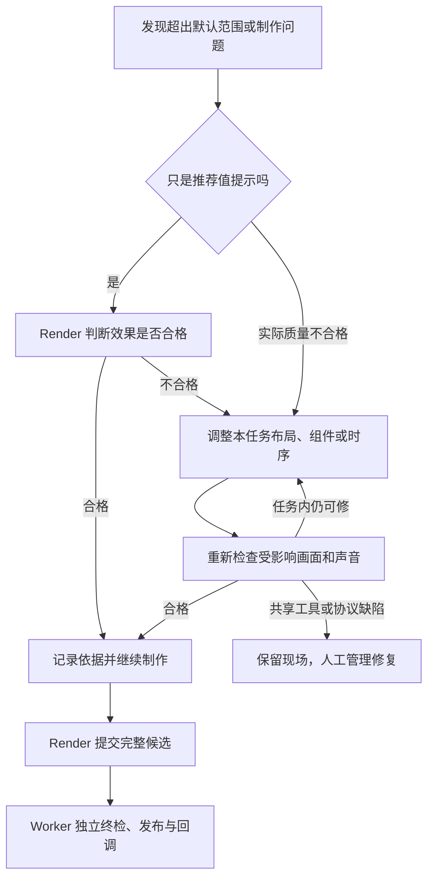

# Render 模板约束自适应与自动调整优化方案

状态：优化方案，尚未据此修改代码或完成验收。

## 1. 要解决什么

当前制作链路存在把组件默认参数当成不可调整规则的情况。例如章节超过六个、图解超出预设项目数、动画时间不足固定帧数时，模板直接抛错；制作任务可能反复碰到相同条件，最终暂停或失败。

用户确认的方向：默认 1–6 章可以，但最终根据分镜和内容安排；其他数量、字数和动画参数也不能因为超出推荐范围就停止。Codex 应根据实际内容调整本任务工程，检查效果后继续制作。

核心原则：**模板固定栏目风格，不把默认参数变成创作上限。Render 决定制作方式与实际时长，质量检查负责发现问题，Worker 管理任务而不替 Render 设计视频。**

本方案沿用现有两阶段链路，不另建制作系统，不改变客户端确认文本、接口或逐镜交付规则。Analysis 只做文字分镜，Render 承接完整制作；Analysis 估时不能限制成片。

## 2. 三类规则必须分开

| 类型 | 例子 | 超出或不满足时怎么处理 |
| --- | --- | --- |
| 推荐值与组件默认参数 | 默认 1–6 章、项目数量、文字长度、动画帧数 | 提示具体位置，由 Render 判断效果并适配；不能单凭越界判任务失败 |
| 实际制作质量要求 | 可读字幕、无错误遮挡、动画完整、栏目风格一致、导航正确 | 不合格则调整本任务工程并重验；首次检查不通过不等于整个任务结束 |
| 不可绕过的交付与安全边界 | 确认稿不丢字、有效声音不截断、实际媒体一致、素材授权、收费保护、预算与取消 | 不允许带问题交付；有安全且获准的任务内修复方式则修复，否则暂停或结束 |

超过推荐值但实际效果合格，可以继续，不必强行改回默认值。实际效果不合格则必须修复，不能通过删除所有校验、伪造报告或缩小到不可读字号来放行。

“Render 决定时长”不等于没有检查：帧数、声音和字幕必须与 Render 最终确定的真实工程一致。检查不能凭字数估时或任意补帧上限替 Render 决定长度。

## 3. 各项规则具体怎样调整

### 3.1 章节与底部导航

章节是视频的大主题，一个章节可以包含多个分镜；不是每句话或每个交付 MP4 都是一个章节。

- 默认建议 1–6 章，出现第七章不直接抛错。
- 根据内容安排主题，不为了凑数量删内容或强行合并。
- 章节多时在任务工程中调整导航，例如分组显示或显示当前章节及相邻章节；不要求预先实现复杂通用导航系统。
- 检查标题是否可读、当前章节高亮是否正确、跨镜头进度是否连续。
- “正文分镜必须完整落在一个章节”不是绝对规则。确实需要镜内切章时，可以在工程内实现正确切换；也可以按语义调整章节边界，但不能擅自改变确认分镜的 ID、文本、数量或顺序。

章节增加属于正常内容适配，不是公共链路故障。

### 3.2 图解类型与新动效

内置图解是优先复用的能力，不是唯一允许的创作范围。

当稿件需要的表达无法由现有组件完成时，允许 Render 在当前任务工程中新增动效组件，并接入真实渲染入口。保持栏目配色、字体、小头像、字幕区及整体视觉层级；新增内容图解不等于重写整个模板。

新类型必须同时具备渲染实现、必要参数检查和审片证据。只增加类型名称、把未知类型强制转为已有类型或移除校验，不算实现。

视频制作任务不能修改共享模板原件、公共工具和 Worker。开发阶段统一打通模板的任务内扩展方式；后续每期制作只改自己的工程副本。不能因“公共模板不能改”而禁止制作模型在任务副本里创作。

### 3.3 动画时长

当前检查中的 14、45、24 帧与现有组件实现有关，不是视频制作的普遍标准。按 30fps：14 帧约 0.47 秒、45 帧为 1.5 秒、24 帧为 0.8 秒。

| 当前规则 | 现有实现线索 | 调整方向 |
| --- | --- | --- |
| 图解至少 14 帧 | 默认入场插值用 13 帧 | 默认保留合适节奏，允许 Render 同步调整动画速度与显示区间 |
| 部分图表揭示后必须超过 45 帧 | 折线用 45 帧，趋势图 28 帧，环形/仪表 26 帧 | 按实际组件动画配置检查，不能统一写死同一时长 |
| 章节转场至少 24 帧 | 当前约 10 帧入场、12 帧退场 | 将这些作为默认节奏；调整时同步修改入场、停留、退场，保证合法时序 |

可以延长展示、简化动画、调整入场时间或更换呈现方式。不能只降低数字检查，却保留无法在给定区间完成的动画。

实际声音、音效、画面意图共同决定工程长度。移除无依据的累计补帧上限；发现完整混音需要更长画面时由 Render 调整，不截有效声音。若反复延长始终不稳定，要定位实际混音与工程边界原因，不能无限补帧。

### 3.4 图解项目数量

对比两项、流程四项、列表五项等是现有版式容量，不是允许表达的内容上限。

超出时可以分行、分页、分批出现、换布局或创建适合的新组件。必须保留应表达的内容及顺序；不得因为五步流程超过四项就删除一步。

保留真实数据语义检查，例如百分比范围、图表数值合法性和来源要求。这些不是可以通过换布局绕过的展示建议。

### 3.5 标题、观点卡与字幕

- 文字长度作为提前提示，最终检查实际文字边界、可读字号、安全区和显示时间。
- 标题与观点卡可以在不扭曲事实的前提下提炼；不能以提炼观点卡为由改动完整确认口播或删除字幕。
- 超长字幕优先自然分句、分页，继续保持用户要求的短句效果，而不是放开后恢复整段长字幕。
- 每页 28 字与独立短句配音一对一，作为当前模板的默认实现保留；它不是唯一正确的同步方式。
- 如需扩展字幕同步方式，必须有可靠句段时间依据，并同步适配任务工程和校验。不得按字数比例猜时间，也不能仅为了分页无条件重新收费配音。
- 已验证的原音频优先复用；需要新的收费能力时遵守授权与未知结果保护。

不要求第一版为所有字体、字号和字幕方式构建通用系统，先保证当前模板的默认路径和实际出现的超范围内容能正确适配。

### 3.6 图解区域重叠

区分两种情况：

1. 错误遮挡：卡片压住字幕、文字叠在一起不可读。Render 调整位置、大小、层级或时间，再检查。
2. 有意叠层：交叉淡入淡出、箭头标注、前后景组合等。允许在任务工程中明确实现，并审查过渡前、中、后画面及动态片段。

区域相交可作为风险提示，不能自动等同成片质量失败。反过来，模型声明“有意叠层”也不能代替实际检查。

### 3.7 隐式声音长度与音效默认值

当前音效未填写 durationFrames 时存在最多 90 帧的默认窗口。需要区分“Render 有意剪辑音效”与“因为没填参数意外截短”。

未明确长度时应根据实际素材、播放起点和制作意图确定；明确剪辑时保存对应编排。仍须检查配音、音效和片尾声音完整符合制作意图，不用固定三秒替代测量。

## 4. 检查发现问题后，谁继续处理

此图不是无限重试许可：全过程受真实进展、总时间、费用、取消和安全边界控制。

- 同一轮 Codex 仍在运行：工具返回问题位置及依据，Render 直接调整并继续。
- Codex 已返回但候选需制作修复：Worker 复用现有恢复循环，在同一 run 写可信反馈，再调用 Render；不重新 Analysis，不改确认版本，不重复有效 TTS。
- 只是推荐值提示：不能被适配器当作失败异常，也不能仅因此消耗失败修复次数；正常制作仍计入总时间与费用。
- 当前工程可修的问题：不能因第一次报错立即进入人工等待。具体错误应映射到已有的制作修复路径。
- 公共工具、协议或执行环境存在矛盾：不能要求制作模型修改共享代码；保留现场，由人管理开发修复后显式恢复。
- 未知收费结果、缓存损坏、确认输入变化等：先核实，不能盲目放行或重复收费。

沿用现有状态和工具返回机制，只补足必要分类和反馈内容，不先引入另一套复杂状态机。

## 5. 开发范围与具体位置

路径相对仓库根；以下为待实施方向，不是本轮已完成修改。

| 位置 | 修改目标 | 明确保留 |
| --- | --- | --- |
| claude-code-video-toolkit/deliverables/财经双人对话视频生成指令/renderer/src/validateTimeline.ts | 区分推荐值提示和无效数据；移除累计一帧限制；允许任务内适配章节、数量、时序和叠层 | 帧区间合法性、数据真实性及必要结构检查 |
| 同目录 VisualBlocks.tsx、ChapterTransition.tsx、ChapterNav.tsx、相关类型 | 默认参数可调，提供最小任务内扩展方式；超过默认容量后实际组件仍能正确显示 | 栏目视觉骨架、导航和参考风格 |
| 同目录 SubtitleLayer.tsx、FinancialDialogue.tsx 及句级音频审计 | 确认长字幕适配、可靠同步及声音播放窗口；避免隐式截音效 | 短句字幕效果、真实音频检查、默认句级路径 |
| 模板主说明、动效说明和 renderer-manifest.json | 明确哪些是默认值、如何任务内适配、哪些效果必须保持 | 当前模板资源、品牌与组件复用要求 |
| .agents/skills/video-pipeline/references/production-flow.md（工具包内） | 写清超范围后的制作判断、调整和重验，不因默认值直接结束 | 唯一制作主干及确认稿权威 |
| claude-code-video-toolkit/tools/stage_media.py、finance_timeline.py、actual_timeline.py、worker_stage.py | 核对模板数据转换、音频完整性和错误分类；不得在其他层重新设置同类上限 | 实测、授权、文件摘要、实际产物和确认对应检查 |
| video-worker/src/application/render-recovery.ts、execute-run.ts 及工具错误适配 | 推荐提示不触发终止；任务工程问题返回 Render；公共缺陷才按人工边界处理 | 原 run、预算、租约、取消、发布与回调机制 |

不是要求以上文件全部重写。先定位实际限制和调用关系，再做必要的最小修改；不要顺手改变客户端协议、任务产品范围或建立全能模板引擎。

“保留模板”指保留视觉设计与有效能力，不是禁止修正其错误技术限制。本次公共模板规则由开发任务统一修改并测试；后续视频生成只改自己的任务副本。

## 6. 模板副本与正在运行任务的处理

修正模板源文件不代表正在运行任务已使用新版本。需要核对：模板原件、打包文件、Worker 冻结快照、任务工程副本，以及转换后的实际数据。

- 新任务必须从明确版本和摘要的新模板生成，测试不能只验证手工修过的旧工程。
- 不静默修改已冻结的 input 模板或控制账本来让检查通过。
- 旧任务如可在已授权的工程副本内适配，保留修改与审片证据；若必须更新冻结输入，走显式受控迁移/新确认路径，不伪造旧摘要。
- 正在运行的任务与公共代码开发避免并发修改；需要暂停或迁移时先报告影响并取得指令。

## 7. 验收用例

| 用例 | 必须达到的结果 |
| --- | --- |
| 七章内容 | 不因超过六章结束；导航可读、高亮和全局进度正确 |
| 六步流程、多项列表 | 内容完整，以合适布局或分批方式显示，不删项 |
| 内置类型之外的新动效 | 任务内实现真实组件，风格一致，有动态审片证据 |
| 动画比默认更短或更长 | 组件参数与检查一致，实际呈现完整且节奏合理 |
| 有意叠层 | 正常转场可通过；声明本身不能代替审片 |
| 错误遮挡 | 被发现并自动调整，不能直接交付，也不首次报错就结束 |
| 超长标题和字幕 | 自动布局/分页，确认口播与字幕内容完整可读 |
| 字幕分页使用有效缓存音频 | 无无依据比例切分，无非必要收费重做 |
| 音效长于默认三秒 | 根据实际素材和明确剪辑意图处理，不被默认窗口意外截短 |
| 合理多次延长画面 | 无累计一帧上限；音画和全局导航一致，导出最终稳定 |
| 新建任务使用新模板 | 不重新带入原模板、旧 ZIP 或快照中的错误限制 |
| 真实丢字、截音、失步、过期画面 | 仍不能发布成功，返回具体证据进行修复或人工处理 |
| 恢复与预算 | 同一任务内继续，保留有效音频与账本；取消和预算耗尽仍有效 |

分层验证：规则单测 → 组件短样 → 新建任务完整两阶段制作 → Worker 恢复与终检回归。静帧、类型检查或模型回复成功都不能替代真实动态片段与最终 MP4 验证。

每例记录输入、模板版本/摘要、触发的提示或错误、实际调整、成片和审片范围。明确区分自动测量、实际看图、动态查看及人工试听，未做的项目不能声称通过。

## 8. 实施顺序、代价与边界

1. 盘点当前实际限制，标记推荐值、质量条件与不可绕过边界，确定误停的真实调用路径。
2. 修正模板检查与组件适配，同步技术说明，避免只放开检查而组件仍无法渲染。
3. 核对制作工具与 Worker 的反馈和恢复分类，确保不是换一层继续拦截。
4. 完成超默认范围测试及必须拒绝不合格成片的反向测试。
5. 在独立的新任务快照中完成全链路验证，再评估旧任务如何安全继续。

代价：复杂稿件可能需要更多任务内创作、渲染和审片时间；自动检查无法保证全部审美质量。先满足当前模板与真实稿件，不预建覆盖所有视频类型的通用系统。

不能承诺任何输入都永不停止。停止应来自安全/授权问题、共享代码缺陷、真实无进展、预算耗尽或取消，而不能只因为出现第七章、第五项流程或超过某个默认动画帧数。

## 9. 本文修改范围

本轮仅新增本 Markdown 文档；不修改现有资料包、ZIP、业务代码、Skill、配置、模板或运行任务。实际开发需另行指令。
