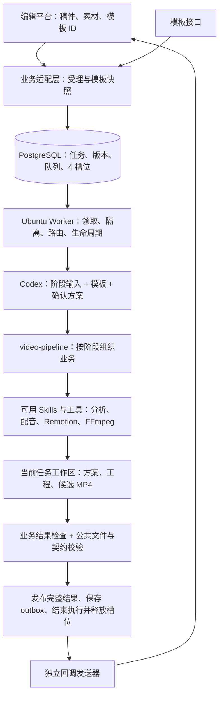
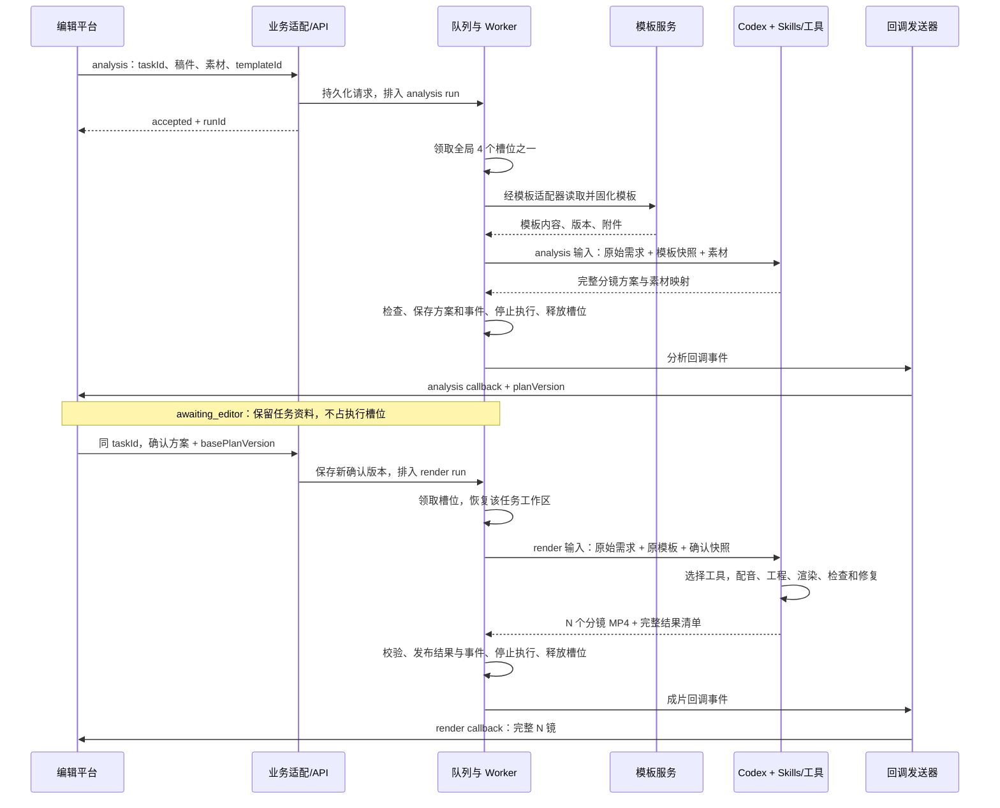
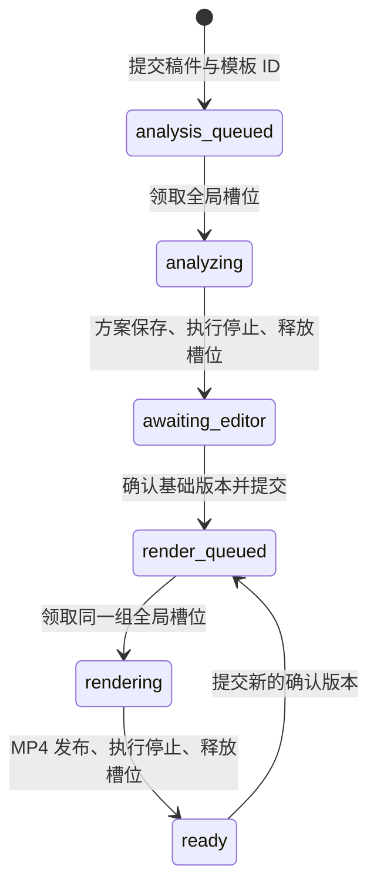
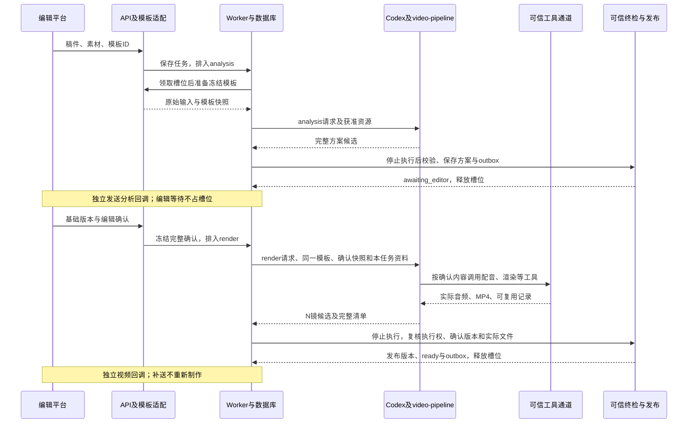

# Worker 代码架构与现有项目接入方案

更新日期：2026-09-15。本次仅更新 Worker 接入方案；Codex 本地两阶段核心已实现，Worker 新链路尚未接入。

**最新补充：请先读第 9.13～9.16 节，说明现有两阶段代码怎样接入 Worker、需要适配的文件与验证顺序。** 总体职责保持第 9 节的方向；旧协议草案与本地实现的差异以最新补充为准。

**阅读顺序：请先看[第 9 节：本轮重构方案](#9-本轮重构方案2026-09-14待评审)，包括职责、流程图、具体文件改动和实施步骤。** 第 1～8 节保留此前的实现说明，便于对照；其中 Worker 提前配音、固定模板、固定渲染器、分镜摘要复用和固定工具准入是本轮要调整的旧做法，不是后续设计目标。第 9 节如与旧说明冲突，以第 9 节的目标方案为准；目标能力仍需开发和验证。

当前部署仍是 Docker 管数据库、任务 API 和回调，Ubuntu 本机 Worker 管隔离执行与 Codex ChatGPT 会话。接口字段和业务调用顺序见 [上下游对接方案](AI视频剪辑上下游对接方案.md)，当前可执行部署步骤见 [Ubuntu 部署与联调手册](Ubuntu部署与联调手册.md)。

## 1. 仓库边界

Git 根目录是 VideoCutEditor，以下同级目录一起提交和发布；不把 Worker 嵌进 toolkit，也不移动原视频组件。

```text
VideoCutEditor/
├── .env                              全项目唯一实际配置
├── docker-compose.yml                PostgreSQL / API / callbacks / migrate / callback-mock
├── claude-code-video-toolkit/         制作能力主体
│   ├── .claude/skills/                Skill 维护源
│   ├── .agents/skills/                同步生成的 Codex Skills
│   ├── tools/                        Python 配音、探测、渲染工具
│   ├── lib/                          原有组件、主题、转场
│   ├── templates/ifeng-scenes/        当前准入的分镜模板
│   ├── examples/hello-world/          原有视频代码保留
│   └── test-cases/                    原本地单任务准备脚本保留
├── video-worker/                      新链路的控制与执行服务
├── huibo-saas/                        原数字人 HTTP 适配器
├── xiling-http/                       原数字人口播脚本
└── docs/
```

工具库保持原来的制作职责。新增接口、队列、认证、版本、发布和回调集中在 video-worker，原本地脚本不会直接变成线上接口。

## 2. 模块和调用关系

```text
video-worker/
├── src/
│   ├── entrypoints/
│   │   ├── api.ts                    Docker HTTP 服务
│   │   ├── callbacks.ts              Docker 回调发送器
│   │   ├── migrate.ts                Docker 一次性建表/迁移
│   │   ├── worker.ts                 Ubuntu 单实例调度循环
│   │   ├── host-check.ts             部署检查，不发起制作/收费配音
│   │   └── runner.ts                 保留的旧 Docker Runner 入口
│   ├── application/
│   │   ├── tasks.ts                  分析/确认提交
│   │   ├── execute-run.ts            准备→配音→Codex→校验→发布
│   │   └── results.ts                版本结果、完整分镜清单和 outbox
│   ├── infrastructure/
│   │   ├── task-repository.ts        幂等、任务状态和方案版本
│   │   ├── queue.ts                  四槽位、租约、执行令牌、恢复
│   │   ├── workspace.ts              输入快照与本次独立目录
│   │   ├── runtime-paths.ts          本机/旧容器路径适配
│   │   ├── audio.ts                  可信配音、缓存与外部调用账本
│   │   ├── app-server.ts             单进程 JSON-RPC、认证、事件分发
│   │   ├── host-sandbox.ts           本机执行器总入口
│   │   ├── host-processes.ts         Bubblewrap + systemd 任务进程
│   │   ├── sandbox.ts                旧 DockerSandbox，保留回归用途
│   │   ├── validation.ts             可信结果校验
│   │   ├── storage.ts                文件路径授权与不可变发布
│   │   └── callback-outbox.ts        回调签名、投递和重试
│   ├── runner/
│   │   ├── codex-host.ts             thread/turn 路由与受控制作工具
│   │   ├── codex.ts                  旧 SDK 容器适配器
│   │   └── prompts.ts                阶段指令，路径由 Worker 提供
│   └── config.ts                     根目录 .env 和运行时配置
├── deploy/
│   ├── install-host.sh               Ubuntu 依赖、用户服务、检查和启动
│   ├── start-worker.sh               共享 flock，启动 Worker 或 host-check
│   ├── Dockerfile.control            API/回调/迁移镜像，无 Docker CLI
│   ├── Dockerfile.runner             旧执行器回归镜像，当前 Compose 不构建
│   └── runtime-manifest.json         制作源码和依赖版本摘要
├── scripts/install-browser.mjs       安装准入模板使用的浏览器
└── tests/                            队列、版本、回调、路由、隔离与媒体回归
```

完整执行路径：

```text
编辑平台 → Docker API → PostgreSQL 排队
                              ↓
Ubuntu Worker 领取租约 → 素材快照 → 必要配音 → Codex app-server
                                                ↓
                              video_exec / video_view_image
                                                ↓
                            当前任务的 Bubblewrap + systemd 服务
                                                ↓
                               可信校验 → 发布文件 → 数据库结果 + outbox
                                                                    ↓
                                                         Docker callbacks → 编辑平台
```

## 3. 分析和渲染边界

分析提交包含稿件、需求和素材。Worker 固化素材后，Codex 实际探测与看图、形成分镜方案，可信校验通过后调用分析回调。此阶段不生成正式成片，等待编辑期间释放执行名额。

编辑确认传入同 taskId、basePlanVersion 和完整分镜列表。Worker 检查版本与素材归属，准备逐镜配音，再按确认内容渲染。Codex 不自行修改已确认口播、替换素材或再次拆镜。

每条分镜输出已包含画面、声音、动画和字幕的 MP4。确认 5 镜就返回 5 项，第 0 项是第一镜，不插入整体视频项。修改第 3 镜时按输入摘要重做受影响内容，回调仍返回完整有序的 5 镜清单，旧结果在新结果成功前保持可用。

原 huibo-saas、xiling-http 暂不纳入无人值守主链路；数字人使用与口播匹配的预生成素材。不能把原适配器当作已经通过 Ubuntu 真实账号联调的服务。

## 4. 任务和会话如何对应

| 标识 | 来源和作用 |
| --- | --- |
| taskId | 上游业务任务 ID，后续编辑指令继续使用 |
| tasks.id | 内部 UUID，用于目录与数据归属 |
| requestId | 单次提交幂等，同 ID 不同内容拒绝 |
| runId | 一次分析或渲染执行 |
| threadId | app-server 返回的会话 ID，保存到 tasks 表 |
| turnId | 本次指令 ID，与 run/attempt/令牌一起保存到 host_executions |
| fencingToken | 执行接管时递增，防止旧执行提交结果 |

上游不用传 Codex threadId。会话路由只读取数据库的可信映射，不读取模型写入的 session.json 来选择任务。恢复已有任务时使用 thread/resume；无法恢复则显式失败，保留输入和业务记录，不假装旧会话恢复成功。

一个常驻 app-server 复用 Ubuntu 用户的 ChatGPT 登录，负责认证刷新和会话文件；不为四任务复制 auth.json，不把 CODEX_HOME 挂进沙箱。当前锁定 Codex 0.154.0，实验协议在部署时验证，升级版本必须重新验收工具和权限行为。[官方协议](https://learn.chatgpt.com/docs/app-server)

## 5. 队列、取消和崩溃恢复

PostgreSQL 存四个 execution_slots，事务锁控制领取。同任务同一时刻最多一个活跃 run，全局最多四个；第五个请求正常入队等待。排队包含 analysis/render 执行，等待编辑和回调不占位。

本机同一任务同一时刻只接受一条制作命令，每条命令由独立 systemd transient service 管理全部后代进程。默认 CPUQuota=200%、MemoryMax=4G、TasksMax=256，每条命令最多 30 分钟；run 总期限仍是 4 小时，最多 3 次恢复尝试、10 轮修复，重启不清空计数。

取消流程：阻止后续工具调用 → turn/interrupt → 等待 turn/completed → 停止任务 systemd 服务并确认无活动进程 → 更新数据库和释放槽位。确认失败保留占位，不能仅凭租约过期就启动替代任务。

app-server 崩溃时停止领新任务，终止当前工具执行并由 systemd 重启 Worker。新 Worker 必须持有同一个本机 flock，先停止遗留的 videocut-job 服务，再按数据库租约接管或失败处理。单个共享 app-server 的崩溃可能影响四个执行，恢复流程必须覆盖该情况。

## 6. 本机沙箱与文件权限

当前 Ubuntu 任务工作区为：

```text
DATA_ROOT/<内部任务 UUID>/runs/<run UUID>/attempt_<N>/
  task.json     可信描述，只读
  input/        稿件、素材、确认方案、配音，只读
  project/      可写工程
  output/       可写候选与证据
  cache/        可写本次缓存
```

Bubblewrap 只挂当前任务和明确准入的工具、Skills、模板、Python/Node 依赖；不挂共享媒体根、其他任务目录、业务 .env、登录缓存或 Docker socket。使用私有 PID、文件系统和网络命名空间，隐藏宿主进程与控制接口；命令环境不继承数据库、回调或模型凭据。

模型内置命令/浏览器/插件等入口关闭，制作和看图通过 Worker 的两种工具路由。Codex 自身使用明确的任务权限 profile；该版本不支持的 readOnlyAccess 示例不会被当作已经生效的隔离配置。

可信配音步骤可以写 input/audio，只有固定的 worker_tts.py 获得必要 TTS 凭据和外网。Agent 制作命令无外网，但可以在自己的网络命名空间内启动 Remotion 本地服务。校验步骤无网络、只读工作区。systemd 负责 CPU/内存/进程上限及全部后代清理，不依赖 shell 后台 PID 的自报信息。

模型生成的 passed 不代表成功。停止写入后，可信验证器检查协议、稿件覆盖、分镜顺序、源素材、全量解码、帧数、音轨和画面证据。审核全部通过才发布。

## 7. 结果与上下游数据

MEDIA_ROOT 默认为 `/home/ops/jiangzb/videos`；请求/回调 url 是服务器绝对文件路径，后续换共享盘只改根目录和调用方路径映射。输入路径经过授权前缀和 realpath 校验后固化，返回的素材路径指向本任务持久化快照。

发布结果写入 `tasks/<内部任务 UUID>/results/<runId>-<token>/<sceneId>.mp4`，临时复制和校验后重命名为不可变结果。数据库在同一事务中保存版本结果、成功状态和 outbox。

callbacks 单独读取 outbox，失败只重发通知、不重新制作、不占槽位。接收端同时返回 HTTP 2xx 与 status=0 才视为投递成功，按 eventId 去重、按版本拒绝旧结果覆盖。HMAC 签名格式见 Worker README。

## 8. 部署和验证边界

Compose 保留 postgres、migrate、api、callbacks、callback-mock，取消 worker/runner-image 与 Docker socket。容器内通过 postgres:5432 访问数据库，本机 Worker 通过 127.0.0.1:15432 访问同一数据库；无需新增 Worker HTTP 服务。

install-host.sh 用当前登录用户安装依赖并生成用户 systemd 服务，启用 linger 保证 SSH 退出后持续运行。主配置仍是一份根目录 .env。host-runtime.json 仅记录安装时解析出的浏览器路径，属于忽略的机器运行数据，不是第二份业务配置。

默认测试使用 PostgreSQL/PGlite、模拟 app-server 验证四并发路由、令牌和取消；媒体测试使用模拟 Agent 和合成音频，实际渲染五镜、修改第三镜、返回完整五项。部署检查验证真实 Ubuntu 沙箱、浏览器、登录与协议，不消耗模型/TTS 调用。

真实素材理解、四个真实模型 turn 并发、账号限流与刷新、Ubuntu 进程清理、豆包与编辑平台回调仍需在部署服务器端到端验收。不要把本地模拟测试当作已完成这些外部环境验证。

## 9. 本轮重构方案（2026-09-14，待评审）

### 9.1 本轮要解决的问题与范围

目标是：上游提交稿件、素材和模板 ID，系统读取并保存模板内容，交给 Codex；Codex 根据阶段要求、模板、Skills 和可用工具完成分析或制作。双主持人财经是第一条真实验收用例，与其他模板共用相同的提交、排队、执行和回调链路。

**当前 Worker 执行主流程需要改。** 保留的是任务管理机制，不是保留“Worker 先安排配音、挑选重做镜头，再让 Codex 调固定渲染器”的执行顺序。改造后，未来增加音色、布局或业务 MCP，才应当主要调整模板、Skill 和工具配置，而不继续改调度器。

本轮不新增财经专用 Worker，不建设任意类型任务平台，不更换 Docker + Ubuntu 部署方式。外部业务继续分为 `analysis` 和 `render`，全局最多 4 个执行中的 run。首要验收目标是通过这条共同链路完成双主持人财经的分析、编辑确认和分镜 MP4 交付；通用智能分镜复用、多机调度、额外业务 MCP 不作为首轮前置条件。

### 9.2 当前耦合在哪里，分别怎样处理

以下路径均相对仓库根目录；“目标处理”是待开发事项。

| 当前位置 | 当前行为与影响 | 目标处理 |
| --- | --- | --- |
| `video-worker/src/application/tasks.ts`、`config/templates.json` | 通过本地模板表检查 ID 并保存固定模板路径，任务配置含单一 TTS 音色 | 改为调用模板读取适配器并保存完整模板快照；不在调度配置里决定主持人数、音色或布局 |
| `video-worker/src/contracts/ifeng.ts` | 严格限定布局为 `full_frame / presenter_pip`，动画也只有少数预设 | 保留接口公共字段校验，调整承载制作方案的结构，容纳模板自己的主持人、动画和画面要求；新结构需与平台确认 |
| `video-worker/src/application/execute-run.ts`、`infrastructure/audio.ts` | Codex 执行前由 Worker 调 `prepareAudio`，选择音色、逐镜生成配音 | 移除调度流程中的制作配音步骤；由 Codex 按 Skill 选择配音工具并决定调用时机 |
| `video-worker/src/infrastructure/workspace.ts`、`domain/scene.ts` | 计算分镜摘要，生成 `renderSelection` 和复用清单 | Worker 不决定重做哪镜；向 Codex 提供确认方案和本任务历史产物清单，由制作能力判断复用；首轮不承诺局部重做 |
| `video-worker/src/runner/prompts.ts`、toolkit 的 `tools/render_segments.py` | 提示词要求固定渲染脚本；脚本使用 `templates/ifeng-scenes` | 阶段指令只规定输入、阶段边界和交付格式；Codex 按模板使用或生成 Remotion 工程，不强制所有模板走此渲染器 |
| `video-worker/src/infrastructure/host-processes.ts` | Skills、工具、模板文件按固定名单挂载，双主持人的若干必要资源未进入任务 | 将所需能力与任务资源整理为明确的部署清单，按任务挂载，保留隔离，不根据模板 ID 写业务分支 |
| `video-worker/src/infrastructure/app-server.ts`、`runner/codex-host.ts` | `mcp_servers: {}`，并把 `mcpToolCall` 作为不受管理的调用拒绝 | 改为支持经过配置和任务授权的能力；首轮可继续以受控命令工具完成制作，未来 MCP 接入还需身份、路径和取消管理 |
| `video-worker/src/infrastructure/validation.ts`、Skill 内 `validate_segments.py` | 校验依赖固定渲染器、预制音频 manifest 和固定结果结构 | 拆出公共文件/协议校验与视频业务校验，后者留在制作能力层；不以固定工程布局判定所有模板 |
| `video-worker/src/application/results.ts`、`integrations/ifeng/mapper.ts` | 按固定字段重建结果并合并 Worker 选定的复用产物，容易丢失扩展制作信息 | 保留完整结果与方案快照；业务适配器生成四接口的 DTO，Worker 不推导镜头内容 |
| `video-worker/src/infrastructure/workspace.ts`、`task-repository.ts` | 渲染输入未携带 `otherRequirements` 时会取空字符串；工程复制主要覆盖同 run 的恢复尝试 | 保存最初需求，跨 analysis/render 显式恢复任务资料与工程；不把“恢复会话”当作“恢复了文件” |

现有分镜复用确实有代码及固定模板媒体测试，但不等于已经实现基于任意模板、Skills/MCP 的复用。旧摘要还会忽略部分画面描述，不能作为新链路的通用复用依据。

### 9.3 调整后的三层职责

这里的三层是代码职责划分，仍在现有仓库和进程中运行，不新增三个服务。

| 层次 | 负责什么 | 不做什么 |
| --- | --- | --- |
| 业务适配层：`integrations/ifeng` 及接口契约 | 理解四个业务接口；读取模板；保存模板版本；把编辑确认转换为完整输入快照；按平台格式封装分析/视频回调 | 不选择声音、编写分镜、安排动画或决定重做镜头 |
| Worker 调度与运行层 | 受理、幂等、版本并发控制、排队、4 槽位、租约、会话路由、任务文件隔离、取消恢复、候选文件检查、发布与可靠回调 | 不把视频制作拆为固定业务子步骤，不按模板 ID 分支，不直接编排配音和渲染 |
| Codex + video-pipeline + 制作工具 | 理解模板/素材；分镜与角色规划；按确认方案选择 Skills、CLI 或 MCP；配音、工程、字幕、动画、渲染、业务检查与修复；判断可安全复用的内容 | 不决定队列名额，不修改其他任务，不直接调用平台结果回调或把自报成功当成已发布 |

Worker 的“知道阶段”与“介入制作”不同：它可以根据 `stage=analysis` 选择状态与回调地址，但不应该因此决定一句话用哪个音色。校验也一样：检查结果是否包含约定数量的可读 MP4 是交付契约；规定所有视频必须使用某个布局组件则是业务耦合。



### 9.4 同一链路如何支持不同模板

新增一个小的 `TemplateProvider` 适配器，放在 `video-worker/src/integrations/ifeng/`，不另起服务。接口请求参数、鉴权和响应字段需等待模板 API 文档；下面仅定义本项目内部需要保留的信息，不假设远端已采用此结构。

```json
{
  "templateId": "finance_dialogue_example",
  "version": "template-version-example",
  "contentHash": "sha256-example",
  "instructions": "双主持人布局；按稿件分配男女声；当前说话人高亮。",
  "resources": [
    {
      "id": "layout-reference",
      "kind": "reference",
      "path": "template/references/layout.md"
    },
    {
      "id": "intro-component",
      "kind": "source",
      "path": "template/source/FinancialIntros.tsx"
    }
  ]
}
```

这是快照清单示例，文件必须实际准备并校验，文本中出现路径不会自动让文件进入沙箱。模板既可提供说明，也可提供指定的组件和附件；具体如何制作交给 Codex，不把说明转换成 Worker 内的布局枚举。

推荐流程：先校验并持久化提交；领取 analysis run 后，通过适配器读取模板、固化内容和附件，再启动 Codex。这样远端模板接口的耗时不会占住 HTTP 提交请求；模板读取失败记录为该次分析的准备失败。已有快照的故障重试使用原快照，不重新取得一个可能变化的模板版本。

分析和随后的 render 使用同一快照。远端修改同一模板 ID，不应改变已确认任务；需要换模板时，明确重新分析并生成新方案版本。若远端没有版本号，内部至少以内容与附件摘要标识快照。

模板只描述业务要求，不能自行扩大文件、网络或凭据访问权限。模板要求用到未部署的能力时，报告缺失能力；不退回固定模板制作，也不假装任务成功。

### 9.5 两阶段执行协议：统一输入外壳，保留业务阶段

不引入任意 `operation` 任务体系。仍使用 `stage: analysis | render`，只把固定配音、固定渲染器、固定布局从 Worker 传入协议中移走。

以下保留的是 **2026-09-14 内部协议草案，尚不能直接提交给现有 API**。本地现已实现 `video-two-stage/1`，其确认信息位于 `confirmation`，与下方早期字段位置不同；Worker 应按第 9.13～9.16 节接入实际协议，不照抄此草案。

```json
{
  "contractVersion": "draft",
  "taskId": "task_001",
  "runId": "run_render_002",
  "stage": "render",
  "planVersion": 2,
  "input": {
    "scriptFile": "input/script.md",
    "requirementsFile": "input/requirements.md",
    "assetsManifest": "input/assets.json",
    "templateSnapshot": "input/template/manifest.json",
    "confirmedPlan": "input/confirmed-plan.json",
    "previousArtifacts": "input/previous-artifacts.json"
  },
  "workspace": {
    "project": "project",
    "cache": "cache",
    "output": "output"
  },
  "delivery": {
    "manifest": "output/result.json",
    "kind": "scene_mp4",
    "oneFilePerConfirmedScene": true
  }
}
```

相对路径由执行器解析到本任务目录，不允许跨目录。analysis 使用同样外壳，但 `confirmedPlan` 为 `null`，交付类型为分析方案；它不读取其他任务的历史产物。工具清单由部署配置注入，不由任务 JSON 自行授予权限。

**analysis 阶段：** Codex 读取稿件、完整需求、模板及允许的参考资料，理解素材，形成可编辑的完整分镜方案。双主持人模板的角色、发言分配、画面位置、字幕、动画、素材引用等由模板和 Codex 决定。没有实际配音时，时长明确标记为估算。本轮不生成正式 TTS 和 MP4，返回方案后结束 turn，等待编辑由外部状态表示。

**render 阶段：** 注入原始输入、冻结模板、最新编辑确认快照及本任务已有资料。Codex 按确认的分镜、文本和素材进行制作，自己组织配音、测量时长、画面编程、字幕、渲染和修复。不得越过确认自由改稿、改镜头数量或换素材；遇到无法满足的确认条件，返回原因，由编辑重新调整。输出每个已确认分镜的完整 MP4 与实际素材清单。

模板里的“直接无人值守导出整片”不能取消当前 analysis 阶段的人工确认边界。需要把模板的视觉与制作要求保留，同时由 pipeline 明确本轮阶段；render 中可以无人值守完成制作，但外部交付仍按确认分镜拆分。



### 9.6 方案如何经过编辑平台后仍完整传回 Codex

仅传 `content + picInfoList + videoInfoList` 不足以保存双主持人的发言分配、图解、动画和音频设计。当前按固定字段重建对象的方式需要调整，否则信息会在分析回调或编辑确认时丢失。

建议完整方案保存在本项目的不可变版本快照中；平台展示的公共字段沿用分镜 ID、口播、素材、花字、时长等，模板特有信息放入可扩展制作数据。下面的 `production` 是待协商结构，**不是现有接口字段，也不是所有模板都必须有 hosts**。

```json
{
  "id": "scene_001",
  "content": "编辑确认的原稿内容。",
  "dur": 5.5,
  "durationSource": "estimated",
  "production": {
    "hosts": [
      { "id": "male", "position": "left" },
      { "id": "female", "position": "right" }
    ],
    "speaker": "female",
    "visualInstructions": "当前发言人高亮，另一位保持暗色；配合本句绘制图解。"
  },
  "extraData": {
    "keywordList": [],
    "videoInfoList": [],
    "picInfoList": [],
    "digitalHumanId": ""
  }
}
```

需要与编辑平台选择一种兼容方式：

- **推荐：平台完整回传方案，包括不展示的扩展数据。** 编辑只修改自己支持的字段，确认时保留其余字段；服务按 `basePlanVersion` 保存完整新版本。这最接近现有“确认完整 dataList”的方式。
- 如果平台不能透传扩展数据，则采用“服务端完整方案 + 基础版本 + 明确编辑变更”的方式。适配器负责合并已定义的修改，明确数组替换、字段清空、拆镜和删除规则，再冻结确认版本。不能靠猜测缺失字段的含义，也不能把旧 production 无条件套到已改文本上。

编辑改变口播后，Codex 可以调整配音时长、图解和字幕等派生制作数据，但必须遵守已确认的内容与素材约束。具体哪些内容能在工作台编辑、哪些是模板固定要求，需与平台一并确认。

### 9.7 Skills 与 MCP：先补齐当前链路需要的执行能力

禁用 MCP 的直接来源是当前运行时代码，而不是 `$video-pipeline` 天生禁止 MCP。`app-server.ts` 清空 MCP 配置，`codex-host.ts` 拒绝 MCP 事件，`host-processes.ts` 又限制了可见技能和工具。这种受控入口配合了早期固定制作流程，现在需要调整到支持模板驱动的制作。

首轮所需能力如下，不必先新建一个业务 MCP 才开始联调：

| 能力 | 本仓库可用基础 | 本轮要接入/检查的内容 |
| --- | --- | --- |
| 两阶段制作编排 | `video-pipeline` 及其阶段协议 | 去掉 v2 固定单音色、固定渲染器要求，保留 analysis 停止边界与 render 确认约束；原本地无人值守入口保持可用 |
| 素材与画面理解 | FFmpeg/ffprobe、素材探测工具、`video_view_image` | 能读取本次允许的素材并看图，禁止参考的历史视频不进入输入清单 |
| 双人配音 | `tools/generate_dialogue_audio.py`、豆包 TTS 工具 | Codex 传入角色与文本，工具返回实际音频及测量时长；不由 Worker 预先统一成单一音色 |
| 画面、动画、字幕与渲染 | Remotion、相关 Skills、FFmpeg | Node/Python/浏览器依赖可用，任务可写自己的工程并执行渲染；必要时加载现有视觉设计 Skill |
| 指定模板资源 | 布局参考文档、头像、Logo、音效、`FinancialIntros.tsx` | 按模板/任务资源清单提供确切文件，不能通过挂整个历史示例目录来间接授权旧作品 |
| 结果检查 | 现有分析、交付和视频探测脚本 | 去除固定 renderer/单音色 manifest 依赖，检查完整分镜交付以及业务要求 |

制作命令和看图可以继续使用现有受控工具入口；“放开制作能力”不要求开放整个宿主 shell。当前只有 Worker 固定 TTS 步骤有网络和凭据，因此移走该步骤时，必须同时让 Codex 可调用的 TTS 工具获得**必要的受控调用通道**，否则只是换了提示词仍然无法配音。

建议首轮沿用现有执行器：为已部署 TTS 工具增加明确的工具路由，由 Codex 提交角色、文本和音色等参数；执行器仅负责参数边界、任务路径、凭据注入及调用生命周期，不替它决定配音策略。凭据保留在可信调用进程中，不把根 `.env` 或 ChatGPT 登录文件暴露给任务。后续这个工具可以换为 MCP，调度器无需了解业务方法。

TTS 工具自身还要补齐缓存匹配：不能仅凭同名音频存在就复用，应核对文本、音色、参数和工具版本。付费调用超时而结果不明时保留调用记录，先核查或报告，不能让 Worker 或 Codex 盲目重试导致重复付费。该逻辑归工具层，Worker 只保留任务资料。

未来接 MCP 时还需：注册已部署服务；将调用绑定到 task/run/执行令牌；约束可访问路径和凭据；纳入超时、取消与日志；阻止已取消任务的迟到结果发布。只删除 `mcp_servers: {}` 和 `UNMANAGED_TOOL` 检查，不算完成接入。尚未部署的 MCP 不应出现在“可用工具”清单中。

### 9.8 任务工作区、会话与 4 并发

业务 `taskId` 贯穿两阶段，数据库记录内部任务 ID 和 Codex `threadId` 的可信映射；每次分析、确认制作或重做各有独立 `runId`。上游只提交业务 ID，不选择任意会话。

建议在现有目录上增加任务级成功检查点，保存模板快照、完整需求、工程和工具缓存；以下是目标结构，非当前已经生成的目录：

```text
/home/ops/jiangzb/video-worker-data/<内部任务 UUID>/
  inputs/                         原始稿件、需求、素材清单与冻结模板
  checkpoints/<runId>/            成功执行后的工程、制作记录与产物索引
  tool-cache/                     本任务工具缓存与调用记录
  runs/<runId>/attempt_<N>/
    task.json                     只读阶段输入
    input/                        只读输入和确认版本
    project/                      从选定检查点复制的可写工程
    cache/                        本次工具缓存
    output/                       候选方案、视频和证据
```

跨阶段执行前，Worker 按数据库登记的版本恢复资料；同一 run 重试另建 attempt，保留旧文件。恢复清单是通用文件持久化行为，不负责判断某镜是否应重做。发布结果仍放在 `/home/ops/jiangzb/videos`，不把临时工作区路径直接回调给平台。

analysis 成功后即使没有视频工程，也必须保留完整方案、素材理解结果与模板输入。render 要重新明确注入这些内容；`thread/resume` 不保证任意历史文件仍存在，更不能替代当前确认版本。



上图只画成功主线。失败/取消记录在 run；通知状态单独保存。`ready` 表示可交付结果已发布，`callbackState=delivered` 才表示视频回调已送达；不要将分析回调送达理解为整个任务制作完成。

保留当前机制：PostgreSQL 全局 4 槽位，analysis/render 共用；第 5 个不同任务正常入队。等待编辑或回调不占槽位；同一个 task 已有 queued/running/cancelling run 时，新业务提交按现有互斥规则返回 409。一次 render 内的多个镜头不是多个排队任务；Codex 可在任务资源上限内组织制作。

取消或故障恢复必须先阻止后续工具调用，停止 turn 与任务进程并确认，再释放或接管槽位；令牌过期只能防止旧结果发布，不能证明旧进程已经停止。保留宿主锁、租约、执行令牌与资源上限。共享 app-server 崩溃可能影响多个任务，仍按当前全局恢复机制处理。

### 9.9 结果如何校验和返回

Codex 的业务输出由 video-pipeline 负责生成：analysis 是完整可编辑方案；render 是按确认顺序排列的 N 个完整 MP4 及实际使用素材。模板可以生成图解和动画，不要求都来自初始 `picInfoList/videoInfoList`；要区分源素材引用、生成资源和最终 MP4，不能把生成画面伪称为原始视频素材。

业务适配层校验分镜 ID、数量、顺序、确认文本和素材引用等接口要求；制作能力中的检查器负责字幕/声音/画面与模板要求的检查；公共执行层验证 manifest、文件归属、文件存在、解码、规格等客观条件。语义与审美仍需编辑查看，不能把自动检查描述为全部正确的保证。

Worker 不依赖某个固定模板的工程文件名来判成功，也不直接接受模型返回的 `passed=true`。候选不合格时，将具体检查反馈交给 Codex 在同一 run 的剩余预算内修复；Worker 只限制时间和次数，不写出修复视频的业务步骤。不能修复则记录失败，保留旧版可用结果。

发布时保存整组结果和 outbox，版本化文件不能覆盖上一版。回调仍由现有发送器处理，失败只补送通知；Codex 不持有平台回调凭据，不直接对外宣告任务完成。

确认 N 镜就返回 N 个 MP4，画面、声音、动画、字幕全部合成在各自文件中。双主持人模板的片头、片尾如何归属分镜应在分析方案中明确，建议放入确认的首尾镜头；如果编辑希望作为独立镜头，就必须明确纳入确认列表。不能额外插入“第 0 项整片”。连续音乐及跨镜效果的边界处理交给模板和 pipeline，但必须满足下游分镜播放/拼接契约。

### 9.10 按现有代码落地的顺序

本节保留原批次划分；本地两阶段核心实现后，当前接入顺序和批次完成条件见第 9.16 节。

| 批次 | 具体改动位置 | 可检查的完成条件 |
| --- | --- | --- |
| 1. 输入与模板 | `integrations/ifeng` 增加模板适配器；调整 `application/tasks.ts`、`task-repository.ts`、外部/内部 contracts | 同一任务两阶段得到相同模板快照、完整原始需求和正确确认版本；扩展信息不丢失；模板接口未提供时用明确标记的 fixture 验证相同内部契约 |
| 2. 移除制作耦合 | 修改 `execute-run.ts`、`workspace.ts`、`prompts.ts`、`results.ts`；停止由调度流程调用 `audio.ts` 和 scene hash 选择逻辑 | Worker 执行顺序变为准备输入→交给 Codex→检查/发布；无单音色预配音、无固定模板路由、无 Worker 决定的镜头复用 |
| 3. 接通制作能力 | 调整 `host-processes.ts` 能力清单/受控 TTS 调用、`codex-host.ts` 路由；更新 video-pipeline 阶段协议、工具及检查器 | 真实任务可见指定 Skills/资源，能由 Codex 选择男女声、生成工程并渲染；隔离/取消仍有效；不依赖新增业务 MCP |
| 4. 编辑与交付 | 修改 `integrations/ifeng/mapper.ts`、结果校验和发布适配；与平台确认方案透传 | 分析回调完整，编辑修改后仍保留模板制作信息，N 镜 MP4 回调包含实际素材和本地发布路径 |
| 5. 迁移与真实联调 | 更新迁移/部署文档、部署资源清单及相关测试 | 旧任务不按新协议误执行；真实双主持人全链路通过，再用另一模板验证无需改 Worker 主流程 |

这是分批验证顺序，不建议把只移除配音、却尚未接通受控 TTS 工具的中间状态部署到生产。批次 1～4 应组成完整可运行版本后再切换。

Skill 改动应维护 `.claude/skills` 源并同步 `.agents/skills`；内部 schema、生成的 TypeScript 类型和结果检查器必须同步更新。保留原本地单任务生产能力作为回归入口，不复制整套财经代码到 Worker。

迁移采取小范围切换：暂停接收新任务，等待执行中的旧 run 完成；备份数据库及任务目录，部署配套协议/工具/代码后执行检查再恢复受理。已在等待编辑的旧方案必须标识旧协议，明确继续使用旧兼容路径或重新分析，不能把它自动解释成新方案；具体保留旧路径与否需结合服务器是否已有业务任务决定。旧结果和回调事件保持原样，可继续读取和补送；旧音频/分镜记录不因移除 Worker 决策就直接删除。

不需要为此增加 Redis 或新容器。现有 Compose 和 Ubuntu 用户服务仍承担原来的部署职责；若新增依赖或工具清单，更新安装/检查脚本即可。根目录 `.env`、媒体根和 ChatGPT 登录位置不因业务职责调整而改变。

### 9.11 验收用例与失败处理

1. **输入完整性**：提交带完整需求和模板附件的 analysis；编辑确认后的 render 必须收到同一模板内容、原需求、最新确认快照。模板服务后来更新也不能悄悄改变这一任务。
2. **真实双主持人分析**：使用本次指定稿件、布局参考及允许资源，由 Codex 返回分镜、发言人、画面/动画描述和素材引用；本阶段无正式 TTS/MP4，随后释放槽位。
3. **人工修改闭环**：平台替换一镜素材或修改花字再确认；未编辑的角色与制作信息保留，Codex 以确认版本制作。
4. **真实制作**：1920×1080、30fps、双主持人布局、对应发言人高亮、指定男女音色；字幕按实际音频，确认 N 镜交付 N 个完整 MP4。逐个从平台后端读取并播放，核对内容、声音、字幕、动画及片头片尾归属。
5. **模板替换**：另用一个不同布局模板执行同样的两阶段链路，Worker 不增加 `if templateId == ...` 分支。用例只证明已提供模板和部署能力可执行，不宣称支持任意未知模板。
6. **队列与隔离**：同时提交 6 个不同任务，最多 4 个执行；等待编辑不占槽；任务间不能读写文件或误投会话；取消后进程停止，再让队列递补。
7. **可靠性**：重复请求不重复入队，旧确认版本被拒绝；Worker 重启后不超额运行；回调失败不重新制作，迟到回调不覆盖新版本；新制作失败保留旧视频。
8. **工具恢复**：文本/音色/参数不同不得复用同名 TTS 缓存；调用结果不明时报告并保留记录，不无条件重复付费。

真实双主持人用例的参考范围沿用用户限制：只读指定稿件、布局文档及其直接示意图、通用技能/工具、指定头像/Logo/音效和 `FinancialIntros.tsx`。不读取旧 DeepSeek 工程、旧财经正文画面源码、历史视频、时间线或审计建议。缺少必要文件明确失败，不自行扩大参考范围。

阶段失败都应带 runId、阶段、错误原因及可操作的信息：模板读取失败发生在执行准备；工具不可用发生在能力检查；素材/制作失败由 Codex 和工具报告；候选不合格由检查器反馈；回调错误只影响通知。错误码需在开发时纳入实际契约，不能把本文示意当成当前已存在的错误枚举。

当前已经存在的队列测试、模拟 app-server 测试和固定模板媒体测试只能说明相应机制通过过测试，不能代替以上真实 Codex、豆包、动态模板和平台端到端验收。Ubuntu 服务 `active (running)` 也只证明服务已启动。

### 9.12 开发前仍需确定的事项

| 事项 | 需要的具体信息 | 本方案建议与影响 |
| --- | --- | --- |
| 模板 API | 地址、方法、鉴权、按 ID 查询样例、正文/附件格式、版本语义、附件读取方式 | 先明确内部快照契约；远端未就绪可用 fixture 验证执行，正式模板读取不能算完成 |
| 编辑方案扩展 | 平台能否保留并回传不展示的制作数据；可编辑字段范围 | 优先完整透传；若不支持，需明确变更协议及合并规则，再实现适配 |
| 双主持人资源 | 服务器上的布局文档、头像、Logo、音效、指定片头片尾源码及男女音色配置 | 按清单预检，缺失则明确失败；不是要求用户重写一套 Worker 业务代码 |
| 片头片尾与音频边界 | 归属哪些已确认分镜，是否有跨镜音乐/效果，下游如何播放/拼接 | 建议在分析方案中确认归属，不额外增加结果项；不承诺当前即可单镜无损重做 |
| 旧任务切换 | 是否已有排队/等待编辑的正式任务 | 无旧业务任务时可采用停机切换；有旧任务时决定保留兼容执行还是重新分析，不能静默丢弃 |

其余方向已经明确：共同的两阶段链路、模板驱动 Codex、Worker 移除制作业务编排、保留 4 并发和隔离、本地/共享盘路径交付。未来有哪些额外 MCP 尚未确定，不阻塞先用现有工具跑通首条真实链路。


### 9.13 结合已完成两阶段代码的结论（2026-09-15）

**总体架构不需要推翻，Worker 的具体接入方案需要细化。** 仍采用“业务适配层读取模板并处理接口、Worker 管执行生命周期、Codex 管制作”的共同链路。不能把本地两阶段完成理解成只需替换 Worker 提示词，也不能直接让 Worker 重复调用本地 `init/confirm` CLI 来管理数据库任务。

当前可复用的是 toolkit 中的 `video-two-stage/1` 契约、阶段 Skill、配音缓存与通用渲染/校验能力。当前 Worker 仍运行旧 v2：`execute-run.ts` 调 `prepareAudio`，`workspace.ts` 生成旧 `task.json/renderSelection`，`validation.ts` 读取旧 `agent-response.json` 和固定方案结构。这些接入点仍需开发。

已完成的本地测试包含 32 项新链路测试和 22 项旧入口/底层回归，含新建短 Remotion 工程真实渲染；这不代表完整财经效果复测、Ubuntu 沙箱、真实模板 API、四并发和平台回调已通过。原 DeepSeek 样片证明制作可行，但不是新代码部署验收。详情见 [Codex 两阶段开发文档第 11 节](Codex两阶段执行开发方案.md#11-本轮实现与使用入口2026-09-15)。

本地协议的实际输入包含 `contractVersion/taskId/runId/stage/input/snapshot/confirmation/previousArtifacts/outputSpec/limits/delivery`；`confirmation` 包含版本、方案路径和摘要。正式字段以 toolkit 的 [two-stage.schema.json](../claude-code-video-toolkit/.claude/skills/video-pipeline/references/two-stage.schema.json) 为源，不在 Worker 再维护一套含义近似的内部 Schema。原四接口 HTTP 契约由业务适配器转换，**不会因为内部协议已有版本号就自动改变外部 API**。

### 9.14 接入现有实现时必须补齐的适配

| 接入点 | 现状与具体问题 | 拟开发处理 |
| --- | --- | --- |
| 任务、run 与确认的权威来源 | 本地 `init` 固定创建 `analysis_001`，`confirm` 生成 `render_001` 等；Worker 使用数据库 run UUID、租约和版本 | PostgreSQL 继续为权威。抽取/复用请求与快照写入逻辑，接受数据库生成的 task/run ID、确认版本与剩余限额；本地 CLI 默认行为保留。模型不得调用确认工具批准自己，也不得用本地序号替换数据库 run ID |
| 阶段输入的文件结构 | 新 `load_request` 查找 `job.json`，核对请求摘要；render 还读取 `confirmation/current.json`；现 Worker 只有旧 `task.json` | `workspace.ts` 创建完整协议根及只读请求登记、输入、确认快照，提示词指向真实 `request.json`。不能只改 JSON 字段而遗漏依赖文件；`current.json` 是本 attempt 的确认投影，不能取代数据库当前版本检查 |
| 模板快照 | 本地从明确文档及附件复制，尚无远端模板读取 | `TemplateProvider` 调真实接口或显式 fixture，将正文、附件和版本固化。转换为本地协议等价输入，不要求远端采用本地 submission JSON；重试和 render 使用原快照 |
| 可见文件与可写目录 | `host-processes.ts` 只挂旧工具，允许写 `project/output/cache`；新工具还写阶段结果、checkpoint、进程记录和锁 | 更新部署能力清单及挂载范围，只允许当前阶段运行目录、工程、输出和必要缓存/锁写入。`job.json`、请求、输入、确认及历史证据保持只读；必要锁文件由可信层预建并单独挂载，不能为方便把根目录全部可写 |
| Schema 的部署路径 | 新 `two_stage.py` 当前从 `.claude/skills/video-pipeline/references/` 读 Schema，而旧沙箱只挂 `.agents` | 统一工具的部署资源定位，或只读挂载确需的 Schema 文件；不能复制工具后遗漏它的依赖。维护源、生成 Skill、Python 校验与 Worker 类型/校验器锁定同一协议版本 |
| 受控配音入口 | 本地 `stage_tts.py` 可由可信工具加载根 `.env`；Worker 隔离命令无该文件与网络 | Codex 通过受控路由发起工具调用，可信进程绑定 task/run/执行令牌并校验阶段、确认文本和路径，再注入必要豆包配置。配音仍由 Codex 决定角色与时机；根 `.env`、ChatGPT 登录文件不进入可写任务环境 |
| analysis 的阶段证据 | 本地校验扫描整个 job 的 TTS 记录和 MP4；如果重分析时恢复旧 render 缓存，会把历史产物误认为本轮越权生成 | 以当前 run 的调用记录和输出为证据，或隔离本轮 analysis 视图；允许读取的本任务历史资料不等于本轮产生的副作用，不能简单沿用全目录扫描 |
| 可信终检 | 本地 `two_stage.py validate` 会写 `.operation.lock`、阶段 `result.json`；现 Worker validate 沙箱只读 | 提供不写候选目录的校验入口，返回结构化报告，由可信 Worker 保存。复用实际校验函数，但不能直接在只读沙箱运行有写入副作用的 CLI；不信任模型可修改的 `passed=true` 或本地请求登记代替服务器版本/输入摘要 |
| 响应与错误 | 旧 Worker 固定读取 `output/agent-response.json`、`operation/jobId`；本地新工具使用 `stage/taskId/runId`，候选结果引用 manifest，失败可单独落盘 | runner 和 `validation.ts` 统一读取阶段结果；检查外壳 ID、协议、文件摘要并加载完整方案/manifest。失败与可重试标记按实际工具错误映射，不能因未生成旧文件而误判或反复重跑 |
| 发布与平台 DTO | 本地 `path` 是任务内相对路径，方案是 `scenes/text/production`；原接口是 `dataList/content/extraData/url` | `results.ts` 保存完整版本并发布文件；`integrations/ifeng/mapper.ts` 做字段/路径映射。业务适配不重写制作方案；只给平台返回 `/home/ops/jiangzb/videos` 下的已发布路径 |

上表是 Worker 集成阶段的待开发事项，不表示本轮已修改这些代码。可复用本地工具的通用逻辑，但要抽出其文件操作和服务端接入接口，不能复制另一套视频业务实现。

### 9.15 任务资料、工具执行与确认边界

**任务资料跨阶段持久化。** 采用第 9.8 节的 task/run/attempt 分层，在每个 attempt 内准备本地协议需要的文件树。例如：

```text
video-worker-data/<internalTaskId>/
  inputs/                              原需求、素材与冻结模板
  confirmations/<planVersion>/         完整确认快照
  checkpoints/<runId>/                 已登记的工程、方案、产物索引
  tool-cache/                          本任务可信工具缓存与调用账本
  runs/<runId>/attempt_<N>/
    job.json                           可信生成、只读的请求登记
    input/                             只读输入
    confirmation/                      只读确认版本与本次 current 投影
    analysis/request.json              analysis 时使用，只读
    render/<runId>/request.json        render 时使用，只读
    project/                           当前任务可写工程
    cache/                             获准的工作缓存/工具产物视图
    output/<runId>/                     当前候选分镜
```

阶段目录中的 `result.json/checkpoint.json/work/` 与请求文件分开设置写权限；历史 analysis 和旧 run 资料只读提供。具体物理布局可沿用现有 attempt 目录，但工具看到的相对路径及请求摘要必须一致。

同 run 重试不等于新业务提交。恢复工程与账本时，先停止并确认旧 attempt 的进程，再恢复有效资料；不能只保存成功 run 的结果，否则中途失败后已完成的收费请求可能丢失。需要持续保留可信工具调用记录，关键产物按步骤登记；恢复时重新核验文件摘要。

**TTS 账本独立于模型可改的工程。** 本地测试的 `cache/tts` 是文件缓存；接入服务后，请求状态和成功凭证应放在该任务的可信持久化区域，由工具适配器写入，模型只获得必要音频和摘要。不能允许模型删除 pending/unknown 记录后通过重试再次收费。`EXTERNAL_RESULT_UNKNOWN` 保留现场并报告，队列重投不自动解决供应商结果不明问题。

**全局执行权只由 Worker 管。** 本地 `.execution.lock` 和进程记录可用于单任务命令互斥、诊断，不能替代 PostgreSQL 的 4 槽位、租约和 fencing token。工具进入时校验当前执行权；取消后拒绝后续调用、终止 turn 与全部本任务工具进程并确认停止，再释放槽位。单次制作可能有多个工具进程，但仍占一个任务执行槽位。

本地通过 `ps` 保存的 PID 记录只在原宿主/命名空间内有效；恢复到新 attempt 时不能按旧 PID 直接杀进程，应以 Worker 管理的 unit/cgroup 和执行令牌为准。新渲染器内部的子进程超时回收仍可保留。不能直接把跨 attempt 的旧进程记录恢复成当前活跃状态。

**总预算与确认由外部控制。** Worker 统计模型、工具和修复的整个 run 耗时，重试继承剩余限额；本地工具目前只累计正式工具执行耗时，不能当总时限。等待编辑和独立回调不占槽位、不消耗制作执行预算。同步工具修复记录，定义一次修复的计数口径，避免 Worker 和 Skill 各自拥有一套可重置的次数。



图中“停止执行”指停止模型制作与其工具，后续可信校验自身也纳入生命周期管理；不能仅结束模型 turn 就认定资源已回收。迟到的候选、工具返回和回调都必须按版本/执行权处理。

### 9.16 当前实施顺序与验收门槛

建议按以下顺序实施，仍不增加服务、容器或财经专用流程：

1. **冻结接入契约。** 以 `video-two-stage/1` 为内部基础，确定数据库 ID、确认版本、请求路径和阶段结果映射；外部扩展字段与平台确认。模板 API 未提供时，只用标明 fixture 的适配器完成内部联调，不报告远端已接通。
2. **先做 Ubuntu 执行适配。** 补齐工具/Schema/依赖清单、可写路径、只读终检、受控配音与取消管理。在真实隔离环境运行短任务，验证 phase 文件可读写、工具能调用、凭据不暴露、旧进程可停止；不是先删除旧限制再试运行。
3. **再替换 Worker 制作调用链。** `execute-run.ts` 去掉预配音；`workspace.ts` 去掉旧 renderSelection 决策并恢复完整资料；`prompts.ts` 指向新请求；`validation.ts/results.ts` 接受新候选。数据库排队、租约、状态和 outbox 继续复用。
4. **接编辑和发布。** 按第 9.6 节选定的完整方案往返方式形成确认快照；映射分析/视频 DTO，发布全部 N 镜和素材路径；验证估算/实测时长、内部视觉段落、源素材与生成资源不会混淆。
5. **完成真实业务与故障验收后切换。** 用允许参考范围内的双人财经任务完成 analysis→编辑确认→render→回调，再测另一种模板。补充 6 任务排队、跨阶段恢复、中途取消、未知付费结果、旧版本发布拒绝、回调补送等测试；旧协议按第 9.10 节的迁移规则处理。

本地完整视频复测可以与接入适配工作分开推进，但必须在声明业务验收完成前通过；桌面短工程测试不能代替 Ubuntu 和平台联调。批次 2～4 的半成品不切换生产。

第 9.12 节尚待确认的模板 API、方案透传方式、资源清单、音频边界与旧任务处置仍然有效。本次新增的是具体接入实现细节，不新增业务需求；当前没有授权或实施 Worker 代码改造。

### 9.17 Worker 接入实现记录（2026-09-15）

已按 9.13～9.16 开发新协议接入路径，启用开关为根 `.env` 的 `WORKER_PROTOCOL=video-two-stage/1`，执行器为 `host`。未经 Ubuntu 验收不自动切换既有任务，旧任务保留原协议。这里更新实施状态，不把桌面机械测试当作生产验收。

- `Tasks/TaskRepository`：保存协议标识，使用完整 `plan` 往返方式保存编辑确认；校验版本、任务及展示字段冲突。模板的实际远端报文仍未提供，`TemplateProvider` 支持显式 fixture 与标准化 GET 接口适配。
- `Workspaces/prepareStage`：数据库 UUID、冻结模板、输入摘要、确认投影、阶段请求登记与本任务历史资料准备；新路径不生成 `renderSelection`，不调用 `prepareAudio`。
- `HostCodex/HostProcesses`：保留进程与租约管控，阶段目录可写、request 和确认只读。动态 `video_tts` 调可信桥接，收费账本独立持久保存，普通命令不获得网络和凭据。当前工具能力为 shell/看图/豆包 TTS，不依赖尚未定义的 MCP。
- `worker_stage.py/validation`：复用两阶段校验函数进行无候选目录写入的终检，按实际 MP4、音频、字幕和画面证据验收。
- `publishStage/mapper`：保存完整方案和 manifest；发布 N 镜与实际资源；估算时长、实测时长分别返回；生成素材保留扩展名，路径仍为本地/共享盘路径。

修复计数口径为一次候选终检失败后重新提交，由数据库 `repair_rounds` 统计；Worker 总 deadline 为外部硬限制。跨阶段预览/实测音频证据限于 `analysis/` 或 `input/`，缺失时失败，不凭空补造资料。

测试入口、标准化模板响应、完整确认提交方式和部署命令见 [Worker README](../video-worker/README.md#模板驱动两阶段执行2026-09-15)。仍须完成真实 Ubuntu 沙箱、ChatGPT 登录执行、真实财经与第二模板、实际平台模板/编辑/回调联调后，才能声明业务验收完成。
