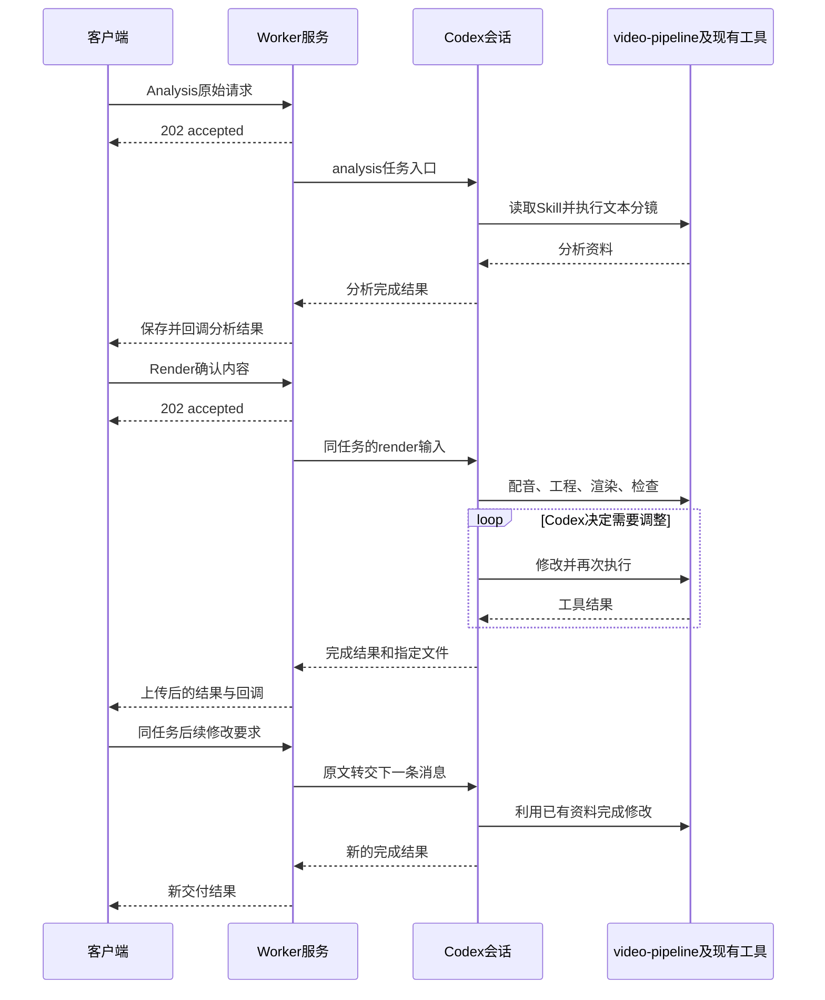

# Worker 接口服务与独立 video-pipeline 输入输出适配方案

日期：2026-09-23  
状态：待实施方案，不代表代码已修改或部署。  
基线：`codex/rebuild-video-pipeline-two-stage` 分支，提交 `a32dcee`；已结合该分支当前工作目录核对。
本次只新增本文，不合并其他分支代码，不修改已有代码、配置或文档。

本文从工作树中的同名方案复制，并按目标分支现状修订。它不要求新增独立 MCP 服务或重新建设任务工具平台。目标分支已有《video-pipeline 两阶段 Codex 输入方案》等文档仍描述 Worker 制作校验、受控工具和候选结果机制；这些是当前机制，本方案提出的目标是让制作判断回到 Codex/toolkit。此次不改写那些文档，本文也不表示新机制已经实现。

### 分支核对结论

- 两阶段 HTTP 接口、原生工具禁用、Worker 注册的 `video_*` 工具、制作验收及恢复循环，在目标分支中已经存在，仍需按本文解耦。
- 当前媒体调用链是 `codex-host.ts → mediaArguments / mediaSlots → processes.run → tools/stage_media.py`，并通过 `recordMediaProgress` 登记结果。
- 目标分支没有另一工作树新增的 `media-executor.ts`、`media-operation-ledger.ts`、`media-cache.ts` 和 `media-execution-view.ts`。不合入它们，也不把删除这些不存在的文件列为本分支实施工作。
- 当前仍有 toolkit 自身的 TTS/渲染复用，以及 Worker 的时间轴摘要检查；不能因为没有新增宿主媒体缓存，就认为现有链路已经完全解耦。

## 1. 一句话说明要做什么

**保留 Worker 的服务和接口，让它把客户端任务交给 Codex；Codex 独立执行现有 video-pipeline，完成后将结果交回 Worker，由 Worker 上传、保存并回调客户端。**

不是删除 Worker，也不是让客户端直接连接模型。删除的是 Worker 对视频制作的业务干预。

```text
客户端
  ↓ HTTP 请求
Worker 接口服务
  ↓ 原始任务 + 阶段 + 输入文件位置
Codex
  ↓ 阅读并执行
video-pipeline Skill + 现有制作工具
  ↓ Codex 返回状态、业务结果、交付文件路径
Worker 接口服务
  ↓ 保存、上传、回调
客户端
```

## 2. 保留什么，移除什么

| 组件 | 是否保留 | 改造内容 |
|---|---|---|
| Worker HTTP API | 保留 | 接收 Analysis、Render、查询、取消等请求 |
| 数据库和队列 | 保留 | 保存请求、会话关联、执行状态和结果，控制系统任务并发 |
| Codex app-server 连接 | 保留 | 启动/恢复会话、转交消息、接收事件及最终回复 |
| 任务目录和进程管理 | 保留并简化 | 同任务使用稳定资料目录，管理启动、停止、取消和系统异常 |
| 文件上传、结果保存、callback outbox | 保留 | 按 Codex 指定文件交付，可靠重试传输 |
| video-pipeline 两阶段 Skill | 保留 | 增加薄的输入输出约定，删除必须使用 Worker 制作工具的要求 |
| Python、Node、Remotion、FFmpeg 等制作工具 | 保留 | 由 Codex 直接调用，解除对 Worker 制作控制记录的依赖 |
| Worker 注册的 video_* 工具 | 移除 | 不再注册、不再处理这些制作调用 |
| Worker 媒体调用封装、时间轴验收、制作修复 | 移除 | 删除目标分支现有干预；不引入另一分支的宿主媒体缓存 |
| 新建独立 MCP 服务 | 本方案不需要 | 不为本次适配重新搭建一套工具平台 |

## 3. Worker 仍然提供哪些接口

以下是仓库已有接口，首阶段继续保留 URL 和客户端请求形式。

| 方法与路径 | 用途 | Worker 做什么 |
|---|---|---|
| `POST /narrate/ai_video_director/getAiVideoEditingAnalysisData` | 请求文本分镜分析 | 登记原始请求，转给 Codex 的 analysis 阶段 |
| `POST /narrate/ai_video_director/getAiVideoEditingData` | 提交确认内容，制作视频 | 登记原始请求，转给 Codex 的 render 阶段 |
| `GET /ai_video_director/tasks/:taskId` | 查询任务 | 返回保存的执行状态、Codex 进度、结果与回调状态 |
| `POST /ai_video_director/runs/:runId/cancel` | 取消一次活动执行 | 停止对应 Codex 执行及所属子进程，保留资料 |
| `POST /ai_video_director/callbacks/:eventId/retry` | 重试失败回调 | 只重发回调，不重新制作视频 |
| `GET /healthz` | 检查服务健康 | 检查服务和数据库连接 |

Analysis 与 Render 请求仍可以快速返回 `202 accepted`。这只表示 HTTP 请求已接收，避免长连接超时；**不表示制作主控只运行几秒就退出，也不表示改成定时任务执行。**

HTTP 请求返回后，服务器上的 Codex 制作会话继续运行，Worker 持续接收事件。客户端使用现有查询和回调获得状态。是否增加实时事件流接口可以后续决定，不是恢复职责边界的前置条件。

## 4. 谁负责执行 video-pipeline

执行者是 Codex，Skill 是它读取的工作说明，命令和脚本是它使用的工具。

```text
Codex 读取 video-pipeline
  ├─ 通过文件工具读取原稿、模板与确认内容
  ├─ 通过命令工具调用配音脚本
  ├─ 编写时间轴与 React 工程
  ├─ 通过命令工具调用 Remotion、FFmpeg
  ├─ 通过看图和检查工具审查结果
  └─ 修改、再次执行，最后提交结果
```

MCP 是一种工具接入方式，不是制作链路能够运行的必要条件。现有 CLI 已经能提供的能力，不需要为了接入 Worker 全部改写成 MCP。

如果独立 video-pipeline 原本确实使用某个已配置 MCP，则继续按其自身配置使用。Worker 不在任务中临时注册一套同名替代工具，也不介入该工具的制作逻辑。

### 4.1 当前代码为什么必须同时改工具配置

目前服务器并不是直接使用 Codex 的普通制作工具：

- `app-server.ts` 强制关闭了原生 shell、命令执行、看图等能力。
- `codex-host.ts` 注册 `video_exec`、`video_tts`、`video_media`、`video_view_image` 和 `video_chapters`。
- Codex 的这些工具调用回到 Worker 的处理函数。
- `video_media` 经 `mediaArguments` 构建命令，经过 `mediaSlots` 后由 `processes.run` 调用 `tools/stage_media.py`。
- 返回结果由 `recordMediaProgress` 核对时间轴摘要并写入 `.control/progress.json`，过期结果会被 Worker 拒绝登记。该分支尚无 MediaExecutor。

所以正确改法不是只删除注册数组，而是：

> **恢复 Codex 在任务环境中使用现有工具的能力，同时删除 Worker 的制作工具注册和处理器。**

## 5. 输入适配怎么实现

### 5.1 Worker 保存原始请求，不加工制作内容

每个视频任务有一个稳定目录；每条客户端消息有独立输入子目录，避免覆盖此前输入。

```text
tasks/<内部taskId>/
├── input/
│   ├── message-001/
│   │   ├── task.json
│   │   ├── request.json
│   │   └── attachments.json
│   └── message-002/
│       ├── task.json
│       ├── request.json
│       └── attachments.json
├── project/                  工程
├── work/                     中间结果、配音与工具记录
└── output/                   Codex 指定的交付文件
```

`request.json` 保存客户端原始请求数据。Worker 不删除正文、调整标点、重新拆句、估算时长或填入角色制作策略。

模板和素材仍由现有输入获取能力按客户端指定 ID 获取；只负责取文件及记录路径，不解析模板来替 Codex 选择制作要求。

### 5.2 task.json 只是一份文件位置说明

```json
{
  "protocol": "video-pipeline-io/1",
  "taskId": "task-123",
  "requestId": "request-456",
  "stage": "render",
  "requestFile": "input/message-002/request.json",
  "attachmentsFile": "input/message-002/attachments.json",
  "resultFile": "output/request-456/result.json"
}
```

这是目标格式示例，尚未实现。路径相对当前任务根目录，不能由任意外部路径替代。

- `stage` 由客户端调用的 Analysis 或 Render 接口确定。
- `taskId` 用于关联同一视频任务，不参与渲染缓存判断。
- `requestId` 用于识别本条消息，防止读取旧消息的结果。
- `resultFile` 为这条消息的输出位置，不代表新建另一份视频工程。

### 5.3 Worker 发给 Codex 的启动说明

保留固定、简短的适配说明，例如：

```text
按 video-pipeline 执行当前任务。
任务入口：input/message-002/task.json。
请读取它引用的完整请求和输入资料。
所有制作资料保存在当前任务目录。
按 video-pipeline 的输入输出协议返回结果。
```

固定说明只描述任务入口、工具权限和返回格式，不包含配音、章节、字幕、动画、渲染顺序或修复策略。

## 6. video-pipeline 内部怎么适配

无需再增加一个外部主控 Skill。给现有 Skill 增加一份 `references/task-io.md` 即可表达输入输出约定，并在 `SKILL.md` 中引用。

该文件只负责说明：

1. 如何读取任务信封和原始请求。
2. analysis 与 render 分别执行已有流程的哪部分。
3. 如何返回完成、失败或需要输入。
4. 如何声明最终文件及业务结果。

不能在这份适配说明里重新写一套不同的制作流程。

### 6.1 Analysis

Codex 读取原稿和要求，执行现有文本分镜方法，返回客户端需要的分析结果。拆句、估时等业务逻辑由 Codex 或它调用的 toolkit 工具负责。

Worker 只保存和回传结果，不再执行 `normalizeAnalysis` 等带正文与制作判断的逻辑。

### 6.2 Render

Codex 读取客户端确认内容，执行现有完整制作流程：配音、实际时间轴、工程、渲染、审片、修改和最终交付。

现有 `stage_tts.py`、`stage_media.py`、`render_batch.py`、`render_scene.cjs` 等继续复用。但其中要求 Worker `.control`、专有动态工具或宿主接纳记录的部分必须解除绑定。

检查功能仍留在 toolkit，并由 Codex 调用。工具报告问题，Codex 判断下一步；Worker 不再独立调用制作终检或业务恢复器。

### 6.3 工具执行约定

- Codex 发起渲染后等待该命令完成，再判断是否修改。
- 长命令返回执行句柄时，继续等待同一命令，不因一次工具调用返回就结束制作任务。
- 同任务已有配音、工程和视频由 Codex/工具继续使用，Worker 不建立媒体缓存。
- 不把修改后的工程与先前完成文件不同，作为 Worker 拒绝交付的理由。
- Codex 对最终交付与确认要求是否相符负责；业务检查不是被删除，而是回到制作链路内部。

## 7. 输出适配怎么实现

### 7.1 由 Codex 生成统一结果

```json
{
  "protocol": "video-pipeline-io/1",
  "taskId": "task-123",
  "requestId": "request-456",
  "stage": "render",
  "status": "completed",
  "result": {
    "dataList": [
      {
        "id": "scene_001",
        "content": "确认正文",
        "artifactRef": "video-001"
      }
    ]
  },
  "files": [
    {"id": "video-001", "path": "output/request-456/scene-001.mp4"}
  ],
  "error": null
}
```

此处展示传输关系。`result` 的实际字段保持现有客户端契约，由 Codex 或 toolkit 的输出转换工具生成。Worker 只进行明确字段映射，以及把 `artifactRef` 替换为上传 URL。

状态先限定为：

- `completed`：Codex 已完成当前阶段。
- `needs_input`：Codex 明确需要客户端或管理端处理。
- `failed`：Codex 明确返回失败及原因。

Worker 不把 `completed` 改成“候选，等 Worker 判断视频是否合格”。

### 7.2 文件和最终回复如何对应

Codex 写入当前消息指定的 `result.json`，并在当前 turn 的结构化最终回复中明确引用该文件及 taskId、requestId。

Worker 只接收当前会话、当前消息的明确最终回复，不能扫描 output 目录找到一个历史文件就宣布完成。两处身份不一致属于协议错误，不是制作错误。

如果当前 Codex 版本支持直接返回完整结构化结果，也可直接使用该结果；实现阶段选定一种权威出口，不能两套结果同时独立发布。

### 7.3 Worker 收到结果之后

```text
确认回复属于当前任务和消息
    ↓
检查指定文件位于本任务目录
    ↓
交接并保存指定文件
    ↓
上传文件，将明确文件引用替换成 URL
    ↓
事务保存结果与 callback outbox
    ↓
回调客户端
```

允许检查文件存在、路径归属、普通文件类型及传输完整性；不得检查字幕、时长、音色、分镜覆盖、时间轴、模板效果或工程版本。

交付文件必须在提交后停止写入。复制时发生变化应报告“文件交接失败”，不能触发重渲染。上传或回调失败，只重试传输。

## 8. 两阶段与同任务修改的完整时序



同一个业务 task 关联稳定的 Codex thread 和任务目录。数据库可以保留 stage/run/请求执行记录，但不能因为新建一条执行记录，就把制作资料搬到空目录重新开始。

同任务只能有一个活动主控。新修改消息按顺序登记；在未验证安全中途投递之前，先排队并明确告知“等待当前操作结束后交给 Codex”，不静默修改正在渲染的输入。

## 9. Worker 主执行代码应当变成什么样

以下为概念伪代码，函数名不是新增框架要求：

```ts
const task = await saveOriginalRequest(clientRequest);
const workspace = await prepareInputFiles(task);
const session = await openOrResumeCodex(task, workspace);

const outcome = await executeCodexTurn(session, {
  input: taskEntryMessage,
  onEvent: forwardAndStoreEvent,
  signal: cancellationSignal,
});

await receiveAndDeliverCodexResult(task, outcome);
```

保留启动、取消、超时、断连和上传错误处理。代码中不应再出现：

```text
if 字幕不合格 → 重渲染
if 时间轴变化 → 旧视频无效
if 模板要求双人 → 选择两个音色
if 制作错误可修复 → 自动要求下一轮制作
```

这些判断全部属于 Codex 制作过程。

## 10. 具体修改现有代码的位置

| 位置 | 修改 |
|---|---|
| `video-worker/src/api/routes.ts` | 保留现有接口，继续调用收发任务应用层 |
| `application/tasks.ts`、`infrastructure/task-repository.ts` | 保留请求身份、幂等和模板文件定位；核对请求入库调用链，转交原始内容，把制作确认转换交给 toolkit |
| `runner/prompts.ts` | 改为简短任务入口说明，不抽取模板正文、不拼制作反馈策略 |
| `infrastructure/app-server.ts` | 恢复制作需要的原生工具，复用既有连接和事件能力 |
| `runner/codex-host.ts` | 删除全部 Worker video_* 动态工具注册、处理器与相关强制提示；保留会话启动、恢复和事件接收 |
| `application/execute-run.ts` | 删除制作验收与修复循环，只运行会话并处理系统状态与交付 |
| `infrastructure/validation.ts` | 仅保留结果信封、消息归属和路径交接检查 |
| `application/stage-results.ts` | 不再对比分镜或推导媒体时长；保存 Codex 结果、上传指定文件并回调 |
| `infrastructure/production-record.ts` | 不再解析时间轴做验收；只归档 Codex 指定资料 |
| `infrastructure/stage-workspace.ts`、`workspace.ts` | 稳定任务目录、追加消息输入，解除 run/attempt 与制作目录重建的绑定 |
| `application/render-recovery.ts` | 退出新调用链，不决定制作恢复 |
| `runner/media-tool.ts`、`media-slots.ts` | 移除 Worker 媒体命令封装、媒体槽位调度和 `recordMediaProgress` / `verifiedMediaProgress` 制作判断；保留系统任务级并发控制 |
| 另一工作树新增的 MediaExecutor、操作账本、宿主媒体缓存与执行视图 | 目标分支不存在，不作为本次迁移前置条件，也无需先合入再删除 |
| `runner/chapters.ts` | 不再由 Worker 注册章节制作工具；如果需要协作，由主 Codex 自身负责 |
| `domain/storyboard.ts` 中拆句、估时、确认转换等逻辑 | 需要的业务能力归 toolkit；Worker mapper 只做机械字段转换 |
| `claude-code-video-toolkit/.agents/skills/video-pipeline/` | 加入 task-io 说明，改用独立工具调用，删除依赖 Worker video_* 的约束 |
| `claude-code-video-toolkit/tools/` 相关脚本 | 复用原有实现，解除 Worker 专有控制记录依赖，不重写渲染引擎 |

不只是移除一个 `dynamicTools` 数组：发布层和资料保存层中的业务校验也必须清理，否则制作仍会被 Worker 的判断阻断。

## 11. 沙箱、凭据和资料保留

### 11.1 沙箱不是本次重建平台的理由

优先复用 Codex 的原生执行能力和现有部署环境。先实测任务目录权限、原生命令、看图、Chrome、FFmpeg、网络能力和取消回收，再确定必要的环境配置。

制作脚本不能再自动创建第二层冲突沙箱。不能通过打开整个宿主读写权限绕过问题，也不预先假定必须新建容器平台或独立 MCP。

如果现有环境无法满足隔离和执行能力，先记录具体失败，再补必要的环境适配。这是第一阶段验证门槛，不是已经解决的事实。

### 11.2 凭据

保留根 `.env`，不打印内容，不复制到任务镜像或任务目录。供应商工具只获取它需要的已授权配置，不能继承数据库等无关凭据。

配音接口如何拿到必要凭据，需要在独立调用验证中落实。不能在删除 Worker 的 video_tts 之后，让制作工具缺少配置，又悄悄把角色与配音决策重新塞回 Worker。

### 11.3 资料与复用

原任务目录保留已有音频、工程、中间文件和工具自己的调用记录。Worker 不管理媒体缓存键，不决定是否复用。

工具原有的音频复用和收费状态记录可以保留；未知收费结果不能通过自动重发来解决。它是供应商调用可靠性，不是 Worker 制作恢复。

## 12. 服务运行不等于定时后台查询

Worker 作为服务必须常驻；客户端请求可以异步返回，但 Codex 制作主控要持续推进或等待当前工具。

必须区分：

- **服务常驻**：Worker 持续接收请求和管理模型会话，这是需要的。
- **HTTP 异步响应**：先返回任务 ID，完成后回调，这是接口行为。
- **Codex 制作持续执行**：在同一会话中调用工具、等待、检查、修改，这是制作主控。
- **定时查询自动化**：隔几分钟唤醒、查状态、退出，不作为本方案的制作主控或默认跟踪方式。

Worker 保存和转发 Codex 的真实进度，不把单镜百分比说成全片百分比，不因进程有活动就判断制作流程健康。

客户端断开不自动取消制作；明确取消才停止。上传成功但回调失败，应显示交付/回调状态，不能误报视频制作失败。

## 13. 实施顺序：先独立跑通，再接 Worker

### 第一步：独立运行验证

不经过 Worker 的 video_* 工具。准备一份输入，直接让 Codex 使用现有 video-pipeline 完成：

1. analysis 返回文本分镜。
2. render 制作一个小视频。
3. 修改一次字幕或布局，再次制作。
4. 返回约定结果与实际文件。

这一步同时验证原生工具权限、依赖、凭据、长命令和沙箱。不能只证明“模型读到了 Skill”。

### 第二步：增加薄的输入输出适配

新增 task-io 说明及所需的小型转换函数，明确 request/result 格式。复用现有脚本能力，不新增独立 MCP 服务。

### 第三步：接入 Worker

保留接口、队列、数据库、app-server 连接、上传和回调。让它发送第一步相同的任务入口，并接收相同结果。

对照日志证明：Worker 没有注册制作工具，没有经 `media-tool.ts` 发起媒体命令或判断时间轴版本，没有运行制作校验器。

### 第四步：清理旧耦合

删除新路径中旧动态工具、制作验收、缓存与恢复的引用。旧协议历史任务可保留只读记录，但不能让新任务半途回退到旧制作机制。

### 第五步：真实完整验收

用同稿同模板完成原有 18 镜任务，再做一次同任务修改。验证实际结果、总耗时和回调，而不只是两秒测试视频能输出。

切换生产之前处理好活动任务，不热替换它们的工具或修改其版本记录。保留旧资料，禁止清空已有音频来“重新跑干净”。

## 14. 验收清单

| 验收项 | 通过条件 |
|---|---|
| 独立性 | 不启动 Worker，Codex 仍能执行 video-pipeline 两阶段 |
| 接口保留 | 客户端已有 Analysis、Render、查询、取消、回调重试接口继续可用 |
| 输入保真 | Codex 实际读取的原始请求与客户端提交一致 |
| 工具解耦 | Worker 不注册 video_*，没有媒体工具调用进入 Worker 业务处理器 |
| 制作主控 | 渲染、检查、修改、再渲染全部由 Codex 发起 |
| 无业务门禁 | Worker 不读取时间轴或视频内容决定是否完成 |
| 同任务修改 | 保留 thread 和任务资料，追加消息而非复制空工程 |
| 原生执行 | Python/Node/Chrome/FFmpeg、看图、等待均在受限任务环境实测成功 |
| 结果交接 | 只接受当前消息的明确最终回复和指定文件，旧输出不能误发布 |
| 上传重试 | 文件上传/回调失败不触发 Codex 再制作 |
| 取消 | 所属进程停止，资料保留，其他任务不受影响 |
| 完整业务 | 实际视频和一次修改结果通过测试验收，回调完成 |

测试套件可以检查字幕、声音、画面和分镜完整性，Codex 制作工具也可以检查；**这些测试不能再被塞回生产 Worker，变成它的业务决策。**

## 15. 完成后的系统是什么样

对客户端：仍然调用 Worker 服务，不需要知道 Codex 的工具细节。

对 Worker：只理解任务、消息、会话、进程、文件、结果和回调，不理解视频该怎么制作。

对 Codex：通过已有 video-pipeline 和工具完成整个制作过程，Worker 是否存在不改变这套制作方法。

对开发：重点是删除耦合、恢复原生工具、增加输入输出适配，而不是重写制作平台。

本文不承诺未经测量的渲染耗时；职责拆分完成后，性能问题仍需在实际制作工具、模板和资源配置中测量解决，不能再通过 Worker 接管制作决策来处理。
