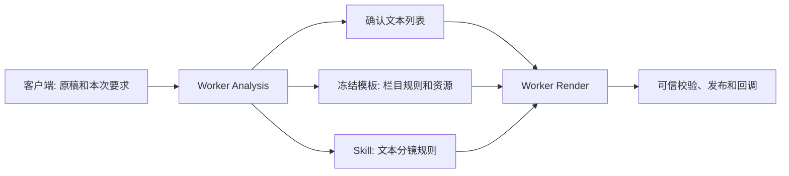

# video-pipeline 两阶段 Codex 输入方案

> 本文说明客户端、Worker、`video-pipeline` Skill 与财经模板在两阶段流程中的输入职责，并给出建议的最小调用方式。本文是输入组织方案，不修改当前 HTTP 路由、数据库字段或制作规则。

## 1. 要解决的问题

一次视频任务里通常同时存在四类信息：原稿、用户本次的特殊要求、栏目固定规则和平台执行约束。如果每次都把它们混在一大段提示词中交给 Codex，会有三个问题：

1. 同一规则在客户端提示词、Skill 和模板中出现多次，日后改动容易不一致。
2. Analysis 与 Render 都重复传整篇原稿、模板路径和技术规则，难以判断哪个版本才是权威。
3. 用户确认的逐句文本被当作提示词片段，而不是服务端的不可变确认快照，容易被模型上下文或旧会话影响。

目标是让调用方只提交本次变化的信息；固定方法只维护一份；Worker 负责冻结、恢复和授权；Codex 专注当前阶段的工作。



## 2. 四层职责

| 层级 | 保存内容 | 是否每次传入 Codex | 负责人 |
| --- | --- | --- | --- |
| `video-pipeline` Skill | 两阶段边界、文本保真、制作流程、TTS/时间轴/校验失败处理 | Worker 按阶段加载 | 工程维护者 |
| 冻结模板 ZIP | 栏目文字、主持人、Logo、BGM、音效、片头片尾、renderer 基线 | Worker 冻结后由 Render 读取 | 模板维护者 |
| 本次任务数据 | 原稿、模板选择、输出规格、用户本次特别要求、授权素材 | 仅在当前任务上下文中提供 | 客户端/用户 |
| 确认快照 | 用户确认后的完整 `sceneId/content` 列表和版本 | Render 从 Worker 数据库恢复 | 客户端确认、Worker 保存 |

固定规则只能有一个权威来源：文本分镜规则在 `references/text-storyboard.md`，正式制作规则在 `references/production-flow.md`，财经栏目规则在模板 ZIP。客户端不复制这些规则。

## 3. 当前 Worker 的真实输入边界

当前接口仍需要历史兼容字段。客户端不要把它们理解为 Codex 提示词的一部分：Worker 解析后只将可信业务数据写入任务快照。

### 3.1 Analysis 提交

当前 `POST /narrate/ai_video_director/getAiVideoEditingAnalysisData` 的最小可用数据如下：

```json
{
  "schemaVersion": 2,
  "requestId": "analysis_唯一请求ID",
  "taskId": "客户端任务ID",
  "script": "本次完整解说稿",
  "otherRequirements": "本次特有要求；没有则传空字符串",
  "digitalHumanAccounId": "",
  "plugin": {
    "digitalHumanId": "",
    "templateId": "finance_dialogue_v1"
  },
  "narration": null,
  "outputSpec": {
    "width": 1920,
    "height": 1080,
    "fps": 30
  },
  "otherMaterial": {
    "picInfoList": [],
    "videoInfoList": []
  }
}
```

含义如下：

| 字段 | 是否为本次创作信息 | 说明 |
| --- | --- | --- |
| `script` | 是 | 唯一原稿来源，Analysis 按 Unicode 字符顺序校验文本保真。 |
| `otherRequirements` | 是 | 只写这期特别要求，例如“必须使用用户提供的财报图”或“首句保留原声”。不重复 Skill 或模板规则。 |
| `templateId` | 是 | 选择已配置的 ZIP 模板。生产服务不应让客户端传服务器文件系统路径。 |
| `outputSpec` | 是 | 本次规格与模板默认不同时才体现差异；财经模板建议明确传 `1920×1080/30fps`。 |
| `otherMaterial` | 是 | 本期新增且已授权的图片/视频素材；没有则为空数组。 |
| `requestId`、`taskId` | 否 | 幂等和任务身份。 |
| 数字人兼容字段 | 否 | 当前链路不支持数字人，必须为空。 |

### 3.2 Analysis 对 Codex 的精简指令

Worker 已加载 `SKILL.md`、`two-stage-contract.md` 和 `text-storyboard.md`，并把原稿、完整要求、输出规格、模板身份和模板的“文本分镜说明”放在可信任务上下文中。因此给 Codex 的阶段指令应当只有：

```text
执行当前任务请求指定的 Analysis 阶段。
遵循 video-pipeline；读取已冻结的原稿、模板文字说明和输出规格。
完成文本分镜后，按阶段协议返回结果并停止。
```

不应在这里再次展开“不得调用 TTS”“按自然句拆分”“不要生成画面”等条目；它们已经由 `text-storyboard.md` 作为唯一规则定义。

Analysis 的合法模型结果只有轻量文本列表：

```json
{
  "status": "candidate",
  "scenes": [
    {"text": "原稿中的一个完整自然句。"}
  ],
  "error": null
}
```

模型不生成 ID、时长、源坐标、视觉方案或预览。Worker 才会生成稳定的 `scene_001`、展示用估时和内部源映射；成功后释放执行槽位并进入 `awaiting_editor`。

## 4. 文本确认的唯一位置

客户端收到 Analysis 结果后，展示并允许用户编辑文本。确认提交的是完整列表，而不是给 Codex 重新拼接一段“请按以下文本制作”的提示词。

当前 `POST /narrate/ai_video_director/getAiVideoEditingData` 的核心请求是：

```json
{
  "schemaVersion": 2,
  "requestId": "render_唯一请求ID",
  "taskId": "客户端任务ID",
  "basePlanVersion": 1,
  "field_5": "",
  "templateId": "finance_dialogue_v1",
  "dataList": [
    {"id": "scene_001", "content": "用户确认或修改后的第一句。"},
    {"id": "scene_002", "content": "用户确认或修改后的第二句。"}
  ]
}
```

规则如下：

1. `dataList` 必须是完整最终列表，允许改字、增删和排序。
2. 每项至少有 `id/content`；不需要客户端计算时长、音频边界、`visualPlan` 或工程信息。
3. `plan` 可以省略或传 `{}`。它不是客户端必须回传的技术方案。
4. Worker 保存确认前后的文本、确认版本和内部方案。Render 只能读取本 run 绑定的确认版本。
5. 用户确认的是文字与顺序，不是预先锁死画面、TTS 或时间轴的实现。

## 5. Render 对 Codex 的精简指令

Render 时，Worker 已从数据库恢复：原始原稿、本次要求、已确认文本、冻结模板 ZIP、授权素材和执行限制。它们位于只读的 `render/<runId>/request.json` 与对应任务目录，而不是靠模型记住 Analysis 聊天记录。

因此给 Codex 的阶段指令应当是：

```text
执行当前任务请求指定的 Render 阶段。
遵循 video-pipeline；使用服务端已确认的文本快照和冻结模板完成制作。
按阶段协议返回 candidate 或 failed。
```

Worker 在此阶段加载 `production-flow.md` 和 `technical-routing.md`。这些文件已经定义：独立逐句 TTS、真实音频时长、字幕边界、模板组件复用、关键帧检查、媒体校验、工程资料保存、预算和失败规则。财经模板定义双人高亮、数据递进、章节卡、片尾及声音规则。

因此以下内容不需要反复加入 Render 指令：

- 原始解说稿全文；
- 模板的服务器或本机路径；
- 逐句 `sceneId/content` 列表；
- “每句一个 MP4”“真实 TTS 时长”“运行字幕校验”等固定制作规则；
- “输出发布路径”之类的发布要求。

最后一项尤其不能交给 Codex。Codex 只生成候选 manifest；Worker 独立校验 MP4、文本、音频、字幕、帧数和文件摘要，随后才发布文件并在回调中返回实际路径与实测时长。

## 6. `otherRequirements` 应该怎样写

`otherRequirements` 只承载本期区别于固定模板的要求。建议按“必须保留的业务事实”和“必须使用的业务资料”写，不写工具命令、实现路径或重复视觉规范。

适合写：

```text
必须使用附件中的 Q3 营收图；数字“近90%”和“0”不可改写；
首句需要更强的悬念节奏；不能把用户提供的采访引语伪造成原始音频。
```

不适合写：

```text
每句调用 TTS、用 FFmpeg、检查静帧、使用主持人高亮、生成 1920×1080 MP4。
```

后者属于 Skill 或模板，重复写会造成冲突风险。

## 7. “只传解说稿”的目标形式

对于固定的财经栏目，用户体验可以进一步收敛为只填写稿件：

```json
{
  "script": "本期完整解说稿"
}
```

由客户端适配层在发送当前 Worker 接口前补全：

```text
templateId              = finance_dialogue_v1
outputSpec              = 1920×1080 / 30fps
otherRequirements       = ""
otherMaterial           = 空数组
数字人兼容字段          = 空字符串
requestId、taskId       = 客户端自动生成
```

这是面向产品的简化输入，不代表当前底层 HTTP 契约已自动支持只传一个 `script` 字段。若要落地该体验，应在客户端或单独的 API 适配层补全默认值，不能改由 Codex 猜测模板、规格或素材。

一旦用户选择其他模板、变更画幅、提供专属素材或提出本期特殊要求，调用方再补充对应字段即可。

## 8. 推荐的最终调用口径

### 8.1 客户端对 Worker

Analysis：提交“原稿 + 模板 ID + 本期特殊要求 + 规格 + 本期素材”。

Render：提交“任务 ID + 分析版本 + 用户确认后的完整 `id/content` 列表”。

### 8.2 Worker 对 Codex

Analysis：

```text
执行当前任务请求指定的 Analysis 阶段。遵循 video-pipeline，完成后按阶段协议返回结果并停止。
```

Render：

```text
执行当前任务请求指定的 Render 阶段。遵循 video-pipeline，使用本 run 的确认快照和冻结模板完成制作，并按阶段协议返回结果。
```

### 8.3 资料流转边界

| 阶段 | Codex 负责 | Worker 负责 | 客户端负责 |
| --- | --- | --- | --- |
| Analysis | 原稿自然句拆分 | 冻结输入、校验保真、生成 ID/估时、保存版本、回调 | 提交原稿，查看文本列表 |
| 确认 | 不执行 | 保存确认版本 | 改字、增删、排序并确认完整列表 |
| Render | 创作、TTS、工程、时间轴、审片、候选 manifest | 恢复快照、提供受控工具、技术校验、发布、回调 | 接收每句成片及实测时长 |

## 9. 结论

推荐把“两阶段指令”从每次调用时的大段创作提示，改为 Worker 的两句阶段启动语。静态规则沉到 `video-pipeline` 和模板；动态业务信息保留在任务数据；确认文本由数据库快照传递。

这样既减少重复，也能保证同一任务的原稿、模板、确认文本和制作资料在重试、恢复、回调时始终对应同一个版本。
