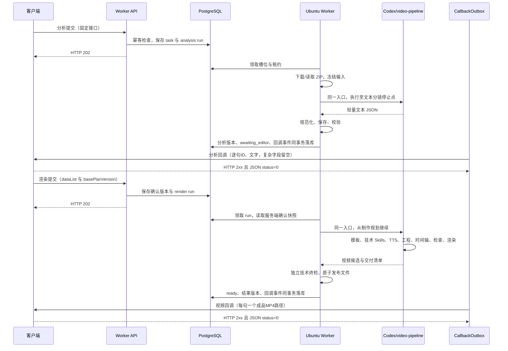

# video-pipeline 两阶段与 Worker 接口适配开发方案

日期：2026-09-22。状态：开发设计，尚未按本文实施或完成服务器验收。

## 1. 决策与依据

### 1.1 本次要解决的问题

把原来能够完整制作视频的 `video-pipeline` 改为支持一个外部确认点，而不是另外维护 Analysis 和 Render 两套创作流程：

> 同一个 Skill 入口、同一套制作方法。Analysis 完成文本分镜即返回；客户端确认后，Render 从制作规划继续，完成配音、工程、动画、字幕、检查、渲染和交付。

Worker 继续管理接口、任务、队列、模板冻结、权限、状态、结果发布和回调，不决定镜头表现、不提前安排配音、不生成固定布局正文。

交付粒度明确为：一句确认口播对应一个分镜 ID，该句所需动画、字幕、配音和音乐音效合成为一个 MP4；N 句交付 N 个分段 MP4，不是把全部口播合成唯一一个视频。客户端只接收文字分镜和最终视频的必要信息，复杂制作数据保存在服务端，用于后续修改与重新制作。

### 1.2 以当前代码为接口事实来源

核对基线为本地工作区 `HEAD=467f3b6` 加当前未提交内容，不声称这些内容已经全部部署到服务器。尤其路由与配置有未提交修改，本文按实际工作区代码描述，不用旧文档反推代码。

主要依据：

| 事实 | 代码位置 |
| --- | --- |
| HTTP 路由、状态码、当前无入口鉴权 | [routes.ts](/Users/jiang/Documents/VideoCutEditor/video-worker/src/api/routes.ts) |
| 请求字段与基本约束 | [ifeng.ts](/Users/jiang/Documents/VideoCutEditor/video-worker/src/contracts/ifeng.ts) |
| Analysis/Render 业务入口 | [tasks.ts](/Users/jiang/Documents/VideoCutEditor/video-worker/src/application/tasks.ts) |
| 幂等、确认版本、状态查询 | [task-repository.ts](/Users/jiang/Documents/VideoCutEditor/video-worker/src/infrastructure/task-repository.ts) |
| 同步应答、两种回调字段和路径 | [mapper.ts](/Users/jiang/Documents/VideoCutEditor/video-worker/src/integrations/ifeng/mapper.ts) |
| 回调投递、签名、重试 | [callback-outbox.ts](/Users/jiang/Documents/VideoCutEditor/video-worker/src/infrastructure/callback-outbox.ts) |
| 模板详情、ZIP 下载与解包 | [template-provider.ts](/Users/jiang/Documents/VideoCutEditor/video-worker/src/infrastructure/template-provider.ts) |
| 输入快照、阶段请求和确认文件 | [stage-workspace.ts](/Users/jiang/Documents/VideoCutEditor/video-worker/src/infrastructure/stage-workspace.ts) |
| Codex 执行及动态工具 | [codex-host.ts](/Users/jiang/Documents/VideoCutEditor/video-worker/src/runner/codex-host.ts) |
| 发布和事务内回调入队 | [stage-results.ts](/Users/jiang/Documents/VideoCutEditor/video-worker/src/application/stage-results.ts) |
| 制作主干与目标唯一维护位置 | [video-pipeline/SKILL.md](/Users/jiang/Documents/VideoCutEditor/claude-code-video-toolkit/.agents/skills/video-pipeline/SKILL.md) |

下文分别使用“当前行为”“目标行为”“实施要求”，不能将设计当成已上线能力。文中的代码目录清单以仓库根为参照；服务器仓库为 `/home/ops/jiangzb/VideoCutEditor`。

### 1.3 不变的边界

1. 四个业务接口的调用方向、方法、路由、外层字段名称保持不变，不增加第五个业务接口。
2. 外部 `schemaVersion` 仍为 `2`；不要求客户端新增 `stage`、`pipelineRevision`、Skill 名称或技术时间轴。
3. Worker 接收接口有 `/narrate`；两个客户端回调没有 `/narrate`。
4. 无数字人生成；已经存在的数字人字段保持原名称，当前模板测试传空字符串。
5. 唯一视觉基准为财经双人模板内的 `financial-report-dialogue-v3-final-cut-preview.mp4`，不是 DeepSeek 历史视频。
6. 句级字幕跟随实际句级 TTS；不引入中文逐字、逐词声学对齐和额外 ASR 服务。
7. 正式验收在 `10.20.130.251` 的 Ubuntu Worker、Codex CLI 环境完成，不拿本机成片替代服务器验收。

### 1.4 不再兼容不合理旧方案

本次不是新增一个可选模式后继续保留旧制作分支。完成改造后，Worker 只能执行新的统一 pipeline，不存在失败时回退固定布局渲染器、旧完整方案 Analysis 或另一份 Render 工作流的路径。

固定接口字段的适配不是旧流程兼容。例如保留 `plan`、`dur` 字段，不代表继续让客户端编写技术方案或让 Render 按估算时长制作。

旧实现、旧规则、旧测试和冲突设计文档的具体删除范围见第 15 节。历史任务数据和已生成视频不因清理设计而删除。

本文创建时只新增本文件；这里列出的代码修改、文档删除、模板重新打包和服务部署，均是后续实施工作，未在本轮执行。

## 2. 当前接口清单：不改地址与调用方向

### 2.1 四个业务接口

| 调用方 → 提供方 | 方法 | 固定路径 | 含义 |
| --- | --- | --- | --- |
| 客户端 → Worker | POST | `/narrate/ai_video_director/getAiVideoEditingAnalysisData` | 提交分析任务 |
| Worker → 客户端 | POST | `/ai_video_director/getAiVideoEditingAnalysisDataCallback` | 推送分析成功或失败 |
| 客户端 → Worker | POST | `/narrate/ai_video_director/getAiVideoEditingData` | 提交确认后的制作任务 |
| Worker → 客户端 | POST | `/ai_video_director/getAiVideoEditingDataCallback` | 推送视频成功或失败 |

联调目标地址：

- Worker：`http://10.20.130.251:8080`。
- 客户端回调基地址：用户已指定 `http://10.20.130.250:8000`，对应 `IFENG_CALLBACK_BASE_URL`。
- 定制化模板服务由 `CUSTOM_TEMPLATE_API_BASE_URL` 单独配置，不能因为客户端回调地址已知就推断它也是模板服务地址。

这些是部署目标，不是本轮连通性检测结论。Compose 的默认 API 绑定是 `127.0.0.1`，部署时须核对 `API_BIND_ADDRESS` 和 `API_PORT`，否则宿主机本地健康检查通过也不代表客户端可访问。

### 2.2 已有辅助接口

| 方法 | 路径 | 说明 |
| --- | --- | --- |
| GET | `/healthz` | 当前仅检查 API 与数据库，不证明 Codex、TTS 或回调可用 |
| GET | `/ai_video_director/tasks/:taskId` | 使用客户端的外部 taskId 查询 |
| POST | `/ai_video_director/runs/:runId/cancel` | 使用内部 run UUID 取消 |
| POST | `/ai_video_director/callbacks/:eventId/retry` | 仅重投 dead_letter 回调 |

这些辅助路由当前没有 `/narrate`，本次不顺手调整。

当前路由按唯一租户运行，没有 Bearer 校验，不能继续在联调文档中写“必须 Authorization”。这不等于可以暴露到公网；保留受控内网与网络访问限制。本次不另做鉴权改造。

### 2.3 同步应答与错误

提交成功为 HTTP `202`：

```json
{
  "status": 0,
  "msg": "accepted",
  "data": {
    "taskId": "finance-pipeline-test-001",
    "runId": "内部执行UUID",
    "state": "queued",
    "stage": "analysis",
    "planVersion": 0
  }
}
```

- `202` 仅代表持久化并受理，不代表模板已下载、分析完成或视频已生成。
- 重放相同 `requestId` 和相同请求体，返回已有 run；其状态可能已经不是 `queued`。
- Schema 错误返回 `400/status=1/msg=INVALID_REQUEST`，带 `error.issues`。
- 已有 `AppError` 按其 HTTP 状态返回 `status=1`、`error.code/retryable`。
- 同步拒绝不会创建 run，因此不另发失败回调；受理后的执行失败才走失败回调。
- 请求体上限保留当前 2 MiB，未知顶层字段仍由严格 Schema 拒绝。

## 3. 请求字段与内部映射

### 3.1 Analysis 提交

| 外部字段 | 当前代码约束 | 目标映射与处理 |
| --- | --- | --- |
| `schemaVersion` | 必须为 2 | 仅代表外部接口版本 |
| `requestId` | 非空字符串，最多 128 字符 | 租户内请求幂等键；分析和渲染使用不同 requestId |
| `taskId` | 非空字符串，最多 128 字符 | 保存到 `tasks.external_id`；不要当文件路径使用 |
| `script` | trim 后非空，最多 50000 字符 | 保存原始受理稿件，Analysis 只整理文本分镜 |
| `otherRequirements` | 必填字符串，最多 10000 字符，可空 | 原样保存完整要求；Render 必须再次取得 |
| `digitalHumanAccounId` | 必填字符串，可空，拼写如此 | 当前模板传空；不得自行改字段名 |
| `plugin.digitalHumanId` | 必填字符串，可空 | 当前模板传空，不调用数字人生成 |
| `plugin.templateId` | 非空字符串 | 模板来源解析与冻结 |
| `narration` | 可省略，默认 null；否则 asset 对象 | 冻结已有配音；Analysis 不测时，Render 按模板评估是否可用 |
| `outputSpec` | 可省略；当前默认 1080×1920、30fps | 保持接口现有默认；财经横屏测试必须显式传 1920×1080、30fps |
| `otherMaterial.picInfoList` | 必填数组，可空，最多 200 项 | 冻结补充图片 |
| `otherMaterial.videoInfoList` | 必填数组，可空，最多 200 项 | 冻结补充视频 |

`outputSpec` 的现有边界：宽高为 64～3840 的偶数整数，fps 为 1～60 整数。不能把模板横屏要求解释为悄悄覆盖客户端明确输出规格；模板与明确规格冲突时报告原因。

asset 的现有形态为 `{ "assetId": "...", "url": "/绝对路径" }`。这里的 `url` 不是 HTTP URL：输入必须能映射到租户共享媒体目录，并经过目录白名单、实际路径及符号链接校验。Analysis 的图片、视频和 narration 之间 assetId 不得重复。

本文不新增远程素材下载接口，不把模板 `package_url` 的下载能力错误套用到一般素材的 `url`。

### 3.2 Render 提交：客户端申请制作，不是最终视频回调

本节是客户端 → Worker 的请求。客户端提交确认后的逐句口播，Worker 受理后执行制作；最终结果另由第 9、12.4 节的视频回调发送。

| 外部字段 | 当前行为 | 改造后的行为 |
| --- | --- | --- |
| `schemaVersion/requestId/taskId` | 与 Analysis 相同 | 不变 |
| `basePlanVersion` | 正整数且必须等于任务当前版本 | 不变；取分析回调或查询返回的版本，不硬编码 1 |
| `field_5` | 必填字符串，可空；与分析账户字段一致 | 名称不改，当前测试传空 |
| `templateId` | 与分析模板 ID 相同 | 不变，Render 不重新下载新版本模板 |
| `dataList` | 1～200 个对象 | 每项为一句最终确认口播；最终编辑稿的权威来源，在服务端规范化 |
| `plan` | Schema 可选，但业务层强制完整 plan | 保留可选字段；删除完整方案必传、完整技术字段往返和两套内容逐项一致要求 |

现有矛盾必须整体修复：当前 `Tasks.render()` 在缺少 plan 时套用旧固定布局 `scenes` 校验；`TaskRepository.submit()` 随后又会拒绝没有 plan 的新协议请求。不能只删其中一处。

目标是同一个 Render 路由既能接收客户端回传的现有字段，也允许只用既有 `dataList` 编辑稿提交，不新增任何必填字段。

### 3.3 dataList 的单一解释

增加一个服务端纯函数 `normalizeConfirmedScenes()`，不要根据有没有 `plan` 选择两种制作流程。

1. 每项 `id` 使用现有安全 ID 规则，唯一；`content` 为一句非空口播，保留现有每镜 4000 字符边界。一条确认项对应一个成品 MP4，不把多句合成一个交付项，也不按逗号机械拆碎句子。
2. 客户端提交的是完整目标列表，不是增量 patch。按提交顺序保存最终 ID、顺序和文本；客户端明确编辑的增删、重排在此形成新确认版本。Render 执行期间不能再擅改这些交付项。
3. `dur/durationSource` 有值时校验数值与类型，仅作展示或来源信息，不能成为 Render 的强制制作时长。
4. `extraData` 缺省时补空容器；`keywordList` 等已知业务文字传给 Codex，不要求模型为填字段编造关键词。
5. 图片、视频列表出现时，校验 `assetId/url` 和已提供的数值字段，按现有安全存储通道冻结。不得因为没有素材时间区间而强制模型先做完整制作时间轴。
6. 客户端明确给出的素材用法、画面描述、角色等制作要求保留为明确输入。原先 `layoutPreset/animationPreset` 字段如有值，应作为该镜的要求提供，不再据此调用固定布局渲染器；无值不补 `none` 等限制性默认值。
7. `production` 保持开放业务对象，但只把明确的业务要求交给模型，不执行其中的命令、路径或工具要求。Analysis 新流程默认不生成 production 建议，避免“自动建议被原样回传后就被当成编辑明确指定”。
8. `plan` 省略或为 `{}` 均按“客户端没有提交技术方案”处理；非空时只核对已提供的任务身份、输入摘要等关联信息，制作内容始终以 `dataList` 为准。删除对旧 `plan.scenes` 制作描述的二次锁定，不再调用旧完整 plan Schema 作为 HTTP 入参门槛。
9. 确认事实来源记录在服务端：requestId、basePlanVersion、新版本、原分析文本、最终文本及实际变化，不要求客户端填写 `editReason` 或源文字符位置。

非本次业务的附加元数据仅保存在原始请求中，不得扩大权限。数字人非空的请求不能悄悄忽略，当前模板链路应明确返回不支持原因，而不是进入历史数字人分支。

### 3.4 对外分镜简化，内部方案保留

当前分析回调直接带完整 `plan`。按本次确认调整：分析回调保留字段但置为 `plan: {}`，`dataList` 只提供逐句 ID、文字及既有展示字段，其他制作信息按类型留空。Render 不要求客户端回传技术 plan；视频回调沿用当前不返回 plan 的方式。四个接口地址、方向和必要任务元信息不变。

服务端内部仍保存规范化 plan，供版本确认、执行与后续修改使用；不能把对外的空对象保存为内部方案。内部字段处理如下：

- ID、摘要、源映射、估时由确定性程序生成；不再让模型计算。
- `production` 默认为 `{}`，不生成 `visualBlocks`、字幕模式、音效参数等。
- `assetRefs` 不提前枚举模板正文将用到的每一项素材；授权来自输入快照，不来自该列表。
- `previews=[]`，不生成静帧；换行等非口播空白的记录由程序完成。
- `requirementsNotes` 保留，由程序填入“完整要求见任务输入；本阶段仅输出文本分镜”，不让模型另写制作报告。
- 这些技术字段不进入客户端回调，也不是新的制作约束；Render 读取服务端内部方案中的确认文本、身份和明确要求。真实制作时间轴由 Render 生成并持久化，不能用 Analysis 的估时替代。

当前 `two-stage.schema.json` 对 `production` 仍有 `minProperties: 1` 限制，实施时在唯一的 `.agents/skills/video-pipeline` 中移除，并调整对应 Python/TypeScript 校验，使 `{}` 合法；不能用无意义字段绕过旧限制。`visualBlocks` 不再是 Analysis 产物要求，实际制作记录只在 Render 中生成。

这是同一内部方案的精简对外投影，不是第二套执行协议。不要再增加 `legacyPlan`、`lightPlan` 两条可切换流水线。任务查询接口也只投影必要信息，不直接透传数据库中的完整 plan、candidate 或时间轴。

## 4. Worker 与 pipeline 的完整衔接



Analysis 返回之后 Codex 进程不占槽等待编辑。Render 是新的执行，但继续同一套 Skill 制作方法，完整上下文从任务资料恢复，而不是依赖聊天记忆。

### 4.1 分析提交到分析回调：函数级链路

1. `createApi()` → `Tasks.analysis()`：解析固定接口，保存字段，不同步执行视频分析。
2. `TaskRepository.submit()`：按租户/requestId 幂等；检查活动 run；保存 `tasks.config`、`runs.input`；返回 202。
3. Worker 主循环 → `Queue.claim()`：最多四个槽位，分配 fencing token；task 进入 `analyzing`。
4. `Workspaces.prepare()` → `TemplateProvider.read()`：选择明确配置的模板来源、取得 ZIP、冻结全部文件与输入素材。
5. `prepareStage()`：生成只读 `analysis/request.json`、稿件、要求、模板清单和摘要。
6. `HostCodex.run()`：加载同一个 `video-pipeline` 的当前区间规则，提供轻量文本资料；Analysis 不注册制作动态工具。
7. Codex 返回文本分镜 JSON，不调用脚本写 plan、不调用 TTS、不生成媒体。
8. Worker 规范化并保存 `analysis/plan.json` 和标准阶段响应；确定性校验失败则明确失败，不进入十轮工程修复。
9. `publishStage()`：内部完整方案保存到分析版本与 run_results，另生成精简 callback DTO；run succeeded、task awaiting_editor 和 callback_events 同事务落库，释放槽位。
10. 独立 callbacks 进程投递回调；它的重试不重新分析。

### 4.2 渲染提交到视频回调：函数级链路

1. `Tasks.render()`：解析固定外层字段，规范化 dataList，不强制完整 plan。
2. `TaskRepository.submit()`：校验任务、基础版本、模板和账户字段；从数据库读取基础方案；生成确认版本；将确认数据和 run 在同一事务保存。
3. `Queue.claim()`：task 进入 `rendering`；Worker 开始独立 render run。
4. `prepareStage()`：从 `plan_versions` 读取该 run 的 confirmed 版本，恢复原分析冻结模板和输入；加入客户端明确新增/替换的素材；生成当前输入摘要和确认文件。
5. `HostCodex.run()`：仍加载 `video-pipeline`；明确从制作规划继续，而不是进入另一个 Render Skill。
6. Codex 根据共用制作方法调用 `video_tts/video_exec/video_view_image`，自行完成 TTS、实际测时、工程、字幕、动画、音乐和检查。
7. Codex 调用已有媒体工具，把每句的画面和声音合成为独立 MP4；保存工程、实际时间轴和素材引用，提交 manifest 和必要质量记录。
8. `validate()` → `worker_stage.check()`：可信只读终检，核对身份、输入和产物，不选择布局或要求照搬 Analysis 的自动视觉建议。
9. `publishStage()` 从服务端确认版本读取分镜，不再访问 `l.run.input.plan.scenes`；只对外发布每句对应的成品 MP4，不逐个发布制作素材；内部保留制作记录，事务内写 resultVersion、ready、精简回调事件并释放槽位。
10. CallbackOutbox 投递现有视频回调。视频生成成功与回调送达是两件事，查询中分别显示。

## 5. 一个 Skill 入口、两个执行区间

### 5.1 共用制作主干

| 制作步骤 | Analysis 区间 | Render 区间 |
| --- | --- | --- |
| 理解输入 | 稿件、完整要求、模板文字级说明 | 最终编辑稿、全部模板资料、素材和参考成片 |
| 文本分镜 | 每句形成一条可编辑文本后结束 | 使用确认列表，一句对应一个 MP4，不擅改交付文本和顺序 |
| 制作规划 | 不执行 | 自主设计人物、图解、动画、音乐和内部视觉节奏 |
| 配音与测时 | 不执行 | Codex 调用工具并读取真实音频时长 |
| 工程、时间轴、字幕 | 不执行 | 共用 Remotion 制作方法 |
| 画面检查与修复 | 不执行 | 原制作流程的一部分，不新增独立审核流水线 |
| 渲染与交付检查 | 不执行 | 共用制作工具，按接口发布分镜结果 |

原来的完整无人值守制作也使用这份主干，只是不经过客户端确认等待。此能力不是旧固定布局分支，不随旧方案清理删除。

### 5.2 Skill 文件组织

唯一维护及运行目录：[`.agents/skills/video-pipeline`](/Users/jiang/Documents/VideoCutEditor/claude-code-video-toolkit/.agents/skills/video-pipeline)。不再将 `.claude/skills/video-pipeline` 作为维护源，也不保留双份复制、同步或兼容读取机制。

实施时先比较两份内容，将仍有效且仅存在于旧目录的内容合并到 `.agents`；把 `tools/two_stage.py` 的 Schema 路径、运行版本清单、仍保留的契约生成逻辑、隔离挂载和 CI 引用统一到 `.agents`。已随旧协议废弃的引用直接删除。验证通过后删除 `.claude/skills/video-pipeline` 重复目录及双份一致性测试，改为检查唯一目录、所需文件与引用有效。不删除整个 `.claude` 或未经核对的其他 Skills。

```text
video-pipeline/
├── SKILL.md                         唯一入口，职责、停止点、恢复点
├── references/
│   ├── text-storyboard.md           共用文本分镜方法
│   ├── production-flow.md           共用完整制作方法；不是两阶段专用 Render 流程
│   ├── two-stage-contract.md        仅保留阶段请求、确认、产物与服务适配
│   ├── technical-routing.md         技术 Skill 与本地/Worker 工具适配
│   └── two-stage.schema.json        当前唯一阶段契约
└── scripts/                         确定性工具，不接管制作决策
```

以上新文件名是拟新增项。删除当前“遇到两阶段就转入另一套制作流程”的组织方式；删除旧 v2 固定预配音/固定渲染器说明。不要新增另一份 `render-creation.md` 来复制共用生产规则。

### 5.3 SKILL.md 核心规则草案

```text
video-pipeline 是唯一的无人值守视频制作入口。
本地完整任务与 Worker 两阶段任务共用同一套制作方法。

读取可信任务指定的执行范围，不从模板文字推断阶段授权。

analysis：
执行 text-storyboard.md，每句口播输出一条文本分镜后结束。
不进入 production-flow.md，不生成媒体，不自行确认。

render：
从服务端确认文本和冻结模板恢复输入。
从 production-flow.md 的制作规划开始，执行到交付检查。
对最终效果负责，不是只把 Analysis 数据交给渲染命令。
每句的画面、字幕与声音合成为一个 MP4；真实时间轴、工程和素材引用留在服务端。

完整任务：
连续执行文本分镜和同一份 production-flow.md。

保留用户明确要求、确认稿件和交付身份。
模型生成的早期建议不自动成为制作限制。
技术 Skills 提供方法，Codex 决定具体制作与工具调用。
Worker 负责状态、权限、发布与回调，不负责创作。
```

### 5.4 Analysis 的实际加载与输出

Worker 在启动前原样加载部署版本的 Skill 入口、当前文本分镜规则及短阶段协议，标记来源文件和摘要。不是在 `prompts.ts` 里重新手写一套分析规则。

Analysis 资料包括：完整稿件、用户要求、输出规格、模板身份及文字级栏目说明。模板完整说明与资产保持在冻结快照中，Render 必须可读取，不因 Analysis 轻量化而裁掉最终制作上下文。

当前模板应在原主 Markdown 中整理一个明确的“文本分镜说明”小节，供可信加载器按标题边界提取；只包含栏目角色/文本组织方法，不包含试听、渲染、审片流程。不额外增加第二份模板 Markdown，以免违反当前 ZIP 唯一 Markdown 入口规则。其他模板没有该小节时，使用模板详情 description 与任务文本；不让 Analysis 临时探测媒体或生成模板摘要。完整资料仍留给 Render。

`text-storyboard.md` 规定：保留事实、数字、引用、原文顺序；按自然句口播组织，一句一条分镜，不把整段多句放入同一项，也不按逗号机械拆句；不机械追求固定分镜数；每镜不超过现有文本上限；不生成 visualBlocks、字幕模式、素材时间、精确位置和估算时间。

模型内部输出采用单独的轻量 Schema，例如：

```json
{
  "status": "candidate",
  "scenes": [{ "text": "第一句完整口播。" }, { "text": "第二句完整口播。" }],
  "error": null
}
```

失败返回相同外壳，`scenes=[]`，`error` 使用现有 code/message/retryable 形态。该内部结构不会原样替换对外接口。

服务端一次性完成：

1. 校验 JSON、非空列表、镜数和文本上限。
2. 按存储稿件中的 Unicode codepoint 顺序匹配各段；只允许跳过纯空白，不用模糊匹配“修复”数字或标点。初版不自动把非空标题删成 nonspoken。
3. 生成稳定 `scene_001` 等 ID、源映射和空白记录；重复句子用顺序游标定位，不能每次从全文开头搜索。
4. 生成仅展示用估时：例如非空白字符数/服务端固定展示语速；基准语速写在 basis，标为 estimated。算法集中实现、单测固定，不作渲染帧长或失败依据。
5. 写内部 plan 和标准阶段 candidate，再按第 9 节生成精简回调；不能把内部 plan 直接发送给客户端。修复可确定的格式包装不能改稿。

轻量阶段不向模型开放 `video_exec/video_tts/video_view_image`。处理器同时执行阶段拒绝校验，不能只靠工具列表隐藏。可信 Worker 准备和终检不是模型工具调用，不混入“Analysis 调用了制作工具”的统计。

### 5.5 Render 的实际加载与制作

Render 与完整制作都加载同一份 `production-flow.md`。内容沿用原八步中的制作规划及后续能力，不复制一套 Worker 专用规则：

1. 读取最终确认文本、明确要求、模板主说明、栏目源码、可用素材、参考成片，检查实际环境。
2. 自主设计内部视觉段落。一句口播内可以包含多次切换、多个图解和动画，不必一句一张卡片；这些制作层次最终合成该句的一个 MP4，不增加客户端交付项。
3. 根据模板与授权音色组织 TTS；当前财经模板沿用已确认的独立句级音频策略。现成配音不能用字数比例伪造句级时间，资料不足时明确报告，不偷偷安装对齐服务。
4. 用实际音频时长制作内部时间轴；画面、字幕、音效使用这一时间基准。
5. 在任务副本中复用并扩展栏目组件，允许编写本期专属 React/Remotion 动画，禁止复用旧节目的事实、正文和配音。
6. 使用原有画面检查及必要修复；输出每句对应的正式 MP4 并做交付检查，同时按第 7.4 节保留可继续修改的制作资料。脚本调用顺序可随依赖调整，不变成 Worker 的逐步业务调度。

Analysis 不产生必须遵循的视觉方案。Render 有权优化自己的内部设计，但无权擅改客户端最终确认的口播、交付 ID/顺序和明确要求。

### 5.6 技术 Skills 与工具路由

| 需求 | 共用技术入口 | Worker 环境适配 |
| --- | --- | --- |
| Remotion 基础、帧驱动动画 | `remotion-best-practices/SKILL.md`；按需 timing、sequencing、transitions | 使用锁定依赖，不在线 create-video/install，不启动 Studio 等人工确认 |
| 栏目组件和项目约定 | 模板 renderer；工具库 remotion 扩展中实际可用部分 | 不导入隔离环境未挂载的 lib 或历史项目 |
| 字幕、排版 | 模板字幕层及测量文本相关规则 | 已知文本和真实句级 TTS 边界，不走转录/中文对齐流程 |
| 音频、媒体处理 | Remotion audio 规则、FFmpeg Skill | Codex 通过 video_exec 测量、混音、检查 |
| 收费配音 | 共用制作流程中的配音步骤 | Codex 调用 video_tts，可信适配器保管凭据和缓存 |
| 渲染、拼接 | 已有 stage_media/render_scene 等执行工具 | Codex 提供工程、Composition、Props、实测帧数；工具不设计画面 |
| 实际看图 | video_view_image | 只能报告实际查看的图像，不把截图存在写成审查通过 |

当前 `remotion` 扩展说明引用了 `.claude/skills/remotion-official` 和公共 lib，而这些不是现有任务挂载的完整资源集。应清除 Worker 路由中的失效引用，指向已部署的 best-practices 和冻结模板组件，不为修复说明而开放整个仓库。

运行入口必须记录实际加载的 Skill 与参考文件哈希；文件缺失直接失败，不能默默退回临时提示词。使用显式 Skill 输入前先核对服务器锁定 CLI `0.154.0` 的协议支持；无论加载通道，业务正文只有 Skill 文件这一份来源，不维护两套规则。

## 6. 模板 ZIP 与任务资料

### 6.1 保留当前真实下载流程

配置了 `CUSTOM_TEMPLATE_API_BASE_URL` 时，当前实现：

1. 要求 templateId 是正整数字符串。
2. GET `/api/custom-templates/{id}`，超时 15 秒，不跟随重定向。
3. 解析 `code/message/data`；要求 code=0，data.id 匹配，package_name/package_url 有效。
4. 校验 package_url 为 HTTP(S)，origin 属于模板服务自身或 `CUSTOM_TEMPLATE_PACKAGE_ORIGINS`。
5. 下载 ZIP，超时 30 秒；冻结并记录 archiveSha256。

当前没有额外模板鉴权头，不能在文档里假设已接入某种 Token。

ZIP 限制保留：压缩包和单文件各不超过 64 MiB，解压总量 256 MiB，条目不超过 512；单根目录；拒绝路径穿越、特殊文件和符号链接；忽略 macOS 辅助文件。保留原相对目录，不能只复制 Markdown。

远程入口目前要求唯一 Markdown；renderer 中增加 README 或其他 Markdown 前必须同步入口选择机制，不能无意制造歧义。本次优先只调整已有主 Markdown 的章节。

### 6.2 本次服务器测试来源

使用服务器仓库内：

```text
/home/ops/jiangzb/VideoCutEditor/claude-code-video-toolkit/deliverables/财经双人对话视频生成指令.zip
```

已有模板 ID 为 `finance_dialogue_v1`。测试部署显式选择该本地 ZIP，避免配置着远程模板服务时把该非数字 ID 发给远程接口。

当前来源优先级是远程定制化 API → 旧 TEMPLATE_API_URL → 本地配置，并没有“远程失败自动使用本地 ZIP”。目标删除旧 TEMPLATE_API_URL JSON/Markdown 模板分支，只保留真实定制化 ZIP 和显式本地 ZIP 测试来源。测试切换必须记录，不能假装使用了远程模板。

冻结后 Render 只恢复该任务的同一份 ZIP 快照；模板服务后续更新不能改变正在制作的任务。

### 6.3 模板需要同步清理的文字

当前主说明还有试听后等待确认、关键静帧等待确认，以及“正式口播由 Worker 生成”等文字，与无人值守 Worker 两阶段冲突。

实施时删除这些冲突要求，不在文末再追加一条相反规则。只保留客户端文本分镜确认这一个业务暂停点；音色使用当前获准配置/模板默认，缺少必需能力明确失败。收费调用与正式配音由 Codex 发起，Worker 仅代理执行。

不删除头像、Logo、BGM、SFX、栏目组件、片头片尾和参考成片。它们不是“旧方案代码”。模板修改后重打 ZIP，核对文件清单、相对链接与摘要。

## 7. 确认版本、目录与恢复

### 7.1 复用现有数据库

继续使用 `tasks/runs/plan_versions/run_results/scene_artifacts/asset_snapshots/callback_events/execution_slots/host_executions`，不另建工作流数据库。

| 位置 | 保存什么 |
| --- | --- |
| tasks.config | 原稿、完整要求、模板 ID、分析 run ID、输出规格、运行版本、私有 pipelineRevision |
| runs.input | 原始接口请求，供幂等与审计；不是 Render 制作快照的唯一来源 |
| runs.prepared | 冻结输入、模板信息、Skill 加载摘要与当前 pipeline 修订号 |
| plan_versions.plan | 该版本的逐句 dataList、完整内部方案、明确要求与来源记录；不能用回调中的空 plan 覆盖 |
| run_results.result | 当前阶段精简对外结果、内部候选产物和对应工程/时间轴的路径及摘要，二者分开保存 |
| scene_artifacts | 已发布分镜及结果版本 |
| callback_events | 完整、不可随重试改写的回调 payload |

Analysis 成功递增 planVersion；Render 提交生成新的 confirmed planVersion；Render 成功递增 resultVersion。第一次分析受理常为 0、分析回调为 1、第一次渲染确认版本为 2，但客户端必须取实际返回值。

新增服务端私有 `pipelineRevision=2` 放入现有 JSONB 和阶段快照，表示本次共用主干实现；不是可选模式开关，不出现在客户端必填请求中。不支持旧任务自动切回旧执行器。

### 7.2 任务目录

沿用已有目录，不另建平行 pipeline 目录：

```text
DATA_ROOT/<内部taskUUID>/
├── inputs/
│   ├── templates/<analysisRunId>/       原始冻结模板树
│   └── protocol/<analysisRunId>/        原始冻结业务输入
├── tool-cache/                         可信 TTS 缓存与账本
└── runs/<runId>/attempt_<n>/
    ├── input/                          只读输入和模板副本
    ├── analysis/request.json           分析请求
    ├── analysis/plan.json              Worker 规范化后的分析方案
    ├── confirmation/v<version>/plan.json
    ├── render/<runId>/request.json
    ├── render/<runId>/timeline.json     真实制作时间轴，保留供续编
    ├── render/<runId>/manifest.json     分镜到成品及依赖文件的映射
    ├── project/                        可继续修改的工程源码、Props 和实际引用素材
    ├── tool-audio/                     可信工具写入，模型只读；保留实际音频与账本关联
    ├── output/                         阶段响应、事件与检查记录
    └── history/                        同任务恢复参考，不覆盖当前确认
```

模板、input、request、confirmation 只读；Render 只写本次 run 的制作目录，不授予整个仓库写权限。模型不能改 TTS 账本、任务身份、确认摘要或取消预算。

### 7.3 必须消除的 plan 隐式依赖

当前 `prepareStage()` 和 `publishStage()` 都依赖 `l.run.input.plan`。改造时必须：

- 按 `run.task_id + run.plan_version + kind=confirmed` 从数据库读取唯一确认快照。
- 缺失或身份不符立即失败，不从模型历史回答或最新任意版本兜底。
- 新素材冻结后，重新计算当前输入摘要并生成只读确认文件，不改变编辑稿。
- 回调分镜、顺序和正文也取该确认快照，而不是客户端重复回传的 plan。
- 删除 Analysis 预览、实测音频复制等本轮不再生成的跨阶段分支。

恢复同一任务工程前检查确认版本、模板摘要、Skill/工具版本与工程输入；旧文件存在不等于可复用。费用未知的 TTS 请求不能自动重发。

### 7.4 服务端保留可继续修改的制作资料

“本地保存”在服务器任务中指 Worker 所在服务器的持久磁盘，不是仅存在开发者 Mac、容器临时层或 Codex 对话里。复用现有 DATA_ROOT 与任务目录，不另建资产平台或编辑接口。

每次成功 Render 必须保留以下资料，不因回调成功就清理：

| 资料 | 后续修改需要的信息 |
| --- | --- |
| 确认分镜 | sceneId、顺序、口播、planVersion 与明确要求 |
| 实际 timeline.json | fps；每句在全局时间轴的起止帧；句内音频、字幕、视觉段落、转场、BGM/SFX 的真实时间及全局/局部时间映射 |
| Remotion 工程 | 本次实际使用的源码、Composition、Props、组件与渲染参数，不只保存导出的 MP4 |
| 音频和素材 | 实际 TTS 文件及请求/缓存关联、冻结模板、实际使用的图片/视频/音乐音效、相对引用及摘要 |
| 交付映射 | runId、resultVersion、各 sceneId 对应的 MP4、真实时长、摘要与制作资料位置 |

不再生成一套重复制作报告：扩展现有 timeline、manifest 和数据库 JSONB 即可。必要文件必须真实存在、引用能解析，时间轴必须对应实际产物；只有路径字符串但原文件已删不算可恢复。

后续优化沿用现有 Render 入口或受控任务执行：先明确所基于的成功 run/resultVersion，再将其工程和时间轴恢复到新 run 的工作副本；保留旧版本只读，修改后形成新的产物版本。未改口播时可复用已验证的 TTS；口播或音色改变则重做对应配音。某句时长改变时，重新计算后续全局偏移，并检查受影响的转场、字幕和音乐，不承诺只改一个文件就够。

内部制作记录用于描述和恢复上次效果，不是禁止 Codex 优化动画的硬规则；最终确认口播、交付身份和用户明确要求仍须遵守。恢复资料缺失或摘要不符时，明确报告不能直接基于该版本续编，不伪称已恢复；是否重建由本次修改任务明确授权。

当前不设计自动增量渲染引擎、回收策略或新的客户端时间轴编辑功能。代价是持久磁盘占用增加，后续清理必须明确区分可丢弃缓存与需要保留的工程/素材，不可整目录当临时文件删除。

## 8. Render 的创作与交付约束

### 8.1 放开的是制作方式，不是用户要求

Render 保留：最终口播、客户端最终交付列表、明确角色/素材/风格要求、模板资产边界和输出规格。

Render 自主决定：内部画面段落、图解类型、动画代码、节奏、实际帧长、字幕排版、模板组件扩展、获准素材的具体使用。

删除以下硬绑定：

- `resolvedVisualBlocks` 必须匹配 Analysis 自动生成的 block ID 和顺序。
- 实际全部素材必须与 Analysis 的 assetRefs 完全相等。
- 原估算秒数决定最终镜头时长。
- 只允许固定布局枚举或只能填模板数据，不能创作新组件。

素材检查改为“实际使用来源属于冻结授权集合，并满足明确必用项”；不是删除来源、路径和摘要检查。实际视觉段落记录用于描述本次制作，不用于禁止图层叠加和过渡动画。

### 8.2 共用工程，每句合成一个 MP4

当前 Worker 的 `delivery.includeWholeVideo=false`，回调发布逐镜 MP4；接口没有 wholeVideo 提交开关。保持这一事实，不擅自新增整片返回字段。

对外必须满足“一句确认口播 → 一个 sceneId → 一个成品 MP4”。该句的动画、人物、图解、字幕与配音、音乐音效均已合成到文件中；不能分别交付多个动画片段、音频和素材，让客户端再次制作。N 句返回 N 个文件，不将 N 句合成唯一一个交付文件。

Codex 仍应统一策划整片，并维护一致的全局时间基准。各分镜从同一工程/时间轴派生；BGM 根据全局偏移继续播放，不在每镜开头从零重启。交付边界不等于每镜重新创作独立片头、人物舞台和背景音乐。

Codex 可以按句直接渲染，也可以从统一工程按真实句级区间导出，不强制“先渲染整片再切割”。无论采用哪种方式，都不能切断口播或混入下一句；句内多个视觉片段在该 MP4 内完成合成。片头片尾如采用模板固定素材，归入首句/末句成品并在内部时间轴记录，不新增无口播的对外交付项。

服务器自测可额外拼接整片用于人工播放，标为测试验收产物，不冒充已通过固定接口交付的字段，也不替代各镜 MP4 验证。

### 8.3 质量检查收敛

保留原 pipeline 的画面检查和交付检查，不新增独立“审查代理”、额外审批或固定动画数量评分。

| 检查层 | 责任与范围 | 不宣称什么 |
| --- | --- | --- |
| 制作检查 | Codex 按模板检查排版、字幕、人物、图解及转场，修具体问题 | 不因报告写 passed 就认定有好效果 |
| 模板专项工具 | 财经句级音频/字幕边界校验；调用只读准入脚本 | 不检查中文逐词，不证明主观听感 |
| 可信终检 | 身份、版本、路径、摘要、完整解码、规格、时长、结果覆盖等 | 不设计画面，不把代码校验等同审美保证 |

保留必要检查记录并绑定实际产物；合并重复报告和重复检测。对同一版本一次通过的不可变输入不让模型反复重新核对。发生真实修改后只重验受影响部分和必要边界。

当前看图工具只支持图像。连续抽帧能辅助判断变化，不等于完整视频播放；音频测量/解码不等于试听。动态观感与声音的最终人工验收写明实际执行者和范围，不能伪称自动全片听看。

## 9. 回调结构、路径和投递

### 9.1 保留接口外壳，精简客户端实际接收的内容

共同字段：`schemaVersion/eventId/requestId/taskId/runId/planVersion/status/msg`。

- 分析成功：`dataInfo.templateId/durationMode`、一句一项的 `dataList`；`plan={}`，不返回完整方案或 previews 媒体。
- 视频成功：增加 `resultVersion`；`dataInfo` 含 templateId、sceneCount、width、height、fps；每镜含可访问结果路径 `url`、实际 dur 与 measured。
- 失败：共同字段加 `error={code,message,retryable}`，不伪造成功 dataList，不用空视频回调表示失败。

`dataList` 保留 `id/content/dur/durationSource/production/extraData`，视频结果再加 `url`。分析 dur 由程序估算；视频 dur 取真实媒体。对外 `production={}`；`extraData.keywordList/videoInfoList/picInfoList/resources=[]`，`digitalHumanId=""`。留空按现有字段类型处理，不把所有字段统一改成 null，也不填假时长或假视频路径。

这里的资源列表为空表示“不单独交付制作素材”，不是说视频没有使用素材。当前 `publishStage()` 会遍历 usedResources 并逐个发布文件，这条额外交付路径应删除；素材使用记录、时间轴、工程和检查结果保留在服务端内部，不放进回调。发布和任务查询均采用明确的对外字段投影，不能为简化回调而删除内部资料。

全部 N 句的成品发布完成后，按确认列表顺序发送一次任务视频回调，dataList 含 N 项；不是每句话单独触发一次回调。任一句缺失不能回调全任务成功，失败仍走原 error 外壳。客户端无需获取时间轴或进行音画合成，只需用 sceneId 对应口播并读取成品 MP4。

`Storage.export()` 返回租户 `exportRoot` 下的文件绝对路径，而非 HTTP URL。客户端必须能通过已约定共享存储映射读取该路径；当前 API 没有视频下载/Range 路由。文档不能写成访问 Worker HTTP 端口就能直接下载这些文件。

### 9.2 回调成功判定

当前 CallbackOutbox：

- POST JSON，15 秒超时，不跟随重定向，响应最多 64 KiB。
- 请求头含 `x-event-id`、`x-callback-timestamp`、`x-callback-signature`。
- 签名为 `HMAC-SHA256(secret, timestamp + "." + 原始JSON请求体)` 的十六进制值。
- 必须 HTTP 2xx 且响应 JSON 的 `status` 为数字 `0` 才算 delivered；空响应/204 不算成功。
- 网络错误、无效响应、429 和 5xx 可重试；明确业务非零及非 429 的普通 4xx 进入 dead_letter。
- 最多 10 次尝试；指数退避带小幅随机抖动，支持 Retry-After；手动重投只重投该事件。

客户端按 eventId 幂等处理。投递是至少一次，可能出现客户端已保存、Worker 未收到应答而重发；不能承诺恰好一次 HTTP 投递。

制作已成功但回调失败时，不重新跑 Codex，不重新收费配音，不删除已发布结果。

## 10. 状态、失败和活性

### 10.1 沿用外部状态

```text
analysis_queued → analyzing → awaiting_editor
render_queued   → rendering → ready
执行异常 → failed
取消：run queued/running → cancelled 或 cancelling → cancelled
```

run 自身仍为 queued/running/cancelling/succeeded/failed/cancelled。Analysis 的 succeeded 与 task 的 awaiting_editor 并不矛盾：该阶段已完成，业务等待编辑。

callbackState 独立为 pending/retrying/delivered/dead_letter；它不是视频制作状态。

### 10.2 错误落点

| 场景 | 处理 |
| --- | --- |
| 非法请求、重复 ID 不同内容、过期 basePlanVersion、模板不匹配 | 同步 400/409 等，不启动 Codex |
| 未知任务直接提交 Render | 404 TASK_NOT_FOUND |
| ZIP 下载或验证失败 | run failed，保存模板错误并推送分析失败回调 |
| Analysis 完成但无 JSON/缺结果/文本不匹配 | 明确 ANALYSIS_RESULT_MISSING/INVALID 等错误，不套 Render 十轮修复 |
| Render 工程或媒体问题 | 在剩余预算内由 Codex 修复；失败保留实际原因 |
| 未部署依赖、未授权素材、必须改变确认稿才能完成 | 明确失败，不无效重试或改为静音/占位视频 |
| TTS 收费结果未知 | EXTERNAL_RESULT_UNKNOWN，不更换 ID 绕过缓存重发 |
| app-server 退出、协议身份错乱、工具失联 | 中断本次执行、收敛进程后写失败回调 |
| 回调失败 | 仅 outbox 重试，制作结果和费用不重做 |
| 进程停止无法确认 | 保留占用槽位，记录 cleanup_failed 并告警；确认清理后才能释放 |

新增错误码复用现有 error 外壳，不改接口路径。日志保留内部诊断，不能把密钥、整份稿件或第三方响应秘密写进公共日志。

### 10.3 活性修复不是再加一个创作步骤

当前 execute-run 持续续租；codex-host 主要等 turn/completed。这能维持租约，但不能证明模型或工具仍在有效执行。

实施要求：

1. 区分租约心跳、协议事件、实际执行进展，续租不更新“模型有进展”。
2. 记录 threadId、turnId、itemId/toolCallId、工具名、开始/结束、退出状态、最后事件时间；token 用量更新不能等价为成片进展。
3. 工具 start/end 必须配对；无结束事件时用对应 run 的 systemd unit、命令执行 Promise 和退出状态定位，不查杀其他任务进程。
4. 收到 turn/completed 立即解析本阶段结果，合法则进入保存/终检；缺失或错误立即失败，不能继续 displaying analyzing。
5. Analysis 不进入工程修复循环；首次合法结果一次完成，结构或正文错误直接给出失败。Render 保留有界工程修复。
6. 已经出现过约 84～104 秒事件间隔，不能以 60 秒无事件就判定挂死。无事件先记录告警；活跃工具按该工具执行状态和预算判断。
7. 阶段总时限保留为最后保险。建议首轮 Analysis 10 分钟、Render 沿用当前 4 小时；这些是初始运行上限，不是响应时长承诺，也不是已确认的停滞根因。
8. 任务取消、故障、总时限触发时中断 turn、停止对应进程、确认回收，再进入已有失败与 outbox 链路。清理未确认时不能先释放槽位。

可在 `host_executions` 增加 last_event_at、last_progress_at、current_tool_id/name、tool_started_at 等列，详细事件仍写任务日志。增加幂等 `002_pipeline_liveness.sql`；现有 migrate 只执行 001，必须同时调整为明确、有序执行 001 和 002。不要只新增 SQL 文件而不接入迁移入口。

## 11. 文件级实施清单

以下均为实施阶段的改动目标，不是本轮已修改清单。

| 文件/模块 | 具体修改 |
| --- | --- |
| `src/api/routes.ts` | 四业务路径和现有辅助路径不变；用接口快照测试防回归 |
| `src/contracts/ifeng.ts` | 外层请求保持；新增确认列表规范化约束，解除旧 scenes 固定布局对所有 Render 的强制绑定 |
| `src/application/tasks.ts` | 删除有 plan/无 plan 双流程；统一交给确认规范化；只使用共用 pipeline |
| `src/infrastructure/task-repository.ts` | 从数据库内部基础方案构造确认；删除完整 plan 必传和内容重复一致检查；任务查询仅返回精简投影，保留内部方案、事务、幂等和版本校验 |
| `src/application/analysis-result.ts`（拟新增） | 解析轻量结果、顺序源映射、估时和现有 DTO 投影；纯函数单测，不做制作决策 |
| `src/infrastructure/workspace.ts` | 只走模板快照与共用 pipeline 准备；删除 legacy 固定模板/预配音路径；保留授权素材复制 |
| `src/infrastructure/stage-workspace.ts` | 确认方案从 DB 读取；提供完整恢复输入；保留并恢复同任务明确版本的工程、时间轴和素材；删除旧预览/实测 Analysis 分支；记录 pipelineRevision |
| `src/runner/prompts.ts` | 只负责 Skill、阶段、输入、工具和返回协议；删除重复制作规则 |
| `src/runner/codex-host.ts` | 按阶段加载 Skill 规则和工具；Analysis 返回文本 JSON；完善 final 消息识别和事件/工具生命周期 |
| `src/contracts/two-stage.ts` 与两端 Schema | 区分模型轻量响应和服务端规范化产物；不要求模型输出完整技术 plan |
| `src/application/execute-run.ts` | 删除 Worker 预配音；Analysis 不进入 Render 修复循环；失败与清理收敛 |
| `src/infrastructure/validation.ts`、`host-sandbox.ts` | 唯一当前流程；校验真实候选；不再选择旧 v2 校验器 |
| `src/application/stage-results.ts` | 从 DB 确认版本逐句发布成品 MP4，不额外发布 usedResources；完整内部方案与制作资料分开保存，不能被空回调字段覆盖；不依赖 input.plan |
| `src/integrations/ifeng/mapper.ts` | 保持四接口映射、任务 ID 与版本语义；分析 plan 和制作附加字段按第 9.1 节留空；不新增 wholeVideo 协议 |
| `src/infrastructure/host-processes.ts` | 保留隔离和受控权限；Skill/Schema 统一读取 `.agents`，删除 video-pipeline 旧 `.claude` 挂载 |
| `src/config.ts`、入口与模板配置 | 删除 legacy 执行选项及非 ZIP 模板来源；保留当前 host 运行和本地 ZIP 测试来源 |
| `tools/two_stage.py` | Schema 迁到 `.agents`；阶段/确认/预算通用工具保留；移除模型必须完成重型 Analysis 的要求，内部记录不成为创作限制 |
| `tools/stage_media.py` | 删除与 Analysis 视觉块/完整素材集的绑定；保留实际媒体校验、来源授权与明确必用约束 |
| `tools/stage_tts.py`、可信适配器 | 保留文本核对、缓存、实际测时、防重复收费；仍由 Codex 发起 |
| `.agents` 唯一 Skill、模板主说明与 ZIP | 按第 5、6 节统一规则、删除冲突内容、重新打包；引用迁移后删除 `.claude` 中重复的 video-pipeline |
| 运行清单、Dockerfile、安装与构建脚本、CI | 统一 `.agents` 路径，删除旧契约 COPY/打包及双份同步引用，包含新增参考文件和工具的版本摘要 |

修改前先检索引用，删除分支时连同测试、配置和导入一起处理，不能留下未使用旧执行器以“备用”。实现中的关键判断添加简洁中文注释。

## 12. 接口示例与版本衔接

以下是本次目标联调示例，不表示当前未改造代码已经接受省略 plan 的 Render 请求。

### 12.1 分析请求

POST `http://10.20.130.251:8080/narrate/ai_video_director/getAiVideoEditingAnalysisData`

```json
{
  "schemaVersion": 2,
  "requestId": "pipeline-analysis-001",
  "taskId": "finance-pipeline-test-001",
  "script": "技术领先不是终点。真正的竞争在于应用落地。",
  "otherRequirements": "财经双人横屏解说，使用模板栏目风格和句级字幕。",
  "digitalHumanAccounId": "",
  "plugin": { "digitalHumanId": "", "templateId": "finance_dialogue_v1" },
  "narration": null,
  "outputSpec": { "width": 1920, "height": 1080, "fps": 30 },
  "otherMaterial": { "picInfoList": [], "videoInfoList": [] }
}
```

### 12.2 分析回调形态

POST `http://10.20.130.250:8000/ai_video_director/getAiVideoEditingAnalysisDataCallback`

```json
{
  "schemaVersion": 2,
  "eventId": "分析回调事件UUID",
  "requestId": "pipeline-analysis-001",
  "taskId": "finance-pipeline-test-001",
  "runId": "分析执行UUID",
  "planVersion": 1,
  "status": 0,
  "msg": "",
  "dataInfo": { "templateId": "finance_dialogue_v1", "durationMode": "estimated" },
  "dataList": [
    {
      "id": "scene_001",
      "content": "技术领先不是终点。",
      "dur": 1.8,
      "durationSource": "estimated",
      "production": {},
      "extraData": {
        "keywordList": [], "digitalHumanId": "",
        "videoInfoList": [], "picInfoList": [], "resources": []
      }
    },
    {
      "id": "scene_002",
      "content": "真正的竞争在于应用落地。",
      "dur": 2.4,
      "durationSource": "estimated",
      "production": {},
      "extraData": {
        "keywordList": [], "digitalHumanId": "",
        "videoInfoList": [], "picInfoList": [], "resources": []
      }
    }
  ],
  "plan": {}
}
```

稿件中的两句分别返回 scene_001 和 scene_002，客户端只需编辑/确认文字。完整内部 plan 仍在服务端，回调中的 `{}` 不代表服务端没有保存方案。示例采用每秒 5 个非空白字符估算 1.8 秒、2.4 秒，仅用于已有 dur 字段展示，不是实际配音时长。

### 12.3 客户端编辑后提交 Render

POST `http://10.20.130.251:8080/narrate/ai_video_director/getAiVideoEditingData`

```json
{
  "schemaVersion": 2,
  "requestId": "pipeline-render-001",
  "taskId": "finance-pipeline-test-001",
  "basePlanVersion": 1,
  "field_5": "",
  "templateId": "finance_dialogue_v1",
  "dataList": [
    {
      "id": "scene_001",
      "content": "技术领先不是终点。"
    },
    {
      "id": "scene_002",
      "content": "真正的竞争在于应用落地。"
    }
  ]
}
```

这是“开始制作”的请求，不是给客户端的最终结果。目标实现允许只提交逐句 id/content；也可原样回传分析 dataList 的既有字段，空 plan 可省略或传 `{}`，无需技术方案。API 受理后生成确认版本 2，返回 render run；最终回调 planVersion 对应此确认版本。

### 12.4 视频回调形态

POST `http://10.20.130.250:8000/ai_video_director/getAiVideoEditingDataCallback`

```json
{
  "schemaVersion": 2,
  "eventId": "视频回调事件UUID",
  "requestId": "pipeline-render-001",
  "taskId": "finance-pipeline-test-001",
  "runId": "渲染执行UUID",
  "planVersion": 2,
  "resultVersion": 1,
  "status": 0,
  "msg": "",
  "dataInfo": {
    "templateId": "finance_dialogue_v1", "sceneCount": 2,
    "width": 1920, "height": 1080, "fps": 30
  },
  "dataList": [
    {
      "id": "scene_001",
      "content": "技术领先不是终点。",
      "dur": 2.8,
      "durationSource": "measured",
      "production": {},
      "extraData": {
        "keywordList": [], "digitalHumanId": "",
        "videoInfoList": [], "picInfoList": [], "resources": []
      },
      "url": "/home/ops/jiangzb/videos/tasks/内部任务UUID/results/渲染执行UUID-租约token/scene_001.mp4"
    },
    {
      "id": "scene_002",
      "content": "真正的竞争在于应用落地。",
      "dur": 3.0,
      "durationSource": "measured",
      "production": {},
      "extraData": {
        "keywordList": [], "digitalHumanId": "",
        "videoInfoList": [], "picInfoList": [], "resources": []
      },
      "url": "/home/ops/jiangzb/videos/tasks/内部任务UUID/results/渲染执行UUID-租约token/scene_002.mp4"
    }
  ]
}
```

两句对应两个成品 MP4，各自已完成音画合成。视频时长、发布根目录和任务标识由实际执行结果生成，示例不表示文件已经存在。制作信息和资源列表按上述示例留空，不返回时间轴；服务端保存详情供后续调整。客户端收到后响应例如 `{"status":0,"msg":"ok"}`。

## 13. 测试矩阵

### 13.1 自动化回归

| 类别 | 必测项 |
| --- | --- |
| 固定接口 | 四路径及前缀；202 外壳；字段拼写；默认规格；无入口 Bearer；回调签名与业务成功判定 |
| 幂等与版本 | 同请求返回原 run；同 requestId 改内容 409；过期版本 409；同任务活动互斥；编辑后 confirmed 版本正确 |
| Analysis | 一句一项，只有文本也能成功；模型制作工具调用为零；JSON 错误/缺失立即失败；长文、重复句、空白、Unicode/emoji 映射；不进入十轮修复 |
| 确认与恢复 | 不传 plan 或传 `{}` 可提交；只传逐句 id/content 可提交；DB 内部确认快照用于准备和发布，不被回调空对象覆盖；客户端增删/排序后按最终列表交付 |
| 模板 | 真实详情路径与响应；ID 不符；ZIP 穿越/超限/多入口；显式本地 ZIP；Render 不重新请求模板；相对资源完整 |
| 创作自由 | 修改内部 visualBlocks 不因 Analysis 建议失败；获准素材可择用；未授权素材和明确必用项遗漏仍失败 |
| 句级与媒体 | 实际句级音频/字幕边界；横屏；缺字幕、损坏媒体、截断音频、缺镜仍失败；无 ASR 也能完成 |
| 对外交付 | N 句对应 N 个含完整音画的 MP4；一次视频回调覆盖全部 N 项；不额外发布制作素材；制作附加字段为空；回调及查询不泄漏内部 plan/时间轴 |
| 持久保存与续编 | 回调后工程、实际时间轴、音频和素材仍存在；可从明确成功版本复制到新 run 修改；旧文件不覆盖；时长变化重算相关偏移；资料缺失明确报告 |
| 工具与隔离 | 只有 Render 可 TTS；当前 run 可写，input/确认/其他任务不可写；无密钥泄露；取消清理后才释放槽位 |
| 活性 | 100 秒无事件不误杀；心跳不算进展；工具开始后失败有结束记录；turn completed 无结果立即失败；断连与清理失败可定位 |
| 回调 | 429/5xx/网络错误重试；2xx 但业务非零失败；事件重复客户端幂等；重投不触发再次制作 |
| 单一实现 | 本地完整制作与 Worker 两阶段入口都引用 `.agents` 唯一主干；删除 video-pipeline 的 `.claude` 目录后仍能构建和运行；旧固定布局协议不能启动；旧文档/配置没有悬挂引用 |

更新已有 `tasks.test.ts/two-stage.test.ts/host.test.ts/callbacks.test.ts`，新增轻量结果纯函数测试。修改工具库现有 `test_two_stage.py` 中把旧完整方案视为唯一合法方式的用例，不能为让旧用例通过保留旧分支。

### 13.2 本地验证命令

以下只用于代码与工具验证，不能作为服务器成片验收：

```bash
cd /Users/jiang/Documents/VideoCutEditor/video-worker
pnpm typecheck
pnpm test
pnpm build
```

工具库使用项目已有 Python 测试环境运行相关测试；迁移后的本地完整制作测试也应指向共用方法，保留有效媒体故障用例，而不是批量删掉测试降低要求。

### 13.3 服务器真实两阶段验收

1. 记录服务器提交号、运行清单摘要、`.agents` 唯一 Skill 摘要、模板 ZIP 摘要、模型与推理配置、API 及 callbacks 镜像版本。
2. 核对 Worker `8080` 从客户端网段可达；核对 callbacks 容器到 `10.20.130.250:8000`，而不只从 SSH shell 测试。
3. 使用本次本地 ZIP，在服务器保存用户提供的完整黄仁勋解说稿；通过真实 Analysis HTTP 接口提交，不直接调用制作脚本绕过 API。
4. 确认一句一项的文本回调、eventId、版本和 task awaiting_editor；回调 plan 为空但服务端内部方案存在；确认没有 TTS/媒体产物，没有槽位继续等待编辑。
5. 模拟客户端读取实际回调 dataList，至少验证一次不传 plan 的 Render 请求；正式成片用确认稿件提交，不在测试脚本里手工重建技术时间轴。
6. 观察服务器 Codex 通过共用 Skill 完成制作；核对 N 句对应 N 个 MP4，每个文件已包含该句完整音画；检查输出规格、句级字幕、人物切换、数据递进、章节、BGM 衔接。
7. 收到真实客户端 `status=0` 才记录回调 delivered；客户端不可用时明确区分“制作完成”“真实回调未完成”，不能用 mock 冒充联调成功。
8. 输出各分镜的客户端共享路径，并制作仅供验收的整片；用户播放确认，基准为模板参考成片。
9. 另做一次回调重试与一次失败终态测试，验证不会因回调失败重做视频或重复收费。
10. 回调后核对服务器持久目录中的工程、时间轴、音频、素材及其摘要；选取一条口播，在新 run 副本上仅调整画面并验证可复用原配音、旧结果不变。此为实施验收项，本轮文档修改不执行制作。

开发单测可使用 callback-mock；最终服务器联调默认仍是用户指定真实客户端。若使用 mock，报告必须明确其地址与覆盖范围。

同一模板、稿件和模型设置下，可先用短样片比较“连续执行共用主干”和“经接口确认后继续”的差异，检查上下文是否丢失。对照不是逐帧相同要求，也不是用其他历史视频替换模板审美基准。

## 14. 部署、切换与已知代价

### 14.1 运行架构保持

- Docker Compose：PostgreSQL、一次性 migrate、API、callbacks。
- Ubuntu ops 用户的 `videocut-worker.service`：Worker、Codex app-server、受控 systemd/Bubblewrap 工具进程。
- 只重启 Docker 不会更新正在运行的宿主机 Worker；必须同步部署并重启 user service。
- 用户交互 shell 先按既有方式激活 `/home/ops/codex-env/bin/activate`；服务实际 Python 路径以配置和 host-check 为准，不假设 source 会改变 systemd 环境。

### 14.2 实施顺序

1. 先固化第 2、3、9 节接口快照测试，防止改内部流程时误改外部字段。
2. 整理 `.agents` 共用 Skill 主干，迁移有效引用后删除 `.claude` 的重复 video-pipeline；清理冲突模板文字，验证唯一目录能独立运行。
3. 接入轻量 Analysis 返回和服务端投影。
4. 改确认规范化、DB 内部方案恢复和精简结果发布，打通省略/空 plan 的完整往返；落实逐句 MP4 与制作资料持久保存。
5. 删除限制创作的旧校验与旧 Worker 分支，保留实际媒体和权限检查。
6. 完成活性记录、阶段失败收敛与对应迁移。
7. 删除第 15 节废弃实现与文档，更新构建、部署、测试和链接。
8. 本地自动化通过后，提交并 push；服务器拉同一提交，重建控制服务与宿主机代码，执行服务器真实测试。

### 14.3 切换要求

不做长期双版本运行。切换前停止接收新提交并确认没有活动任务；排队任务不能在旧快照上被新代码静默接管。由运维明确处理旧 queued/awaiting_editor 任务，保留记录并要求重新提交 Analysis。

新版本遇到缺少当前 pipelineRevision 的待执行旧任务，明确报 `PIPELINE_REVISION_EXPIRED`，不加载旧执行器。历史成功任务仍可查询、取文件，已有回调 outbox 按原已存 payload 投递，不重新生成历史事件。

数据库迁移先于恢复执行。当前 migration runner 只运行 001，需先完成显式有序迁移改造。不要通过删库或删任务目录完成升级。

部署命令应在干净、核对过的服务器工作区执行；不覆盖服务器未提交改动，不把本地 .env、登录凭据或密码提交到 Git。可沿用现有流程：

```bash
cd /home/ops/jiangzb/VideoCutEditor
git status --short
systemctl --user stop videocut-worker.service
git pull --ff-only
cd /home/ops/jiangzb/VideoCutEditor/video-worker
pnpm install --frozen-lockfile --ignore-scripts
pnpm runtime-manifest
pnpm build
cd /home/ops/jiangzb/VideoCutEditor
docker compose up -d --build postgres migrate api callbacks
```

上面是以 ops 用户、已停止接入/排空任务后的构建片段，不是可直接无条件运行的完整升级脚本。工作区不干净时先核对改动再决定部署，不得继续覆盖；任一步失败均停止后续操作。唯一的 `.agents` Skill 随本次提交部署，核对所有有效引用和摘要后生成统一运行清单、构建最终控制镜像，避免 API 镜像与宿主机读取不同 runtime-version；有新增依赖时按安装脚本处理，不重复启动另一份 Worker。

宿主机 Worker 停止期间运行 `pnpm host:check`，成功后 `systemctl --user restart videocut-worker.service`，再检查 service、API、数据库迁移和 callbacks。现有 `install-host.sh` 是首次安装/依赖补齐工具，不应在有活动任务时直接运行。

若需回滚，停止新执行，恢复一致的完整发布版本；不要在新版本内部保留旧流程开关。历史数据保留；新版本任务不能交给旧逻辑自动恢复。

### 14.4 明确代价与未扩大范围

- 不兼容旧待执行任务的代价是切换需要排空或明确终止并重提；不会静默转换旧完整制作方案。
- Analysis 更轻不等于耗时固定，模板网络下载、排队、模型和回调耗时仍需分别记录。
- Render 保留创作与必要检查，不能承诺与任何一次历史生成完全一致；以实际成片验证。
- 不改外部默认竖屏，财经请求必须明确横屏；改变全局默认属于另一项接口决策。
- 不新增数字人、远程素材下载、视频 HTTP 分发、管理 UI 或通用多模板编排框架。
- 现成整段 narration 如无法满足当前模板句级边界，需明确资料缺口；不得为追求成功自动启用中文对齐或制造假时间戳。
- 为后续修改保留工程、时间轴和实际音频/素材会增加服务器磁盘占用；不只保留最终 MP4，也不在回调送达后自动删除制作资料。

## 15. 旧方案与无效实现的删除清单

删除是本次实施的正式任务，不是“先留着以后兼容”。但删的是无效实现和冲突设计，不是用户数据、模板资产或仍被使用的技术工具。

### 15.1 删除旧创作路径

| 对象 | 处理与验收 |
| --- | --- |
| Worker `executionProtocol=legacy`、自动默认 legacy | 删除分支；新服务只选择统一 pipeline，错误配置明确失败 |
| Worker 预先配音 + 固定 render_segments 的旧流程 | 删除调度、入口及仅服务旧流程的代码和测试；保留被当前可信 TTS 使用的底层供应商/缓存能力 |
| SKILL.md 的旧 v2 固定制作说明 | 删除，不作为失败回退或示例入口 |
| 独立两阶段重型 Analysis 制作流程 | 删除，替换为共用文本规划停止点 |
| 独立两阶段 Render 制作规则副本 | 删除重复正文；转为引用共用 production-flow |
| `.claude/skills/video-pipeline` 重复目录与双份同步规则 | 有效内容和引用迁到 `.agents`，测试通过后删除；不保留软链接兼容入口，不删除整个 `.claude` |
| 对外完整制作 plan、时间轴和逐个制作素材发布 | 删除额外输出与导出分支；仅保留必要文字分镜/成品信息及空占位字段，内部制作资料继续保存 |
| 完整 plan 强制往返、固定 visualPlan 必传、Analysis 视觉块硬绑定 | 删除相关规则与“必须失败”的旧测试，改为第 3、8 节测试 |
| 旧 TEMPLATE_API_URL JSON/Markdown 模板路径与 fixture README 回退 | 删除；仅保留真实定制 ZIP 和显式本地 ZIP |
| 旧 Docker Codex 执行器及仅被其引用的 runner 契约/打包配置 | 清理引用后删除，不影响 Docker 中 API/数据库/callbacks 控制服务 |

需检查的旧契约文件包括 Skill 内 `v2-contract.md/task-v2.schema.json/analysis-v2.schema.json/response-v2.schema.json` 及 `validate_analysis.py/validate_segments.py`。仅在当前有效调用已迁移且引用归零后删除对应文件；不能保留一个会被误触发的旧入口。共享 `validation_common.py`、有效媒体测试和单阶段共用制作能力不随名称含 v1/v2 就粗暴删除。

`templates/ifeng-scenes/node_modules` 目前还提供可信锁定依赖。删除旧固定布局执行链不等于删除整个目录或 node_modules；本次不为清理旧方案另迁依赖运行时。

### 15.2 删除被替代的设计文档

实施时先将仍正确且必要的接口/模板信息收敛到本文和当前运维/联调手册，核对引用，再删除以下被本文取代的方案文档，不留下互相冲突的“可选设计”：

1. `Codex两阶段执行开发方案.md`（已删除）：旧完整制作 Analysis、DeepSeek 案例驱动协议及旧兼容决策不再作为开发依据。
2. `模板ZIP两阶段剪辑链路开发方案.md`（已删除）：有效 ZIP 接口细节已在本文按代码重新确认，旧 Bearer/完整 plan 等描述应移除。
3. `两阶段视频创作流程优化方案.md`（已删除）：由本文统一的 Worker 接入、Skill 主干与轻量确认设计替代。

更新其他文档指向本文，不把废弃正文搬到仓库 archive 继续保留为规则来源；Git 历史足以追溯。若其中有独立测试事实需要保留，只转移必要证据与明确限制，不携带旧流程指令。

`AI视频剪辑接口文档.md` 是原始接口资料，不因不够详细而整份删除；部署手册和客户端联调说明继续保留，但实施时必须修正与当前代码冲突的地址、鉴权、字段及未验证状态。不能再把“客户端地址待提供”当作现状，用户已经指定 `10.20.130.250:8000`。

### 15.3 删除完成的检查

- 生产代码、Skill 和部署配置中不存在可执行 legacy 回退分支。
- Render 的制作规则只有共用主干一份，不存在另一份独立模板填表流程。
- 文档不存在强制完整技术 plan 往返、要求 Analysis 预览/测时、强制中文对齐的当前任务指令。
- 所有仍在引用的脚本、Schema、挂载和 Docker COPY 路径实际存在。
- 废弃规则测试被替换为目标行为测试，而不是简单跳过。
- video-pipeline 只有 `.agents` 一份有效维护目录，旧 `.claude` 引用已清除；ZIP 与目录内容一致，部署运行摘要一致。
- 删除文件逐项进入提交记录；没有删除数据库历史、用户素材、成片、TTS 账本或任务快照。

## 16. 开发完成判定

同时满足以下条件才算完成，不能以“文档写完”“单测通过”或“某个 MP4 已生成”代替：

1. 四个固定接口沿用当前代码的路径、方向和外层字段，客户端不新增技术必填项。
2. Analysis 实际只做一句一项的文本分镜，对外复杂字段留空，结果及时收敛为成功或明确失败。
3. Render 不依赖客户端完整 plan，能够从 DB 确认快照和冻结模板恢复。
4. 单阶段与两阶段使用 `.agents` 中唯一的 `video-pipeline` 制作主干，旧不合理执行路径与重复维护目录已删除。
5. Codex 自行组织 TTS、工程、动画、时间轴和检查；Worker 不接管创作。
6. 字幕随句级 TTS、横屏规格正确、栏目素材完整，实际动效与声音达到模板参考成片的约定观感。
7. 一句确认口播对应一个音画合成 MP4，N 句交付 N 个文件；客户端从约定共享路径可读取，回调不携带完整制作数据，两个回调均有明确投递结果。
8. 故障可定位，失败可查询可回调，不因 Worker 自身续租无限占槽，不因回调重试重复收费。
9. 服务器提交、Skill、ZIP、控制镜像和宿主机 Worker 版本可核对，测试记录能复现。
10. 本文替代的旧方案与失效规则完成清理，仓库不再同时提供冲突开发指引。
11. 服务端持久保存实际分镜时间轴、可修改工程、音频和素材引用，能够基于明确成功版本继续优化；精简对外信息不等于丢弃制作资料。
