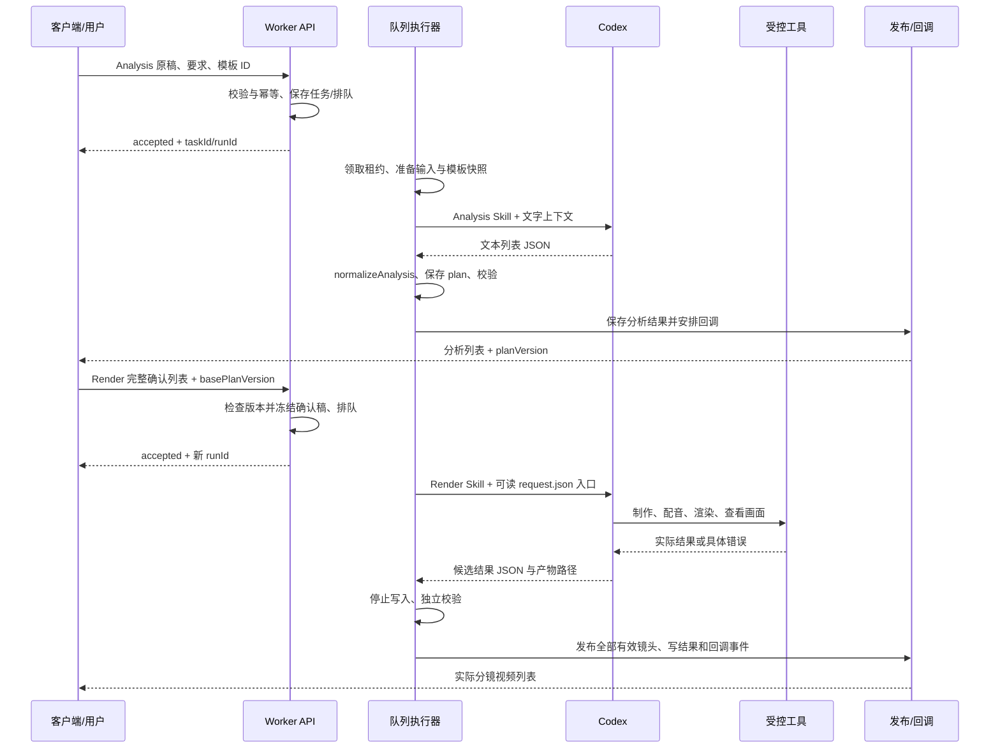

# 两阶段接口与接入说明

阅读边界：本文件记录要保留的当前接口与调用机制，不宣称当前代码已消除制作越界。两阶段制作规则按 05 替换；接口、会话和发布机制不重做。Worker 可以执行 Render 参数并核验媒体事实，不能另行决定布局、字幕风格或用估时限制实际时长。

## 1. 保留的业务链路

客户端提交原稿 → Worker 执行 Analysis → 分析回调 → 用户编辑并确认完整文本列表 → 客户端提交 Render → Codex 完整制作 → Worker 校验、发布所有分镜 → 视频回调。

HTTP 接收成功不等于制作完成。Analysis 结束后释放执行槽，等待编辑确认；不能自动开始收费配音。
本说明保留后续已确认的轻量文本分镜接口，不继承早期“Analysis 输出完整视觉方案”的设计。

## 2. 地址与提供方

| 方法与路径 | 提供方 | 用途 |
| --- | --- | --- |
| POST /narrate/ai_video_director/getAiVideoEditingAnalysisData | Worker | 提交分析 |
| POST /ai_video_director/getAiVideoEditingAnalysisDataCallback | 客户端 | 接收分析结果 |
| POST /narrate/ai_video_director/getAiVideoEditingData | Worker | 提交确认文本并制作 |
| POST /ai_video_director/getAiVideoEditingDataCallback | 客户端 | 接收分镜成片 |
| GET /healthz | Worker | 健康检查 |
| GET /ai_video_director/tasks/:taskId | 当前 Worker 已有 | 查询任务 |
| POST /ai_video_director/runs/:runId/cancel | 当前 Worker 已有 | 取消执行 |
| POST /ai_video_director/callbacks/:eventId/retry | 当前 Worker 已有 | 人工重发死信回调 |

两个提交接口有 /narrate，回调、查询和管理接口没有此前缀。管理接口是否向普通客户端开放，应按部署权限决定；当前没有可以在这里凭空定义的 HTTP 人工恢复接口。

历史联调 Worker：http://10.20.130.251:8080；客户端回调基址：http://10.20.130.250:8000。只作历史接入线索，新分支上线必须重新核验。
当前入站业务路由未要求 Authorization，不应直接暴露到非受信网络；网关鉴权、TLS、来源限制须由部署人员核定。本包不携带密钥。

## 3. Analysis 请求

Content-Type: application/json；当前兼容协议 schemaVersion=2。

```json
{
  "schemaVersion": 2,
  "requestId": "analysis-request-001",
  "taskId": "video-task-001",
  "script": "第一句解说。第二句解说。",
  "otherRequirements": "本期特别要求；没有则为空字符串",
  "digitalHumanAccounId": "",
  "plugin": {"digitalHumanId": "", "templateId": "finance_dialogue_v1"},
  "narration": null,
  "outputSpec": {"width": 1920, "height": 1080, "fps": 30},
  "otherMaterial": {"picInfoList": [], "videoInfoList": []}
}
```

- script 是完整原稿；模板 ID 决定栏目模板，otherRequirements 只放本期特殊要求。
- requestId 用于幂等，taskId 跨两阶段保持相同；同一幂等键不应用于不同载荷。
- 数字人当前不在制作范围；兼容字段保留空字符串，不代表已经接入数字人服务。
- 当前素材数组元素至少传 assetId、url，assetId 唯一。url 是 Worker 可读取且获准的绝对文件路径，不是浏览器本机路径。
- outputSpec 是明确输出规格，不是 Analysis 对时长的决定。
- 当前格式错误通常 HTTP 400；受理成功 HTTP 202：

```json
{"status":0,"msg":"accepted","data":{"taskId":"video-task-001","runId":"服务端执行UUID","state":"queued","stage":"analysis","planVersion":0}}
```

runId 是一次执行身份，不代替 taskId，也不代替确认版本。

## 4. Analysis 回调与确认

```json
{
  "schemaVersion": 2,
  "eventId": "回调UUID",
  "requestId": "analysis-request-001",
  "taskId": "video-task-001",
  "runId": "分析执行UUID",
  "planVersion": 1,
  "status": 0,
  "msg": "",
  "dataInfo": {"templateId":"finance_dialogue_v1","durationMode":"estimated","previews":[]},
  "dataList": [
    {"id":"scene_001","content":"第一句解说。","dur":1.2,"durationSource":"estimated","production":{},"extraData":{"keywordList":[],"digitalHumanId":"","videoInfoList":[],"picInfoList":[]}},
    {"id":"scene_002","content":"第二句解说。","dur":1.2,"durationSource":"estimated","production":{},"extraData":{"keywordList":[],"digitalHumanId":"","videoInfoList":[],"picInfoList":[]}}
  ],
  "plan": {}
}
```

示例 dur 仅用于展示，单位按现有 Worker 为秒；不能用于最终帧数或限制配音。
客户端保存 planVersion，允许编辑、增删和排序文本。Analysis 不生成 TTS、图片预览、正式时间轴或动画工程。
失败回调 status=1，附 error；不能拿失败分析继续制作。error 及查询详细字段以重建时保留的协议测试核对，不把未经核验的错误码枚举写死。

## 5. Render 请求

```json
{
  "schemaVersion": 2,
  "requestId": "render-request-001",
  "taskId": "video-task-001",
  "basePlanVersion": 1,
  "field_5": "",
  "templateId": "finance_dialogue_v1",
  "dataList": [
    {"id":"scene_001","content":"第一句经用户确认的解说。"},
    {"id":"scene_002","content":"第二句解说。"}
  ]
}
```

- basePlanVersion 必须匹配当前版本；过期确认必须拒绝，不能默默覆盖。
- dataList 是完整最终列表，不是修改增量；id 唯一，当前实现长度上限 128。
- templateId 与分析时一致；变更模板如何重新分析/确认不能靠同一请求偷偷替换。
- plan 可省略或为 {}；客户端不用回传内部视觉方案、音频时间轴或源码。
- 不需要再次通过 HTTP 提交原稿，但 Worker 必须把原稿、特别要求、模板和确认文本全部交给 Render。不是让 Render 仅看到 sceneId/content。
- 原稿是理解语境的依据；确认文本是最终口播和顺序的权威，不能用原稿覆盖用户改字。
- 受理响应 stage=render；版本推进由服务端完成，客户端以后以查询/回调返回值为准。

## 6. 视频回调与文件交付

```json
{
  "schemaVersion": 2,
  "eventId": "视频回调UUID",
  "requestId": "render-request-001",
  "taskId": "video-task-001",
  "runId": "渲染执行UUID",
  "planVersion": 2,
  "resultVersion": 1,
  "status": 0,
  "msg": "",
  "dataInfo": {"templateId":"finance_dialogue_v1","sceneCount":2,"width":1920,"height":1080,"fps":30},
  "dataList": [
    {"id":"scene_001","content":"第一句经用户确认的解说。","dur":3.2,"url":"/共享目录/results/run/scene_001.mp4","production":{},"extraData":{"keywordList":[],"digitalHumanId":"","videoInfoList":[],"picInfoList":[]}},
    {"id":"scene_002","content":"第二句解说。","dur":2.8,"url":"/共享目录/results/run/scene_002.mp4","production":{},"extraData":{"keywordList":[],"digitalHumanId":"","videoInfoList":[],"picInfoList":[]}}
  ]
}
```

dur 为实际成片秒数，示例不是预计值。N 项确认文本对应 N 个已合成音画字幕的 MP4，顺序和 id 与确认稿一致。
不把整片放在 dataList[0]；早期截图文档的这项规则已被后续确认覆盖。当前 Worker 不提供 wholeVideo 提交开关；本机验收可以另生成整片预览，不擅自增加客户端回调字段。
视频完成与回调送达是两件事。某一镜未通过，不回调全任务成功；保留已完成资料供恢复。

## 7. 回调送达、幂等与失败

现有接入约定应保留并复测：

- x-event-id：客户端去重依据。
- x-callback-timestamp：Unix 秒级时间戳。
- x-callback-signature：HMAC-SHA256(callbackSecret, timestamp + "." + 原始请求体)，十六进制。
- 客户端验签时使用原始字节，不能重新序列化 JSON 后验签；防重放时间窗需双方约定。
- 接收成功：HTTP 2xx 且 JSON {"status":0,"msg":""}。
- 当前发送超时 15 秒；网络失败、非成功响应不算送达；明确 4xx（429 除外）或业务拒绝进入死信，其余按发送器重试策略。
- 客户端重复收到同一 eventId 不应重复入库/生成任务。
- awaiting_editor、waiting_human、制作失败、取消、回调失败不可混成一个状态。人工暂停保留现场，恢复需显式管理操作；不自动删账本、更换 run 或重发未知收费请求。

## 8. 模板和资源服务如何接入

当前已知外部资源接口，服务提供方不是 Worker：

| 路径 | 用途/状态 |
| --- | --- |
| GET /api/custom-templates/{id} | 定制化模板元数据，供工作台展示；不是 Worker 下载前置条件 |
| GET /api/custom-templates/{id}/package | 下载模板 ZIP；不能把封面或 `package_local_path` 当模板包 |
| GET /api/templates/{tid} | 普通模板详情；不等于定制化 ZIP，尚不能假定结构通用 |
| GET /api/materials/{mid} | 素材元数据，含 file_url |
| GET /api/materials/{mid}/file | 文件访问；二进制/重定向、鉴权等仍待联调确认 |
| GET /api/digital-humans/{hid} | 仅保留原接口资料；本轮数字人未接入 |

定制化模板通过 CUSTOM_TEMPLATE_API_BASE_URL 配置资源服务基址；Worker 直接下载固定包路径、校验 ZIP、解包并冻结本任务副本，再交给 Render。详情接口中的 `package_local_path` 是平台内部路径，不能跨主机使用。
本地 finance_dialogue_v1 是已配置 ZIP 的逻辑 ID；远程定制化模板使用对应 ID，不能把本机目录路径当生产 templateId。
详情外壳为 code/message/data，示例成功 code=0；不与 Worker 的 status/msg 外壳混用。
相对 file_url 是资源 API 路径，而业务素材 url/成片 url 当前是文件系统路径，二者必须经接入适配，不能直接等同。不得假称资源服务的全部接口已联调完成。

## 9. 部署接入核对顺序

1. 确认 Worker、客户端回调、资源服务三方基址及网络范围。
2. 挂载输入和结果共享目录；核对双方路径映射、读写权限、保留期。
3. 配置模板 ID/资源服务、获准音色与收费凭据；凭据不进入模型提示或资料包。
4. 先测试受理、重复提交、版本冲突、回调验签、去重、查询和取消。
5. 再测试无收费 Analysis；用户确认后使用授权音频测试 Render。
6. 本机重建测试不登录服务器、不调用客户端接口；接口/回调用测试替身验证，不发真实业务回调。

## 10. 原始依据及待确认

本包已列出本次接入的请求、回调、文件和调用规则，无须加载历史方案才能理解主流程。历史出处仍保留在原仓库 docs/AI视频剪辑接口文档.md、docs/Worker客户端联调接口说明.md、docs/video-pipeline两阶段与Worker接口适配开发方案.md；不随开发包附带，不作为另一套开发指令。
待确认：生产鉴权、回调防重放窗口、共享路径/保留期、资源下载鉴权和错误响应、管理接口访问范围。不要把旧文档“未完成”或历史连通记录解释成当前服务保证。

## 11. 接口在 Worker—Codex 链路中如何运行

以下是现有工作区的主要调用关系。HTTP 接口不是 Codex 工具；客户端也不直接调用 Skill。



Analysis 回调后不会直接启动 Render；用户确认通过第二个 HTTP 接口进入下一阶段。回调网络失败只处理通知，不重新启动视频制作。

### 11.1 代码入口与职责（路径相对仓库根）

| 位置 | 输入 → 输出 | 本次处理方向 |
| --- | --- | --- |
| video-worker/src/api/routes.ts | HTTP 请求 → 受理/查询/管理响应 | 保留现有接口 |
| video-worker/src/infrastructure/workspace.ts、stage-workspace.ts | 任务记录、确认记录、资源 → 独立目录和请求文件 | 保留快照机制，核对 Render 原稿交接 |
| video-worker/src/application/execute-run.ts | 租约和执行 → 制作、校验、发布或恢复判断 | 保留管理循环，单独审计制作相关判断 |
| video-worker/src/runner/prompts.ts | 阶段、Skill、模板说明、任务数据 → 模型指令 | 保留传输，重整被加载的阶段规则 |
| video-worker/src/runner/codex-host.ts | app-server 会话及动态工具调用 → 模型结果文件 | 保留会话/工具通信，制作策略不在此重造 |
| video-worker/src/domain/storyboard.ts | Analysis 文本 JSON → 带 ID、来源关系和估时的分析记录 | 保留轻量文字规范化 |
| video-worker/src/infrastructure/validation.ts | 当前候选与任务 → 独立校验结果 | 校验事实，不用估时决定画面时长 |
| video-worker/src/infrastructure/callback-outbox.ts | 持久化回调事件 → 发送/重试/死信 | 保留，与制作修复分开 |

### 11.2 任务文件到底是什么、由谁提供

| 文件/数据 | 创建者、用途 | Codex 如何使用 |
| --- | --- | --- |
| input/script.txt | Worker 保存的完整原稿 | Analysis 原文；Render 上下文，不代替确认稿 |
| input/requirements.json | Worker 保存的本次要求 | 不是用户必须事先手写的 requirements.txt |
| input/template.json 和模板副本 | Worker 准备模板身份、文档位置和冻结内容 | Analysis 取文本说明；Render 读完整模板 |
| analysis/request.json | Worker 创建分析执行请求 | 现有提示词还会直接展开文字上下文 |
| analysis/plan.json | Worker 对模型文本列表 normalizeAnalysis 后写入 | 是分析记录，不是已设计好的动画方案 |
| confirmation 下的确认资料 | Worker 持久化客户端完整确认列表 | Render 必须以本 run 绑定版本为准 |
| render/<runId>/request.json | Worker 准备本轮制作入口，定位输入和确认资料 | 启动前必须存在且能读取 |
| project、render、output、cache 中本轮制作文件 | Render 经受控工具创建 | 工程、实际配音、时间轴、候选和有效缓存 |
| output/agent-response.json | 适配器解析模型最终 JSON 后保存 | Worker 继续校验，不直接当成功证明 |

客户端 schemaVersion=2 与内部 contractVersion=video-two-stage/1 是不同层的版本，不能混用。HTTP plan 兼容字段、Analysis plan 和 Render 工程规划也不能混为一个文件。

### 11.3 模型调用的现有规则

loadPipeline 按阶段载入 SKILL.md、two-stage-contract.md；Analysis 加载 text-storyboard.md，Render 加载 production-flow.md 与 technical-routing.md。会记录来源及摘要。
Analysis 上下文展开原稿、要求、规格、模板名称与“文本分镜说明”；没有制作工具，返回轻量文本 JSON。
Render 提示词给出实际 request.json 路径及受控工具范围。video_exec 用于工程操作，video_media 用于媒体操作，video_view_image 用于看图，video_tts 用于授权收费配音。工具名本身不决定制作职责，工具内部强加的制作政策仍需审计。
HostCodex 通过 app-server 建立会话并执行；恢复时有可信反馈且原会话可用则 resume，否则新建模型上下文，不能因此更换业务 run、丢弃工程或清空预算。
Analysis 的模型结果经 normalizeAnalysis 后写 plan；Render 最终结果经阶段契约校验写 agent-response；缺 JSON 或格式错误是未完成，不是发布成功。

### 11.4 本机不调用客户端时如何等价测试

本机准备同样的原稿、要求、确认列表和冻结模板，使用同样的阶段规则与结果检查；记录实际输入路径。Analysis 完成后仍需用户确认，再开始 Render。
可以绕过 HTTP 网络提交和真实回调，但不能省掉确认版本、全文交接、实际配音、模板要求和候选校验。接口序列化、版本冲突和回调签名另用测试替身验证；不声称本机手工流程等于线上全部链路已验收。

## 12. 保留调用链，不保留越界制作政策

| 现有机制 | 重整后保持什么 | 必须退出或调整什么 |
| --- | --- | --- |
| prepareStage 与版本快照 | 冻结原稿、要求、模板和确认列表 | 不把展示估时当制作要求 |
| loadPipeline 与 app-server | 加载唯一阶段规则、会话和结果通信 | 不同时灌入旧制作指令与重整后的相反规则 |
| video_media 动态工具 | 路径隔离、授权、实际测量、受控执行 | 累计一帧政策、隐式打开 BGM、互相覆盖时长的操作顺序 |
| 终检 | 确认对应、解码、完整音频、字幕和当前有效产物 | 将财经模板的一对一字幕结构强加给所有模板 |
| 恢复管理 | 原 run 续跑、预算、人工暂停 | 普通制作调整首次失败就结束；模型自行改共享代码 |

这是目标边界，不是本轮修改后的代码事实。开发后应通过工具参数、文件写入范围、恢复行为和成片验证，而非只阅读 Worker 的职责声明。
