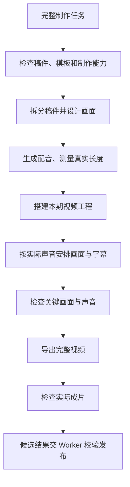
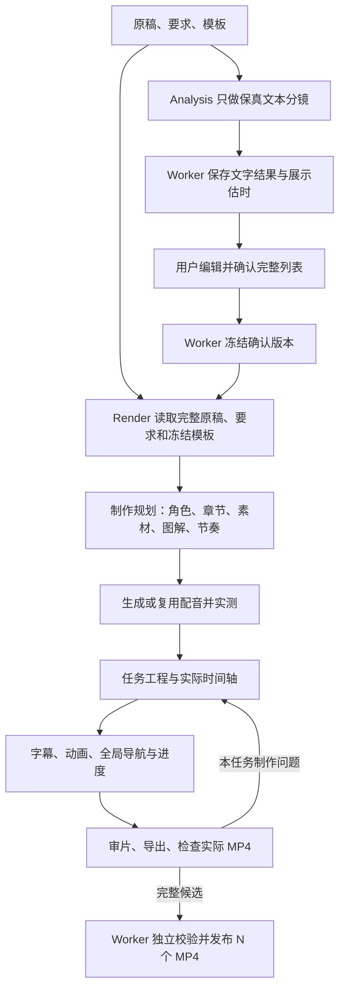

# 从单阶段 video-pipeline 拆分的需求与输入

本文方向已确定：用 5a46746 的制作顺序重整当前 video-pipeline，保留当前 Worker 和模板。只维护一个 video-pipeline、一个 Render 制作主干；旧版是参考，不另部署一套旧流水线。

## 1. 目标与非目标

已确认目标：在原来可以完整制作视频的能力外增加“先确认文本、再制作”的业务边界，保持 Render 的创作自由和参考模板效果。
不是重新发明时间轴、混音、模板引擎；不是把 Render 限制为填表或仅导出 Analysis 决定的画面。
保留原单阶段的真实配音、素材安排、Remotion 工程创作、字幕与动画、实际时长处理、审片、技术导出及制作资料保存能力。
旧入口是否能直接满足逐镜交付需复测，不在本包宣称可无改动复用。

## 2. 如何拆

### 2.1 最早单阶段实际做了什么

Git 对照：5a46746，2026-09-09 10:41:22 +0800；历史分支 codex/before-ifeng-initial-import；当时路径是 .agents/skills/video-pipeline/SKILL.md，不是现在的嵌套路径。



| 原步骤 | 原来要解决的问题 | 原产物 | 拆分后的处理 |
| --- | --- | --- | --- |
| input_check | 稿件、资源、模板、运行依赖是否可用 | normalized-input.json | Analysis 检查文字输入；Render 开始前再检查制作依赖、资源和语音授权 |
| planning | 分段并安排素材、布局和效果 | plan.json | 只把文字分段抽到 Analysis；其余制作规划仍在 Render |
| voiceover | 获得可用配音及真实长度 | audio-manifest.json | 完整留在 Render，优先复用有效缓存 |
| project | 将本期内容放进模板任务副本 | project-manifest.json | 完整留在 Render |
| timeline | 声音、字幕、画面、转场形成实际时间轴 | timeline.json | 完整留在 Render，不取 Analysis 估时作上限 |
| quality_check | 检查画面、字幕、声音并调整 | quality-report.json、截图 | Render 负责；还需检查导出后的实际 MP4 |
| rendering | 按工程导出音画 | video.mp4、render.log | Render 负责，适配为 N 项确认文本对应 N 个视频 |
| delivery_check | 确认真实文件符合交付要求 | validation.json、candidate | Render 提交证据，Worker 独立校验后发布 |

表中的英文是旧源码的定位名称，不是新建的系统模块。原 planning 不等于新 Analysis；原单阶段 plan.json 也不等于当前 Analysis 的文字确认记录。不能仅改名称就宣称完成拆分。

### 2.2 新流程如何接回原制作能力



举例：Analysis 估计某段 8 秒，配音实际 10.872 秒，Render 就按真实配音和实际音效安排该镜；不是先生成 8 秒画面，再为了 8 秒去删稿或截音。Render 发现封装后声音仍越界，应在本任务内修正工程再导出；若共享工具拒绝合法调整或反向覆盖时长，属于链路缺陷，由人修代码。

| 原完整制作中的工作 | 两阶段归属 |
| --- | --- |
| 原稿保真、自然句文本拆分 | Analysis |
| 文字编辑、增删、排序、确认 | 用户/客户端 |
| 实际配音、角色安排、素材理解与具体使用 | Render |
| 章节、图解、动画、节奏、字幕、真实时长与工程 | Render |
| 实际审片、输出候选 MP4 与制作资料 | Render |
| 输入冻结、确认版本、执行环境、预算、发布回调 | Worker |

Analysis 不提前做视觉方案、音频、图片、预览或正式时间轴；模板只提供文字分镜相关说明。Worker 分配稳定 ID、记录源映射及展示估时。
用户确认的是文本、顺序和明确要求，不是冻结内部图解、角色出场帧数或布局实现。

## 3. Analysis 输入与输出

输入：完整原稿、本次特殊要求、输出规格、模板身份及其文本分镜说明；本期授权素材登记。
输出：保持原稿内容顺序的自然句列表。不得为了短视频效果改写引语、数字或事实。
展示估时必须标 estimated；即便客户端回传 dur，Render 也不得将其当最终时长。
当前模型轻量结果示例：

```json
{"status":"candidate","scenes":[{"text":"第一句原文。"},{"text":"第二句原文。"}],"error":null}
```

这是内部模型结果，不是客户端回调；Worker 才转换成 id/content/dur 等兼容字段。

## 4. Render 必须拿到的资料

- 原始完整解说稿：用于上下文和语义理解。
- 本 run 绑定的用户最终确认列表：sceneId/content/顺序/版本；决定最终口播。
- 本次特殊要求、输出规格和授权素材。
- 同一个冻结模板快照：说明、源码、图片、音乐、音效、片头片尾和参考片。
- 同任务有效制作资料及配音缓存（续跑时）。

不依赖 Analysis 聊天记忆。不能只交 sceneId/content，也不能把原稿藏在一个未创建、不可读取的路径中。
客户端无需在 Render HTTP 请求重发原稿；Worker 有责任恢复它并实际提供给 Render。
原稿与确认内容不同，保留原稿作语境，最终口播服从确认稿。

## 5. 两阶段精简执行指令

以下是供新实现采用的指令内容示例，不代表已经创建任何任务输入文件。阶段规则来源仅维护一份，模板规则不复制进 Worker。

Analysis：

```text
执行 Analysis 阶段。使用所提供的完整解说稿、用户要求和模板文本说明，
按 video-pipeline 的文本分镜规则输出保真文本列表，完成后停止并等待用户确认。
```

Render：

```text
执行 Render 阶段。读取完整原解说稿、用户确认的 sceneId/content 列表、
本次要求和完整模板，沿用 video-pipeline 的完整制作能力完成视频。
口播和顺序服从确认稿；效果、真实时长、动画、字幕和制作方式由本阶段负责。
提交真实候选成片及必要制作资料，不自行宣称发布成功。
```

实际调用只附“阶段指令 + 本期数据 + 模板入口”。规则可由 Skill 提供，不再塞入历史诊断、补丁说明、服务器操作指令或另一任务的成片内容。
若使用文件，启动前实际创建并核验可读，向用户说明文件位置；不能引用不存在的 requirements.txt 或含义不明的 plan.json。
客户端的 plan={} 兼容字段与内部保存确认记录不是同一个概念，不能要求用户构造技术方案。

## 6. 时长与效果的归属

实际声音和画面素材驱动时长。制作模型按 Skills 编写工程，可在渲染前用工程计算逻辑得到总帧数。
Worker 不从 Analysis 估时推导最终 frames，不设置累计只能补一帧、不自动改短稿件或片头。
正确边界是“不截断声音、音画一致、符合用户要求”，而不是规定所有任务必须采用同一个时间轴算法。
字幕的分页、布局和角色效果遵守所选模板；财经模板的句级要求不能升级成所有模板的强制格式。

## 7. 交付与续编

N 项确认文本交付 N 个已合成的 MP4，sceneId/文本/顺序保持对应。可在一个统一工程内制作，再按真实区间导出，也可按句导出；不强制先整片后切割或每镜独立重新策划。
一项里可有多个动画和图解。章节可以跨句；进度条和 BGM 依全局时间保持连续。
正式 HTTP 回调不把整片插到列表首项。本机验收可另外生成整片预览。
保存工程源码、真实音频、模板快照、实际时间轴、素材来源和 MP4 映射。不得把“路径已保存”当作原文件还在。
同一次失败恢复保留 run、确认版本和预算；后续用户请求修改成功作品，应明确以哪个成功版本为起点，不覆盖旧交付。

## 8. 明确不继承的方案

此前新增的固定补帧上限、强制重算/派生、通用层写死财经类型或 BGM、单一音色替换、对所有模板强制字幕一对一，不作为重建需求。
此前关于固定混音、进展统计等建议不能整篇作为开发指令；只复用本次实施清单确认需要的有效能力。

## 9. 落地时按什么顺序改（方案，不是本轮已实现）

1. 建立原单阶段步骤到当前文件的对应表，区分业务管理代码与制作规则；不整批恢复旧目录。
2. Skill 总入口只做阶段路由；Analysis 文档只保留文字分镜；Render 文档按上述原制作顺序组织。两阶段共享的是原稿、要求和模板身份，不共享 Analysis 的硬性制作参数。
3. 检查 prompts.ts、stage-workspace.ts 是否把这些真实输入交齐。能复用的传输不重写；不存在的输入文件不得写进指令。
4. 对 stage_media.py、actual_timeline.py、worker_stage.py 及模板适配按[文件级实施清单](05-video-pipeline重整实施清单.md)替换冲突规则：测量与验证保留，模板转换不决定时长，累计补帧限制退出。函数不能因名字叫“时间轴”就全部删除，也不能因目前能调用就全部保留。
5. 先让 Render 用固定原稿、确认文本、有效音频完成小样；再验证全局工程到逐镜 MP4 的映射。逐镜导出要使用全局偏移，不能每镜重复片头、归零进度或重置 BGM。
6. 最后接回现有 Worker 管理循环，验证输入快照、候选结果、发布和回调；不要边改接口边排查画面问题。

接口字段不因这次重整而增加视觉参数；最终内部制作证据格式需由旧能力与现有接入的差异决定，不预先新增另一套全能协议。

## 10. 两阶段最低验收用例

| 输入/操作 | 必须观察到的结果 |
| --- | --- |
| Analysis 原稿含数字、引语、长句 | 文本保真；不调用 TTS、不输出正式时间轴 |
| 用户改字、增删、排序后确认 | Render 口播与最终列表一致，原稿只作上下文 |
| 预估短、真实配音长 | 成片允许变长，无截音、无估时失败 |
| 音效、转场延长实际内容 | Render 纳入实际工程，不被 Worker 隐式删掉 |
| 长句需多个字幕页 | 字幕分句与实际声音对应，不能全文压成一行 |
| 后镜调整导致全片长度变化 | 检查受影响的进度条、章节位置和旧导出，不能发布过期画面 |
| 某镜画面溢出但素材有效 | 在本任务工程内修复并继续，不改共享库 |
| 工具要求相互矛盾 | 保留现场并等待人工，不无限循环或放宽终检 |
| 任务续跑 | 确认版本不变、已验证音频复用、未知付费请求不重发 |

每例保存输入、实际工具调用、产物和校验证据；“模型回复完成”不是验收证据。

## 11. 唯一制作主干的验收要求

当前 Skill 已有“共用主干”的文字描述，本次不是再写一句相同口号。必须检查 prompts、production-flow、媒体工具和本机驱动实际调用，证明它们没有第二份相互冲突的制作规则。
早期 Skill 不作为第二个运行入口安装；原步骤融入当前唯一 Render 流程。迁移后失效的强制操作顺序从阶段文档、工具描述和驱动一起退出，不能让新旧路径按异常类型来回切换。具体文件与退出规则见 05。
只有流程一致还不能保证效果：还必须按 04 验证模板确实被使用、新稿件图解适配和真实动态效果。不能将所有效果问题笼统归咎于两阶段。
