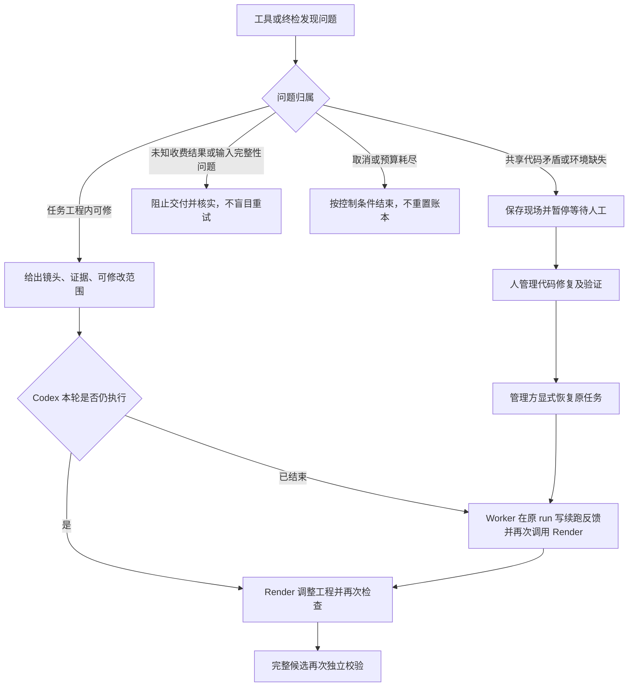

# Worker、Codex 与制作工具的职责边界

本文规定重整后必须满足的边界。当前 Worker 的接入和管理机制继续保留，不代表其调用的每条制作规则都已合格；具体差异与调整见[实施清单](05-video-pipeline重整实施清单.md)。本轮只改文档。

## 1. 已确认的原则

Analysis 确认文本分镜；Render 使用已有制作能力完成视频；Worker 管任务，不再造一个导演。
Render 负责视频，不意味着可以改用户确认稿、绕过收费授权或自行宣布所有结果合格。
工具由 Worker 启动并不等于越界；没有用户/模板依据而替 Render 作制作决定，才是边界问题。

## 2. 职责表

| 主体 | 应负责 | 不应负责 |
| --- | --- | --- |
| 用户/客户端 | 原稿、特别要求、模板选择、编辑确认、接收成片 | 构造技术时间轴或给 Codex 写工程参数 |
| Analysis Codex | 原稿自然句拆分 | TTS、图解、动画、正式时长与预览 |
| Render Codex | 角色、节奏、字幕、图解、动画、实际时间轴、工程、审片和候选 | 改公共代码、改确认文本、删账本、越权收费/发布 |
| 模板/Skills | 栏目约束和制作方法；按模板提供适配 | 让某模板结构成为所有视频唯一格式 |
| 受控制作工具 | 按 Render 明确参数测量、计算、渲染、封装并返回事实 | 默默改音色、打开 BGM、重排内容或覆盖制作决定 |
| Worker | 快照/幂等/版本、队列、环境、安全、预算、缓存授权、独立终检、发布和回调 | 根据估时限制时长、固定布局、图解类型、主持人比例或字幕方法 |

获准音色是可用范围：Render 根据角色选取或映射，Worker 验证授权；不能将男女主持静默替换成同一声音。
用户已明确选择财经模板，小头像、字幕、章节、进度条等是必须遵守的模板要求，不是允许 Render 任意删除的装饰。

## 3. 合理检查与不合理干预

- 合理：核验全文、交付列表、帧率分辨率、文件解码、实际音画同步、素材来源、确认版本和真实产物摘要。
- 不合理：为了满足预估秒数删稿；规定只能累计补一帧；默认每次重算都会覆盖 Render 的节奏。
- 合理：字幕按本次要求完整且同步。
- 不合理：所有模板必须“一条音频对应一条字幕”，或用财经类型名和固定 BGM 参数改写任何工程。
- 合理：检测变化使缓存失效。
- 需评估：整工程哈希导致所有镜头重渲；属于保守成本，不是证明所有镜头真的受影响。
- 合理：限制执行预算、停止真正无进展的重试。
- 不合理：已完成有效制作步骤却仅因 MP4 数量没增加就认定无进展。

终检要说明依据是用户要求、模板声明还是技术事实。校验失败应指出可修对象与证据，不增加隐形产品要求。

## 4. 自动继续与人工接管

已确认边界：

- 当前视频工程的动画、排版、字幕、素材编排错误：Render 在本任务内调整并重新检查，不因为首次错误立即停止。
- 普通音画边界调整：属于制作；由原制作能力处理，不能每次请求人工改公共代码。
- Worker/共享工具自身规则矛盾、环境能力缺失：暂停，保留现场，由人管理代码修复。
- 收费结果未知：暂停核对，防止重复扣费。
- 素材或音频损坏、确认输入改变、真实丢字/截音/不同步：阻止交付；是否可依据有效源资料在任务内修复需明确证据，不能盲目放行或重新收费。
- 多次恢复没有真实进展、预算耗尽、取消：按授权和账本结束或暂停，不换 ID、重置预算绕过限制。

暂停必须报告：哪个阶段、哪个镜头、实际错误和证据、已保留内容、需要谁处理。
人工修复后由管理入口显式恢复，不由制作模型自己修改 waiting_human 或控制记录。
waiting_human 不是“视频已发布”，也不是“全部素材失败”；成功发布和回调送达分开记录。

## 5. 已确定的范围与实施边界

不在本包指定新的状态机、混音缓存格式、自动补帧算法或模板适配架构。
按 05 的文件级清单重整当前制作规则，先复用已有能力；需要额外新增机制时必须证明必要性，不能把管理边界变成新的制作限制。
本机与正式 Worker 应提供等价的阶段输入和任务边界，但本机回归不访问服务器、不调用客户端接口。

## 6. 返回“可调整”之后，谁发起下一步

“返回一个状态”不会自己修好任务：同轮制作错误由 Render 继续；模型结束后的恢复由 Worker 执行循环发起；共享代码修复由人管理。当前 executeRun 已有 decideRecovery、反馈文件及 waitHuman 路径，可复用结构，但分类规则和进展证据要按上述边界核对，不能把所有现有判断视为已正确。

例如：字幕超出安全区，Render 改本任务字幕布局；实测声音长于画面，Render 调整本任务工程；工具不允许合法延长或又把新帧数覆盖掉，暂停给人修工具。不能授权 Render 修改共享 Python/TypeScript 库来“自救”。

## 7. 保持项目不越修越乱的最低约束

1. 制作写入范围限定为任务工程、制作产物和获准缓存；原稿、确认稿、共享模板、Skill、Worker 代码及控制账本不可由制作任务修改。
2. 修复反馈包含问题事实、证据与允许修改对象，不包含“想办法绕过校验”之类指令。
3. 继续制作和发布是两道门：允许自动返工，不等于允许带着丢字、截音或失步发布。
4. 修改后校验受影响结果。有效音频未变则复用；变化影响全片导航时不能只检查当前镜头。
5. 保留尝试记录和实际进展；预算仍由 Worker 执行。不能用换会话、换 run 或删除失败记录获得无限尝试。
6. 共享缺陷记录最小复现，由独立开发任务修复、测试，经人确认恢复；不是每个视频任务各写一份公共工具补丁。

本次不新增状态名或恢复 HTTP 接口。管理恢复方式在实施时复用已存在入口；如果现有入口不足，先明确缺口与最小修改，再开发，不能在接口文档里假装它已存在。
