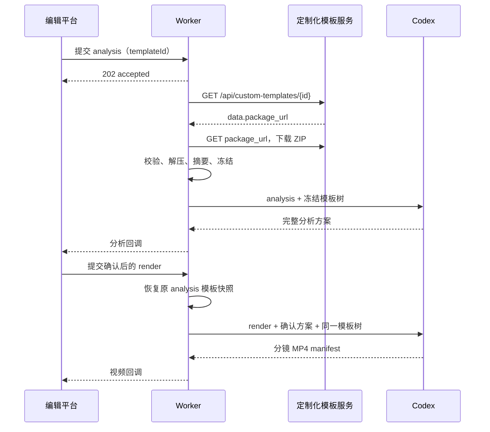

# 模板 ZIP 两阶段剪辑链路开发方案

日期：2026-09-20。

本文只固化本次“模板 ZIP 驱动 AI 视频剪辑”的开发方案，不修改既有四接口的业务语义，不增加数字人服务。Worker 的模板来源已经确定为“查询定制化模板详情，再下载其 `package_url` 指向的 ZIP”；本机 ZIP 只保留为无模板服务时的测试兜底。

## 1. 目标与边界

目标是让编辑平台提交剪辑任务后，Worker 在分析阶段取得并冻结指定模板 ZIP，按 ZIP 内的 Markdown 说明和素材完成分析；编辑平台确认方案后，Worker 使用**同一份冻结模板**完成渲染，并分别回调分析结果和逐镜视频结果。

本次包含：

- 保留现有 analysis → 人工确认 → render 的两阶段模型；
- 固化四个 HTTP 接口的最终调用方向与路径；
- 支持定制化模板详情查询、ZIP 下载、安全解压、目录保留、摘要校验和任务级冻结；
- 让 Codex 在任务工作区中同时读取模板 Markdown 与其相对路径素材；
- 补充自动化测试、部署配置和 Ubuntu 联调步骤。

本次不包含：

- 数字人生成、口型驱动或新的数字人接口；
- 新增第五个业务接口，或改变现有任务、回调、结果文件的业务含义；
- 根据未提供的信息猜测模板服务鉴权头、`package_url` 的重定向规则或跨域下载权限；
- 让 Codex 从历史项目、未授权目录或网络自行寻找模板缺失素材；
- 修改现有 `AI视频剪辑接口文档.md` 中基于截图整理的原始字段记录。

模板内的文字是未来 Codex 剪辑任务的业务资料，不是对 Worker 开发人员或服务进程的执行指令。Worker 只把它作为冻结输入交给受控任务环境。

## 2. 最终接口路径与职责

`/narrate` 只属于 **Worker 对外提供的接收接口**。编辑平台提供的两个回调接口**不加** `/narrate`。

| 阶段 | 调用方 → 提供方 | 方法 | 最终路径 | 说明 |
| --- | --- | --- | --- | --- |
| 分析提交 | 编辑平台 → Worker | POST | `/narrate/ai_video_director/getAiVideoEditingAnalysisData` | 提交脚本、需求、模板 ID、补充素材，异步创建 analysis run |
| 分析回调 | Worker → 编辑平台 | POST | `/ai_video_director/getAiVideoEditingAnalysisDataCallback` | Worker 校验并持久化分析方案后推送 |
| 渲染提交 | 编辑平台 → Worker | POST | `/narrate/ai_video_director/getAiVideoEditingData` | 提交编辑确认后的完整方案，异步创建 render run |
| 视频回调 | Worker → 编辑平台 | POST | `/ai_video_director/getAiVideoEditingDataCallback` | Worker 发布逐镜 MP4 后推送 |

Worker 接收接口保留现有 Bearer 鉴权和 JSON 请求体；回调端的 Base URL 继续由 `IFENG_CALLBACK_BASE_URL` 配置。Worker 通过该 Base URL 加上上表中**没有** `/narrate` 的回调路径发送请求。

接收成功只代表任务及输入已经持久化，仍返回 HTTP 202；分析或视频制作结果只能通过回调、任务查询或失败回调获得，不能把 HTTP 202 当成制作完成。

### 2.1 无数字人时的请求兼容

当前 Worker 的 v2 校验仍要求数字人相关字段出现，但允许空字符串。首轮客户端维持既有字段，不接数字人：

```json
{
  "digitalHumanAccounId": "",
  "plugin": {
    "digitalHumanId": "",
    "templateId": "finance_dialogue_v1"
  }
}
```

渲染请求的 `field_5` 同样传空字符串。这样不需要同时改客户端、Worker 校验和历史接口文档；本次不移除这些字段。

## 3. 现有能力与需要调整的点

现有 `video-worker/` 已具备接收任务、数据库幂等与版本控制、最多四个执行槽位、analysis/render 阶段调度、受控 Codex 执行、结果发布、Outbox 回调与回调重试。

| 位置 | 当前行为 | 本次调整 |
| --- | --- | --- |
| `src/api/routes.ts` | Worker 接收路径以 `/ai_video_director/` 开头 | 两个 Worker 接收路由改为 `/narrate/ai_video_director/…`；任务查询、取消、回调重试路径是否保留旧前缀由内部管理接口兼容策略单独决定，本次不让客户端依赖它们 |
| `src/integrations/ifeng/mapper.ts` | 回调路径为 `/ai_video_director/…Callback` | 保持不变，明确不能随接收接口加入 `/narrate` |
| `src/infrastructure/template-provider.ts` | 只支持本地 Markdown 配置或约定 JSON 响应 | 改为定制化模板适配器：先读取模板详情，再下载 `package_url` ZIP；本机 ZIP 仅作显式测试兜底 |
| `src/infrastructure/workspace.ts` | analysis 时冻结模板正文和附件引用 | 冻结 ZIP 解包树及完整 manifest；render 从 analysis 冻结副本恢复 |
| `src/infrastructure/stage-workspace.ts` | 只写 `input/template.md`，快照假定输入目录第一层均是文件 | 按原 ZIP 层级写入 `input/template/`，递归生成并校验快照 |
| `src/runner/prompts.ts` | 告诉 Codex 读取冻结模板快照 | 明确模板 Markdown 入口和模板根目录，禁止读取工作区外的模板资源 |
| `config/templates.json` | 模板 ID 指向旧目录或 README | 为测试模板建立 `templateId → 本机 ZIP 路径/入口文件` 映射 |

不能仅把 ZIP 中的 Markdown 内容复制到 `template.md`：该 Markdown 使用 `assets/images/...`、`assets/video/...` 等相对链接。若资源被拆散、改名或未复制，Codex 无法可靠读取片头、片尾、参考片与排版示意。

## 4. 模板 ZIP 适配设计

### 4.1 统一内部输入

模板提供器对上层返回统一的“已冻结模板描述”，不让 analysis/render 的其余逻辑关心来源是定制化模板服务还是本机测试包。至少包含：

```json
{
  "id": "1",
  "version": "sha256:模板压缩包摘要",
  "source": "custom_template_api",
  "name": "鹤梳室",
  "description": "11111111",
  "updatedAt": "2026-09-18T17:44:41.051980+08:00",
  "packageName": "财经双人对话视频生成指令.zip",
  "archiveSha256": "…",
  "rootDirectory": "财经双人对话视频生成指令",
  "document": "财经双人对话视频生成指令/财经双人对话视频生成指令.md",
  "files": [
    {"path": "…/财经双人对话视频生成指令.md", "sha256": "…", "size": 0},
    {"path": "…/assets/video/intro/financial-intro-portrait-sfx-v1.mov", "sha256": "…", "size": 0}
  ]
}
```

`version` 由实际下载 ZIP 的内容摘要产生；不能只使用 `package_name`、详情接口的 `updated_at` 或人工版本号。当同一模板 ID 换包时，新 analysis 才会拿到新摘要，已经开始的任务不受影响。`name`、`description`、`updatedAt` 只作来源审计信息，不能代替 ZIP 内容摘要。

### 4.2 定制化模板下载链路

analysis run 首次被 Worker 领取后，模板提供器按以下顺序工作：

1. 将 `plugin.templateId` 原样作为定制化模板 ID 请求 `GET /api/custom-templates/{id}`。当前 Worker 请求字段是字符串；接入定制化模板服务时，客户端应传十进制字符串（例如 `"1"`），Worker 只在远程模式下接受正整数 ID。
2. 校验详情响应为 JSON，且 `code = 0`、`data.id` 与请求 ID 一致、`data.package_name` 非空、`data.package_url` 是合法 HTTP 或 HTTPS URL；否则停止任务并归类为 `TEMPLATE_UNAVAILABLE` 或 `TEMPLATE_INVALID`。
3. 下载 `data.package_url` 指向的响应体到本任务专属的暂存文件，再按第 4.4 节校验并解压。不能把 URL 字符串、封面 `cover_url` 或 `package_name` 当作 ZIP 内容。
4. 下载成功后记录模板详情中的 `id`、`name`、`description`、`package_name`、`updated_at`，以及最终 ZIP SHA-256；随后删除可丢弃的下载暂存文件，只保留冻结目录和 manifest。

详情接口与 ZIP 下载均发生在 Worker 异步领取 analysis run 后，不占编辑平台提交 HTTP 请求的等待时间。任一请求失败都不会启动 Codex，也不会让 render 阶段重新访问模板服务。

模板服务基础地址需要由 Worker 配置提供，例如 `CUSTOM_TEMPLATE_API_BASE_URL`。`package_url` 是详情响应中的完整下载地址；Worker 必须只允许该基础地址所属 origin，或配置中显式允许的下载 origin，避免一个异常详情响应诱导 Worker 访问任意内网地址。接口文档尚未说明鉴权方式、下载重定向和临时下载地址有效期：实现时须配置化，未配置时不得臆造或透传编辑平台凭据。

### 4.3 本机 ZIP 测试兜底

测试阶段使用：

```text
claude-code-video-toolkit/deliverables/财经双人对话视频生成指令.zip
```

未设置定制化模板服务基础地址时，可为本机 ZIP 配置稳定的测试模板 ID，例如 `finance_dialogue_v1`。该配置只描述“该 ID 对应哪个本机归档与入口 Markdown”，不把 ZIP 解压目录当作运行时来源，也不把财经模板硬编码进 Worker 逻辑。

本机 ZIP 只用于自动化测试、开发机调试或模板服务暂不可达时的显式测试环境。正式部署默认走第 4.2 节的定制化模板下载链路；不能因为服务器上残留了一个本机 ZIP 而静默回退，掩盖模板服务故障。

### 4.4 下载与安全解压规则

在解压前、解压中都执行以下规则：

1. 下载设置连接、首字节、总时长和响应体大小上限；仅接受成功的二进制 ZIP 响应。URL 文件名、`Content-Type` 或详情中的 `package_name` 只能作为辅助信息，实际归档结构必须经解析验证。
2. 只接受预期的 ZIP 格式，设置压缩包大小、文件数、单文件大小和解压总大小上限；超限按 `TEMPLATE_UNAVAILABLE` 失败。
3. 拒绝绝对路径、`..` 路径、空路径、重复路径、符号链接、设备文件与非普通文件，防止 Zip Slip 和链接逃逸。
4. 忽略 macOS 元数据目录 `__MACOSX/` 及 `.DS_Store`，但不把它们计入有效模板文件。
5. 要求有且仅有一个明确配置的 Markdown 入口；入口和所有资源都必须位于归档根目录内。
6. 解压到 Worker 数据根下本任务专属目录，不能解压到 toolkit、媒体根、临时公共目录或 Codex 工作目录外。
7. 解压完成后逐文件计算 SHA-256，写入 manifest；随后将冻结目录设为只读。

异常 ZIP、入口文件缺失、摘要校验失败或所需资源丢失时，不启动 Codex。analysis run 记录结构化失败并通过**分析回调**发送失败信息；不会把错误伪装成空模板继续制作。

### 4.5 冻结与恢复

模板只在 analysis run 首次开始时获取：



重试 analysis 时读取同一冻结目录；render 及其重试也读取同一目录。模板服务恢复、ZIP 替换或配置变更都不得改变在途任务的模板内容。

## 5. 任务工作区与 Codex 输入

analysis 工作区应得到如下只读输入：

```text
input/
├── script.txt
├── requirements.json
├── assets.json
└── template/
    └── 财经双人对话视频生成指令/
        ├── 财经双人对话视频生成指令.md
        └── assets/
            ├── images/guide/
            └── video/
                ├── intro/
                ├── outro/
                └── reference/
```

`input/template.json` 记录：模板 ID、名称、描述、详情更新时间、ZIP 文件名、ZIP 摘要、入口 Markdown 相对路径、模板根目录、文件 manifest 和来源。阶段请求引用该 JSON；提示词要求 Codex 先读取 `template.json` 指定的入口 Markdown，并只通过该模板根目录访问附件。`package_url` 不需要交给 Codex，避免它在制作阶段自行联网重新下载。

需要将阶段快照从“第一层文件摘要”升级为“递归相对路径 → SHA-256”映射。render 恢复原始输入时，对每个嵌套文件进行摘要校验，再复制到当前任务目录。这样既保留 Markdown 相对引用，也能检测模板被篡改、遗漏或错误覆盖。

ZIP 内模板资源和编辑平台的 `otherMaterial` 是两类资料：

- 模板资源属于模板本身，例如片头、片尾、参考片、版式示意；
- `otherMaterial` 属于本次业务输入，例如本期人物头像、Logo、财报图表、数据截图、获准音乐或音效。

两类资料都只读、可追溯并带摘要，但不能混淆来源。Codex 只能使用这两类已登记文件。

## 6. 两阶段业务链路

### 6.1 analysis

1. 编辑平台向 `/narrate/ai_video_director/getAiVideoEditingAnalysisData` 提交任务。
2. API 校验 `schemaVersion`、`requestId`、`taskId`、脚本、`plugin.templateId` 和素材路径，持久化后返回 HTTP 202。
3. Worker 领取任务、取得并冻结模板 ZIP，复制本次素材快照，建立只读 analysis 输入。
4. Codex 只做理解与规划：读取脚本、完整要求、模板、模板资源和本次素材，输出完整可编辑方案；不得生成正式 MP4，不得自行确认。
5. Worker 可信校验方案的分镜顺序、文本映射、素材引用和协议结构，保存不可变分析版本。
6. Outbox 创建分析回调事件，向客户端的 `/ai_video_director/getAiVideoEditingAnalysisDataCallback` 投递。
7. 客户端返回 HTTP 2xx 且 JSON `{"status":0}` 后，事件才标记为 delivered；失败只重送回调，不重新分析。

analysis 完成后任务状态为 `awaiting_editor`，不占执行槽位。

### 6.2 编辑确认与 render

1. 客户端展示分析回调内容；编辑确认或修改后，提交完整 `plan` 和与之对应的 `dataList`。
2. 客户端调用 `/narrate/ai_video_director/getAiVideoEditingData`，带同一 `taskId`、新 `requestId`、`basePlanVersion`、模板 ID 和空数字人字段。
3. Worker 校验方案版本、任务归属、模板 ID、`dataList` 与完整方案的一致性，持久化确认版本并创建 render run。
4. Worker 恢复 analysis 的冻结模板、原始输入、允许的已登记素材和确认方案，不能重新下载模板或猜测素材。
5. Codex 严格按确认方案制作。模板没有明确的细节可自行决定；已确认文本、分镜数、顺序、素材和制作决定不得擅自改变。
6. Worker 对候选进行无网络终检，确认 N 个 MP4 与确认分镜一一对应、可完整解码、时长和素材清单有效，再发布至共享媒体根。
7. Worker 创建视频回调事件，向客户端的 `/ai_video_director/getAiVideoEditingDataCallback` 发送每镜 MP4 路径及实际资源信息。

同一任务在 queued、running 或 cancelling 时拒绝冲突的新提交；等待编辑和等待回调不占四个执行槽位。

## 7. 素材前置条件与失败处理

当前财经 ZIP 已含说明文档、片头、片尾、参考片和排版示意，但不包含本期男女主持人头像、Logo、财报数据素材、已确认 TTS 音色、背景音乐或音效。

因此，真实测试任务至少应由客户端在 `otherMaterial` 提供：

- 男女主持人头像；
- 本期 Logo 或明确声明不使用 Logo；
- 本期财报图表、截图或视频素材；
- 如要求使用背景音乐、音效或固定声音，则提供已授权文件及使用说明。

缺少这些资料时，analysis 应在方案中明确提出素材缺口；不能自动拿历史项目素材补齐。若确认方案仍引用不存在或未登记的文件，render 在启动 Codex 前以结构化错误失败。

| 场景 | 处理 |
| --- | --- |
| 模板详情 `code != 0`、ID 不匹配或缺少 `package_url` | analysis 失败，发送分析失败回调，错误码归类为 `TEMPLATE_UNAVAILABLE` 或 `TEMPLATE_INVALID` |
| ZIP 下载超时、HTTP 非成功、origin 不获准、响应不是有效 ZIP、超限或入口缺失 | analysis 失败，发送分析失败回调，错误码归类为 `TEMPLATE_UNAVAILABLE` 或 `TEMPLATE_INVALID` |
| 已冻结模板任一文件摘要变化 | 当前 run 失败为 `INPUT_SNAPSHOT_INVALID`，不重取新模板 |
| 模板 ID 未配置本机 ZIP | analysis 失败为 `TEMPLATE_UNSUPPORTED` |
| 客户端确认使用旧 `basePlanVersion` | render 接口同步返回 409 `STALE_PLAN` |
| render 引用未登记素材 | render 失败为输入快照/素材校验错误，不进入 Codex |
| Codex 候选不符合确认方案或 MP4 校验失败 | 在修复预算内要求修复；耗尽后发送视频失败回调 |
| 客户端回调不可达或业务响应非成功 | 文件和结果保留，Outbox 指数退避重送；不重新制作 |

## 8. 模板服务配置与待确认项

本次实现的模板获取边界为 `TemplateArchiveProvider.get(templateId)`。正式来源已确定为定制化模板服务：

```text
GET {CUSTOM_TEMPLATE_API_BASE_URL}/api/custom-templates/{templateId}
  → code = 0，读取 data.package_url
GET data.package_url
  → ZIP 二进制流
```

本机归档配置仍可满足同一边界，但只能在显式测试模式启用。无论来源如何，上层都必须执行第 4 节同一套下载（远程时）、校验、解压、摘要与冻结逻辑。

接口文档尚未提供以下信息，开发时必须以部署配置或联调结论补齐：

- 鉴权头、签名和租户传递方式；
- `package_url` 是否允许重定向、最大跳转次数及下载地址允许的 origin；
- 下载超时、临时 URL 失效后的“重新查询详情再下载”重试次数；
- 模板删除、权限不足、版本回滚、限流和 HTTP 错误的精确业务码映射。

对于连接失败或 HTTP 5xx，可在 analysis run 的准备期内按有限次数重新执行“详情查询 → 下载”这个完整步骤；不能只盲目重试一个可能已过期的 `package_url`。HTTP 4xx（429 除外）、`code != 0`、ID 不匹配和 ZIP 结构错误应立即失败。任何重试开始前都不得冻结不完整目录。

## 9. 开发顺序

1. **确定路径契约**：修改 Worker 两个接收路由，保留两个回调路径；新增路由测试，防止回调误加 `/narrate`。
2. **实现定制化模板适配器**：调用 `GET /api/custom-templates/{id}`，校验 `code/data.id/package_url`，下载 ZIP；将本机 ZIP 作为显式测试来源保留。
3. **实现归档读取与冻结目录**：完成下载流限制、ZIP 解析、入口定位、安全校验、文件 manifest、摘要、analysis 首次解压和冻结；数据库只保存来源元数据、manifest 与位置，不把二进制写进数据库。
4. **调整阶段工作区**：递归复制、递归摘要、只读挂载、render 原样恢复，并更新模板快照 JSON 与 Codex 提示词。
5. **保留现有业务链路**：不改任务排队、版本、取消、回调 Outbox、结果发布和逐镜回调语义；只让它们使用新的模板输入。
6. **补充测试**：先做 ZIP 单元测试与阶段快照测试，再跑现有 Worker 回归和真实短媒体测试。
7. **部署联调**：配置模板服务地址、下载 origin 与回调地址，依次验证 analysis、人工确认、render、回调和失败重送；本机 ZIP 仅在显式测试模式部署和验证。

## 10. 自动化验收

至少新增或调整以下测试：

| 用例 | 通过条件 |
| --- | --- |
| 定制化模板详情读取 | `GET /api/custom-templates/1` 的 `code/data.id/package_url` 校验正确；不匹配时不下载 ZIP |
| package_url 下载 | ZIP 二进制可下载、下载上限有效、来源 origin 受限；超时/4xx/5xx/非 ZIP 响应按规则失败 |
| 本机财经 ZIP 兜底 | 显式测试模式下，入口 Markdown、片头、片尾、参考片和示意图均出现在 manifest，目录结构不变 |
| 恶意 ZIP | 含 `../`、绝对路径、符号链接、超限文件数或超限解压大小时被拒绝，工作区外无文件产生 |
| 模板冻结 | analysis 后替换源 ZIP，analysis 重试与 render 的摘要、入口和资源仍与原任务一致 |
| 相对链接 | Markdown 中 `assets/...` 的资源在工作区对应路径真实存在 |
| 仅模板无数字人 | 空数字人字段通过，任务不调用任何数字人服务 |
| 接口路径 | 两个 Worker 接收路由必须带 `/narrate`；两个客户端回调请求必须不带 `/narrate` |
| 分析回调 | 成功方案可回调；模板失败能发送结构化失败回调 |
| 渲染回调 | 编辑确认后 N 个 MP4 与 N 个确认分镜严格对应，回调文件路径可被客户端后端读取 |
| 回调补送 | 回调端短暂不可用时，恢复后仅重发相同事件，不重新执行 Codex |
| 回归 | `pnpm build`、`pnpm test`、`pnpm test:stages` 通过；真实媒体测试不调用未经确认的数字人能力 |

## 11. Ubuntu 部署与联调步骤

### 11.1 部署准备

1. 配置 `CUSTOM_TEMPLATE_API_BASE_URL` 和允许的 `package_url` 下载 origin；确认 Ubuntu Worker 可访问模板服务及其下载地址。
2. 按联调结果配置模板服务鉴权；不要把编辑平台的调用方 Bearer Token 自动转发给模板服务，除非平台明确要求且已单独配置。
3. 保持 `WORKER_EXECUTOR=host`、`WORKER_PROTOCOL=video-two-stage/1`。
4. 将 `IFENG_CALLBACK_BASE_URL` 配成 callbacks 容器可访问的编辑平台域名；客户端实现两个不带 `/narrate` 的回调路径。
5. 挂载并验证 `MEDIA_ROOT`，保证 Worker 能读到 `otherMaterial`，编辑平台后端能读到最终成片路径。

### 11.2 首条联调任务

1. 在模板服务确认一个可用的定制化模板 ID；准备一个新的 `taskId`、`requestId`、脚本、该模板 ID 与本期素材；数字人字段为空。
2. 向 `/narrate/ai_video_director/getAiVideoEditingAnalysisData` 提交分析请求，确认返回 HTTP 202。
3. 查看 Worker 日志，确认已经依次读取模板详情、下载 `package_url`、冻结 ZIP，且目录、摘要、入口文件均正确。
4. 等待客户端收到分析回调；确认回调 URL 为 `/ai_video_director/getAiVideoEditingAnalysisDataCallback`。
5. 客户端按回调方案提交完整确认对象至 `/narrate/ai_video_director/getAiVideoEditingData`。
6. 等待客户端收到 `/ai_video_director/getAiVideoEditingDataCallback`；逐个检查 MP4 可播放、顺序正确、路径位于共享媒体根。
7. 暂停回调接收端完成一次回调补送测试；再验证模板损坏、素材缺失和旧版本确认等失败路径。

### 11.3 发布判定

只有同时满足以下条件，才认为本次链路验收通过：

- Worker 接收路径与客户端回调路径严格符合第 2 节；
- analysis 与 render 使用同一模板归档摘要；
- Codex 只能读取任务提供的模板与素材；
- 编辑确认前不产生正式视频；
- render 结果逐镜完整、可解码、顺序与确认方案一致；
- 客户端成功接收两个回调，回调失败能够补送且不重复制作。

## 12. 已知代价

- 本机 ZIP 模式仍适合离线与自动化测试，但正式链路依赖模板服务与 `package_url` 下载可用；模板服务故障不会静默回退为服务器残留 ZIP。
- 完整模板树的复制和摘要会增加少量磁盘占用与启动时间，但能保证重试、人工确认和 render 的可复现性。
- 首轮保留空数字人字段有兼容字段冗余；代价小于同时改动客户端、Worker 和既有接口契约的联调风险。
- 当前财经 ZIP 缺少本期业务素材，必须由客户端在每个任务中明确提供；否则只能得到素材缺口分析，不应期待完整成片。
